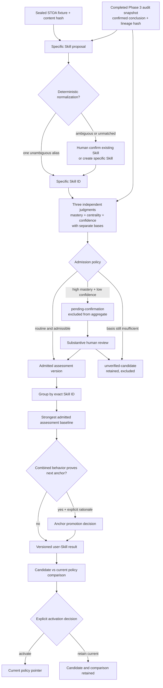

# Phase 4: Contribution–Skill Assessment and Aggregation Calibration - Research

**Researched:** 2026-08-27
**Domain:** Contribution-grounded capability assessment, human admission, anchor-safe aggregation, and policy calibration
**Confidence:** HIGH

<user_constraints>
## User Constraints (from CONTEXT.md)

### Locked Decisions

#### Skill proposal and normalization

- **D-01:** Only a concrete, independently verifiable specific Skill receives an assessment or user-level mastery score. Broad areas such as “backend development” may classify Skills but never receive a mastery score.
- **D-02:** One Contribution may propose every specific Skill it directly supports. Each Contribution–Skill pair is assessed independently and retains its own traceability; the system must not force one primary Skill or create a combined multi-Skill label.
- **D-03:** Deterministic, unambiguous aliases and synonyms may normalize automatically. Ambiguous or unmatched candidates require explicit human confirmation of an existing Skill or creation of a new specific Skill.
- **D-04:** A Phase 3 skip or self-rating may become a formal Phase 4 assessment only after the substantive human confirmation defined in D-10. Its `self-assessed-unverified` origin remains visible permanently; Phase 4 admission must not rewrite history as though Phase 3 verified it.

#### System assessment and human correction

- **D-05:** The system directly produces `demonstrated_mastery`, `skill_centrality`, and `evidence_confidence`. Human review is exception-based: a reviewer intervenes when a result is disputed, low-confidence, or otherwise flagged rather than confirming every routine result.
- **D-06:** For demonstrated mastery, the system first identifies the satisfied 0–100 capability anchor, then selects an exact score inside that band and stores the observable basis for both decisions. A bare number without anchor fit is invalid.
- **D-07:** Demonstrated mastery, Skill centrality, and evidence confidence remain independent stored judgments with separate bases. The system may additionally derive one convenience composite for display, but that composite is not mastery, cannot replace the three source dimensions, and cannot drive mastery-anchor promotion opaquely.
- **D-08:** A human correction preserves the original system proposal, the corrected values, the reviewer, and the reason. The corrected assessment becomes the current effective version without overwriting the original proposal.

#### Low-confidence admission

- **D-09:** A high-mastery proposal with low evidence confidence is marked `pending-confirmation`, visibly prompts for human review, and remains outside the formal user-level Skill aggregate until confirmed.
- **D-10:** Human confirmation is substantive. The reviewer must inspect the assessment basis, verify responsibility attribution and capability-anchor fit, and explicitly accept or modify all three judgments. A confirmation click without that review is insufficient.
- **D-11:** If the reviewer still finds the basis insufficient, retain the record as an `unverified-candidate` outside the formal aggregate. Inability to verify is not a mastery score of zero, and the candidate is neither deleted nor silently admitted.
- **D-12:** New evidence or a later audit creates a new assessment version and triggers a new confidence/admission decision. Preserve the earlier candidate, its basis, and every prior human decision.

#### Multi-Contribution aggregation

- **D-13:** The strongest admitted Contribution–Skill assessment is the baseline for user-level mastery. Other admitted Contributions establish stability and breadth; their scores are not averaged, summed, or converted into automatic volume bonuses.
- **D-14:** Several Contributions may raise user-level mastery above the strongest individual assessment only when their combined credible behavior observably satisfies the next higher mastery anchor. The aggregate must store an explicit cross-Contribution rationale naming the behaviors and admitted assessments that justify promotion.
- **D-15:** One evidence item may support multiple different Skills, with its relevance assessed independently for each Skill. Repeated references to the same evidence within one Skill do not multiply its weight. Relationships are preserved even when duplicate weighting is suppressed.
- **D-16:** Aggregation and confidence-admission policies are versioned. During calibration, the same inputs may be recalculated under a candidate policy and compared with the current policy; activation is explicit, and prior policy results, variance, reviewer decisions, and regressions remain inspectable.

### the agent's Discretion

- Exact replaceable thresholds for `pending-confirmation`, provided D-09 through D-12 hold and the threshold is recorded as policy data rather than hidden in code.
- Exact formulas for Skill centrality, evidence confidence, the convenience composite, and user-level aggregation within the locked separation, no-inflation, and anchor-promotion constraints.
- The internal policy/result envelope, stable identifiers, command names, and report layout, provided lineage, current-effective status, and history remain explicit.
- Whether the system proposal is produced by deterministic rules, a structured model call, or a narrow combination during calibration. Offline deterministic tests and provider isolation remain mandatory.

### Deferred Ideas (OUT OF SCOPE)

- Structured JD requirements, JD relevance, gaps, and JD usefulness evaluation belong to Phase 5.
- Resume selection, rewriting, review, export, and evidence-producing gap work remain downstream product capabilities.
- Whether the system improves real application, interview, or hiring outcomes requires later multi-round empirical use and is not a Phase 4 completion claim.
</user_constraints>

<phase_requirements>
## Phase Requirements

| ID | Description | Research Support |
|----|-------------|------------------|
| ASS-01 | The system proposes a specific Skill only from an audited Contribution and preserves the Contribution, Evidence, audit answers, attribution, and assessment basis supporting that proposal. | Use an immutable proposal envelope bound to a completed audit's `conclusion_lineage_hash`, conclusion entry, answer IDs, evidence IDs, attribution, Contribution ID, and normalization record. |
| ASS-02 | Reviewers can assign and inspect `demonstrated_mastery`, `skill_centrality`, and `evidence_confidence` as separate judgments, including high-centrality/low-mastery, low-centrality/high-mastery, and high-mastery/low-confidence cases. | Evolve the existing assessment contract with a separate basis for each dimension and golden cases proving independence. |
| ASS-03 | Every demonstrated-mastery judgment identifies the observable 0–100 anchor it satisfies, and no judgment enters a higher band without evidence of that band's capability conditions. | Represent anchor ID/range, verbatim anchor text, anchor-fit basis, exact-score basis, and next anchor not established; validate score containment. |
| ASS-04 | A high demonstrated-mastery proposal with insufficient evidence confidence remains explicitly provisional and requires human confirmation rather than being silently accepted or converted into a different capability score. | Make admission a separate policy decision whose provisional states cannot be aggregated and whose confirmation records all three judgments and their bases. |
| AGG-01 | A user can inspect one aggregated mastery score per specific Skill and trace it back to the admitted Contribution–Skill assessments and aggregation-policy version. | Produce one policy-result view per exact `skill_id`, including admitted assessment IDs, baseline assessment, policy version, and optional explicit promotion decision. |
| AGG-02 | Duplicate Evidence, duplicated Contributions, and numerous incidental or low-centrality uses cannot mechanically raise a user Skill into a higher mastery band. | Baseline is maximum admitted mastery, never a sum/mean; deduplicate within a Skill by stable evidence and behavioral identity; require explicit anchor proof for promotion. |
| AGG-03 | Multiple Contributions can justify a user score above the strongest single Contribution only when their combined, credible behavior observably satisfies the higher anchor, such as repeated advanced responsibility across real contexts. | Model promotion as an auditable decision naming the target anchor, distinct behaviors/contexts, and admitted assessments; absence of that decision leaves the maximum unchanged. |
| AGG-04 | Evaluators can compare replaceable aggregation and confidence-admission policies while preserving run-to-run variance, reviewer disagreement, calibration decisions, and regressions instead of hiding them in one opaque score. | Recalculate immutable identical inputs under current and candidate policies; store per-Skill deltas, band/admission changes, disagreements, regressions, and an explicit activation record. |
</phase_requirements>

## Summary

Phase 4 should be implemented as a deterministic, provider-neutral assessment and calibration layer over the existing Phase 2 domain contracts and completed Phase 3 audit snapshots. The repository already has frozen strict models, deterministic hashing, a reviewable skill normalizer, three independent assessment fields, one-view-per-Skill invariants, immutable audit proposal/review lineage, and atomic JSON stores. [VERIFIED: src/career_evidence_graph/validation/models.py:12-15] [VERIFIED: src/career_evidence_graph/domain/models.py:161-172] [VERIFIED: src/career_evidence_graph/domain/models.py:196-233] [VERIFIED: src/career_evidence_graph/audit/models.py:181-232] [VERIFIED: src/career_evidence_graph/audit/store.py:73-109]

Do not put calibrated results into the sealed Phase 2 STOA fixture. Its collections are explicitly allowed to remain empty, and its existing user view says verbatim `expectation_status: "fixture-test-expectation"` and `policy_marker: "fixture-test-expectation"`; Phase 4 needs policy-bearing, versioned sidecar records that reference the sealed fixture and accepted audit lineage rather than mutating either source. [VERIFIED: src/career_evidence_graph/domain/models.py:220-246] The checked-in STOA fixture contains no Phase 4 assessment or user-Skill results, while the existing Phase 3 end-to-end audit is generated in `tmp_path`; Wave 0 therefore needs a checked-in calibration corpus with completed audits and deliberately adversarial counterfactuals. [VERIFIED: validation/fixtures/stoa/v1/known-good.json:1] [VERIFIED: tests/test_audit_gap_e2e.py:116-242]

Aggregation must be intentionally boring: group admitted assessments by exact Skill, choose the strongest admitted assessment as the baseline, and leave it unchanged unless a distinct, reviewable cross-Contribution decision proves the next anchor. Never let a count, average, sum, duplicate, centrality value, or confidence value become an implicit mastery promotion. [VERIFIED: .planning/PROJECT.md:79-96] Candidate admission/aggregation policies should run on the same immutable inputs, retain disagreements and deltas, and require an explicit activation record; NIST's AI RMF Measure guidance supports documented, repeatable testing, uncertainty measurement, benchmark comparison, independent review, and recalibration, but does not prescribe this project's scoring formula. [CITED: https://airc.nist.gov/airmf-resources/airmf/5-sec-core/]

**Primary recommendation:** Evolve the existing assessment and user-Skill contracts in one application layer, backed by immutable hash-linked JSON sidecars, with a max-baseline aggregator and explicit anchor-promotion/admission decisions; calibrate policy data against a versioned offline corpus before activation.

## Architectural Responsibility Map

| Capability | Primary Tier | Secondary Tier | Rationale |
|------------|--------------|----------------|-----------|
| Skill proposal and normalization | API / Backend (local application layer) | Database / Storage | The application derives candidates only from accepted audit records; storage retains normalization decisions and lineage. [VERIFIED: src/career_evidence_graph/domain/invariants.py:216-306] |
| Three-dimensional assessment | API / Backend (domain/application) | — | Validation, anchor fit, score separation, and provenance are business rules, not presentation behavior. [VERIFIED: src/career_evidence_graph/domain/models.py:196-217] |
| Human correction and admission | API / Backend (workflow) | Database / Storage | The workflow enforces review completeness and state transitions; storage preserves proposal, correction, reviewer, reason, and hashes. [VERIFIED: src/career_evidence_graph/audit/models.py:181-232] |
| Per-Skill aggregation | API / Backend (pure domain service) | — | Grouping, maximum baseline, duplicate suppression, and promotion validation must be deterministic and directly testable. [VERIFIED: .planning/PROJECT.md:83-96] |
| Policy comparison and activation | API / Backend (calibration service) | Database / Storage | Evaluation recomputes identical inputs; storage makes versions, comparison results, decisions, and activation inspectable. [CITED: https://airc.nist.gov/airmf-resources/airmf/5-sec-core/] |
| Operator commands and reports | Browser / Client equivalent (CLI) | API / Backend | The current product entry point is a thin `argparse` CLI; it should invoke application services without owning policy logic. [VERIFIED: pyproject.toml:15-16] [VERIFIED: src/career_evidence_graph/cli.py:86-200] |

## Project Constraints (from AGENTS.md)

- Follow the supplied priority order: YAGNI; reuse repository code; prefer the standard library; use framework-native behavior; reuse installed dependencies; keep a clear one-line solution as one line; only then write the smallest runnable and testable custom implementation. [VERIFIED: user-provided AGENTS.md instruction]
- Every score is for one specific Skill; Contribution is the minimum auditable unit; mastery, evidence confidence, duration, context, and JD match retain separate meanings; higher anchors require higher-order observable capability; responsibility and assistance remain distinguishable. [VERIFIED: AGENTS.md:13-22]
- Reused or adapted upstream code must record repository, pinned revision, license, and local divergence. [VERIFIED: AGENTS.md:20-22]
- Do not add a database, web UI, provider framework, document parser, résumé generator, JD comparison, or gap-planning feature in this phase. [VERIFIED: AGENTS.md:151-173] [VERIFIED: .planning/phases/04-contribution-skill-assessment-and-aggregation-calibration/04-CONTEXT.md:16-19]
- Use the GSD planning/execution workflow for future edits; this research artifact is being produced by the active `$gsd-plan-phase` research workflow. [VERIFIED: AGENTS.md:240-252]

## Standard Stack

### Core

| Library / capability | Version | Purpose | Why Standard |
|----------------------|---------|---------|--------------|
| CPython | `3.13.14`; project range `>=3.13,<3.14` | Pure assessment, admission, aggregation, comparison, and CLI orchestration | The project pins this range and the local runtime matches it. [VERIFIED: pyproject.toml:6-13] [VERIFIED: local environment probe, 2026-08-27] |
| Pydantic | `2.13.4` (published 2026-05-06) | Frozen schema-versioned models, cross-field invariants, validated JSON boundaries | It is the sole runtime dependency and `StrictModel` already uses `ConfigDict(extra="forbid", frozen=True)`. [VERIFIED: pyproject.toml:10-13] [VERIFIED: src/career_evidence_graph/validation/models.py:12-15] [CITED: https://pypi.org/pypi/pydantic/2.13.4/json] |
| Python standard library | Python 3.13 | Grouping, sorting, JSON files, paths, timestamps, hashing, and CLI | Existing deterministic serialization uses `json` and `hashlib`; existing stores use `pathlib`, `tempfile`, `os.fsync`, and `os.replace`. [VERIFIED: src/career_evidence_graph/validation/hashing.py:5-27] [VERIFIED: src/career_evidence_graph/validation/store.py:77-90] |
| JSON sidecars | Schema-versioned | Immutable proposals, reviews, policies, calibration results, activation pointers | Existing stores already publish canonical, hashed JSON and verify declared payloads and ancestry. [VERIFIED: src/career_evidence_graph/validation/store.py:92-218] [VERIFIED: src/career_evidence_graph/validation/store.py:252-338] |

### Supporting

| Library / capability | Version | Purpose | When to Use |
|----------------------|---------|---------|-------------|
| pytest | `9.1.1` (published 2026-06-19) | Unit, invariant, golden, counterfactual, CLI, and policy comparison tests | Use for every assessment/admission/aggregation rule; default markers exclude live model execution. [VERIFIED: pyproject.toml:18-30] [CITED: https://pypi.org/pypi/pytest/9.1.1/json] |
| Ruff | `0.16.0` (published 2026-07-23) | Formatting and linting | Use the existing Python 3.13, 100-column configuration. [VERIFIED: pyproject.toml:32-38] [CITED: https://pypi.org/pypi/ruff/0.16.0/json] |
| Existing canonical hashing | Project code | Content-address policies, proposals, source audit lineage, and result bundles | Reuse `canonical_json_bytes` and `sha256_digest`; do not invent a second canonicalizer. [VERIFIED: src/career_evidence_graph/validation/hashing.py:12-27] |
| Existing optional model seam | Project code; provider unfrozen | Optional proposal generation only | Leave provider/model selection unchanged. Deterministic rules and recorded fixtures remain the offline acceptance path. [VERIFIED: AGENTS.md:42-50] |

### Alternatives Considered

| Instead of | Could Use | Tradeoff |
|------------|-----------|----------|
| Existing Pydantic + JSON | Dataclasses or a new ORM | Duplicates validation or introduces persistence complexity without a Phase 4 need. [VERIFIED: AGENTS.md:149-168] |
| Max admitted mastery plus explicit anchor promotion | Weighted average, sum, or Bayesian-looking composite | A numeric formula would reward volume or collapse confidence/centrality into mastery, violating locked behavior. [VERIFIED: .planning/PROJECT.md:79-96] |
| Existing deterministic alias normalizer | Embeddings/vector matching | The current normalizer already distinguishes `"matched"`, `"review-required"`, `"unmatched"`, and `"descriptive-only"`; semantic ambiguity still needs human authority. [VERIFIED: src/career_evidence_graph/domain/models.py:161-172] |
| Immutable sidecars referencing sealed sources | Mutating the sealed fixture or audit snapshot | Mutation would destroy reproducibility and original/current distinction. [VERIFIED: src/career_evidence_graph/audit/models.py:181-232] [VERIFIED: validation/fixtures/stoa/v1/known-good.json:1] |

**Installation:** No installation. Use the existing locked environment:

```bash
uv run --offline --locked python scripts/run_pytest.py -q
```

[VERIFIED: pyproject.toml:6-22] [VERIFIED: local command, 2026-08-27]

**Version verification:** The pinned versions above were confirmed through the installed environment and official PyPI release metadata on 2026-08-27. [VERIFIED: local environment probe, 2026-08-27] [CITED: https://pypi.org/pypi/pydantic/2.13.4/json] [CITED: https://pypi.org/pypi/pytest/9.1.1/json] [CITED: https://pypi.org/pypi/ruff/0.16.0/json]

## Package Legitimacy Audit

Not triggered: Phase 4 should add no external package. The only runtime dependency and both dev dependencies are already pinned in `pyproject.toml`. [VERIFIED: pyproject.toml:6-22]

**Packages removed due to [SLOP] verdict:** none

**Packages flagged as suspicious [SUS]:** none

## Architecture Patterns

### System Architecture Diagram



The flow keeps proposal, normalization authority, three judgments, admission, aggregation, comparison, and activation as distinct stages. This matches the project's required score separation and the established immutable review pattern. [VERIFIED: .planning/PROJECT.md:79-96] [VERIFIED: src/career_evidence_graph/audit/models.py:181-232]

### Recommended Project Structure

```text
src/career_evidence_graph/
├── assessment/                 # proposed Phase 4 package [ASSUMED]
│   ├── models.py               # evolved assessment, review, policy, result contracts
│   ├── service.py              # pure proposal/admission/aggregation/comparison rules
│   └── store.py                # smallest atomic sidecar store; reuse existing helpers
├── domain/
│   ├── models.py               # evolve existing assessment/UserSkillView contracts
│   └── invariants.py           # retain lineage/no-propagation/one-view rules
├── audit/                      # consume; do not duplicate or rewrite Phase 3 authority
├── validation/                 # canonical hashing and immutable calibration bundles
└── cli.py                      # thin operator surface

validation/calibration/phase-04/ # checked-in corpus and policy expectations [ASSUMED]
tests/                           # focused models, workflow, aggregation, policy, CLI tests
```

The exact new directory and filenames are planner discretion; the important boundary is one domain/application implementation reusing `domain`, `audit`, and `validation`, not a parallel scorer. [ASSUMED]

### Component Responsibilities

| Component | Responsibility | Must Not Do |
|-----------|----------------|-------------|
| Skill proposal service | Read only a completed, confirmed audit; emit all directly supported specific-Skill candidates with full source references. | Score broad audit areas, infer from Experience/title/repository/ontology, or choose a single “primary” Skill. |
| Normalization decision | Auto-accept one deterministic alias; route ambiguity/unmatched candidates to a recorded human decision. | Treat ontology adjacency as user capability. |
| Assessment proposal | Emit all three scores plus independent bases, anchor fit, exact-score basis, and source lineage. | Hide confidence/centrality inside mastery or emit a bare number. |
| Assessment review/admission | Preserve proposal and every correction; enforce substantive review for flagged/self-rated cases. | Turn insufficient evidence into zero, rewrite Phase 3 provenance, or admit with a click-only record. |
| Aggregator | Select strongest admitted baseline per Skill; validate optional next-anchor promotion. | Average, sum, count, or let incidental evidence mechanically promote mastery. |
| Calibration service | Re-run identical inputs under policy versions and produce inspectable deltas and regressions. | Overwrite prior runs, average reviewer disagreement away, or auto-activate a candidate. |
| Store | Strictly validate, hash, atomically publish, and verify content and ancestry. | Silently repair malformed data or allow path escape/symlink aliases. |

These responsibilities are direct consequences of D-01 through D-16 and reuse existing safe storage behavior. [VERIFIED: .planning/phases/04-contribution-skill-assessment-and-aggregation-calibration/04-CONTEXT.md:28-59] [VERIFIED: src/career_evidence_graph/validation/store.py:252-338]

### Pattern 1: Immutable Source Envelope and Versioned Effective Assessment

**What:** An assessment proposal references the sealed fixture hash, `audit_id`, `contribution_id`, audit `conclusion_lineage_hash`, conclusion entry ID, answer/evidence references, attribution record, normalization decision, and policy version. A correction appends a review version containing original proposal hash, corrected complete judgment, reviewer, reason, sequence, and before/after hashes. [VERIFIED: src/career_evidence_graph/audit/models.py:206-232] [VERIFIED: src/career_evidence_graph/audit/models.py:271-318]

**When to use:** Every proposal, correction, later-evidence reassessment, policy recalculation, and activation.

**Prescriptive detail:** Treat only the exact audit state values `"completed"` and conclusion review value `"confirmed"` as the routine assessment input gate. The values appear verbatim in the source contracts: `AuditStatus = Literal["active", "paused", "reviewing", "completed", "rejected"]` and `whole_review: Literal["pending", "confirmed", "rejected"]`. [VERIFIED: src/career_evidence_graph/audit/models.py:13-13] [VERIFIED: src/career_evidence_graph/audit/models.py:181-187]

### Pattern 2: Anchor First, Exact Score Second

**What:** Store an anchor record with range, verbatim anchor text, established behaviors, missing next-anchor behaviors, and basis references. Only then select an integer inside that range with a separate exact-score rationale. [VERIFIED: .planning/PROJECT.md:83-94]

**Accepted anchors (verbatim):**

```text
0–19    Exposure only; cannot complete a practical task
20–39   Understands fundamentals; can complete simple tasks with explicit guidance
40–54   Can complete bounded practical tasks with documentation or guidance
55–69   Can independently complete common, well-bounded practical tasks
70–79   Can independently handle complex problems and explain and defend decisions
80–89   Can own a complete module or system, including failures, trade-offs, and maintenance
90–95   Has repeatedly carried advanced responsibility in multiple real contexts and can guide others
96–100  Rare; sustained, broad, and strongly verified expert capability
```

[VERIFIED: .planning/PROJECT.md:83-94]

**When to use:** Every system proposal, human correction, and aggregate promotion. A score outside its selected range or without observable fit fails validation rather than being clamped. [VERIFIED: .planning/PROJECT.md:83-96]

### Pattern 3: Admission Is Separate From Scoring

**What:** The assessment retains proposed values even when it is excluded. The locked provisional values are quoted verbatim: `pending-confirmation` and `unverified-candidate`. [VERIFIED: .planning/phases/04-contribution-skill-assessment-and-aggregation-calibration/04-CONTEXT.md:42-45]

**When to use:** Any high-mastery/low-confidence proposal, disputed assessment, self-rated Phase 3 origin, insufficient attribution, or insufficient basis. The policy should output an admission decision and reason codes; it must not mutate mastery to encode uncertainty. [VERIFIED: .planning/PROJECT.md:79-81]

### Pattern 4: Maximum Baseline Plus Explicit Promotion Proof

**What:** For each exact Skill, sort admitted effective assessments deterministically and select the maximum `demonstrated_mastery`; ties use a stable identifier only for reproducibility. An optional promotion is a separate decision whose target is exactly the next anchor and whose rationale names distinct credible behaviors, contexts, and assessment IDs. [VERIFIED: .planning/phases/04-contribution-skill-assessment-and-aggregation-calibration/04-CONTEXT.md:49-52]

**When to use:** Every user-level result. If no valid promotion record exists, the result equals the strongest admitted assessment. [VERIFIED: .planning/PROJECT.md:96-96]

### Pattern 5: Same Inputs, Side-by-Side Policies, Explicit Activation

**What:** Hash the same fixture, audits, assessment versions, reviewer decisions, and candidate policy; store immutable current/candidate results and a comparison containing per-Skill value delta, anchor-band change, admission change, disagreement, and regression flags. Activate only by a separate human record. [VERIFIED: src/career_evidence_graph/validation/models.py:208-256] [CITED: https://airc.nist.gov/airmf-resources/airmf/5-sec-core/]

**When to use:** Threshold tuning, formula changes, anchor rule changes, duplicate suppression changes, and any later recalibration.

### Pattern 6: Revalidate Corrections Instead of Trusting `model_copy(update=...)`

**What:** Pydantic documents that `model_copy(update=...)` does not validate the update payload. At human-authority and policy-activation boundaries, dump the effective record in JSON mode, merge the proposed change, and call the concrete model's `model_validate`; the store must validate again after reading. [CITED: https://docs.pydantic.dev/latest/api/base_model/#pydantic.BaseModel.model_copy]

**When to use:** Assessment corrections, admission confirmations, promotion decisions, policy creation, and activation.

### Anti-Patterns to Avoid

- **Second assessment model or normalizer:** Evolve `ContributionSkillAssessment`, `UserSkillView`, and `SkillNormalizationRecord`; duplicating them creates competing authority. [VERIFIED: src/career_evidence_graph/domain/models.py:161-233]
- **Scoring Phase 3 `area`:** Values such as `"implementation"` are audit capability areas, not specific Skills. [VERIFIED: src/career_evidence_graph/audit/models.py:14-35]
- **Silent assisted-work rejection:** The Phase 2 invariant currently emits `assessment.definite_claim_assisted` for any non-`"none"` assistance; Phase 4 must replace that blanket rule with audited user responsibility and understanding, while preserving assistance provenance. [VERIFIED: src/career_evidence_graph/domain/invariants.py:148-167] [VERIFIED: src/career_evidence_graph/audit/models.py:122-127]
- **Confidence-discounted mastery:** Do not multiply mastery by confidence. Exclude or provisionally admit through an explicit admission decision. [VERIFIED: .planning/PROJECT.md:79-81]
- **Composite as authority:** D-07 permits a display convenience only; YAGNI says omit it in Phase 4 unless a concrete acceptance surface needs it. [VERIFIED: .planning/phases/04-contribution-skill-assessment-and-aggregation-calibration/04-CONTEXT.md:35-38] [VERIFIED: user-provided AGENTS.md instruction]
- **Policy constants buried in code:** Every threshold and formula version must be serialized as policy data and compared before activation. [VERIFIED: .planning/phases/04-contribution-skill-assessment-and-aggregation-calibration/04-CONTEXT.md:52-59]
- **Mutating sealed inputs:** Never write assessment results back into the sealed STOA truth fixture or Phase 3 audit snapshots. [VERIFIED: validation/fixtures/stoa/v1/known-good.json:1] [VERIFIED: src/career_evidence_graph/audit/store.py:111-138]

## Don't Hand-Roll

| Problem | Don't Build | Use Instead | Why |
|---------|-------------|-------------|-----|
| Model validation | Ad hoc `dict` checks | Existing frozen Pydantic `StrictModel` plus validators | Rejects extra fields and centralizes cross-field contracts. [VERIFIED: src/career_evidence_graph/validation/models.py:12-15] |
| Canonical content identity | Another serializer/hash format | `canonical_json_bytes` and `sha256_digest` | Existing format is deterministic UTF-8 JSON with sorted keys and prefixed SHA-256. [VERIFIED: src/career_evidence_graph/validation/hashing.py:12-27] |
| Skill normalization | Embedding similarity or another alias index | `normalize_skill_metadata` and human resolution | Existing path already handles deterministic matches and review-required ambiguity without mastery propagation. [VERIFIED: src/career_evidence_graph/domain/invariants.py:216-306] |
| Review lineage | Mutable “current row” only | Audit proposal/review hash-chain pattern | Preserves original proposal, effective result, ordered reviewer decisions, and reasons. [VERIFIED: src/career_evidence_graph/audit/models.py:181-232] |
| Durable local writes | Direct `write_text`, database, or event engine | Existing temp-file, fsync, replace pattern | Meets the trusted-local single-operator boundary with much less machinery. [VERIFIED: src/career_evidence_graph/audit/store.py:73-109] |
| Policy run custody | A loose spreadsheet or overwritten report | Adapt the immutable formal-run manifest/bundle pattern | It already binds `"fixture"`, `"artifacts"`, `"prompt"`, `"model"`, `"configuration"`, `"policy"`, and `"reviewer"` hashes. [VERIFIED: src/career_evidence_graph/validation/models.py:224-236] |
| Aggregation | Generic statistics/scoring package | Small pure Python maximum + explicit promotion validator | The hard problem is semantic authority, not arithmetic. [VERIFIED: .planning/PROJECT.md:96-96] |
| Provider orchestration | New agent/LLM framework | Existing optional provider seam or deterministic proposer | Model/provider selection is explicitly unfrozen and outside Phase 4. [VERIFIED: AGENTS.md:42-50] |

**Key insight:** Phase 4 is an authority-and-lineage problem. Libraries cannot decide whether combined observable behavior satisfies a mastery anchor; the safe implementation is a small explicit rule set plus human review and immutable evidence, not a sophisticated scoring formula. [VERIFIED: .planning/PROJECT.md:79-96]

## Common Pitfalls

### Pitfall 1: Treating Capability Areas as Skills

**What goes wrong:** A broad Phase 3 area such as `"implementation"` receives a mastery score, violating specific-Skill semantics. [VERIFIED: src/career_evidence_graph/audit/models.py:14-35]

**Why it happens:** Phase 3 conclusions are organized around capability probes; the current fixture contains only a placeholder Skill and no calibrated assessment corpus. [VERIFIED: validation/fixtures/stoa/v1/known-good.json:1]

**How to avoid:** Insert a distinct specific-Skill proposal and normalization decision before assessment. Require each proposal to explain how the conclusion entry directly supports that Skill.

**Warning signs:** A Skill name contains a job family, broad area, multi-Skill conjunction, or matches a Phase 3 `AuditArea` value.

### Pitfall 2: Copying a Number Without Its Anchor Basis

**What goes wrong:** An integer satisfies Pydantic's `0..100` range but has no observable evidence for the selected capability band. The current model validates only numeric bounds, context, lineage, and basis IDs. [VERIFIED: src/career_evidence_graph/domain/models.py:196-217]

**Why it happens:** Numeric validation is mistaken for semantic calibration.

**How to avoid:** Add an anchor-fit structure and validator; persist the anchor text/range, observable established behaviors, missing next-anchor behavior, and exact-score basis.

**Warning signs:** Score changes without a changed anchor record, or a proposal has a number but no cited audit answer/capability boundary.

### Pitfall 3: Encoding Uncertainty by Lowering Mastery

**What goes wrong:** A high-capability, low-confidence case becomes a lower mastery score and is silently aggregated.

**Why it happens:** One composite is simpler to display but destroys dimension meaning.

**How to avoid:** Keep the proposed mastery unchanged; store a separate provisional admission state and require substantive confirmation. [VERIFIED: .planning/PROJECT.md:79-81]

**Warning signs:** Any formula uses `mastery * confidence`, confidence appears in a mastery comparator, or an unverified candidate has mastery zero.

### Pitfall 4: Evidence-Volume Inflation Through a Side Door

**What goes wrong:** A maximum baseline appears safe, but a “breadth bonus,” contribution count, average, centrality sum, or duplicate reference crosses a band boundary.

**Why it happens:** Repetition is confused with higher-order capability.

**How to avoid:** Let counts remain descriptive. Require a promotion record that identifies unique behaviors and proves the next anchor; deduplicate evidence within the Skill before any supporting metric. [VERIFIED: .planning/phases/04-contribution-skill-assessment-and-aggregation-calibration/04-CONTEXT.md:49-52]

**Warning signs:** Duplicating an assessment or evidence link changes mastery; removing a low-centrality use lowers mastery; promotion rationale lists counts instead of behaviors.

### Pitfall 5: Rejecting All Coding-Agent-Assisted Work

**What goes wrong:** Phase 4 inherits Phase 2's blanket assisted-claim rejection and discards user-owned capabilities that Phase 3 established despite coding-agent assistance. [VERIFIED: src/career_evidence_graph/domain/invariants.py:148-167]

**Why it happens:** The earlier invariant predates Phase 3's provider-neutral responsibility/assistance boundary.

**How to avoid:** Preserve assistance as provenance, then decide admission from the confirmed audit's user ownership, explained behavior, capability boundary, limitations, and unresolved conflicts. Assistance alone neither proves nor disqualifies capability. [VERIFIED: src/career_evidence_graph/audit/models.py:122-160]

**Warning signs:** `assistance != "none"` is the sole rejection condition, or the assistance field disappears after admission.

### Pitfall 6: Weak “Confirmation” Records

**What goes wrong:** A reviewer clicks confirm without proving they inspected bases, attribution, anchor fit, and all three judgments.

**Why it happens:** Reusing Phase 3's whole-conclusion confirmation shape without the additional D-10 payload.

**How to avoid:** Require a structured review record with acknowledged proposal hash, attribution/anchor checks, complete current values/bases, reviewer, reason, and before/after hashes.

**Warning signs:** A confirmation request contains only `assessment_id` and a boolean.

### Pitfall 7: Using Unvalidated Pydantic Copies

**What goes wrong:** `model_copy(update=...)` creates an effective record with invalid combinations because Pydantic does not validate update data. [CITED: https://docs.pydantic.dev/latest/api/base_model/#pydantic.BaseModel.model_copy]

**Why it happens:** Frozen models encourage copy-based updates, which look like validated constructors.

**How to avoid:** Rebuild through `model_validate` and revalidate on store read/write.

**Warning signs:** Authority-changing workflow code calls `model_copy(update=...)` without a subsequent full validation.

### Pitfall 8: Calibrating Against No Canonical Audits

**What goes wrong:** Policy behavior is tested only with hand-built model objects or a temporary happy path, so thresholds appear stable without real STOA traceability.

**Why it happens:** The sealed fixture's assessment collections are empty and the Phase 3 E2E writes its audit to `tmp_path`. [VERIFIED: validation/fixtures/stoa/v1/known-good.json:1] [VERIFIED: tests/test_audit_gap_e2e.py:116-242]

**How to avoid:** Wave 0 must materialize a hash-bound Phase 4 calibration corpus from completed/reviewed audits plus synthetic negative and counterfactual variants; keep it separate from sealed truth.

**Warning signs:** A threshold is activated after only one assessment, or no test loads an actual completed `AuditSnapshot`.

### Pitfall 9: Overwriting Policy History

**What goes wrong:** Re-running a candidate changes “current” results in place, erasing reviewer disagreement, variance, and regressions.

**Why it happens:** Policy configuration and activation authority are stored together.

**How to avoid:** Content-address policy versions and immutable result bundles; make activation a separate pointer/decision record. NIST recommends documented repeatable TEVV, uncertainty measurement, independent review, and recalibration rather than opaque replacement. [CITED: https://airc.nist.gov/airmf-resources/airmf/5-sec-core/]

**Warning signs:** There is only one policy file, no comparison artifact, or a candidate run automatically becomes current.

## Code Examples

Verified patterns and planning skeletons follow. Names under the proposed `assessment` package are recommendations, not existing API. [ASSUMED]

### Validated Replacement at a Human-Authority Boundary

```python
# Source: https://docs.pydantic.dev/latest/api/base_model/#pydantic.BaseModel.model_copy
# Existing local serialization pattern: validation/hashing.py:12-22
from typing import TypeVar

from pydantic import BaseModel

ModelT = TypeVar("ModelT", bound=BaseModel)


def validated_replace(model: ModelT, **changes: object) -> ModelT:
    payload = model.model_dump(mode="json")
    payload.update(changes)
    return type(model).model_validate(payload)
```

Pydantic states that `model_copy(update=...)` does not validate update data; this helper deliberately returns through full validation. [CITED: https://docs.pydantic.dev/latest/api/base_model/#pydantic.BaseModel.model_copy]

### Anchor Containment Validator

The accepted ranges used below are quoted verbatim in the “Accepted anchors” block above. [VERIFIED: .planning/PROJECT.md:83-94]

```python
# Source: .planning/PROJECT.md:83-94
MASTERY_ANCHORS = (
    (0, 19),
    (20, 39),
    (40, 54),
    (55, 69),
    (70, 79),
    (80, 89),
    (90, 95),
    (96, 100),
)


def anchor_for(score: int) -> tuple[int, int]:
    return next((low, high) for low, high in MASTERY_ANCHORS if low <= score <= high)
```

The implementation model must additionally require observable anchor-fit and exact-score bases; numeric containment alone is insufficient. [VERIFIED: .planning/phases/04-contribution-skill-assessment-and-aggregation-calibration/04-CONTEXT.md:35-38]

### Max Baseline With No Mechanical Bonus

The exact admission values used by a future model must be defined and quoted in its source before implementation; this skeleton avoids inventing them and accepts already-admitted inputs. [ASSUMED]

```python
# Source behavior: 04-CONTEXT.md D-13 and D-14
def strongest_baseline(admitted_assessments):
    if not admitted_assessments:
        return None
    return max(
        admitted_assessments,
        key=lambda item: (item.demonstrated_mastery, item.id),
    )
```

Promotion must be a separate validated decision and not an arithmetic branch in this function. [VERIFIED: .planning/phases/04-contribution-skill-assessment-and-aggregation-calibration/04-CONTEXT.md:49-52]

### Existing Canonical Policy Identity

```python
# Source: src/career_evidence_graph/validation/hashing.py:12-27
policy_hash = sha256_digest(canonical_json_bytes(policy))
```

Use the same identity helper for source envelopes, policy versions, immutable proposals, effective results, and comparison artifacts. [VERIFIED: src/career_evidence_graph/validation/hashing.py:12-27]

## State of the Art

| Old / unsafe approach | Current recommended approach | When established | Impact |
|-----------------------|------------------------------|------------------|--------|
| One generated score as final truth | Evidence-bearing three-dimensional proposal plus human exception handling | Locked for Phase 4 | Separates capability, importance, and confidence. [VERIFIED: .planning/phases/04-contribution-skill-assessment-and-aggregation-calibration/04-CONTEXT.md:35-45] |
| Average/sum/volume bonus | Strongest admitted baseline plus explicit next-anchor proof | Locked for Phase 4 | Prevents numerical pile-up from manufacturing expertise. [VERIFIED: .planning/phases/04-contribution-skill-assessment-and-aggregation-calibration/04-CONTEXT.md:49-52] |
| Threshold hard-coded during initialization | Versioned candidate policies tested side by side and explicitly activated | Locked for Phase 4 | Keeps calibration replaceable and regressions inspectable. [VERIFIED: .planning/STATE.md:85-88] |
| Mutable latest result | Original proposal, correction history, current effective version, and content hashes | Already established in Phases 1 and 3 | Preserves reviewer authority and reproducibility. [VERIFIED: src/career_evidence_graph/audit/models.py:181-232] |
| Coding-agent assistance as automatic disqualification | Preserve assistance and assess audited user understanding/responsibility | Phase 3 handoff to Phase 4 | Avoids both assistance laundering and blanket rejection. [VERIFIED: src/career_evidence_graph/audit/models.py:122-160] |
| Ad hoc evaluator impression | Documented repeatable TEVV with uncertainty, comparison, and recalibration | NIST AI RMF 1.0 guidance; revision is underway | Supports explicit policy comparison without treating NIST as a score formula. [CITED: https://airc.nist.gov/airmf-resources/airmf/5-sec-core/] |

**Deprecated/outdated:**

- The Phase 2 `UserSkillView` values `"fixture-test-expectation"` are compatibility-only and cannot represent calibrated Phase 4 output. [VERIFIED: src/career_evidence_graph/domain/models.py:220-228]
- The Phase 2 rule that any non-`"none"` assistance makes a reviewed assessment invalid must be deliberately evolved, not silently bypassed. [VERIFIED: src/career_evidence_graph/domain/invariants.py:148-167]
- A plain current-result file without policy and reviewer lineage is insufficient for AGG-04. [VERIFIED: .planning/REQUIREMENTS.md:42-45]

## Assumptions Log

| # | Claim | Section | Risk if Wrong |
|---|-------|---------|---------------|
| A1 | A new `assessment/` package and `validation/calibration/phase-04/` directory are the clearest file layout. | Recommended Project Structure | Low: planner may choose different names while preserving the architectural boundary. |
| A2 | The smallest useful operator surface will add assessment propose/inspect/review, aggregate, policy compare, and policy activate commands to the current CLI. | Architecture | Low: exact command names are agent discretion; behavior remains required. |
| A3 | A deterministic proposer is sufficient for Phase 4 calibration and no optional model invocation is needed for acceptance. | Standard Stack | Medium: if real calibration demonstrates deterministic proposal quality is inadequate, the existing provider seam may be used without changing domain authority. |
| A4 | No convenience composite is needed in Phase 4 because no acceptance criterion requires it. | Anti-Patterns | Low: it can be added later as a derived display value without changing the three authoritative dimensions. |

No confidence/admission threshold is assumed here. The planner must make candidate thresholds policy data and place explicit human calibration/activation after comparative evidence. [VERIFIED: .planning/phases/04-contribution-skill-assessment-and-aggregation-calibration/04-CONTEXT.md:54-59]

## Open Questions

1. **Which concrete STOA Skills and completed audits form the first calibration corpus?**
   - What we know: the sealed fixture has four Contributions, evidence, and only a placeholder Skill; assessment and user-Skill collections are empty. [VERIFIED: validation/fixtures/stoa/v1/known-good.json:1]
   - What's unclear: no checked-in completed audit snapshots map those Contributions to a reviewed specific-Skill catalog.
   - Recommendation: Wave 0 should select at least two concrete Skills from real completed/reviewed STOA audits, bind them to exact fixture/audit hashes, and add synthetic negative/counterfactual variants separately.

2. **What candidate confidence threshold should define `pending-confirmation`?**
   - What we know: it must be replaceable policy data; high-mastery/low-confidence cases are excluded pending substantive review. [VERIFIED: .planning/phases/04-contribution-skill-assessment-and-aggregation-calibration/04-CONTEXT.md:42-45]
   - What's unclear: neither the threshold nor “high mastery” cutoff is frozen.
   - Recommendation: do not choose it in a model default. Include at least two candidate policies and a boundary-case matrix, compare admission flips, then require an explicit human activation checkpoint.

3. **How much cross-context evidence is enough for a higher anchor?**
   - What we know: promotion is allowed only when combined credible behavior satisfies the next anchor, with explicit behavior and assessment references. [VERIFIED: .planning/phases/04-contribution-skill-assessment-and-aggregation-calibration/04-CONTEXT.md:49-50]
   - What's unclear: each anchor's operational rubric for distinct behavior/context and repeatability needs calibration.
   - Recommendation: encode anchor-specific required observable conditions as versioned policy/rubric data, test allowed and denied promotions, and keep the reviewer decision inspectable.

4. **Should the existing immutable `FormalRunStore` be extended or used only as a pattern?**
   - What we know: it atomically creates immutable bundles, verifies exact payload sets and ancestry, and hashes seven reproducibility inputs. [VERIFIED: src/career_evidence_graph/validation/store.py:92-218] [VERIFIED: src/career_evidence_graph/validation/store.py:252-338]
   - What's unclear: its fixed payload filenames are Phase 1 formal-run vocabulary and may not fit Phase 4 assessment history directly.
   - Recommendation: reuse its hashing/write/verification pattern and manifest concepts; extend it only if doing so remains clearer than a minimal Phase 4 store. Do not force assessment records into misleading `raw_response` or model fields.

## Environment Availability

| Dependency | Required By | Available | Version | Fallback |
|------------|-------------|-----------|---------|----------|
| CPython | Domain/application code | ✓ | `3.13.14` | — |
| uv | Locked offline execution | ✓ | `0.12.6` | Project Python may run directly only if locked dependencies are already present. |
| Pydantic | Strict contracts | ✓ | `2.13.4` | None needed. |
| pytest | Validation architecture | ✓ | `9.1.1` | None needed. |
| Ruff | Lint/format gate | ✓ | `0.16.0` | None needed. |
| Git | Provenance and docs commit | ✓ | `2.54.0` | — |
| External model/provider | Not required for Phase 4 acceptance | Not probed | — | Deterministic recorded/offline path. |

[VERIFIED: local environment probe, 2026-08-27]

**Missing dependencies with no fallback:** none.

**Missing dependencies with fallback:** no provider is required; deterministic offline assessment fixtures are the acceptance path. [VERIFIED: pyproject.toml:24-30]

## Validation Architecture

### Test Framework

| Property | Value |
|----------|-------|
| Framework | pytest `9.1.1` [VERIFIED: pyproject.toml:18-30] |
| Config file | `pyproject.toml` [VERIFIED: pyproject.toml:24-30] |
| Quick run command | `uv run --offline --locked python scripts/run_pytest.py -q tests/test_assessment_models.py tests/test_assessment_admission.py tests/test_skill_aggregation.py` [ASSUMED] |
| Existing seam command | `uv run --offline --locked python scripts/run_pytest.py -q tests/test_domain_models.py tests/test_domain_invariants.py tests/test_assistance_migration.py tests/test_audit_conclusion.py tests/test_audit_gap_e2e.py` — `88 passed` on 2026-08-27. [VERIFIED: local command, 2026-08-27] |
| Full suite command | `uv run --offline --locked python scripts/run_pytest.py -q` [VERIFIED: pyproject.toml:24-30] |

### Phase Requirements → Test Map

| Req ID | Behavior | Test Type | Automated Command | File Exists? |
|--------|----------|-----------|-------------------|--------------|
| ASS-01 | Specific Skill proposal is bound to completed audit, Contribution, Evidence, answers, attribution, normalization, and basis | integration | `uv run --offline --locked python scripts/run_pytest.py -q tests/test_assessment_proposal.py` | ❌ Wave 0 |
| ASS-02 | Three values and bases remain independent in contrasting cases | unit/golden | `uv run --offline --locked python scripts/run_pytest.py -q tests/test_assessment_models.py -k independent` | ❌ Wave 0 |
| ASS-03 | Score fits stored anchor and higher band requires higher behavior | invariant/golden | `uv run --offline --locked python scripts/run_pytest.py -q tests/test_mastery_anchors.py` | ❌ Wave 0 |
| ASS-04 | High-mastery/low-confidence stays provisional until substantive review | workflow | `uv run --offline --locked python scripts/run_pytest.py -q tests/test_assessment_admission.py` | ❌ Wave 0 |
| AGG-01 | Exactly one traceable policy-bearing result per exact Skill | invariant/integration | `uv run --offline --locked python scripts/run_pytest.py -q tests/test_skill_aggregation.py -k traceable` | ❌ Wave 0 |
| AGG-02 | Duplicate evidence/contributions and incidental volume are metamorphically mastery-neutral | metamorphic | `uv run --offline --locked python scripts/run_pytest.py -q tests/test_skill_aggregation.py -k no_inflation` | ❌ Wave 0 |
| AGG-03 | Cross-Contribution promotion succeeds only with explicit next-anchor proof | golden | `uv run --offline --locked python scripts/run_pytest.py -q tests/test_anchor_promotion.py` | ❌ Wave 0 |
| AGG-04 | Same-input policies preserve deltas, disagreements, decisions, variance, and regressions | integration/golden | `uv run --offline --locked python scripts/run_pytest.py -q tests/test_policy_calibration.py` | ❌ Wave 0 |

### Required Golden and Counterfactual Matrix

The calibration corpus should contain the following paired cases; these derive directly from ASS-02, AGG-02, AGG-03, D-04, D-09, D-15, and the Phase 3 assistance boundary. [VERIFIED: .planning/REQUIREMENTS.md:38-45] [VERIFIED: .planning/phases/04-contribution-skill-assessment-and-aggregation-calibration/04-CONTEXT.md:28-52]

| Case | Required invariant |
|------|--------------------|
| High centrality / low mastery | Centrality does not raise mastery. |
| Low centrality / high mastery | Low centrality does not lower demonstrated capability. |
| High mastery / low confidence | Proposal remains visible as `pending-confirmation` and is excluded. |
| Same evidence reused across two Skills | Both relationships remain; relevance is assessed independently. |
| Same evidence repeated within one Skill | Relationship lineage remains; weighting/mastery is unchanged. |
| Duplicated Contribution or assessment | User mastery and anchor band are unchanged. |
| Many incidental low-centrality uses | User mastery and anchor band are unchanged. |
| Self-rating / skipped probe | Origin remains `self-assessed-unverified`; no aggregate admission without D-10 review. |
| Coding-agent-assisted, user-owned and well explained | Assistance remains visible and is not an automatic rejection. |
| Assisted work with unresolved responsibility | Excluded or provisional until substantive attribution review. |
| Multiple contexts satisfying next anchor | Promotion allowed only with explicit behavior/assessment rationale. |
| Multiple contexts not satisfying next anchor | Baseline remains maximum admitted mastery. |
| Candidate threshold boundary | Policy comparison records admission flips and requires activation. |
| Two reviewer judgments | Disagreement remains visible; no averaging-away. |

### Sampling Rate

- **Per task commit:** focused new Phase 4 tests plus affected Phase 2/3 regression tests.
- **Per wave merge:** `uv run --offline --locked python scripts/run_pytest.py -q`.
- **Phase gate:** full offline suite, Ruff check, deterministic replay of the calibration corpus, and exact same-input current/candidate comparison must be green before `$gsd-verify-work`.

### Wave 0 Gaps

- [ ] Checked-in Phase 4 calibration corpus bound to sealed fixture and completed Phase 3 audit hashes.
- [ ] `tests/test_assessment_models.py` — strict schemas, score separation, anchor containment, version lineage.
- [ ] `tests/test_assessment_proposal.py` — audit gate, specific Skill, normalization and complete source envelope.
- [ ] `tests/test_assessment_admission.py` — provisional/self-rated/substantive review workflow.
- [ ] `tests/test_mastery_anchors.py` — every anchor boundary and higher-band rejection.
- [ ] `tests/test_skill_aggregation.py` — one result per Skill, maximum baseline, duplicate and volume neutrality.
- [ ] `tests/test_anchor_promotion.py` — allowed/denied cross-Contribution promotions.
- [ ] `tests/test_policy_calibration.py` — same-input comparisons, disagreement, variance, regression, activation.
- [ ] CLI black-box test for proposal, pending inspection, review, aggregate, compare, and activate behavior.

No test framework installation gap exists. [VERIFIED: pyproject.toml:18-30]

## Security Domain

Security enforcement is enabled in `.planning/config.json`; Phase 4 is a trusted-local, one-operator CLI workflow, not an authenticated multi-user service. [VERIFIED: .planning/config.json:1-80] [VERIFIED: .planning/STATE.md:107-110]

### Applicable ASVS Categories

OWASP ASVS 5.0.0 is the stable release, and its current category numbering differs from older ASVS mappings: V2 is Validation and Business Logic; V6 is Authentication; V7 is Session Management; V8 is Authorization; V16 is Security Logging and Error Handling. [CITED: https://github.com/OWASP/ASVS/blob/master/5.0/docs_en/OWASP_Application_Security_Verification_Standard_5.0.0_en.json]

| ASVS Category | Applies | Standard Control |
|---------------|---------|------------------|
| V1 Encoding and Sanitization | yes | Canonical JSON serialization and strict schema validation before hashing/writing; do not evaluate input as code. [VERIFIED: src/career_evidence_graph/validation/hashing.py:12-27] |
| V2 Validation and Business Logic | yes | Allow-listed enum/state values, cross-field validators, ordered review flow, and fail-closed admission/activation. [CITED: https://github.com/OWASP/ASVS/blob/master/5.0/docs_en/OWASP_Application_Security_Verification_Standard_5.0.0_en.json] |
| V5 File Handling | yes | Safe IDs, resolved workspace containment, symlink rejection on verified payloads, atomic replace. [VERIFIED: src/career_evidence_graph/validation/store.py:25-40] [VERIFIED: src/career_evidence_graph/validation/store.py:252-292] |
| V6 Authentication | no | No authentication boundary exists in the trusted-local one-operator phase; `reviewer_id` is asserted provenance, not authenticated identity. [VERIFIED: src/career_evidence_graph/audit/models.py:206-217] |
| V7 Session Management | no | No session/cookie/token layer exists. [VERIFIED: .planning/STATE.md:107-110] |
| V8 Authorization | no | No multi-user protected-resource boundary exists. [VERIFIED: .planning/STATE.md:107-110] |
| V11 Cryptography | limited | Use standard-library SHA-256 only for content identity/integrity checks; do not claim signature/authenticity. [VERIFIED: src/career_evidence_graph/validation/hashing.py:25-27] |
| V16 Security Logging and Error Handling | yes | Log validation, review-bypass, policy-activation, and integrity failures with structured identifiers; avoid raw sensitive interview text; fail securely. [CITED: https://github.com/OWASP/ASVS/blob/master/5.0/en/0x25-V16-Security-Logging-and-Error-Handling.md] |

### Known Threat Patterns for This Stack

| Pattern | STRIDE | Standard Mitigation |
|---------|--------|---------------------|
| Malformed or schema-drifted assessment/policy JSON | Tampering | `extra="forbid"`, full `model_validate`, exact schema version, fail closed. [VERIFIED: src/career_evidence_graph/validation/models.py:12-15] |
| Skipping normalization, substantive review, or activation steps | Elevation of privilege / business-flow bypass | Explicit state transition validators; only terminal confirmed audits and admitted assessment versions aggregate. [CITED: https://github.com/OWASP/ASVS/blob/master/5.0/docs_en/OWASP_Application_Security_Verification_Standard_5.0.0_en.json] |
| Replacing policy/result/reviewer history | Tampering / repudiation | Canonical hashes, immutable bundles, ordered before/after lineage, separate activation record. [VERIFIED: src/career_evidence_graph/audit/models.py:206-232] |
| Path traversal or symlink alias in local workspace | Tampering / information disclosure | Safe-ID regex, resolved-root containment, symlink rejection, exact payload allow-list. [VERIFIED: src/career_evidence_graph/validation/store.py:25-40] [VERIFIED: src/career_evidence_graph/validation/store.py:256-292] |
| Sensitive audit answers copied into errors/logs | Information disclosure | Emit IDs, invariant codes, and hashes rather than raw answer text; protect logs from modification. [CITED: https://github.com/OWASP/ASVS/blob/master/5.0/en/0x25-V16-Security-Logging-and-Error-Handling.md] |
| Optional model output attempts to bypass schema or authority | Tampering | Treat output as an untrusted proposal, validate strictly, require deterministic policy/human gates, keep offline provider-free tests authoritative. [VERIFIED: src/career_evidence_graph/validation/models.py:12-15] |
| SHA-256 hash mistaken for authenticated reviewer identity | Spoofing / repudiation | State explicitly that content hashes detect changes but do not authenticate a reviewer; retain the trusted-local boundary. [VERIFIED: src/career_evidence_graph/validation/hashing.py:25-27] |

## Sources

### Primary (HIGH confidence)

- `.planning/phases/04-contribution-skill-assessment-and-aggregation-calibration/04-CONTEXT.md` — all locked Phase 4 decisions, discretion, scope, and handoff seams.
- `.planning/PROJECT.md:70-120` — score semantics, accepted mastery anchors, aggregation boundary, and project constraints.
- `.planning/REQUIREMENTS.md:36-45` — ASS-01 through ASS-04 and AGG-01 through AGG-04.
- `src/career_evidence_graph/domain/models.py:161-246` — existing normalization, assessment, user-Skill, and fixture contracts.
- `src/career_evidence_graph/domain/invariants.py:55-334` — contribution lineage, duplicate evidence links, attribution, normalization, one-view-per-Skill, and mastery-isolation behavior.
- `src/career_evidence_graph/audit/models.py:122-232,271-370` — Phase 3 provenance, conclusion, review, attribution, and lineage values.
- `src/career_evidence_graph/validation/models.py:12-15,208-267` — strict models, formal run hashes, and correction records.
- `src/career_evidence_graph/validation/hashing.py:12-27` — canonical JSON and SHA-256 identity.
- `src/career_evidence_graph/validation/store.py:25-338` — safe immutable bundle creation and verification.
- `validation/fixtures/stoa/v1/known-good.json:1` and `tests/test_audit_gap_e2e.py:116-242` — absence of calibrated results and temporary-only audit E2E.

### Secondary (MEDIUM confidence)

- [Pydantic `BaseModel` API](https://docs.pydantic.dev/latest/api/base_model/#pydantic.BaseModel.model_copy) — `model_copy(update=...)` trust boundary and JSON-mode dumping.
- [NIST AI RMF Core](https://airc.nist.gov/airmf-resources/airmf/5-sec-core/) — documented, repeatable TEVV, uncertainty, comparison, independent review, and recalibration.
- [OWASP ASVS 5.0.0 JSON](https://github.com/OWASP/ASVS/blob/master/5.0/docs_en/OWASP_Application_Security_Verification_Standard_5.0.0_en.json) — current category mapping and business-logic controls.
- [OWASP ASVS V16](https://github.com/OWASP/ASVS/blob/master/5.0/en/0x25-V16-Security-Logging-and-Error-Handling.md) — security logging and error-handling controls.
- Official PyPI metadata for [Pydantic 2.13.4](https://pypi.org/pypi/pydantic/2.13.4/json), [pytest 9.1.1](https://pypi.org/pypi/pytest/9.1.1/json), and [Ruff 0.16.0](https://pypi.org/pypi/ruff/0.16.0/json) — versions and publish dates.

### Tertiary (LOW confidence)

- Proposed Phase 4 package names, command names, and exact calibration corpus location are `[ASSUMED]`; planner may change them without altering the contract.

## Metadata

**Confidence breakdown:**

- Standard stack: HIGH — installed versions, lock/config, and source files were verified; no new dependency is proposed.
- Architecture: HIGH — recommendations follow locked D-01 through D-16 and reuse inspected domain/audit/storage seams.
- Pitfalls: HIGH — most are demonstrated by current source boundaries or explicit requirements; Pydantic update behavior is confirmed by official documentation.
- Calibration thresholds: LOW / deliberately unresolved — exact thresholds require fixture-based human calibration and explicit activation.

**Research date:** 2026-08-27

**Valid until:** 2026-09-26 for repository architecture; re-check Pydantic/OWASP/NIST guidance if dependencies or security baseline change.
