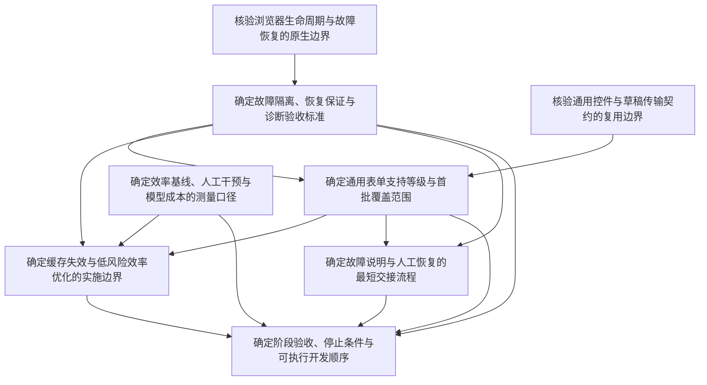

# 申请 worker 下一阶段开发计划

2026-10-11。规范入口为[申请 worker 下一阶段：稳定性、普适性与效率决策地图](map.md)。
用户确认按稳定性 → 普适性 → 效率推进。本页是阶段草案与导航，不保存第二份决策或完成状态。
目标是可执行规格；最终决定及仍未验收的证据边界以所属票、地图和[阶段规格](assets/stage-acceptance-proposal.md)为准。

2026-10-12 的[当前工作与开放 ticket 审计](../work-audit-2026-10-12/README.md)
核对了实际 frontier、六张稳定性实施票的关闭记录，以及后续岗位分流改动造成的历史输入失配。
下文事实基线保留 2026-10-11 的规划背景；当前版本验收与历史证据须按审计中的绑定范围判断。

2026-10-13 的[较早开放 ticket 快照](../open-ticket-audit-2026-10-13/README.md)
保留当时领取、依赖和后台 Cua 交付边界。
[同日后继整理](../open-ticket-audit-2026-10-13-followup/README.md)
链接已定案的 worker 规格及剩余职业清单票。领取前仍运行下方实时查询；
日期快照不替代子票状态。

## 事实基线

[当前测试总览](../../docs/application-worker-workflow.md)已分开合成、真实空表、辅助填写和独立 worker。
现有单进程、答案库、通用控件、PDF 绑定、同步和人工交接可以复用。
真实草稿保存仅有一个岗位的证据；重复回合不是不同企业覆盖。
历史退出错误尚未定位根因；工作台恢复不证明浏览器或原 DOM 已恢复。
现有套件耗时不是岗位耗时；尚无可用的分段效率基线。

## 推荐开发顺序

下面是进入细化的默认方案，不是本轮执行指令。具体保证、样本和数值目标只在相应决策票中确定。

| 顺序 | 可运行切片 | 推荐内容 | 退出证据由哪张票定义 |
| --- | --- | --- | --- |
| 开始前 | 最小效率基线 | 分开机器处理、用户等待、人工介入、缓存和模型调用；保留失败样本 | [确定效率基线、人工干预与模型成本的测量口径](issues/05-measurement-contract.md) |
| 第一阶段 | 稳定恢复闭环 | 运行身份与版本可核验；局部故障隔离；实时页面状态；保存与上传结果分层；只同步不重填 | [确定故障隔离、恢复保证与诊断验收标准](issues/02-recovery-contract.md) |
| 第二阶段 | 通用表单覆盖闭环 | 原生控件复用；动态必填重新扫描；按能力预检；只补最小站点契约；跨企业样本 | [确定通用表单支持等级与首批覆盖范围](issues/04-coverage-contract.md) |
| 第三阶段 | 低风险效率闭环 | 测量后优化语义缓存、重复资料读取和状态加载；保持顺序执行与输入失效守卫 | [确定缓存失效与低风险效率优化的实施边界](issues/06-efficiency-contract.md) |
| 交付前 | 故障交接与验收 | 复用现有工作台，用户只处理不确定项；按相同输入比较基线；逐切片报告支持与缺口 | [确定故障说明与人工恢复的最短交接流程](issues/07-recovery-handoff-prototype.md)及[确定阶段验收、停止条件与可执行开发顺序](issues/08-stage-acceptance.md) |

第一阶段不先拆分多进程或重写状态机。第二阶段不先为每个平台创建整套适配系统。
第三阶段不先增加多 worker 或大规模模型调用。以上为待验证的最小方案，具体反例可推翻。

稳定性阶段的具体故障矩阵、恢复规则与验收用例见[稳定性阶段：故障隔离、恢复保证与验收规格](assets/stability-contract.md)。定案状态仍由所属决策票记录。

## 现有复用入口

下表说明当前模块职责。每个开发切片先在这些入口增加最小改动，不另建平行系统。

| 职责 | 现有实现 | 现有验证入口 |
| --- | --- | --- |
| 队列、检查点、答案范围与记录同步 | [application_worker.py](../../src/career_evidence_graph/application_worker.py) | [worker 契约测试](../../tests/test_application_worker.py) |
| 浏览器生命周期、页面执行与人工交接 | [application_worker_browser.py](../../src/career_evidence_graph/application_worker_browser.py) | [通用浏览器测试](../../tests/test_generic_worker.py) |
| 岗位身份、通用控件与页面观察 | [hosted_ats.py](../../src/career_evidence_graph/hosted_ats.py) | [控件与身份测试](../../tests/test_hosted_ats.py) |
| 已核验的草稿保存与附件契约 | [ashby_drafts.py](../../src/career_evidence_graph/ashby_drafts.py) | [草稿契约测试](../../tests/test_ashby_drafts.py) |
| 岗位简历、缓存与 PDF | [application_resume.py](../../src/career_evidence_graph/application_resume.py) | [简历与缓存测试](../../tests/test_application_resume.py) |
| 当前状态、待核验项与用户操作 | [worker.js](../../src/career_evidence_graph/portal_static/worker.js) | [工作台 HTTP 测试](../../tests/test_career_portal_http.py)及现有浏览器夹具 |

开发时只运行与切片相关的检查，再完成该切片要求的回归。真实试点另报，不用合成通过数代替。

## 决策依赖

箭头表示前者阻塞后者。图仅展示依赖，不显示完成状态；状态以票为准。



研究票可以并行。人的决策一次一票，不由研究代理代替确认。
每张票已给系统推荐默认方案；讨论时只确认仍有实际取舍的部分。

## Wayfinding operations

沿用仓库已有本地 Markdown tracker。没有单独配置的远程 issue tracker。
如需改用远程 tracker，先运行 `/setup-matt-pocock-skills`；本地图无需等待该配置。

- 地图为 `map.md`，标签 `wayfinder:map`。`issues/` 每个文件是一张子票，文件路径是本地身份。
- `Parent` 指向地图；`Type` / `Label` / `Interaction` 记录票种和 HITL / AFK。
- `Status: open` 且 `Assignee: none` 表示未领取。先把 assignee 改为执行者，再开始。
- 本地 tracker 无原生阻塞关系，使用 `Blocked by` 中的标题链接。仅依赖票全部 resolved / closed 后才无阻塞。
- `## Resolution comment` 保存答案与资产、证据、分支和 revision。问题正文不改写成答案。
- 关闭后只在地图 `Decisions so far` 追加标题链接和一句摘要。推荐值不能以无用户回答为由关闭 HITL 票。
- 按文件顺序选择 frontier 第一票。查询生成状态，README 和 HTML 均不能代替子票状态。

在仓库根运行以下只读 frontier 查询：

```sh
python3 - <<'PY'
from pathlib import Path
import re
root = Path('.scratch/application-worker-next-stage/issues')
rows = {p.name: (p, p.read_text()) for p in sorted(root.glob('*.md'))}
def field(text, name):
    return re.search(r'^' + re.escape(name) + r': (.+)$', text, re.M)[1]
for p, text in rows.values():
    if field(text, 'Status') != 'open' or field(text, 'Assignee') != 'none':
        continue
    dependencies = re.findall(r'\]\(([^)]+)\)', field(text, 'Blocked by'))
    if all(field(rows[Path(d).name][1], 'Status') in {'resolved', 'closed'} for d in dependencies):
        print(f'{text.splitlines()[0][2:]} — {p}')
PY
```

查询只读文件，不连接招聘网站、不读取申请答案、不运行 worker。
