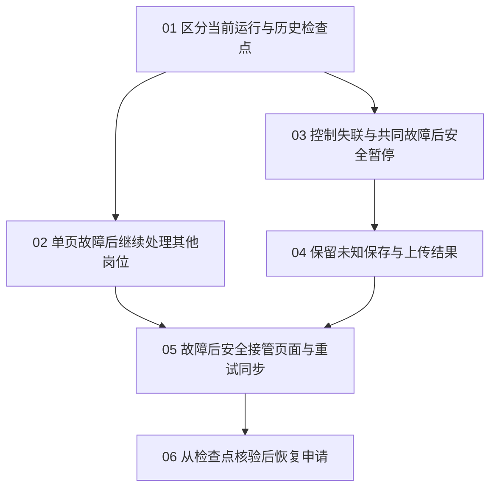

# 申请 worker 稳定性开发票

> 当前规范与唯一执行计划（2026-10-20）：[产品规范](../../docs/single-job-flow.md) · [开发计划](../../docs/development-plan.md) · [系统审计](../../docs/system-audit-2026-10-20.md)。
> 07历史冷启动与10特定Cua后台生命周期保留独立诊断，不再堵住当前主App正常运行。必要断点、单执行者、无盲重放仍保留；一次继续/可恢复skip/明确提交结果自动处理由单岗27/34/37实现。 本次仅重规划，未改Status/Assignee、未执行真实申请。

2026-10-20：全部开放票现按[并行执行分组](../open-ticket-parallel-plan-2026-10-20/README.md)组织；规范子票身份、原领取、依赖及验收保持，真实申请继续暂停。

## 后续执行 — 2026-10-13

用户要求将剩余稳定性调查与验证建成执行票，先推进冷启动。沿用本地 tracker：
Status 保存状态，Assignee 保存领取；已有六张完成票及其验收不重写。

| 执行票 | 顺序与范围 |
| --- | --- |
| [调查 Cua 冷启动前置窗口阻断](issues/07-cold-start-prewindow-investigation.md) | 优先；隔离合成环境、CDP 前结束、首次拒绝证据与根因调查 |
| [验证真实故障恢复](issues/08-native-fault-recovery-verification.md) | 随后；自有原生进程故障、检查点和原页交接；现有资源保留 |
| [修复 Cua MCP 后端退出后的传输关闭阻塞](issues/09-cua-mcp-exit-lifecycle.md) | 独立稳定性缺陷；后端先退出的真实管道复现、最小修复与离线回归 |
| [调查 CuaDriver 0.35 后台浏览器附着拒绝](issues/10-cua-035-background-attach.md) | 升级后的实际兼容性拒绝；只做自有资源对照，不放宽前台与发送守卫 |

执行顺序是用户优先级，不虚构技术阻塞关系。领取与执行结果只写所属票。
冷启动与故障恢复票执行已有规格，不重新打开已定案的开发前决策地图。

2026-10-16：[调查 CuaDriver 0.35 后台浏览器附着拒绝](issues/10-cua-035-background-attach.md)
已完成修复版接入已安装 TomorrowStar 及包内路径隔离合成验收，保留完整原包回退。
后继[GUI 宿主 TCC 独立核验](../cua-gui-host-tcc-2026-10-16/README.md)已完成：
实际原生宿主的辅助功能和录屏权限均未授予，后台调用在创建浏览器前安全拒绝。
所属票保持 open，待 GUI 宿主具备权限后完整复验；本轮未切前台或请求新权限。

2026-10-14：[修复 Cua MCP 后端退出后的传输关闭阻塞](issues/09-cua-mcp-exit-lifecycle.md)
完成 checkout 修复与合成验收。真实管道 red/EOF 对照/green、完整离线与保全读回见所属票及
[后继报告](../cua-mcp-exit-stability-2026-10-14/README.md)。冷启动来源调查继续保持开放。

2026-10-11，Europe/Zurich。用户已确认六张票的切分与直接阻塞关系：“按此发布（推荐）”。
开发票已发布到现有本地 Markdown tracker。本次发布未开始实现或行为测试。

规格：[稳定性阶段：故障隔离、恢复保证与验收规格](../application-worker-next-stage/assets/stability-contract.md)。
来源决策：[确定故障隔离、恢复保证与诊断验收标准](../application-worker-next-stage/issues/02-recovery-contract.md)。
父地图：[申请 worker 下一阶段：稳定性、普适性与效率决策地图](../application-worker-next-stage/map.md)。
原审阅内容：[稳定性开发票切分草案](breakdown.draft.md)。来源决策票、规格与父地图未因发布而修改。

## 开发顺序

| 开发票 | 直接阻塞票 | 可独立验收的交付 |
| --- | --- | --- |
| [01：区分当前运行与历史检查点](issues/01-current-runtime.md) | 无 | 工作台区分运行身份、启动版本、观察过期和受管退出事实 |
| [02：单页故障后继续处理其他岗位](issues/02-single-page-isolation.md) | 01 | 单页关闭、崩溃或局部命令失败不结束其他岗位 |
| [03：控制失联与共同故障后安全暂停](issues/03-safe-batch-pause.md) | 01 | 批次停止新自动动作，条件恢复后须明确继续 |
| [04：保留未知保存与上传结果](issues/04-unknown-action-outcomes.md) | 03 | 保存、上传与挂接结果未知时保留证据，不自动重传 |
| [05：故障后安全接管页面与重试同步](issues/05-handoff-and-sync.md) | 02、04 | 人工接管保持停止；仅同步重试不触发填表或上传 |
| [06：从检查点核验后恢复申请](issues/06-checkpoint-recovery.md) | 05 | 重启后先核验旧动作与输入，再恢复下一必要操作 |

箭头只表示直接阻塞。状态只以各票的 `Status` 为准；本表和依赖图不保存第二份完成状态。
`ready-for-agent` 表示切分已批准，仍须满足 `Blocked by` 才能领取。
按依赖结构，先从 01 开始；01 完成后，02 和 03 均可开始。共享文件本身不构成新阻塞。

## 本地执行规则

- 领取前确认直接阻塞票均已 `closed` 或 `resolved`。
- 领取、验收和完成记录写入对应票。完成后更新该票的 `Status`，并保留验证证据。
- 每张票完成时均有自己的演示与测试。06 另完成全部 17 组的整体验收与必要离线回归。
- T07 的故障隔离断言由 02 验收，接管断言由 05 验收。共享用例不重复累计通过数。
- 自动最终 Submit 动作和最终请求放行数均为零。故障测试使用隔离合成页面与临时记录。
- 个人资料、答案、简历、认证和真实 trace 保持私有。公开验收报告只含合成证据。

每张票保留完整验收条件及共同边界。验收结果须区分通过、失败、跳过、受阻和未观察。
开发票发布不表示恢复保证已实现，也不表示真实申请或雇主接收已通过。

## 复查与修复记录

2026-10-11：[独立复查](review/README.md)发现 R1、R2、R3，原验收记录保留。
04、06 的重开、修复和重新验收写入各票。[本轮修复报告](fixes/2026-10-11-r1-r3/README.md)
另存新增回归、取消结算边界、工作台加载修复、最终完整验证和全部失败输出。

2026-10-11：[第二次独立复查](review-after-fixes-2026-10-11/README.md)发现 R4、R5。
06 再次重开后修复，并在 04、06 联合验收完成后关闭。[第二轮修复报告](fixes/2026-10-11-r4-r5/README.md)
保留竞态回归、完整验证、首次 crash 超时和原断言复验记录。04 票及所有原验收正文保持原状。

2026-10-11：[第三次独立复查](review-after-r4-r5-2026-10-11/README.md)发现 R6、R7。
用户批准修复。06 已重开；完成前 recheck 和旧检查点时钟回拨边界正在修复，尚未重新验收。

2026-10-11：R6、R7 修复及 04、06 联合复验通过，06 重新关闭。
[第三轮修复报告](fixes/2026-10-11-r6-r7/README.md)保留新增 11 个回归、完整离线 843 passed、原生 80 passed、独立探针 12 passed 及全部失败输出。
旧验收、04 票和来源合同未改；历史首次 crash 超时根因仍未定位。

2026-10-11：[第四次独立复查](review-after-r6-r7-2026-10-11/README.md)发现 R8、R9。用户要求修复，06 重开。
旧 R6 无绑定完成证据及同一申请的历史批次现在停止自动写入，不补造 attempt；原生 crash 验收改用当前 Page 的 CDP 注入，原时限和断言保留。

2026-10-11：R8、R9 修复及 04、06 联合复验通过，06 重新关闭。
[第四轮修复报告](fixes/2026-10-11-r8-r9/README.md)保留新增 21 个回归、完整离线 858 passed、原生 86 passed、封存探针 14 passed，以及所有红测、回归失败和中止输出。
关闭前核对 633 个旧文件和 35 项最终输入，均无差异。04 票、旧验收与来源合同保留。
本轮修复合成 crash 注入入口；历史生产 TargetClosedError 和 Chromium 底层根因未宣称已解决。
