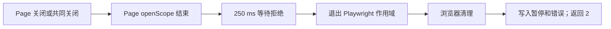

# 历史 TargetClosedError：隔离诊断

2026-10-12，Europe/Zurich。本轮只核对证据和隔离复现。

**已复现相同错误文本，并定位保留历史入口的异常传播机制。历史对象关闭的发起原因仍未确定。**
当前代码已有与 Page 生命周期分开的 pump；本轮没有修改运行代码或 04、06 状态。
合成诊断结果不建立生产恢复验收。

## 已证机制

原始错误指向 `Page.wait_for_timeout`，文本为 `Target page, context or browser has been closed`。
保留历史入口用 `context.pages[0].wait_for_timeout(250)` 服务事件。
这个调用在岗位异常边界之外，失败会退出 `sync_playwright` 作用域。
Playwright 清理浏览器后，外层处理才保存 paused / TargetClosedError 并返回 2。



双页探针中，局部关闭后另一个 Page 仍可操作；随后历史入口退出并清理浏览器。
原生 stderr 记录了浏览器退出。已停止 Playwright 的 Browser 对象仍曾返回 is_connected=true；
这个缓存值不能代替原生进程退出证据。

固定环境的 SDK 实现与合成 trace 相符：Frame 的 timer 与 Page openScope / frame detachedScope 竞争。
close 和 crash 都使用 TargetClosedError；crash 的消息是 `Page crashed`。
错误类名不能区分这些原因。

[保留 main](legacy-main.py.txt)、[来源边界](legacy-source-provenance.json)、[合成原生 trace](red-native-trace.zip)、
[trace 调用核对](red-trace-audit.json)及[安装源码核对](installed-source-audit.json)保留上述证据。
保留 main 来自初始历史入口与其打印补丁。原长期生产进程的完整加载源码指纹没有记录；
本轮复用当前 Store，替换岗位主体为合成双页探针。因此不能把它称为原生产进程的完整重放。

## 隔离结果与归因边界

| 条件 | 本轮观察 | 能确定的范围 |
| --- | --- | --- |
| 历史入口，关闭一个 Page | 3/3 返回 2；错误与原文本相同；其他 Page 在 owner 清理前可操作 | 局部关闭能触发历史传播路径 |
| 缩减为单 Page 和 timer | 3/3 相同错误；无关闭对照不报错 | 不需要真实表单、上传、答案或业务请求 |
| Context 正常关闭 | 同样的 TargetClosedError；其他 Page 已不可操作 | 原日志也相容于共同关闭 |
| Browser 正常关闭 | 同样的 TargetClosedError；原生退出码 0 | 原日志不能排除正常 Browser 关闭 |
| 对新 Browser 发 SIGTERM | 同样的 TargetClosedError；观察到退出码 143，或后续清理导致 SIGKILL | 最初信号与最终退出事实必须分开 |
| 对新 Browser 发 SIGKILL | 同样的 TargetClosedError；原生 signal=SIGKILL | 原日志也相容于 Browser 异常终止 |
| 确认原生 renderer crash 后等待 | TargetClosedError，消息为 Page crashed；其他 Page 可操作 | 本版本下纯 renderer crash 的文本不同；不能据此排除历史 Browser 崩溃 |
| 当前 pump 方法级对照 | 3/3 不传播局部关闭；其他 Page 保持可操作 | 只验证当前方法的隔离行为，未验证生产恢复 |

最终 [26 项诊断检查](diagnostic-final.log)通过，[XML](diagnostic-final.xml)为 0 failed / error / skipped。
这些检查包含对预期错误的断言。它们验证诊断签名，不能作为修复验收或生产成功计数。
[执行清单](run-results.json)保留所有轮次，不把重复运行相加。

首个局部隔离断言的 [1 failed 红测](red-poll.log)原样保留。
第一轮签名试验为 [7 passed / 4 failed](signatures.log)：SIGTERM 信号预测不成立，
另两项 renderer 试验未在清理前观察到 crash，不能算有效注入。
[后续 4 passed / 2 failed](signatures-followup.log)确认实际 crash，但否定 Error 类名预测。
修正的只是假设断言和新探针：保留原 250 ms timer，先按 1500 ms 等待真实 crash；CDP 命令预算仍为 1 秒。
旧 R8、R9 的注入、时限、断言和验收没有修改。
首轮源码快照及修正前源码均保留；最小化源码副本明确标为 reconstructed。

此前进度更新混入了正常关闭的退出码 0。原始 stderr 核对已纠正该表述。
SIGTERM 的记录为 143 或清理阶段的 SIGKILL，二者的先后保留在原始流中。

## 原生产证据核对

原日志只有错误类型与调用文本，没有异常堆栈或原生生命周期顺序。
旧检查点没有可绑定的受管退出码、Browser 退出事实或原进程源码身份。
现存请求归档记录业务请求，不能补足故障时段的 close / crash / disconnect 事件。
找到的 OS crash report 属于另一时段的 crashpad handler，不能当作目标 Browser 的崩溃记录。

已只读检索故障窗口的 macOS unified log。浏览器活动记录存在，
但没有能把关闭发起方或退出事实绑定到原 worker 的记录。
附近系统活动的时间相邻关系不构成关闭原因。
原始定位、时间线、哈希及系统日志只保留在私有诊断报告中。

因此目前不能唯一选择用户关页、Context / Browser 关闭、外部终止或其他共同故障。
同一日志可由多条受控路径产生，单独重现文本不足以确认历史发起原因。

## 后续观测所需证据

若有故障时段的原生 trace、Browser stderr 或退出记录，应先按原 PID / run / 源码身份核对。
否则，新的获准生产观测至少需要以下四项；本轮未启动这种观测。

| 记录 | 最小内容 |
| --- | --- |
| 运行身份 | 新 run、启动源码 / SDK / Browser 版本及当前受管 child；不从旧 PID 推造 |
| 原生事件 | Page close / crash、Context close、Browser disconnect 的对象绑定、追加顺序与单调时间 |
| 主动操作 | release / handoff / stop 命令的来源和开始顺序；外部关页原因保持 unknown |
| 进程事实 | 父进程实际观察的 worker return code；私有 Browser stderr 中的退出码 / 信号；区分故障前事实与清理事实 |

这些记录放在新的私有目录。现有工作流的未知 intent、人工 Submit 和批准 PDF 规则继续适用。
只记录诊断元数据，不记录答案值、请求正文或认证信息。

## 保留与复验

[991 个受保护文件](preservation-check.json)无变化，包括原验收、失败记录、04、06 及运行源码。
读到的生产日志、检查点、HAR 和私有试点证据另做私有哈希核对，均未改写。
最终 [8 项执行输入](final-diagnostic-inputs.json)在执行后保持一致。
Ruff、格式和 diff 检查通过；未做全套回归，因为本轮没有运行代码改动。
诊断脚本集中保留在本 scratch 目录，没有向运行模块加入 DEBUG 日志。

复验需使用新的输出前缀和新 log / XML，保留本轮记录：

```sh
TS_TARGETCLOSED_MATRIX_PREFIX=NEW_UNIQUE_PREFIX- \
UV_CACHE_DIR="$PWD/.cache/uv" uv run --locked python scripts/run_pytest.py \
  -q -m worker_browser \
  .scratch/application-worker-targetclosed-2026-10-12/test_diagnostic_matrix.py \
  --junitxml=/private/tmp/NEW_DIAGNOSTIC.xml
```

原红测另见 test_poll_reproduction.py；它对保留历史入口应继续失败。
所有浏览器均使用新临时 profile 和离线合成页面。信号只发给该探针创建并由 CDP 确认的 PID。
真实 ATS / 模型调用、自动填表 / 上传 / Submit 为 0。
04、06 保持原关闭状态，现有验收不变，生产恢复仍未验证。未提交或推送。
