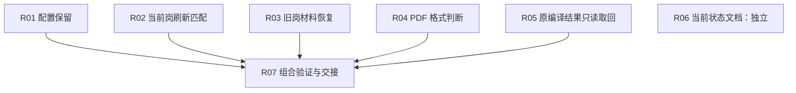

# 审计发现修复计划 — 2026-10-25

Label: wayfinder:map
Status: closed
Assignee: root-integration
Created: 2026-10-25
Updated: 2026-10-25
Tracker: local-markdown

最初授权为规划，以下原规划及原审计基线保留。后续用户调用 implement，已授权执行 R01–R07 的源码、合成验证与独立复审；不含提交、发布、打包、安装或真实业务。当前进展见[实施与交接](implementation.md)。
原[三轮审计](../work-audit-2026-10-25/README.md)确认 **5 项 P2、1 项 P3**，规划时均未修复。后续实施结果见本页末尾及实施与交接；原严重程度与历史结论保持。

## 建议顺序

同为 P2 时，先保护持久设置，再保护默认队列和恢复准入，随后处理材料格式与结果恢复。
下表序号表示建议处理次序，不表示前项是后项的技术依赖；可用并行安排见下文。

| 顺序 | 工作包 | 原发现／级别 | 优先理由 | 硬依赖 |
| --- | --- | --- | --- | --- |
| 1 | [R01 保护配置](issues/01-preserve-configuration.md) | N1 / P2 | 防止保存模板时删除已有设置 | 无 |
| 2 | [R02 当前岗刷新匹配准入](issues/02-current-job-match-admission.md) | S2 / P2 | 先约束默认主流程的另岗执行 | 无 |
| 3 | [R03 旧岗材料恢复准入](issues/03-sequential-material-recovery.md) | S1 / P2 | 补齐独立准备入口及两个恢复路径 | 无 |
| 4 | [R04 PDF 格式判断](issues/04-pdf-accept-validation.md) | SP1 / P2 | 先阻止无效构建和错误就绪 | 无 |
| 5 | [R05 原 PDF 结果只读取回](issues/05-read-completed-pdf-result.md) | M1 / P2 | 恢复已完成尝试，保持未知不重放 | 无 |
| 6 | [R06 当前文档状态](issues/06-correct-current-status-navigation.md) | D1 / P3 | 更正工作导航，可独立并行 | 无 |
| 收尾 | [R07 组合验证与交接](issues/07-combined-verification.md) | 验收工作包，非新缺陷 | 证明五项修复在同一最终版本共同成立 | R01–R05 |

## 真实依赖

五项代码修复之间没有必须等待的技术前置。R04 不要求 R05 先完成，R05 也不要求先改格式判断。
R06 可立即按当前证据纠正文档；源码、安装及真实接受状态应保持分层。
单项验证跟随各自修复，最终组合验证才等待五项代码任务完成。

箭头仅表示验收前置，不是建议顺序或共享文件锁。
整份计划收尾需六项发现均有对应结论，且 R07 完成；不把文档正确当成产品正确。

## 并行与文件协调

| 建议负责人 | 工作包 | 文件协调规则 |
| --- | --- | --- |
| 配置负责人 | R01 | 拥有 career_portal 配置保存及 CLI 测试；可与其他流并行 |
| 队列准入负责人 | R02、R03 | 同一人统筹两个 Module 的准入语义；通常文件不冲突，可并行但串行集成，不引入两套当前岗状态 |
| 材料负责人 | R04、R05 | 实现文件不同，可并行；两项都涉及 test_cover_letter_delivery.py，必须明确该文件唯一编辑者，或由同一人按 R04 → R05 集成 |
| 文档负责人 | R06 | 仅当前导航；保留历史日期、原票及原负责人 |
| 独立审查／集成人 | R07 | 不以作者自测替代复审；核对最终冻结版本和证据 |

以上为原规划建议职责；后续已按 implement 指令分流实施，实际负责人见各票及实施与交接。
文件重叠是协作约束，不能伪装成技术依赖。

## 验证与完成含义

审计基点 HEAD 为 e4a26d0c24311d014d478f7f92e58a88e6709b4b；审计前工作区含未提交及未跟踪源码。
原默认回归 6,786 passed / 2 skipped 只证明当时套件通过，没有覆盖已确认的全部反例。
实施起点须重新核对当前所属源码；位置行号是审计定位，不是不可变化的实现约定。
五项代码修复先补公开 Interface 的失败回归，再做最小修复与独立复审；跨岗刷新应补实际 loopback HTTP 分派验证。
纯文档 R06 只核对当前证据及链接，不新增产品测试；安装差异按执行时实况重新核验，不固定沿用旧数量。
旧实验补丁已撤回，不能整包恢复来代替逐项核验，也不能复用其绿测声称新版本完成。

这份计划只覆盖六项已确认发现。JD 明确 PDF 与页面文本入口优先级尚有解释空间，未计为确定缺陷，
不在本计划中顺便新增需求、格式支持或产品选择。

计划没有安装或真实业务工作包。源码与合成验证完成后，只记录当时安装差异和剩余真实验收范围；
不自动更新唯一主 App、不调用真实模型／Prism／ATS、不代替用户最终 Submit。

## 状态与查询

规划时七张票均为 open、Assignee=none；后续 implement 已完成并关闭本计划七票。旧地图不重开，旧票负责人、依赖及历史结果不变。
使用现有 scripts/query_tickets.py 查询，不另建 tracker。查询中的 mechanical_frontier 仅表示依赖满足，
execution_authorized=false，不提供执行授权。每票具体依赖只维护在其 Blocked by 字段。

## 后续实施 — 2026-10-25

已按用户 implement 指令启动。R01 配置、R02/R03 跨岗准入、R04/R05 PDF、R06 文档分流实施；R07 由集成人等待最终版本后完成组合验证和独立复审。原“只规划”段落记录规划时点，不再代表当前授权或执行状态。

## 最终完成 — 2026-10-25

R01–R07 全部关闭。最终默认离线 6,882 passed / 2 skipped，相关 Chromium 21 passed；静态检查和三组独立复审通过。源码与测试运行前后无漂移。当前安装版有 7 项源码差异，未更新 App；无真实模型、Prism、ATS 或最终 Submit。详见[实施与交接](implementation.md)及[机器摘要](verification.json)。

## 后续主 App 同步 — 2026-10-25

源码验证收尾后，用户明确授权安装同步。现已完成唯一主 App 更新和安装后验证，源码阶段记录的安装差异已消除；固定签名、实际权限、配置、人工材料与已有任务均保留，完整回退已验证。详见[安装记录](installation.md)及[布尔验证结论](installation-verification.json)。原源码阶段“未安装”结论保持其历史范围；本次未执行真实申请、真实模型／Prism／ATS 或最终 Submit。
