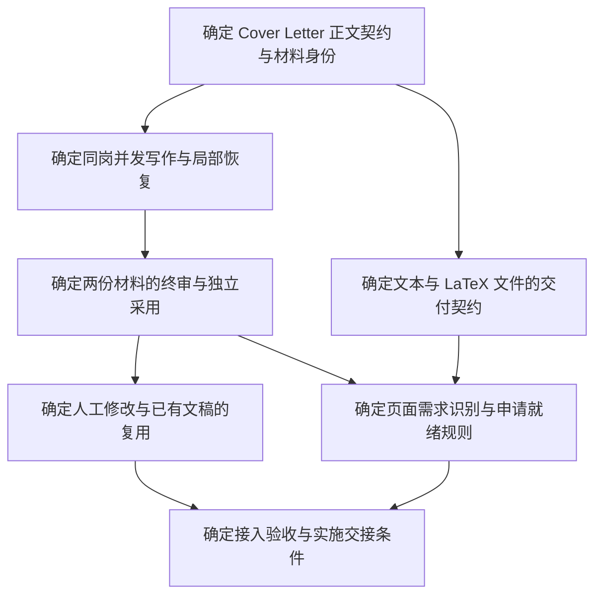

# Cover Letter 接入规划导航

唯一地图：[简历与 Cover Letter 同岗并发生成接入规划](map.md)。
规划输入：[已确认的产品约定](PRD.md)。
七张票已解决，源码接入与合成验证完成；见[实施记录](implementation.md)。
原始建图规则保留为历史，本轮实施范围以地图中的明确授权为准。安装版与真实申请未执行。

## 依赖关系

下图展示建图时的决策依赖，不表示领取或完成状态；实时状态与依赖均以子票和查询为准。



## Wayfinding operations

沿用仓库的本地 Markdown tracker。没有为本轮指定远程 tracker，不创建远程 issues；
如以后需要重新配置技能的 tracker，可运行 `/setup-matt-pocock-skills`。

- `map.md` 是 `wayfinder:map`；`issues/` 下一个文件代表一张子票，文件路径是身份。
- `Parent` 链接父地图；`Blocked by` 使用题名链接。本地 tracker 没有原生 blocking，
  依赖通过该字段和现有查询工具计算。
- 初始票全部 `Status: open`、`Assignee: none`。所有直接前置 closed/resolved 且未领取
  才是 frontier；按 Priority、同优先级按文件名选第一张。
- 解题前先设置唯一 `Assignee` 并保存；必要时将 Status 改为 claimed。HITL 必须
  由用户参与，agent 不代答。只读资料调查不是擅自解决用户决策。
- 每会话最多解决一张非 research 票。答案追加到原票 `## Comments` 下的 resolution，
  然后关闭；地图只追加题名、链接与一句摘要。新问题先建票，再接依赖。
- 当前票为规划决策，不用“源码已改”或“测试通过”替代决策结果，也不把它们直接
  当作实施授权。旧图的状态和负责人保持原样。

从仓库根查询本轮票据，复用既有工具；不另建 tracker 实现：

```bash
UV_CACHE_DIR=/private/tmp/tomorrowstar-wayfinder-uv-cache uv run --locked --offline --no-sync python -B - <<'PY'
from pathlib import Path
import runpy

report = runpy.run_path('scripts/query_tickets.py')['query'](Path.cwd())
prefix = '.scratch/cover-letter-integration-2026-10-25/issues/'
for ticket in report['tickets']:
    if ticket['path'].startswith(prefix):
        state = '可领取' if ticket['mechanical_frontier'] else ticket['status']
        print(f"{state}: {ticket['title']} | owner={ticket['assignee']}")
        if ticket['direct_dependencies']:
            titles = {row['path']: row['title'] for row in report['tickets']}
            print('  等待: ' + '、'.join(titles[path] for path in ticket['direct_dependencies']))
print('tracker errors:', report['errors'])
PY
```

查询报告的 `execution_authorized=false` 表示查询不提供执行权限，不妨碍已授权的本轮规划。
所有实际前置与状态只读子票；本页不维护第二份开放票清单。
