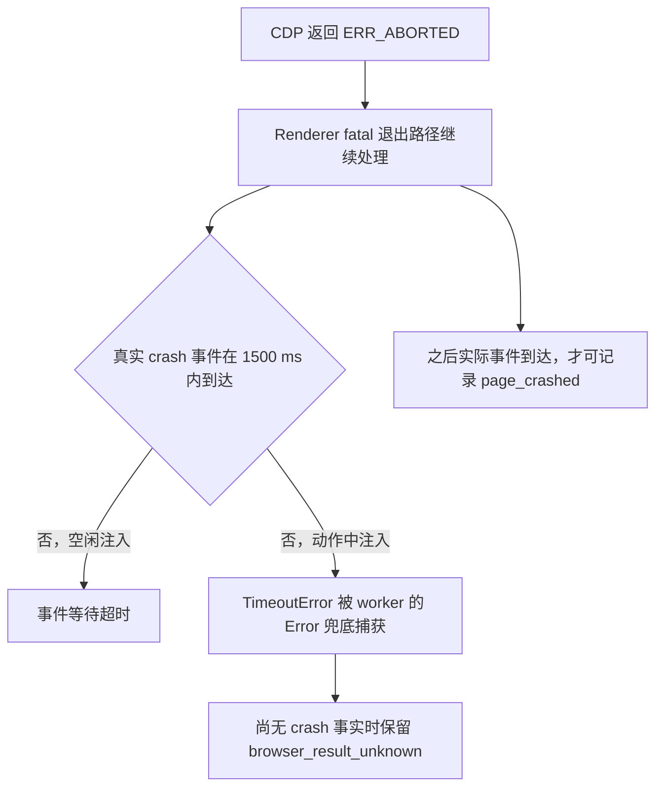

# Crash 回归根因与夹具修复

2026-10-13，Europe/Zurich。所属票：
[验证真实故障恢复](../application-worker-stability/issues/08-native-fault-recovery-verification.md)。
首轮证据：[真实故障恢复验证](../native-fault-recovery-verification-2026-10-13/README.md)。

**已用真实 renderer 故障复现两种错误，修复故障夹具，并按原 1500 ms 事件和 2 s 诊断期限复验通过。**
修复范围是两份测试文件。worker 的事件分类、未知 intent、恢复及发送守卫未修改。
原失败包、现有私人状态/附件及现有进程启动身份均保持。

## 根因与证据

旧夹具通过 `Page.navigate("chrome://crash")` 触发 fatal renderer crash。
CDP 很快返回 `net::ERR_ABORTED`，真实 Page crash 事件稍后才到达。
该响应不是 renderer 已退出或 worker 已收到故障事实的证明。
把这条带可变 fatal-crash 处理时间的路径放进严格事件预算，使回归依赖 native 退出时序。

本轮先重复冻结原用例 **16 passed**，没有自然复现。
跟踪覆盖 CDP attach、命令发送/回复、原生事件接收和 worker callback，
见 [natural traces](natural-traces-01/)。该阶段事件约 0.30–0.37 s 到达，
接收后立即由 worker 记为 `page_crashed`。

随后只对新建 profile 的已绑定 renderer 执行有界 `SIGSTOP` / `SIGCONT`。
这模拟该进程短暂不能运行，不增加全机负载，不触碰共享服务或现有进程。
单页控制只有一个 renderer；双页控制使用目标页的原生 user-timing marker，
从 tracing 的 PID 绑定目标，再匹配 PID、父进程、启动时间与唯一 profile。
无法绑定时探针停止，未按 PID 顺序猜测目标。

| 同一暂停条件 | 旧 `chrome://crash` | `chrome://kill` 对照 |
| --- | --- | --- |
| 单 renderer 暂停 1.25 s | 两例均超过 1500 ms；事件约 1.59–1.61 s 到达 | 两例通过；事件约 1.27 s 到达 |
| 双岗位目标 renderer 暂停 1.43 s | 复现事件超时及 `browser_result_unknown` | 四例通过；其他岗位继续 |
| 从实际 SIGCONT 到 crash 事件 | 0.320–0.376 s | 0.007–0.012 s |

完整的实际恢复时间、事件、Page/renderer 绑定、检查点与断言结果见
[current-contract control](worker-control-traces-cohort04/)及
[comparison summary](comparison-summary.json)。这些对照使用真实进程暂停和真实退出，
未调用假的 crash callback。



两种首轮错误对应同一事件延迟机制。动作中还有一个测试边界问题：
`TimeoutError` 属于 `Error`，会被 `runner.tick()` 捕获。
旧断言可能在稍后收到事件后通过，从而掩盖已经超出 1500 ms 的注入等待。
本轮旧-contract 对照中也观察到这种迟到事件但宏断言通过的情况。

这些结果确定了可复现的夹具失稳机制。首轮旧日志没有进程和边界时序，
无法追补当时具体是哪项外部调度或系统处理使 fatal 路径变慢。
不将本轮结果扩展为历史生产 `TargetClosedError`、Cua 冷启动或整个 Chromium 的底层修复。

## 最小修复

- [test_worker_stability.py](../../tests/test_worker_stability.py)：注入入口改为 `chrome://kill`；仍等待真实 crash 事件。保留 1 s 命令、1500 ms 事件和 2 s 诊断期限。
- 同一文件在 worker catch 边界外独立检查实际事件时间，动作中事件超时不能再被隐藏。
- [test_worker_crash_injection.py](../../tests/test_worker_crash_injection.py)：新增真实短暂停顿回归。只向唯一自有 renderer 发信号，恢复前重新核对启动身份；保留同一期限及“crash 不等于 close”断言。

`chrome://kill` 在 POSIX 触发当前 renderer 的 SIGTERM；Chromium 区分该入口与
null-pointer fatal crash。实现说明见 [Chromium debug URL source](https://chromium.googlesource.com/chromium/src/%2B/main/third_party/blink/common/chrome_debug_urls.cc)。
本轮所测构建另由实际 PID 退出及真实 `Inspector.targetCrashed` / Page crash 事件核验。
源码说明是 main 快照，不冒充所测二进制的精确构建 revision。

改动差异见 [scope patch](scope.patch)。没有新增依赖、自动重试、启动等待、
自动重连、推断 crash 分类或放宽期限。没有部署、安装 App 或重启现有运行。

## 红测、复验与准备失败

| 运行 | 结果 | 解释 |
| --- | --- | --- |
| [原函数自然重复](natural-repetition-01.log) | 16 passed | 原断言，未自然复现；不作为修复证据 |
| [单 renderer 因果控制](exit-control-01.log) | 2 old failed、2 control passed | 真实调度暂停与两种退出入口 |
| [双页绑定准备 01](worker-control-01.log) | 8 setup failed | tracing 未提供可用 frame/PID 参数；没有发送信号 |
| [双页绑定准备 02](worker-control-02.log) | 4 setup failed | 同一绑定限制；没有发送信号 |
| [marker 绑定核验](worker-binding-03.log) | 1 passed | 仅核验绑定，未注入故障 |
| [冻结原 contract 控制](worker-control-03.log) | 3 failed、5 passed | 复现两种原错误；另发现动作中迟到事件可被旧宏断言隐藏 |
| [独立事件断言控制](worker-control-04.log) | 4 old failed、4 control passed | 旧入口均超预算；修复入口均满足原预算 |
| [新增 native 回归红测](regression-red.log) | 1 failed | 修复前实际调用旧注入函数，1500 ms 等待失败 |
| [同一回归及原用例绿测](regression-green.log) | 5 passed | 新增回归事件约 1.28 s；普通注入约 0.008–0.024 s |
| [首轮同范围与新增检查](affected-native.log) | 20 passed、81 deselected | 含页面隔离、共同故障、原页/File 保留与上传恢复 |
| [修复后原函数重复](fixed-repetition.log) | 16 passed | 空闲、动作中各 8 次；事件约 0.011–0.029 s |
| [相关离线检查](affected-offline.log) | 79 passed、29 deselected | 检查点、未知动作与恢复边界 |

各 cohort 的调用范围重叠，通过数不相加。旧入口的红对照是明确保留的因果证据，
不标为修复后的默认夹具失败。准备失败与产品行为失败分开记录。
统计及退出码见 [cohort summary](cohort-summary.json)。

新增回归的复现命令：

```sh
PYTHONDONTWRITEBYTECODE=1 uv --cache-dir /private/tmp/ts-crash-rootcause-uv run --locked --offline python -B scripts/run_pytest.py -q -p no:cacheprovider -m worker_browser tests/test_worker_crash_injection.py
```

使用明确的新 trace / basetemp 路径收集后续结果；封存后不向本包重跑。
诊断脚本及旧版本只作为证据，实际反馈回归已放入 `tests/`。

## 记录缺口与保全

cohort04 初次复用了新诊断 cohort03 的逐例 JSON 输出名，覆盖了八个逐例 JSON。
cohort03 原日志、JUnit 及覆盖前工具读回保留；读回另存
[derived summary](cohort03-readback-summary.json)，明确不是恢复的原 JSON。
cohort04 完整记录已单独归档；后续 control 目录改为必填环境参数。
详见 [preservation incident](artifact-preservation-incident.json)。
这是本轮记录组织错误，未修改首轮封存失败包，也未覆盖新增回归红测。

1082 个历史包文件（含首轮失败）逐字节一致；126 个其他源码/测试/launcher 文件一致。
现有私人状态、附件与设置摘要一致；现有进程启动身份保留。
本轮 profile/worker 均退出，见 [postcheck](postcheck.json)和 [process check](process-check.json)。
私有保护摘要只存在独立私有临时目录，未写入此包。
实际依赖、所测 headless-shell 版本和输入摘要见 [execution inputs](execution-inputs.json)。
[Lint](lint-final.log)、[format](format-final.log)及 [diff check](diff-check.log)通过。

真实 ATS、模型和自动最终 Submit / 提交请求均为 0。
真人 Acceptance、真实系统 sleep/wake 和 Cua 冷启动根因不在本轮通过声明中。
冷启动票及其封存输出保留。
