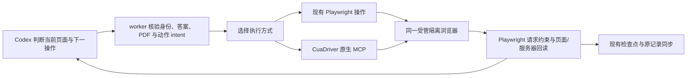

# CuaDriver 原生接入验证 — 2026-10-12

时区：Europe/Zurich。范围：本机 CuaDriver 0.21.0、独立标准权限 runtime、隔离 Chrome 155 和一个本地合成表单。

**建议 TomorrowStar 直接使用 CuaDriver 原生 MCP。Hermes 不作为运行依赖。**
本次已经直接完成表单交互，并验证 Playwright 请求拦截可与 Cua 共用同一个隔离浏览器。
这是合成接入原型，不是完整 worker 集成或真实 ATS 验收。

## 为什么直接接入

Hermes 提供代理循环、模型路由、工具注册、审批与会话管理，也提供 Cua 的包装适配。
TomorrowStar 已有 Codex 模型入口、worker、输入约束、检查点与人工交接。再引入整个 Hermes runtime 会重复部分职责并增加配置和版本边界。
本次直接客户端只使用 Python 标准库和驱动的原生 JSON-RPC/MCP，没有导入 Hermes，也没有新增项目依赖。
此前 Hermes 包装器的 socket 失联仍是保留观察；本次没有定位该失联根因，不能归因成 Hermes 必然不稳定。

## 实际观察

| 项目 | 本次结果 | 证据与限制 |
| --- | --- | --- |
| 原生 MCP 初始化、动态工具发现 | passed | [初始化](initialize.json)、[工具清单](tools.json)；与 Hermes runtime 无关 |
| Cua 创建隔离浏览器及精确绑定 | passed | [创建](action-02.json)、[绑定](action-04.json)；`endpoint_access_class=driver_owned`、`mutation_allowed=true` |
| 当前页面语义读取及图像 | passed | [页面状态和截图](action-07.json)、[截图](action-07-image-0.png)；snapshot/query 可按具体问题缩小上下文 |
| 原生窗口捕获 | passed | [原生捕获](action-11.json)、[窗口图像](native-window.png)；实际图像已人工式视觉检查，显示合成页面及已输入内容 |
| 文本输入及回读 | passed | 合成姓名和授权说明进入页面；输入使用 `trusted_input`，每次都另行回读 |
| select-only combobox、动态必填 | passed | [展开后的选项](action-14.json)、[新必填项](action-16.json)；点击明确使用 `dom_event` |
| 控件替换后的新绑定 | passed | [替换后空字段](action-20.json)、重新输入后的服务器事件；未沿用旧控件 ref |
| 模拟 PDF 文件选择及本地上传 | passed | [文件操作](action-23.json)；一份测试字节文件、一次上传，服务端 SHA-256 与本地相同。它不是可用个人简历或 ATS 文件解析验证 |
| 本地 Next 及同源 iframe | passed | [iframe 语义](action-26.json)、[回读](action-28.json)；不覆盖跨域 iframe、登录或有服务端副作用的真实 Next |
| 同浏览器 Playwright 发送守卫 | passed | [拦截结果](guard-result.json)、[页面回读](action-31.json)；Cua 点击测试按钮后，Playwright 阻止唯一 `/guard-probe` POST，服务器未收到请求 |
| 最终 Submit | 未执行 | 所有动作未点击最终按钮；最终 POST 为零。此计数不证明完整生产提交守卫已实现 |

服务器观察及九项布尔核对见 [validation.json](validation.json)。这些是一个场景的观察检查，不是九个不同企业或九次独立重复试验。
已执行源码：[原生 stdio 客户端](direct_stdio.py)、[共存守卫探针](guard_probe.py)、[合成页面](form.html)、[loopback 服务](serve.py)。
fixture 与测试文件复用上一轮合成材料，原字节对应见 [fixture-provenance.json](fixture-provenance.json)。

## 权限与保留的失败

辅助功能、录屏权限都已授予 CuaDriver.app；原生窗口图像成功获取。
[检查回执](action-32.json)的专用 `direct_capture_status` 仍为 `not_checked`。
因此本次证明已使用的窗口捕获可用，不证明所有 ScreenCaptureKit 捕获模式均已完成授权/验证。
没有运行权限重置、没有自动点击系统授权窗口，也没有修改 existing-profile grant。

| 保留观察 | 处理 |
| --- | --- |
| 沙盒中的 NSPasteboard NULL panic | 只对本机图形测试使用已获准的执行环境；没有修改 Cua 安装 |
| 提供现有 Chrome PID 的请求被自动审批拒绝 | 请求没有执行；后续仅使用测试新建的临时进程及 Cua 自建隔离 profile |
| Hermes 读取外部新建 profile 被 Cua 拒绝 | 没有设置 existing-profile grant；改为由 Cua 创建真正 driver-owned profile |
| Hermes 最后一次 socket connection refused | 保留原 [action-07](../hermes-computer-use-probe-2026-10-12/action-07.json)；直接原型使用独立标准权限 socket，没有停掉共享 daemon |
| 原生 `browser_prepare` 不给 PID 时找不到签名系统浏览器 | [首次结果](action-01.json)保留；用全新空白测试进程识别已安装 Chrome，再请求 Cua 创建另一个隔离 profile |
| 后台 trusted CDP click 被拒绝 | [原始拒绝](action-10.json)保留；之后的点击显式选择 `dom_event`，并核验页面效果。真实站点可能拒绝此类事件 |
| 导航后 snapshot 的 `page.title` 仍是 about:blank | 已观察到的接口限制；使用当前 URL、渲染根标题与图像交叉核对，不将该字段单独作为岗位身份 |
| 第一次 CDP 地址定位失败 | `ps` 输出的含空格路径不能按 shell argv 拆分；没有打开目标文件。之后使用任务 PID 所有的 loopback listener 核验，见 [地址记录](owned-cdp.json) |

驱动显示更新提示，但本次没有安装或升级。结论只适用于实际测试的 0.21.0。
本次使用的系统 Chrome 为 155.0.8059.39；它不是现有 worker 历史验收中的打包 Chromium 版本。

## 建议的系统接入

- 保留 CuaDriver.app 的标准权限运行身份，优先独立 socket 和驱动自建 profile；避免从用户日常 Chrome 引入授权。
- 只增加一个薄的驱动适配器，负责安装/版本能力检查、MCP 生命周期、精确窗口/页面绑定、当前 ref 与实际效果回读。
- 模型可以读取截图或语义状态并选择操作；动作仍须经过现有 worker 输入与发送约束。CuaDriver 不是投递策略或状态存储。
- 一页只有一个写入者。模型辅助时 Playwright 可做观察与请求守卫；交回后重新核验输入和未知结果。
- 输入路径 `trusted_input` / `dom_event` 记录到操作证据；不因 trusted 拒绝而静默降级。
- 保留人工最终 Submit。未知发送、未知结果和新个人事实不能由模型推造。

原型只验证了简单 context route 与 Cua 操作共存。完整 WorkerStore/intent、重复发送、接管、批次控制、恢复、ATS 精确请求契约仍需接入回归。
本次由当前 Codex 聊天选择动作；没有运行 Hermes AIAgent，也没有启动独立模型/provider 循环。
没有比较模型成本或全流程耗时，不能宣称混合流程已经更快。

正式接入前，复用已验证边界完成最小 worker 切片；不引入第二套代理框架、任务队列、答案库或审批状态。
所属决策票仍为[确定通用表单支持等级与首批覆盖范围](../application-worker-next-stage/issues/04-coverage-contract.md)，本报告不替代其余支持范围决定。

## 收尾与证据保留

原生测试 session 已通过 [end_session](action-33.json)结束，独立 daemon 与 socket 已关闭。
测试浏览器及 loopback 服务已退出。仍存活的测试进程在发出 SIGTERM 前，逐一核对了其临时 profile 或服务路径。
没有关闭共享 daemon、日常浏览器或 Hermes gateway，没有删除 profile 或原始证据。结果见 [cleanup.json](cleanup.json)。

源码语法、JSON、文档链接及当前 worker 源码指纹的最终核对见 [artifact-check.json](artifact-check.json)。
本轮没有修改生产运行模块，未重跑完整 pytest 套件。执行证据来自上表的真实本地操作与请求回读。
