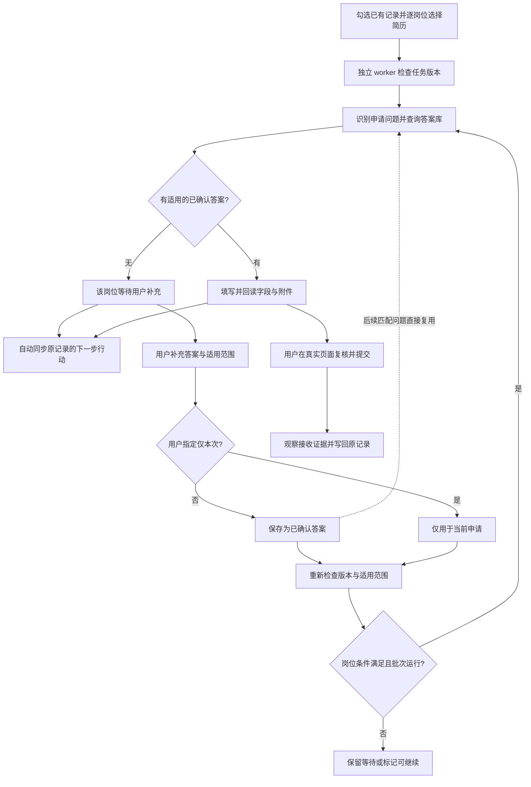
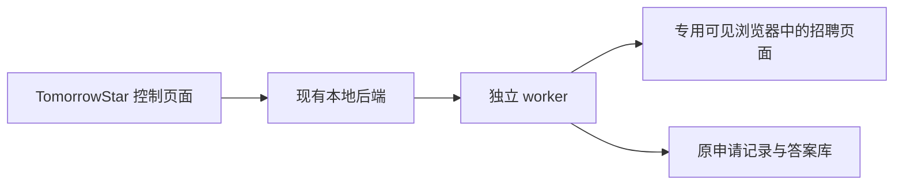
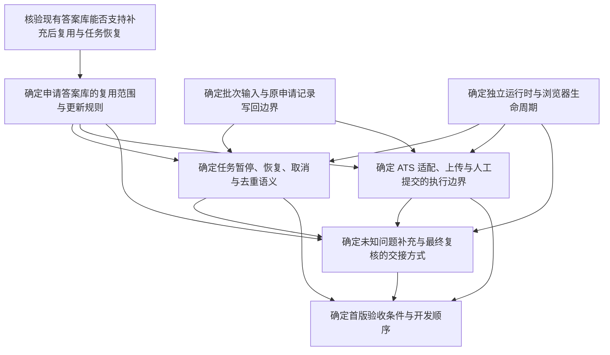

# 独立申请 worker 规划入口

规划日期：2026-10-09 至 2026-10-10。规范入口是[独立申请 worker 开发决策地图](map.md)，每个问题与其答案只保存在对应子票。
本页解释目标流程和依赖，不维护第二份任务状态。

2026-10-10 开发更新：[Lever 本地可用预览](../../docs/lever-worker-preview.md)已接入实际独立 worker
和现有后端，并完成[三轮主流程与故障测试](../../validation/application-automation/2026-10-10/lever-worker-preview/README.md)。
随后已接入 Greenhouse，复用同一 worker 与答案库，见[双平台开发验证](../../validation/application-automation/2026-10-10/greenhouse-worker-preview/README.md)。
仅使用隔离合成页面。真实 ATS、模型判断和安装包验收仍未完成。

## 开发入口

首版开发前决策已齐备。开发从
[确定首版验收条件与开发顺序](issues/08-acceptance-build-order.md)的 Lever 单岗位闭环开始，
依次完成答案补充、多岗位交接和故障恢复，再提供 Lever 可用预览。
随后接 Greenhouse；双平台通过才完成首版。每步进入、退出和停止条件以该票为准。

首次开发只使用隔离合成资料。现有 Codex 回放与布局选择不代替独立 worker 验收。

## 已确认的首版目标

独立本地 worker 使用自己的浏览器，批量填写已选定的 Lever / Greenhouse 岗位。
不需要保持 Codex 对话或 Codex 内置浏览器运行。最终 Submit 由用户操作。
原 Job Apply 接入仍使用 Codex 浏览器；新的独立 worker 预览使用自己的 Chromium。

申请答案库契约已确定，详见[确定申请答案库的复用范围与更新规则](issues/02-answer-library-contract.md)。
批次输入与自动同步契约已确定，详见[确定批次输入与原申请记录写回边界](issues/03-batch-input-writeback.md)。
执行边界已确定，允许 Codex 等工具作受限的同义判断，详见
[确定 ATS 适配、上传与人工提交的执行边界](issues/06-ats-execution-boundary.md)。
下面的流程包含默认保存与“仅本次”例外；具体规则只保存在对应决策票。

这是首版目标流程，完整验收按平台分别进行。未知问题只让对应岗位等待，其他符合条件的岗位继续。
补充后自动恢复满足条件的等待岗位；关闭控制页面仍暂停整个批次，答案就绪不解除整批暂停。
状态、故障与恢复规则见[确定任务暂停、恢复、取消与去重语义](issues/05-recovery-cancellation.md)。

## 最小技术基线

TomorrowStar 是本地 Web 应用，已有原生窗口可承载其界面。worker 接入现有本地后端，
专用招聘浏览器提供真实申请页面；界面、服务、批次暂停和浏览器退出是不同的生命周期。
运行职责和关闭后的暂停规则已确定，见[确定独立运行时与浏览器生命周期](issues/04-runtime-browser-lifecycle.md)。
控制失联采用有限宽限后暂停；重连不自动继续。具体规则见恢复决策，检测配置仍需原型验证。

这是职责关系。当前隔离预览的实际运行入口见上面的开发更新。

用户已选择 A：集中补充问题，逐岗位复核。
规范交接契约见[确定未知问题补充与最终复核的交接方式](issues/07-input-review-handoff.md)。
[合成演示](prototype/application-worker.prototype.html)与[操作说明](prototype/NOTES.md)
保留这一布局供查看，不调用模型或招聘网站。布局确认不代表浏览器交互验收通过。

下表保留开发前基线。最新实现和未完成验收以上述开发更新及验证报告为准。

| 部分 | 现有事实或候选方案 | 开发与验收工作 |
| --- | --- | --- |
| 浏览器执行 | 独立 Python + Playwright；页面、字段、附件及人工交接边界已定 | 平台夹具与执行实现 |
| 同义判断 | 本地明确映射优先；允许 Codex 等工具判断新措辞 | 复用现有 CLI 调用机制，验证数据范围与映射质量 |
| 信息库 | 现有 Job Apply helper；答案复用契约已定 | 调用方校验、答案版本及统一写入的实现边界 |
| 任务输入 | 原记录勾选、逐岗位附件与身份绑定契约已定 | 原型与执行实现 |
| 申请记录 | 原记录自动同步契约已定；已有编辑、备份和冲突检查 | 统一写入的运行部署与故障恢复 |
| 运行状态 | 单个顺序 worker；文件、共享锁和恢复契约已定 | 断点与并发故障验收 |
| 交接界面 | 已选 A；复用现有门户，集中补充与逐岗位复核 | 正式后端连接与交互验收 |
| 验收 | 已有三轮 Codex 合成测试；独立 worker 的验收条件已定 | 按开发顺序形成新 worker 的合成证据，再进入受控真实小样本 |

## 决策依赖

箭头表示后者依赖前者。状态以子票内的 `Status` 和 `Assignee` 为准。
开放、无未解决依赖且未领取的票构成 frontier；按文件编号选择第一张。

| 决策票 | 类型 | 作用 |
| --- | --- | --- |
| [核验现有答案库能否支持补充后复用与任务恢复](issues/01-answer-store-reuse.md) | research / AFK | 先分清能复用的机制与缺口 |
| [确定申请答案库的复用范围与更新规则](issues/02-answer-library-contract.md) | grilling / HITL | 把用户的“一次补充，后续复用”要求变成明确契约 |
| [确定批次输入与原申请记录写回边界](issues/03-batch-input-writeback.md) | grilling / HITL | 保持一份申请状态，明确发送范围 |
| [确定独立运行时与浏览器生命周期](issues/04-runtime-browser-lifecycle.md) | grilling / HITL | 关闭 Codex 后仍能运行并交接真实页面 |
| [确定任务暂停、恢复、取消与去重语义](issues/05-recovery-cancellation.md) | grilling / HITL | 防止崩溃、旧答案和重复任务造成错误 |
| [确定 ATS 适配、上传与人工提交的执行边界](issues/06-ats-execution-boundary.md) | grilling / HITL | 明确允许动作、回读和停止条件 |
| [确定未知问题补充与最终复核的交接方式](issues/07-input-review-handoff.md) | prototype / HITL | 用合成原型确认实际操作流程 |
| [确定首版验收条件与开发顺序](issues/08-acceptance-build-order.md) | grilling / HITL | 形成开发执行顺序及逐步验收条件 |

## 必须验收的答案闭环

1. 首次遇到未知问题时等待，不能填入猜测答案。
2. 用户补充后按最终适用范围保存，自动恢复满足条件的等待岗位；整批暂停时只标记就绪。“仅本次”不进入可复用答案库。
3. 同一适用范围的等价问题再次出现时，不重复询问。
4. 不同条件的问题不会错误复用；用户修改或撤回后，旧值不再使用。
5. 填表、待复核、已人工提交与已观察接收证据分别记录。

以上是已确认需求及其必要正确性条件，不是独立 worker 已通过的测试结果。
