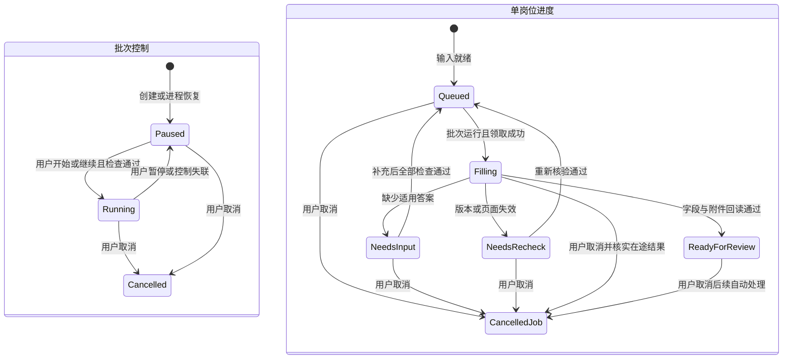

# 确定任务暂停、恢复、取消与去重语义

Type: grilling
Label: wayfinder:grilling
Status: resolved
Interaction: HITL
Assignee: Codex / root
Parent: [独立申请 worker 开发决策地图](../map.md)
Blocked by: 02, 03, 04

## Question

未知问题、浏览器失效、进程崩溃或原记录变化后，worker 如何恢复，且不重复填写或误报投递？

决定单个顺序 worker 的领取和持久化方式；遇到未知问题是继续处理其他岗位还是暂停批次；
用户补充后的触发方式；取消、超时、重启和版本失效的状态迁移。
表单填写、人工提交观察与笔记写回应分别记录，防止写回失败引发再次提交。

## Resolution requirements

使用状态图和故障表。优先现有文件机制和标准库；只在真实需求证明必要时考虑 SQLite。
任务恢复前重新验证岗位、原记录、答案和附件版本。
接收结果不明时不得标为成功或自动重试最终提交。

关闭 TomorrowStar 时暂停批次已经由用户选择，参见
[确定独立运行时与浏览器生命周期](04-runtime-browser-lifecycle.md)。本票确定其正常停止边界、
保存失败、强制退出及重启恢复，不能重新默认关闭 App 后继续处理。

## Comments

### 2026-10-09 — 开始处理：未知问题对批次的影响

运行时契约已解决：现有 Web 控制界面、本地独立 worker、专用可见浏览器；
关闭控制界面暂停，保留仍有效页面。实际连接失效检测与异常恢复属于本票。

第一个产品选择：一个岗位遇到未知问题时，仅该岗位等待，继续其他已具备答案的岗位，
还是整批暂停等待用户补充？推荐只暂停该岗位，在页面容量允许时继续其余岗位。
问题按已解决答案库契约汇总；补充后记录适用范围并复用，不重复询问已解决问题。
这项选择尚待用户回答；本轮没有运行任务或模拟真实投递。

### 2026-10-09 — 用户选择：只暂停该岗位，继续其他岗位

用户原话：“只暂停该岗位，继续处理其他岗位”。

一个岗位缺少适用的已确认答案或需要澄清时，该岗位进入补充等待，保留可续进度和仍有效页面。
其他已满足条件的岗位继续处理；不因一条未知问题将整个批次转为暂停。
同义且适用范围相同的问题可合并为一个补充项，保存后的答案按已解决答案库契约复用。
适用条件或题目含义不同的问题不能为了合并提问而共用答案。

批次全局暂停优先于单岗位就绪：用户点击暂停、关闭控制界面或控制失联后，不再启动新步骤。
单岗位等待解除不能绕过全局暂停。页面容量不足时显示容量等待，不把它误报为未知答案，
也不关闭未复核页面来腾位置。容量配置与原型仍依运行时契约核对。

### 2026-10-09 — 下一问题建议：补充后如何恢复

建议用户保存补充答案后，系统重查题目等价性、适用范围、答案及文件版本，
自动将满足条件的等待岗位恢复到可执行队列。只有批次仍在运行时才继续自动操作；
批次已暂停时只标记可继续，等待用户恢复批次。尚缺其他答案的岗位保持等待。
另一种方式为保存后仍需用户逐岗位点击“继续”。此恢复触发选择尚待用户回答。
本轮只记录决策，没有保存私人答案或启动投递。

### 2026-10-09 — 用户选择：自动恢复满足条件的等待岗位

用户原话：“自动恢复满足条件的等待岗位”。

补充答案成功保存后，重新检查等待岗位的题目等价性、适用范围、答案版本、原记录和附件。
满足全部条件的岗位自动回到可执行队列，无需逐岗位点击继续。
批次仍在运行时按顺序执行；批次已暂停时只标记可继续，等待用户恢复批次。
仍有缺项、版本冲突或页面问题的岗位继续等待，不因保存一条答案而跳过其他检查。

### 2026-10-09 — Resolution comment

用户已选择单岗位等待、其他岗位继续，以及补充后自动恢复符合条件的等待岗位。
结合已解决的关闭后暂停、答案范围和记录写回契约，以下 Answer 定义首版恢复规则。
此前建议保留为交流历史；下方 Answer 是规范答案。
本票完成规划，没有启动 worker、保存私人答案或操作真实招聘页面。

## Answer

### 三种状态分别记录

批次控制、单岗位执行进度和原记录同步结果分别保存。
暂停批次不抹掉某岗位的补充等待或待复核状态；同步失败不回退已完成的浏览器动作。
真实投递状态仍以原申请记录及对应确认来源为准。

图中 Queued 表示具备执行条件，不表示已经开始；批次必须是 Running 才能领取下一步骤。
还有等待原因：页面容量、需要用户处理的登录或页面、配置错误，以及结果待核实。
这些原因可用现有进度加明确原因表示，不为每个原因建立独立队列或状态框架。
待复核不是已投递；人工提交确认及接收证据另行记录。

### 补充后的自动恢复

保存可复用答案后，按其问题含义及实际适用范围重查相关等待岗位。
确认状态、值、条件或版本不一致时不能复用；同义判断不能扩大答案范围。
仍缺其他答案的岗位保持补充等待。已具备全部输入的岗位自动排回原顺序队列。
“仅本次”答案只解除对应岗位的等待，不影响其他岗位。

每次真正执行前再次核对原记录、岗位身份、答案引用及所选文件内容版本。
自动就绪不能绕过批次暂停、取消、页面容量或人工交接。
批次暂停期间可以保存答案并显示就绪，只有用户恢复批次后才能继续自动操作。
单个顺序 worker 每次只执行一个自动步骤；保留多个页面不等于并行填表。

### 暂停、控制失联与取消

显式暂停请求到达 worker 后停止启动下一自动步骤。
已经发出的填写、上传或网站自动保存请求不能承诺撤回；等待有限时长并记录实际结果。
超时或结果无法读取时记录待核实动作，不假定未发送，也不按失败自动重发。
暂停保留批次、进度和仍有效页面。

点击开始或继续的控制页面持有该批次的控制连接。其他窗口可观察，不自动接管。
用户在另一窗口明确继续后可接管，旧连接不能再恢复或控制该批次。
关闭控制页面可尽力发送暂停请求；仍须由后端和 worker 的连接存活检查确认失联。
不能只依赖 beforeunload，也不能把普通网页关闭等同后端退出。

首版采用有限、可配置的失联宽限；建议从 60 秒开始做原型验证，不作为已测指标。
失联确认后暂停新步骤；后端退出也必须触发 worker 的失联暂停，不能继续无控制执行。
后台标签页限流或临时网络中断可能造成保守暂停，重连只显示状态，不自动恢复。
实现必须验证后台标签页、多窗口、休眠和强制退出。不能承诺关闭页面后瞬时停止。
关闭 Codex 不影响此连接。

取消批次或岗位停止其后续自动处理，并保留已发生动作、结果和待同步信息。
取消不撤回招聘方已收到的字段或附件，也不撤销用户已经完成的投递。
取消后不自动重新入队；再次尝试须由用户发起并重新检查重复申请及原状态。
正常取消不自动关闭待复核页面；页面仍可由用户自行处理。

### 文件持久化、领取与去重

复用现有 JSON、原子文件替换、内容摘要和 Job Apply helper；不新增数据库或工作流框架。
私人运行记录保存批次控制、申请 ID、输入版本、已观察页面进度、未核实动作和待同步结果。
答案继续由答案库拥有；运行记录使用引用及版本，避免复制一份可复用事实库。
“仅本次”答案只在当前任务使用；丢失后重新请求该答案，不自动转成长期保存。

用标准库文件锁保证同一私人运行根只有一个 worker 持有执行权，并覆盖其整个运行期。
不以 PID 文件或旧的 running 字段代替互斥锁。
所有系统答案及笔记写入经同一共享锁协议串行化，并保留现有进程内锁、revision 检查及备份。
复用已研究的 fcntl.flock 模式；其现有 campaign 锁不能直接视为答案库或笔记已受保护。
不参与协议的旧 helper 直接写入须明确禁止并发使用。不能声称已锁住 Obsidian。

每个非最终步骤在执行前保存意图，执行后保存观察结果。
崩溃可能发生在招聘方收到数据与本地保存结果之间，因此不承诺浏览器动作恰好执行一次。
重启后批次默认暂停。用户继续时，先核对实际页面和所有输入，再决定是否需要该步骤。
字段已符合绑定值时跳过重填；附件或自动保存结果不明时先核实，不盲目重传。
不能把旧 DOM 快照、cookies 或文件名当成完整草稿恢复证据。

同一规范化岗位只能有一个未结束的任务；沿用现有重复检查并在领取时再次核验。
原记录已投递、已确认收到或提交结果待核实时不再启动填表。
最终 Submit 始终由用户完成；恢复流程没有自动提交或自动重试最终提交路径。

### 故障与恢复表

| 事件 | 保存及停止范围 | 恢复条件 |
| --- | --- | --- |
| 未知问题或答案冲突 | 该岗位补充等待；其他就绪岗位继续 | 补充后自动重查；全部条件通过且批次运行时继续 |
| 原记录、答案或简历变化 | 对应岗位等待重新核验；旧计划失效 | 重新读取并绑定有效输入；必要时由用户重新选择文件 |
| 页面容量已满 | 保留待复核及等待页面；不领取新页面 | 用户释放页面后重查容量；不能关闭未复核页面腾位置 |
| 页面、浏览器或认证失效 | 保存该岗位实际进度；页面丢失不等于任务完成 | 用户处理必要登录，重建并回读页面与附件；已投递或结果不明则停止 |
| 关闭控制页面、控制失联或休眠 | 暂停整个批次；保留有效页面 | 重连呈现暂停状态；用户继续后重新核验 |
| worker 崩溃或运行状态保存失败 | 不再发新动作；保存失败不能报告已可靠暂停 | 取得唯一执行锁；重启为暂停；核实未完成步骤后由用户继续 |
| 原记录写回失败或后端不可用 | 保留浏览器进度和待同步结果；不因失败重跑 | 后端恢复后仅重试写回；先检查原记录 revision |
| 外部编辑冲突 | 停止该记录写回及后续旧计划；保留用户内容与待同步结果 | 重新读取并处理冲突；系统自己的成功写回可更新绑定 revision |
| 人工提交结果不明或缺少接收证据 | 记录待核实；不报告成功，不重新填写或提交 | 用户核实实际提交情况；接收证据按单独来源记录 |
| 用户取消 | 停止所选范围后续自动处理；保留历史、页面及待同步结果 | 无自动恢复；再次尝试须用户发起并检查原记录 |

### 必须验证的合成案例

- A 缺少答案时等待，B 继续；保存适用答案后 A 自动恢复，不另点继续。
- 同一次补充只解除其适用范围内的等待；尚缺其他答案的岗位继续等待。
- 整批已暂停时保存答案，岗位就绪但浏览器无新自动动作。
- 两个 worker 启动时只有一个取得执行权；系统并发保存答案不丢更新。
- 在动作前、请求后和结果保存前分别中断，恢复前核实实际页面，不盲目重发。
- 写回失败只重试同步；自己的成功同步更新绑定 revision，外部变更仍触发冲突。
- 多窗口、后台标签页、失联、休眠和强制退出不能自动解除暂停。
- 取消不改变已投递事实；所有正常及故障路径的自动最终提交次数为零。

这些是开发规则和验收要求，尚不是独立 worker 的测试结果。
