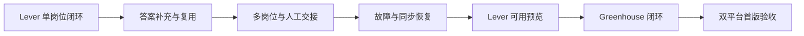

# 确定首版验收条件与开发顺序

Type: grilling
Label: wayfinder:grilling
Status: resolved
Interaction: HITL
Assignee: Codex / root
Parent: [独立申请 worker 开发决策地图](../map.md)
Blocked by: 05, 06, 07

## Question

哪些证据足以证明首版值得进入真实小样本试点，开发应先完成哪条最小完整流程？

依据前面的契约，确定独立进程、答案复用、未知问题补充、崩溃恢复、原记录冲突、
零自动最终动作、人工页面交接的验收标准。决定先 Lever 还是 Greenhouse 的完整流程，
再扩展第二平台，不把实现分成彼此不可验收的大层。

## Evidence and assets

- [现有三轮合成测试](../../../validation/application-automation/2026-10-09/three-rounds-01/README.md)验证 Codex 接入，不是独立 worker 的验收。

## Resolution requirements

给出开发执行顺序、每步进入 / 退出条件和明确停止条件。
合成测试、真实 ATS 填写和真实接收分别报告。
必须包括“首次补充并保存，第二次匹配不再询问，修正后旧值不再使用”的验收场景。
答案场景应采用[确定申请答案库的复用范围与更新规则](02-answer-library-contract.md)中的
合成验收表，覆盖自动同义复用、不确定时澄清、敏感答案复用及“仅本次”例外。
真实小样本是后续用户明确指定岗位、资料与发送范围的执行任务。

## Comments

### 2026-10-10 — 开始处理：可审查的首版开发顺序

用户已选择 A，交接票解决；本轮领取最后一张决策票，不在同一轮解决第二张 HITL 票。
先给出按已确认契约形成的开发与验收提案，再请用户选择可用预览的交付方式。

现有三轮 Codex 合成回放含 Lever 完整及缺答场景、Greenhouse 完整场景。
因此建议先利用 Lever 的正反夹具完成一条端到端流程，再复用公共机制接 Greenhouse。
这个顺序基于现有本地资产，不声称已测得某平台更容易或更可靠。

### 2026-10-10 — Resolution comment

用户确认：“先提供 Lever 可用预览，再接 Greenhouse。”
采用下述开发顺序和验收门槛。Lever 完成闭环及对应故障检查后先交付可用预览，
再扩展 Greenhouse；双平台验收通过后才完成首版。
本票解决最后一个开发前决策，未执行 worker 实现或真实申请。

## Answer

### 最小完整流程与开发顺序

每步以可观察行为结束，避免先建设整层基础设施再等待可用流程。
所有个人资料、运行记录、认证状态及原始调用输出继续保存在显式私人目录。

| 步骤 | 本步交付的完整行为 | 进入条件 | 退出条件 |
| --- | --- | --- | --- |
| 1. Lever 单岗位闭环 | 原记录勾选、明确选择简历、检查版本、独立进程填合成页面、回读、人工复核入口和 next_action 同步 | 已解决契约与固定上游／工具版本；只使用隔离合成资料 | 从 checkout 启动可重复跑完整流程；关闭 Codex 不影响执行；原状态保持 drafting；自动最终动作 0 |
| 2. 答案补充闭环 | 未知问题进入 A 的集中补充区；保存、受限同义判断、按范围复用与自动恢复 | 单岗位流程已通；共用写入及答案实际 scope 校验可用 | 首次补充后保存，后续匹配不再询问；修正后旧值失效；关键反例不复用；仅本次不进入信息库 |
| 3. 多岗位与人工交接 | 单个顺序 worker 处理多项；逐岗位附件；只让缺答岗位等待；暂停及可见页面保留 | 答案闭环已通；页面容量受控 | 保存解除适用等待；整批暂停不因答案就绪而执行；交接页面不再自动改写；关闭控制界面按契约暂停 |
| 4. 故障与同步恢复 | 执行锁、断点、版本失效、取消、页面丢失、控制失联与待同步重试 | 多岗位闭环可重复；浏览器结果与原记录同步分开保存 | 两实例仅一个取得执行权；并发系统写入不丢答案；冲突保留结果；结果不明不盲目重发或伪报成功 |
| 5. Greenhouse 闭环 | 复用已通过的队列、答案、界面与写回，只补平台字段及非最终动作适配 | Lever 闭环及故障检查通过；明确平台夹具与上传路径 | Greenhouse 独立通过完整、缺答、页面变更、附件与最终动作守卫场景；不以 Lever 通过代替 |
| 6. 双平台验收与真实试点准备 | 重跑独立 worker 的三轮主场景及必要故障场景，形成可复现报告和受控小样本入口 | 两平台实现可用，下面的共同验收门槛全部有对应证据 | 明确列出已通过／未做／失败；满足真实填写前置条件；正式发布或实际资料发送仍为后续执行 |

运行时与存储从实际闭环需要开始实现。复用已有 helper、链接识别、原记录更新、哈希、
标准库文件锁及 Codex 子进程模式；不先新增数据库、通用代理或多服务商框架。
实际出现公共机制重复时才抽取，平台字段映射保留各自验证。

首版目标仍包含 Lever 与 Greenhouse；Lever 可用预览不等于双平台首版完成。
先从当前 checkout 的 Web 入口启动并验证。现有原生 App 验收不证明新 worker 已打包；
若后续交付安装包，必须另验依赖、浏览器 build、路径与签名，不沿用旧 App 结果。

### 共同验收门槛

| 门槛 | 必须出现的证据 | 不足以通过的证据 |
| --- | --- | --- |
| 独立执行与可见浏览器 | 实际 worker 进程持有浏览器，关闭 Codex 后仍处理合成岗位；控制界面关闭／失联后按契约暂停 | Codex 浏览器回放、CLI help 或仅进程已启动 |
| 输入与附件绑定 | 原 ID／revision、规范化岗位、逐项文件摘要及实际上传回读对应；未选资料不发送 | 文件名相同、resume_version 说明或上传按钮成功 |
| 答案闭环 | 首次补充与再次复用、修改／撤回、范围例外、敏感值及仅本次的逐项结果 | helper 查到值、模型说高置信或仅一次填表成功 |
| 模型判断与数据范围 | 固定规则／schema／工具版本；题目、条件和选项反例；受限读取与工具能力验证；调用只含已批准元数据 | JSON 输出合法、read-only 字样或未在一次运行中观察到工具调用 |
| 执行与恢复 | 确定性中断及竞争场景，包括请求后结果保存前中断；先核实页面再恢复 | 顺序单元测试、旧 running 标志或自动重跑全批 |
| 原记录同步 | 同一受控写入入口、系统写入锁与 revision 冲突；待同步结果在重启后仍可只重试写回 | 进程内 RLock、文件原子替换或未发生并发的成功写入 |
| 人工最终动作 | 全部自动路径最终动作数 0；真实页面交接后用户可编辑及提交，worker 不再控制该页 | prompt 禁止 Submit、按钮黑名单或只测正常路径 |
| 界面 A | 正式后端连接；保存失败保留输入；范围与仅本次明确；键盘、窄屏、暂停、容量及冲突可辨认 | 用户选择布局或合成演示的 JavaScript 语法通过 |

Obsidian 不参与系统共享锁协议，不能把现有 revision 复查称作完整编辑器事务。
检测到外部变更时停写并保留待同步结果。记录最后复查到替换之间仍存在的故障窗口；
不能承诺任意外部编辑器竞争下无损。真实试点前须核对这一部署限制和相应操作范围。

关键反例包括不同国家、当前／未来、工作资格／sponsorship、选项反义、多个冲突答案、
文件版本变化、原记录变化、认证中断、页面新必填项和无法确定的提交结果。
所有必需案例通过，且自动最终动作、未选资料发送及错误范围复用均为零，才进入真实填写。
失败或缺证据不能按“不适用”计成通过；预期阻塞案例应明确记录其成功阻止了什么。

### 三轮主场景与真实样本

独立 worker 重新跑 Lever 完整、Greenhouse 完整及缺失确认答案的三轮主场景。
复用原合成夹具和检查思路，同时加新 worker 的进程、答案版本、写回及控制连接观测。
原回放结果仍保留，不把新验收写成旧报告的重新解释。

真实试点建议先每平台 1 个用户指定岗位；检查填表与人工交接后，再考虑各 3 个的小批次。
这是待执行样本建议，不是实际岗位选择、资料发送授权或申请成功率保证。
每次实际发送前通过批次预览确定目标、每岗位附件与确认答案范围。
岗位关闭、已有申请、未支持页面、CAPTCHA／MFA、字段不明确、版本变化和结果待核实均按既有契约停止。

报告按平台与模式分别给出岗位数及分母：完整填写、未知问题、人工修改、字段／附件错误、
页面失效、范围误匹配、同步冲突、模型调用及耗时。人工提交与可核验接收分别统计。
“未人工提交”或“未观察到回执”不能计成模型／填写成功后的自动接收。
小样本仅支持当前样本结论，不建立跨平台长期无人值守可靠性。

### 当前尚未完成的验证

此前三轮是 Codex 接入的合成浏览器回放；答案库研究另有合成探针。
交接 A 已由用户选定，但临时 Chrome 在 CDP 前退出，界面浏览器交互未验证。
独立 worker、受限 Codex 判断、Playwright 执行、真实附件传输及真实接收均尚未验收。
本票的规划工作没有执行这些步骤，也没有重跑现有测试套件。

### 分步交付与完成边界

1. 完成步骤 1–4，并通过 Lever 对应的共同门槛与必要反例，提供 Lever 可用预览。
   预览必须由实际独立 worker 和正式后端驱动，包含答案补充、复用、自动恢复与人工交接。
   只完成基础填表或展示合成界面，不能算可用预览。
2. 预览明确标注仅支持 Lever，并列出合成验收结果及尚未完成的真实 ATS 验证。
   Greenhouse 开发不阻塞 Lever 预览；真实 Lever 填写仍按本票前置条件和批次范围执行。
3. 再完成步骤 5–6。Greenhouse 自身的场景和双平台验收全部通过，才完成首版。
   真实接收、安装包和后续扩大样本各按自身证据报告。

