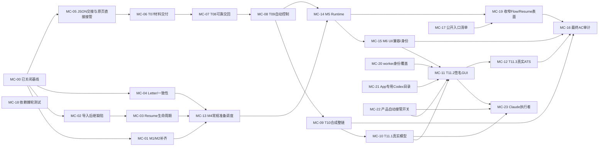

# Module 设计剩余开发与最终验证

更新：2026-10-29，Europe/Zurich（MC-10 按一般场景结案；MC-11 安装版已更新、待 GUI 实际使用核对；MC-23 暂缓至 MC-11 之后）。原 10-27 记载：**R6 本轮全量离线与隔离合成浏览器验收已完成；
剩余开发和最终 AC01–AC27 整体验收未完成。** 当前交接见
[ACTIVE-HANDOFF.md](../remaining-tickets-2026-10-26/ACTIVE-HANDOFF.md)（[current-handoff.md](current-handoff.md) 为 2026-10-27 历史）。

**此前三票后继已按源码/合成范围结案。** 同一 665 文件快照完整默认离线
7,722 passed、2 skipped，随后相关隔离浏览器 89 passed；JUnit 精确覆盖，源码
运行前后不变。独立审查及修正闭环，见
[本轮实施与验收](../mc01-mc02-mc04-implementation-2026-10-26/README.md)。

目标：完成正式设计的剩余开发，再做完整测试和独立审计。此前 T01–T03 的证据保留，
不把它们重新命名为全库已完成。没有真实申请、安装 App 更新或默认页面写入授权（2026-10-29 用户为 MC-11 授权并完成安装版更新）。

权威需求：[Module 设计](../../docs/module-interfaces-and-migration-design.md)、
[产品规则](../../docs/single-job-flow.md)、[开发计划](../../docs/development-plan.md)。

**此前 Resume 生命周期后继已结案。** 同一 668 文件快照完整默认离线
7,755 passed、2 skipped，随后相关隔离浏览器 102 passed；独立审查、修正和精确覆盖
见[实施报告](../mc03-resume-lifecycle-2026-10-26/README.md)。

**此前常规准备与岗位调度后继已结案。** 同一 672 文件快照完整默认离线
7,804 passed、2 skipped，随后相关隔离浏览器 152 passed；独立审查修正与精确覆盖见
[实施报告](../mc13-preparation-scheduling-2026-10-26/README.md)。当前 MC05 原 T06 已按受控 agent/合成原 Page/实际 native 工具层结案，MC06 已于 2026-10-27 按普通页面范围结案（离线 8100/3 skips、浏览器 281/5 skips、实际 native 7/0 + Ashby 1 skip；独立审查 READY），见[MC06 结案](issues/06-t07-bound-material-delivery.md#comments)；MC07 已于同日结案（离线 8166/3 skips、浏览器 281/5 skips、实际 native 6/6；独立审查 READY），见[MC07 结案](issues/07-t08-return-and-completion.md#comments)；当前机械前沿为 MC08。MC08 已于同日结案（离线 8290/3 skips、浏览器 305/5 skips；复审 READY），见[MC08 结案](issues/08-t09-app-dispatch-controls.md#comments)。
[最终验收](../remaining-tickets-2026-10-26/mc05-native/final-acceptance-r5.md)：同一1799项快照，
完整offline 7843/2 skips、affected browser 224/5 skips、实际native 8/0；独立证据审查通过。
JSON交接不要求截图解释进度，原Page单控制者接续与unknown/撤权/保存失败边界均已验证。
实际模型、安装App、真实ATS及T07/T08仍各按原票，不外推完整M4或最终AC。
历史开发经过见[关闭前交接归档](current-handoff-before-mc05-closure-2026-10-27.md)；
失败及两份旧静态日志覆盖例外见最终验收。正式契约继续只在
[Module设计](../../docs/module-interfaces-and-migration-design.md#codex-takeover-json-contract)维护。

## 已完成的 R6 验收基线

| 范围 | 结果与边界 |
| --- | --- |
| 全量默认离线 | 7,460 项：7,458 passed、2 skipped；零失败/错误 |
| 隔离合成浏览器 | 615 项完整覆盖：594 passed、21 skipped；零失败/错误 |
| 源码与静态检查 | 同一 652 文件快照运行前后相同；先离线后浏览器，无重叠；Ruff、格式与 diff 检查通过 |
| 跳过项 | 2 个 PDF 性能基准、16 个 measurement baseline 和 5 个 native Cua，均需显式 opt-in，本轮未启用或执行 |

证据见[正式验收](../../docs/module-interfaces-and-migration-design.md#2026-10-26-修复与整批验收)、
[R6 汇总](serial-r6-verification-summary.md)与[机器记录](final-verification.json)。
旧失败与中断记录保留。此基线不证明真实模型、原生 Cua、签名 GUI 或真实 ATS 验收，
也不关闭以下剩余任务。

## 当前票据与硬依赖

本轮票据位于 `issues/`，由现有 `scripts/query_tickets.py` 自动读取。共 **24 张（MC-00–23）：
1 张已关闭的基线登记、19 张已结案工作票（MC-01–10、13–15、17–22；MC-10 于 2026-10-29 按一般场景结案）、4 张 open（MC-11 已领取并安装；MC-12/16/23 未领取）；MC-20/21/22 已于 2026-10-28/29 结案**
（其中 MC-17–19 为 2026-10-27 架构审计补充）。MC 编号只属于本轮，
不与旧稳定性测试的 T 编号混用。T01–T05 已交付内容登记在 MC-00，不重复建实现票。
M1/M2 当前归属核对及条件采用由 MC-01 结案，后续统一控制/调度按具体方法承接到
MC-08/13；M3 Analysis 已审范围无未关闭 finding。导入后继缺口与信件契约由
MC-02/04 结案，完整 Resume 生命周期已按本票源码/合成范围结案，见
[收拢 Resume 准备、版本和 PDF 生命周期](issues/03-resume-lifecycle-interface.md#comments)。

`Blocked by` 是开始该票实施/验收的硬前置：必须交付并关闭；需求阅读、证据清点和
不写代码的接口核对可提前进行。共享文件冲突不伪装成需求依赖，按下节协调。
机械 frontier 只表示依赖满足，不代表本次已领取、模型/安装/真实站点运行获授权。

| 票据 | 范围 | 当前状态 | 硬前置 |
| --- | --- | --- | --- |
| [MC-00 登记已交付切片与 R6 源码基线](issues/00-r6-source-baseline.md) | 已交付切片/R6 | closed；限定源码/合成范围 | 无 |
| [MC-01 核对并补齐 M1/M2 剩余职责迁移](issues/01-m1-m2-remaining-ownership.md) | 归属与条件采用 | closed；源码/合成验收 | MC-00 |
| [MC-02 修复映射导入材料的 Prism 人工后继](issues/02-mapped-import-prism-successor.md) | 导入后继修复 | closed；源码/合成验收 | MC-00 |
| [MC-03 收拢 Resume 准备、版本和 PDF 生命周期](issues/03-resume-lifecycle-interface.md) | 材料生命周期 | closed；源码/合成验收 | MC-02 |
| [MC-04 收拢 CoverLetter 与材料一致性契约](issues/04-letter-material-contracts.md) | 信件与一致性 | closed；源码/合成验收 | MC-00 |
| [MC-05 JSON 交接与 Codex 原页直接接管](issues/05-t06-visual-actions.md) | T06 原页接管 | closed；native/合成验收 | MC-00 |
| [MC-06 T07 交付已绑定正文与附件](issues/06-t07-bound-material-delivery.md) | T07 材料交付 | closed；普通页面源码/合成/native 验收，Ashby/Workable 早期上传移入 fog | MC-05 |
| [MC-07 T08 可靠交回与填写完成](issues/07-t08-return-and-completion.md) | 剩余工作 | closed；源码/合成/native 验收（自定义下拉框见 fog） | MC-06 |
| [MC-08 T09 App 自动派发与统一控制](issues/08-t09-app-dispatch-controls.md) | 剩余工作 | closed；源码/合成验收（产品默认关闭，开启见 MC-22；App 内接管提示经 MC-15 实现，安装版待 MC-11） | MC-07 |
| [MC-09 T10 新产品路径合成整链与故障验收](issues/09-t10-synthetic-chain.md) | 剩余工作 | closed；源码/合成/native 验收 | MC-08 |
| [MC-10 T11.1 实际 Codex 与同一合成原页验收](issues/10-t11-model-synthetic-page.md) | 剩余工作 | closed；一般场景实际验收（C0/C1 真实通过；C2 已知局限；C3–C5 以受控证据为准，用户决定） | MC-09 |
| [MC-11 T11.2 唯一签名 App 新接管链验收](issues/11-t11-signed-gui.md) | 剩余工作 | open；2026-10-29 安装版已更新（单一 driver `ba1541e7…`，verify／签名／权限检查通过），待 GUI 实际使用核对 | MC-10、MC-15、MC-20、MC-21、MC-22 |
| [MC-12 T11.3 获授权真实 ATS 新接管链验收](issues/12-t11-real-ats.md) | 剩余工作 | open；未领取；分层运行范围另核 | MC-11 |
| [MC-13 M4 收拢剩余准备与岗位调度职责](issues/13-m4-preparation-scheduling.md) | 常规准备/调度 | closed；源码/合成验收 | MC-01、MC-03、MC-04 |
| [MC-14 M5 收拢 Runtime 装配与 Portal 传输](issues/14-m5-runtime-portal.md) | 剩余工作 | closed；源码/合成验收（测试按 Module 迁移延后至 MC-19） | MC-08、MC-13 |
| [MC-15 M6 后端投影、调用兼容与运行身份](issues/15-m6-ui-compatibility-identity.md) | 剩余工作 | closed；源码/合成验收（worker 角色覆盖缺口见 MC-20） | MC-14 |
| [MC-16 最终 AC01–AC27 证据审计与整体验收](issues/16-final-ac01-ac27-audit.md) | 剩余工作 | open；未领取 | MC-09、MC-12、MC-15、MC-19 |
| [MC-17 登记核心 Module 公开入口与当前有效索引](issues/17-public-entry-index.md) | 文档：入口清单/当前有效索引 | closed；文档验收 | 无 |
| [MC-18 依赖棘轮测试，禁止新增循环导入与跨模块私有访问](issues/18-dependency-ratchet.md) | 新增离线检查测试 | closed；默认离线测试验收 | 无 |
| [MC-19 收回 Flow / Resume 的外部私有访问并迁移内部状态测试](issues/19-narrow-flow-resume-surface.md) | 接口收窄 | closed；源码/合成验收（剩余测试迁移见 fog） | MC-14、MC-17 |
| [MC-20 补齐 worker 运行身份对材料核验代码的覆盖](issues/20-worker-role-coverage.md) | 运行身份 | closed；源码/合成验收（native 未运行：无驱动层改动） | 无 |
| [MC-21 正式 App 的 Codex 使用专用目录而非用户本人 HOME](issues/21-app-codex-home.md) | 模型上下文边界 | closed；源码/合成验收，用户已在专用目录登录 | 无 |
| [MC-22 决定并接通产品中的自动接管开关](issues/22-product-native-assistance-policy.md) | 产品开关 | closed；源码/合成验收，安装版随 MC-11 生效 | 无 |
| [MC-23 Claude 作为接管执行者](issues/23-claude-takeover-executor.md) | 第二执行者 | open；未领取；暂缓至 MC-11 之后（用户决定，不阻塞 MC-11） | MC-10、MC-22 |

**2026-10-28 工作审计补充：** 依据[工作审计](../work-audit-2026-10-28/README.md)，经用户同意新增 MC-20–22（原 fog 中已可精确陈述、
标“MC-11 前处理”的两项，以及 MC-08 默认关闭后无人负责的产品开关），均加入 MC-11 的 Blocked by。原状态、认领和验收不变。

## Decisions so far

- [跳过 MC-23](issues/23-claude-takeover-executor.md#comments)：Claude 执行者不阻塞 MC-11，改到 MC-11 之后。
- [安装版单一 driver 并安装](issues/11-t11-signed-gui.md#comments)：只带新版 driver（release、keychain 补丁、固定身份签名），脚本与接管共用；用户授权构建并更新唯一主 App。
- [实际 Codex 一般场景验收](issues/10-t11-model-synthetic-page.md#2026-10-29-结案一般场景跑通claude-code-4ca66ce5root)：真实模型在合成原页读页、按确认答案填写、不提交；为此换受限元数据 driver、回报 schema 改 strict、四个工具预批准；边角场景边用边优化。
- [产品中的自动接管开关](issues/22-product-native-assistance-policy.md#comments)：默认开、设置可关；先过 MC-10 再随 MC-11 打开；不可用即停下说明原因、不重试不换执行者；执行者可选 Codex 或 Claude（Claude 经 `claude -p`、订阅登录于专用目录、版本固定，另开 MC-23）。

- [正式 App 的 Codex 使用专用目录](issues/21-app-codex-home.md#comments)：模型调用与接管共用专用 HOME，按条目名拒绝个人上下文、未登录即停止且不回退到 `~/.codex`；用户已登录。

- [补齐 worker 运行身份对材料核验代码的覆盖](issues/20-worker-role-coverage.md#comments)：每个角色须含其全部静态包导入闭包，worker 记录身份前预载整个角色；运行时身份与构建测量跨进程一致。

- [M6 后端投影、调用兼容与运行身份](issues/15-m6-ui-compatibility-identity.md#comments)：页面状态投影移入 `application_flow_view`，接管提示在窗口内显示，老调用方经测试锁定，运行身份按角色覆盖（worker 缺口记入 fog）。
- [收回 Flow / Resume 的外部私有访问](issues/19-narrow-flow-resume-surface.md#comments)：外部私有访问改用公开入口或登记 Module 内部理由，内部状态断言改走公开视图，新增私有调用计数棘轮。

- [M5 收拢 Runtime 装配与 Portal 传输](issues/14-m5-runtime-portal.md#comments)：Runtime 负责装配与关闭，Portal 只做 HTTP 并调用公开入口；`pipeline.request` 删除；业务规则测试按 Module 迁移延后至 MC-19。

- [T10 新产品路径合成整链与故障验收](issues/09-t10-synthetic-chain.md#comments)：真实页面上脚本 → 自动接管 → 读回结算 → 交回脚本 → 第二次接管填完 → 等手动 Submit 的整链在浏览器与原生层通过；补修会话内第二次交接与丢失保存后的 Continue。

- [T09 App 自动派发与统一控制](issues/08-t09-app-dispatch-controls.md#comments)：脚本处理不了就自动交给 Codex（仅事实缺失走信息库），每次 Continue 至多一次接管且须填完，能力失败不重试；所有控制经 Pipeline 命名方法，材料编辑先确认停写。

- [T08 可靠交回与填写完成](issues/07-t08-return-and-completion.md#comments)：Codex 以带版本 JSON 回报，Worker 停写、排空、收回会话并只读核对后才交回脚本（每岗最多一次）或记填写完成等待手动 Submit；迟到报告只留历史，存盘丢失只重存原结果。

- [T07 交付已绑定正文与附件](issues/06-t07-bound-material-delivery.md#comments)：普通页面经新原生工具交付固定正文/附件并独立回读；未知不重放、无效目标不算完成；Ashby/Workable 早期上传因 Chrome 不暴露磁盘文件字节而 fail closed，移入 fog。

- [M4 收拢剩余准备与岗位调度职责](issues/13-m4-preparation-scheduling.md#comments)：Flow 拥有普通及候选准备，Pipeline 保持单岗调度，Worker 提供固定执行许可；取消与未知保留原材料和历史，新接管控制仍由原票负责。

- [收拢 Resume 准备、版本和 PDF 生命周期](issues/03-resume-lifecycle-interface.md#comments)：准备/复用、模板、完整版本与 PDF 副作用归 Resume；原尝试恢复不重放未知，Flow 保留任务准入与采用。

- [核对并补齐 M1/M2 剩余职责迁移](issues/01-m1-m2-remaining-ownership.md#comments)：执行材料条件采用收回 Worker，剩余控制/调度由原后续票承接。
- [修复映射导入材料的 Prism 人工后继](issues/02-mapped-import-prism-successor.md#comments)：真实映射与槽位模板支持人工后继及保留写作，原来源与历史保持。
- [收拢 CoverLetter 与材料一致性契约](issues/04-letter-material-contracts.md#comments)：信件生命周期归所属模块，一致性检查绑定当前准确版本对。
- [依赖棘轮测试](issues/18-dependency-ratchet.md#comments)：基线记录 20 对互相导入与 87 项跨模块私有名导入；新增即失败，消除时同改动收紧基线。
- [登记核心 Module 公开入口与当前有效索引](issues/17-public-entry-index.md#comments)：七个 Module 的入口按当前代码实际调用登记，私有访问逐项归 MC-08/14/19；入口说法以 10-26 设计“日常入口是 App”为准。

## 2026-10-27 架构审计补充

依据[架构审计](../work-audit-2026-10-27/architecture-audit.md)（深模块与灰盒设计）：

- 新增 MC-17（公开入口清单与当前有效索引）、MC-18（依赖棘轮测试）：均无前置，只改文档或新增测试，可与 MC-06 并行。
- 新增 MC-19（收回 Flow / Resume 的外部私有访问）：在 MC-14 之后，作为 MC-16 的新增硬前置。
- MC-06、MC-08、MC-14、MC-16 各追加“2026-10-27 架构审计补充”，原状态、认领和原验收不变；
  仅 MC-16 的 Blocked by 增加 MC-19。

### Notes

- 约定：每张 MC 票结案时同步更新 MC-17 的[入口清单与计划收回表](../../docs/codebase-responsibilities.md#public-entry-points)、
  [当前有效索引](../../docs/current-index.md)（入口约定、契约位置或取代关系改变时）和 MC-18 的基线。

### 尚未细化

- 业务模块直接抛出含 HTTP 状态码的 `PortalDataError`（49/62 个 `application_*` 模块）：是否把状态码与文案映射集中到 Portal，
  等 MC-14 完成后视 Codex/CLI 调用者的实际需要再定。
- 现有 20 对循环导入的拆除：MC-18 只阻止新增；是否以及按什么顺序拆除，待 MC-14/19 完成后依剩余数量判断。
- **Ashby / Workable“选完文件即自动上传”与原生文件交付的组合**（2026-10-27 用户决定暂缓，MC-06 只保证普通页面）。
  - 原因：原生驱动用 `DOM.setFileInputFiles` 放入落盘的封存 PDF；Chrome 交给拦截器的请求体里**不含磁盘文件内容**
    （实测文件段 0 字节）。Worker 守卫对已批准写请求用 `route.fetch` 自行转发，转发的就是这份缺内容的请求体，
    所以既无法按哈希核验，放行也会把空文件发给服务器。当前 `DraftSession.allows` 一律拦截（fail closed，页面停止），
    回归 `test_upload_with_browser_hidden_file_bytes_fails_closed`；原生用例 `material_upload_lost` 标记 skip。
    普通页面不受影响：文件留在上传框，直到用户手动 Submit 时由浏览器自行发送。
  - Workable 目前仍走旧的非原生上传（内容可见），由[原 Workable 票](../single-job-application-flow-2026-10-16/issues/20-workable-resume-upload.md)负责；
    若改为原生交付会遇到同一问题。
  - 可能的解决办法：① 守卫在转发前把文件段填回本次封存的 PDF 字节（重核 sha256），保留不跟随重定向的保护；
    ② 仅这一个已批准上传改为 `route.continue_()` 由浏览器发送，代价是失去重定向保护；
    ③ 用系统化命名规则（用户提议：资料库已确认姓名 + 岗位 + 文件类型 + 日期，如 `{姓名}-{岗位}-cover-letter-{日期}.pdf`）
    作为文件名核对依据，需与 ① 或 ② 搭配，单独不能解决空文件问题。
  - 证据：[MC-06 开发原生运行与诊断](../remaining-tickets-2026-10-26/mc06-bound-materials/acceptance/README.md)。
- **原生工具对自定义下拉框的操作范围**（2026-10-27 MC-07 原生开发运行发现）。MC-05 已验收的原生点击策略只允许点击：
  `<select>` 或空的文本/搜索 `input` 型 combobox、`summary`/disclosure；拒绝点击 `option` 选项、`<button role=combobox>`，
  且任何已有显示值（含占位文字，如 “Select a country”）的控件都按“已有内容”拒绝。`browser_type` 只接受与该字段已确认事实
  相同的文本。因此 Codex 能打开部分下拉框、往空输入框输入，但**不能从自定义列表中选择选项**，真实站点上常见的自定义下拉框
  （按钮型、带占位文字、需点选项）仍无法由原生接管完成。
  - 可能的解决办法：在驱动中为 listbox/option 增加“点击后可回读选中值”的受证明点击路径（与 disclosure 的展开回读同理）；
    对带占位文字的控件区分占位与真实值；或支持键盘选择（方向键/Enter）并回读。均需改动已验收的原生契约与 Rust 代码，并重新原生验收。
  - MC-07 的合成验收改用“输入即选定”的 input 型 combobox，只证明交回/完成链路，不代表自定义下拉框已可用。
- **原生测试浏览器的外部连接**（2026-10-27 MC-09 原生开发运行发现，用户决定先接受并记录）。候选驱动启动的 Chrome 未加
  `--disable-background-networking`，启动即连接 Google 服务；导航到合成地址（如 `jobs.lever.co/...`，内容由本机 loopback 提供）时
  Chrome 会对真实主机做 DNS 与 TCP 预连接（`:443` 连接保持，很可能完成 TLS 握手/SNI），页面层面不发送任何请求内容。页面层面的隔离成立，socket 层面不是严格离线。
  - 可能的解决办法：驱动启动参数加入关闭后台联网与预连接（需改 Rust、重建候选并重跑受影响的原生验收）；或合成测试改用保留域名并让 ATS 识别接受测试域。

- **测试与接口收窄的剩余项**（2026-10-28 MC-19 结案记录，未分配后续票）：约 67 处 `flow._save` 状态重放与 145 处 `pipeline._tick`；
  full-LaTeX/group-review/reviewed-LaTeX/renderer/unknown-manifest 的 HTTP 规则链（MC-14 审计补充 3 的剩余部分）；无外部调用的 Flow 公开方法收窄；
  私有调用计数只覆盖指定接收者名。是否另开票及顺序，待 MC-16 前视剩余量决定。
- **页面仍自行判断的阶段规则与 MC-15 开放点**（2026-10-28 MC-15 结案记录）：`application_flow.js` 剩余的本地阶段状态读取、`app.js` 概览卡读旧通知字段、
  App 不识别 `single-flow-required`、`public_site`/`validation.models` 不可规范化。（worker 角色覆盖缺口已于 2026-10-28 升为 [MC-20](issues/20-worker-role-coverage.md)。）
- **worker 安装身份未在 worker 内强制**（2026-10-28 MC-20 审查发现，早于 MC-20）：`application_worker_browser.py` 解析但从不校验
  `--expected-worker-revision`，`require_packaged_worker_identity` 无生产调用方；安装身份目前只在 `application_readiness` 中比较。MC-11 前应确认是否需要在 worker 内拒绝不符身份。
- **MC-21 留存项**（2026-10-28 结案记录）：界面仍是通用失败文案（登录命令只在错误记录与文档中）；研究/校准 CLI 亦受新 exec 参数影响；检出版 `career_portal`
  启动器不设专用目录；后端启动登录检查只捕获 `CodexCLIError`；MC-10 的 `mc10-codex-home` 需另行登录。2026-10-29 已让 `tests/codex_live_guards.py` 复用 `validate_codex_home`。
- **MC-10 留存（2026-10-29 结案，边用边优化）**：C2 被遮挡且 pending unknown 的字段模型不补填、driver 拒绝原因未回传；C3–C5 无真实模型证据；产品默认请求超时 2 s 低于实测 thread/start 约 5 s——已于 2026-10-29 改为 thread/start 单独 15 s（MC-11 前置）；`codex --version` 冷启动仍 2 s（P3）；安装版随附单一 driver successor-r3-signed `ba1541e7…`（脚本与接管共用，2026-10-29）；实际 Codex 运行均用 debug `eb298be3…` 与源码 `c98544fe`，`ba1541e7…` 尚无实际 Codex 运行；脚本路径“最小化”测试期望过时、worker 停止退出较慢（待安装后观察）。
- **JSONL 读取按 `splitlines()` 分行**（2026-10-29 发现）：`application_match.py:126`、`application_match_refresh.py:580` 解析 Codex exec 输出、`application_gmail.py:105` 解析 gws 输出，均用 `splitlines()`；它把 U+2028／U+2029 等也当换行，模型或邮件文本含这些字符时会把一行 JSON 切断导致解析失败。JSONL 只应按 `\n` 分行。受控测试读取器已改正（回报 schema 的 pattern 含字面 U+2028 时暴露）；产品读取器待实际遇到或顺手修。
- **Playwright 驱动死亡后 worker 空转**（2026-10-29 脚本路径真实 driver 测试发现，与 cua-driver 无关）：测试以 `killpg(SIGTERM)` 停 worker，连带杀死 Playwright 驱动；worker 主循环 `runner.pump()`→`owned_browser_cdp.pump_events`→Playwright `_sync` 的 `while not task.done(): switch()` 永久空转（100% CPU，孤儿进程不退出，faulthandler 栈见 [记录](../remaining-tickets-2026-10-26/mc10-native-metadata/script-path-diag/stop3/worker.log)）。App 正常经控制连接停止不走此路径，但 Playwright／Chrome 意外死亡时可能出现。需决定修法（如检测连接断开即退出）。
- **交回核验失败不记录原因**（2026-10-29 MC-10 后继候选验收发现）：`_service_assistance_return` 的 `except (PortalDataError, Error)` 只置等待原因（如 `assistance_return_unverified`），不记录异常。受控 native 整轮中第一次接管交回间歇失败 2 次（successor-r2 52 次中 1 次、candidate-r1 26 次中 1 次；单独重跑 successor-r2 的 01 10/10、candidate-r1 的 03 3/3 通过；诊断插件下尚无失败用例的整轮观测），原因无法读出；见 [后继候选记录](../remaining-tickets-2026-10-26/mc10-native-metadata/README.md#未定位的间歇失败未计为通过)。需决定是否持久化失败原因并再查根因。
- **MC-20 冻结字节内留下的 P3**：闭包扫描未识别 `from career_evidence_graph import X`（当前无此用法）；`loaded_code.py` 注释“covered, not executed”应为“无论是否执行”；
  `application_preparation_fixtures` 豁免理由漏写 `--synthetic-mail`；跨进程身份测试未覆盖带岗位启动。下次改动这些文件时一并处理。

### 不在本地图范围

- 为每个 Module 定义 `Protocol`/抽象基类、依赖注入框架、事件总线、拆成多个服务或包。
- 为缩小文件而拆文件，或为与设计同名而批量改名、加转发层。
- 用数据库或图数据库替换 JSON 状态存储。

## 执行顺序与可并行范围

| 可并行工作 | 文件/操作条件 | 必须串行的部分 |
| --- | --- | --- |
| MC-05 JSON 交接与 MC-02 导入后继 | Worker/Browser 与 Resume/Versions 分开拥有 | 同一文件出现必要交叉适配时先固定契约，再由一个 owner 集成 |
| MC-04 信件与 MC-02/03 简历 | Letter/Materials/Consistency 与 Resume 主文件分开 | Flow/Portal/MaterialEdit 的消费者接线，同一方法区域不并发写 |
| MC-01 初步只读核对与上述实现 | 只读清点可并行；最终结论绑定实际受审快照 | MC-01 需要改 Worker/Flow 时与 MC-05/08/03 串行；修改后重新审相关结论 |
| MC-13 常规准备收拢与 T07/T08 新链实现 | 不同方法/文件且先固定执行结果交付 | Pipeline/Flow/Portal 共享区域与 MC-07/08 串行集成 |
| MC-10 模型合成页验收与 MC-14/15 文档或其他隔离工作 | 使用独立资源和已冻结受验源码，已有相应运行授权 | 受验文件/配置不得同时修改；变更影响实际工具/装配时补对应实测 |

优先推进 T06 JSON 交接与直接接管主链；MC-02 的已确认缺陷和 MC-04 可按上述文件边界并行，不要求先搬完
全部 M3。**T07 只依赖 T06 和现有可信材料 Interface，不等待 MC-03/04 关闭。**
MC-03 在 MC-02 的人工后继/模板契约修复后实施；MC-13 收拢常规准备与调度，
MC-08 专门收拢新接管控制，两部分均交付后才进入 MC-14，避免循环依赖。

MC-10/11/12 分别记录真实模型、GUI、ATS；MC-11 等 MC-10、MC-15、MC-20、MC-21、MC-22 均完成后才验收（MC-23 已改到 MC-11 之后），
GUI 实测不是 UI 实现的前置。MC-16 可提前只读整理 AC 证据，但前置未齐不能关闭。
MC-11 与 MC-16 还须核对较早 MC-10 的实际模型证据适用于最终候选；若后续装配、
工具或运行身份改变其证明前提，补验受影响层，不能只用历史 closed 状态放行。
最终统一冻结的完整离线与浏览器按 R6 已验证的顺序执行，不重叠；受验代码修改与
对应批次验收不得并行。测试编写可按独占文件并行，结果必须归属准确快照。

## 旧票与历史范围

用户随后调用 implement，授权上述 M1/M2 核对、Prism 人工后继修复和信件契约收拢
三票并发实施；认领/方法区域及验证记录见
[并发实施记录](../mc01-mc02-mc04-implementation-2026-10-26/README.md)。此前“仅认领”
是实施前记录。Prism 远端更新按用户决定搁置，仅在具体相关缺陷出现后重新评估。

本次不重开旧 39/40/41、分经历生成或 Cover Letter 已关闭票，也不转移旧开放票负责人。
旧 18 的平台控件、20 的 Workable 上传、33 的 Ashby 初始化、34 的真实自然 Submit
闭环、36 的资料影响更新，以及安装材料真实接受，继续由原票负责；新接管与 Module
职责收拢只由本轮票负责。相关旧票追加后继导航，Status/Assignee/Blocked by 保持。

初次整理仅建立票据。2026-10-26 wayfinder 接续已认领 MC-05，见其 Comments；
后续 wayfinder 会话按未认领前沿的 P1 优先级接手
[修复映射导入材料的 Prism 人工后继](issues/02-mapped-import-prism-successor.md#comments)，
该段为当时认领历史；当前状态以本图票表与各票Resolution为准。
此前视觉草稿因用户更正已撤回；JSON 与原生交接的当前源码证据见本图开头，MC05限定实际工具层已完成；产品自动派发仍属MC08。未更新
已安装 App、未运行模型或真实申请；最终 Submit 保持手动。

每项先使用当前所属 Interface 写有意义的回归，再最小实现；不为目录重命名或转发
facade 算作职责收回。未知、历史和人工内容的独有用例继续保留。源码验证、隔离浏览器、
真实模型、签名 App 与真实 ATS 的结论分别记录，不用低层替身代替高层产品验收。

## 已修复的 mapped-import 契约缺口

合法 mapped-import 的人工后继曾错误套用原生生成归档并抛 `KeyError('request')`。
[缺口记录](mapped-import-prism-gap.md)与[实施计划](mapped-import-prism-plan.md)
保留为修复前证据；当前修复及验收由
[修复映射导入材料的 Prism 人工后继](issues/02-mapped-import-prism-successor.md)持有。
完整 Resume 生命周期的源码/合成实施已由[所属票](issues/03-resume-lifecycle-interface.md)结案；未对真实 Prism 或安装 App 执行该链。

## 初次票据整理核验（实施前）

[整理记录](ticket-reconciliation.md)与[机械核验](ticket-reconciliation.json)记录：
17 个新票依赖无环，Mermaid 与票内依赖一致，现有查询器零错误、无新增 warning；
原票状态/负责人/依赖不变。独立依赖与范围审查通过。652 个 R6 冻结文件仍相同，
本次未重跑行为测试或执行任何开放票。
