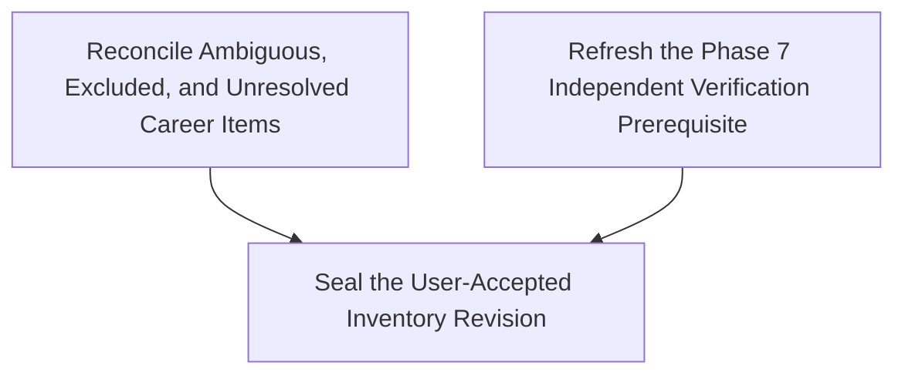

# 开放 tickets 后继整理 — 2026-10-13

时区：Europe/Zurich。本页是实时读取后的日期快照。票据保存状态和结论；
[ROADMAP](../../.planning/ROADMAP.md)保存主里程碑验收。本页承接
[同日较早快照](../open-ticket-audit-2026-10-13/README.md)，不改写旧记录。

## 当前队列

五组本地 tracker 共 **34 张子票**：14 张 `closed`、17 张 `resolved`、
1 张 `claimed`、2 张 `open`。**未完成共 3 张**，均属于职业清单后继修订。
GitHub 当前开放 issue 和 PR 均为 0；本地 Markdown 仍是 tracker。
状态、依赖和领取字段见[本次快照](tracker-snapshot.json)，远端查询见
[GitHub 回读](github-readback.json)。

| 票组 | 子票数 | 已关闭或 resolved | 未完成 |
| --- | ---: | ---: | ---: |
| [申请 worker 下一阶段：稳定性、普适性与效率决策地图](../application-worker-next-stage/map.md) | 8 | 8 | 0 |
| [申请 worker 稳定性开发票](../application-worker-stability/README.md) | 6 | 6 | 0 |
| [独立申请 worker 开发决策地图](../independent-application-worker/map.md) | 8 | 8 | 0 |
| [Candidate-Skill Harness Execution Logic](../candidate-skill-harness-execution/map.md) | 3 | 3 | 0 |
| [Complete and Seal the Full-Career Experience Inventory](../phase-08-career-experience-inventory/map.md) | 9 | 6 | 3 |

## 三张未完成票

| ticket | 状态与阻塞 | 下一步与完成条件 |
| --- | --- | --- |
| [Reconcile Ambiguous, Excluded, and Unresolved Career Items](../phase-08-career-experience-inventory/issues/07-reconcile-ambiguous-excluded-and-unresolved-items.md) | `claimed`；依赖已 resolved；领取人未记录 | 找回已有领取人；在私有工作区绑定后继 proposal、review 和 cutoff。用户核对全部 dispositions，并接受精确 revision 和 coverage 后才解决。 |
| [Refresh the Phase 7 Independent Verification Prerequisite](../phase-08-career-experience-inventory/issues/08-refresh-the-phase-7-independent-verification.md) | `open`；无依赖；领取人未记录 | 确认责任及复验输入后领取。独立核验当前 custody 和后继发布路径，形成明确的通过、失败、未观察结论。旧 passed 不自动覆盖新输入。 |
| [Seal the User-Accepted Inventory Revision](../phase-08-career-experience-inventory/issues/09-seal-the-user-accepted-inventory-revision.md) | `open`；被以上两票阻塞；领取人未记录 | 精确接受与独立核验通过后，复用后继 publisher 和完整 verifier。发布后回读 Source、review、coverage 及 predecessor lineage；保留已接受 parent。 |

首版接受与封存已完成。这三张票针对后继修订，不能以首版完成为由关闭。
公开记录只保存通用门槛；精确私人输入和接受指针留在私有工作区。

## Frontier 与推进顺序

严格 frontier 要求 `Status: open`、`Assignee: none`，且所有依赖已关闭。
**当前严格 frontier 为空**。缺少 Assignee 不能解释成未领取；
`claimed` 也不能证明仍有活跃执行者。

建议下一步准备 **Refresh the Phase 7 Independent Verification Prerequisite**：
它没有票据依赖，但须先确认责任和当前输入，再正式领取。
人工 reconciliation 可在原领取人确认后继续。封存始终等待两张前置票。
本次整理不代答 HITL、不解除旧领取，也不开始独立复验或私人封存。

## 相较早快照的变化

以下五票已由所属 resolution comment 记录用户确认并关闭。本次只回读，未重新解决：

- [确定通用表单支持等级与首批覆盖范围](../application-worker-next-stage/issues/04-coverage-contract.md)。
- [确定效率基线、人工干预与模型成本的测量口径](../application-worker-next-stage/issues/05-measurement-contract.md)。
- [确定缓存失效与低风险效率优化的实施边界](../application-worker-next-stage/issues/06-efficiency-contract.md)。
- [确定故障说明与人工恢复的最短交接流程](../application-worker-next-stage/issues/07-recovery-handoff-prototype.md)。
- [确定阶段验收、停止条件与可执行开发顺序](../application-worker-next-stage/issues/08-stage-acceptance.md)。

worker 决策地图关闭表示开发前规格齐备。实施结果见
[剩余决策与最小实现](../worker-remaining-tickets-2026-10-13/README.md)，
包内交付见[当前应用更新](../worker-handoff-app-update-2026-10-13/README.md)。
决策、代码交付、合成验证和真实验收各自保留其证据边界。

## 后续执行与验收边界

这些工作不计入开放决策票。沿用既有规格和阶段合同，不为整理而重复建票。

| 工作面 | 已有入口 | 未验收或待确认事项 |
| --- | --- | --- |
| worker 真实覆盖 | [阶段验收规格](../application-worker-next-stage/assets/stage-acceptance-proposal.md) | 六个真实槽位在最近交付中为 0/6。真实试点须按逐动作准入执行，最终 Submit 人工。 |
| 效率 | [测量基线](../worker-measurement-baseline-2026-10-13/README.md)、[效率边界决策](../application-worker-next-stage/issues/06-efficiency-contract.md) | 原 16 场景保留 15 passed / 1 failed；没有因果效率收益、真实模型成本或人工时长结论。新性能候选须至少五对可比运行，并超过同版本波动。 |
| 原生 Cua 与恢复 | [当前应用更新](../worker-handoff-app-update-2026-10-13/README.md) | 本次包内交付未重新进行原生 Cua 视觉验收。历史前置窗口阻断根因、真实人工可用性和实际模型 snapshot 仍未确认。 |
| Career Evidence Graph | [当前阶段](../../.planning/STATE.md)、[ROADMAP](../../.planning/ROADMAP.md) | Phase 9 问题质量、readiness 和人工校准仍待审查；Phase 10–14 未验收。后继清单未接受不撤销首版接受，也不使主里程碑完成。 |

## 本次核验

- 实时读取全部 34 张子票。兼容旧式数字依赖与粗体字段；44 条依赖均可解析且无环。
- GitHub 仅查询当前仓库。没有远端写入。
- 两份最近封存包共 206 个文件全部匹配原清单。这只确认留存字节，没有重跑其测试。
- 票据状态、领取字段、依赖和源码保持。导航改动前的字节副本保存在 `previous/`。
- 文档链接、快照一致性和保留检查见[核验结果](verification.json)。
- 未读取私人清单或答案，未运行测试、worker、浏览器、模型或真实申请。未创建、领取或关闭票据。

再次推进前须重读所属票；本页快照不能代替实时状态。
