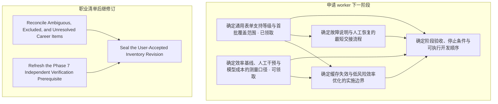

# 开放 tickets 整理 — 2026-10-13

时区：Europe/Zurich。范围：本地 tracker、公开规划和验收包、GitHub 开放记录。
本页是日期快照；子票保存状态和结论，ROADMAP 保存里程碑验收。

## 当前队列

五组 tracker 共 **34 张子票**：7 张 `open`、1 张 `claimed`、9 张 `closed`、17 张 `resolved`。
未完成共 **8 张**：worker 5 张，职业清单后继 3 张。GitHub 当前开放 issue 和 PR 均为 0。
原始状态、依赖、领取和源码核对见[本次快照](tracker-snapshot.json)。

worker 的严格 frontier 是 `open`、`Assignee: none` 且全部依赖已关闭的票。
当前只有[确定效率基线、人工干预与模型成本的测量口径](../application-worker-next-stage/issues/05-measurement-contract.md)满足此条件。
[确定通用表单支持等级与首批覆盖范围](../application-worker-next-stage/issues/04-coverage-contract.md)依赖已关闭，但已有 `root` 领取，尚未定案。
继续其讨论前应核对已有会话；本次整理不重复领取或解除领取。

| 顺序 / 入口 | ticket | 当前状态与责任 | 下一步及完成门槛 |
| --- | --- | --- | --- |
| 继续已有讨论 | [确定通用表单支持等级与首批覆盖范围](../application-worker-next-stage/issues/04-coverage-contract.md) | open，root，HITL；无开放依赖 | 复用已确认的 Playwright / Cua 混合方向和后台实现；讨论仍待确认的支持等级、样本矩阵与退出条件。真实覆盖尚未验收。 |
| 可新领取 | [确定效率基线、人工干预与模型成本的测量口径](../application-worker-next-stage/issues/05-measurement-contract.md) | open，未领取，HITL；无依赖 | 定计时起止、人工等待、失败/取消保留、缓存和模型/工具成本。采基线先于效率优化。 |
| 等前置决策 | [确定缓存失效与低风险效率优化的实施边界](../application-worker-next-stage/issues/06-efficiency-contract.md) | open，未领取，HITL；支持等级、测量口径仍开放 | 用基线选瓶颈，定失效矩阵、收益门槛和停止条件。尚无效率提升结论。 |
| 等支持等级 | [确定故障说明与人工恢复的最短交接流程](../application-worker-next-stage/issues/07-recovery-handoff-prototype.md) | open，未领取，HITL prototype | 复用现有工作台及原页复核能力；用四种合成故障交互稿取得用户反馈。后台显示机制交付不等于交互方案已接受。 |
| 最后汇总 | [确定阶段验收、停止条件与可执行开发顺序](../application-worker-next-stage/issues/08-stage-acceptance.md) | open，未领取，HITL；以上四项决策仍开放 | 汇总每个切片的输入、退出证据、真实试点边界和顺序；前置未定时不关闭地图。 |
| 后继人工核对 | [Reconcile Ambiguous, Excluded, and Unresolved Career Items](../phase-08-career-experience-inventory/issues/07-reconcile-ambiguous-excluded-and-unresolved-items.md) | claimed，执行者未记录；依赖已 resolved | 找回领取者，绑定后继 proposal / cutoff；取得完整 dispositions 与精确接受。首版清单已完成。 |
| 后继独立复验 | [Refresh the Phase 7 Independent Verification Prerequisite](../phase-08-career-experience-inventory/issues/08-refresh-the-phase-7-independent-verification.md) | open；无依赖，assignee 未记录 | 先确认责任和后继复验输入，再独立审查当前 custody / 发布路径。旧 passed 保留，不自动继承到新输入。 |
| 后继封存 | [Seal the User-Accepted Inventory Revision](../phase-08-career-experience-inventory/issues/09-seal-the-user-accepted-inventory-revision.md) | open；被后继人工核对和独立复验阻塞 | 仅在精确接受与前置通过后复用 publisher；核验完整 lineage 和 readback，保留 parent。 |

职业清单旧票缺少 Assignee 字段，不能把缺字段直接解释为未领取。
本次保留原状态，补清后继范围和完成门槛，并把开放依赖改为标题链接；依赖边没有改变。
不凭首版完成记录关闭后继票，也不从旧 `claimed` 推定仍有活跃执行者。

## 依赖图

只显示仍未完成的阻塞。已关闭的前置保留在原票中。

## 近期工作归属

| 新证据 / 工作面 | 对应已有 ticket 或阶段 | 整理后的边界 |
| --- | --- | --- |
| [无窗口 Cua 启动与原页复核](../cua-worker-windowless-startup-2026-10-13/README.md) | 通用表单支持等级；人工交接 | 已有原生合成验收：19 passed，其中 5 项原生场景；另有独立进程补充 1 passed。123 项维护输入中 122 项仍匹配，变化为桌面测试文件；执行核心仍匹配。这些是留存结果，本次未重跑。 |
| [本机应用默认后台 Cua](../cua-app-update-2026-10-13/README.md) | 通用表单支持等级；阶段验收 | 构建、安装和包内入口有证据；当轮完整离线 905 passed。Chrome 155 行为未重验，真实 ATS 覆盖和效率比较未执行。 |
| [09:10 Chrome 崩溃命令审计](../chrome-crash-command-audit-2026-10-13/README.md) | 现有诊断上下文 | 后续证据已将触发命令定位到另一会话的直接 Chrome 启动。应用安装包中的“触发命令未知”是较早观察。该归因不证明底层权限根因已解决，也不构成新的 worker 缺陷票。 |
| 六张稳定性实施票 | 稳定性票组，全部 closed | 保留历史输入下的验收；不重复建稳定性实现票，不把历史 passed 扩大为当前全部真实恢复保证。 |
| [Phase 7 独立验证](../../.planning/phases/07-career-source-custody-and-private-workspace/07-VERIFICATION-2026-10-07.md) | 后继独立复验 | 11 项历史输入中 7 项匹配、4 项变化：workspace.py、cli.py、数据边界文档、架构文档。变化不是缺陷判定；后继复验须绑定当前范围。 |
| 职业图核心验证 | [ROADMAP](../../.planning/ROADMAP.md)，Phase 9–14 | Phase 9 的问题质量、readiness 和真实人工校准仍开放。Phase 10–14 尚未验收。沿用阶段合同，不为整齐而扩写成重复票。 |

通用覆盖票中的草案、后台切片授权、合成实现验收、真实岗位覆盖和完整规格定案是不同事实。
已确认的方向无需重问；剩余决定仍通过一次一题的 HITL 交流解决。
不存在新的可自动关闭票。本次未创建、领取或关闭任何票。

## 本次核对

- 实时读取全部 34 张子票，兼容旧式数字依赖和稳定性票的粗体字段；所有依赖可解析且无环。
- GitHub 只读查询完成；开放 issue / PR 为零。本地 Markdown 仍是 tracker。
- 两个近期封存包共 135 个文件全部匹配，未改写历史证据。
- 已修改文档的本地链接、状态/领取/依赖保留和源码保留检查见[核验结果](verification.json)。
- 本轮只整理规划和导航。未读取私人清单或答案，未运行测试、worker、浏览器、模型或真实申请。

修改前六份规划/导航文件的字节副本保存在 `previous/`；本次不改变运行实现。
每次领取仍用[实时 frontier 查询](../application-worker-next-stage/README.md#wayfinding-operations)。
人的决策按 wayfinder 每次一票推进；本次是队列整理，没有代答 HITL。
