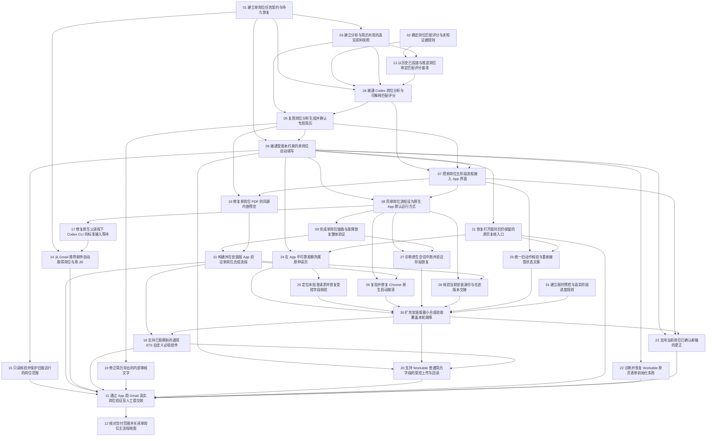

# 单岗位申请主流程执行导航

> 当前规范与唯一执行计划（2026-10-20）：[产品规范](../../docs/single-job-flow.md) · [开发计划](../../docs/development-plan.md) · [系统审计](../../docs/system-audit-2026-10-20.md)。
> 本轮精简已写入同一地图的子票：既有任务复用，四个独立缺口另列。当前依赖以票头Blocked by及查询结果为准；下方旧修复顺序和历史正文不再决定当前执行。Status/Assignee保留，本次仅写票，未领取、实施或执行真实申请。

规范地图：[接通单岗位 JD 分析、专用简历与自动填写主流程](map.md)。

正式规格：[本地自动投递与系统精简规格](spec.md)，已标记ready-for-agent；现有子票继续承接，发布spec不新增实施票或启动业务。

2026-10-17 后继优先范围为[交付 Gmail 岗位筛选与专用简历稳定版](../gmail-resume-preparation-2026-10-17/map.md)，其[执行导航](../gmail-resume-preparation-2026-10-17/README.md)承接全部材料准备任务。此旧图保留自动填写与历史故障验收；本轮不改变旧票状态、领取人或原申请的暂停决定。

本轮中止后的[测试问题复盘](test-findings-2026-10-17.md)汇总实际故障、修复边界、未定原因与执行失误。申请仍暂停，真实链未验收。

本目录把用户已接受的设计落为可领取的本地子票，覆盖实现、安装和真实 App 验收。
地图的 Notes 显式采用执行扩展：规格完成、源码通过或合成通过都不足以完成 Destination。
本页只保存导航、依赖和操作方法，不另存子票状态。

## 复盘后的修复顺序

2026-10-17：新增 24–31 共 8 张修复票，复用 18/20/23 的实现及待完成真实验收，继续用 11/12 做整体验收与收尾。新票均未领取；原票责任记录保留。这里只建立排程，不恢复申请或授权执行。

- **P0**：阻止可靠重测的基础问题，以及防止再次无限排障的执行规则。先处理。
- **P1**：在基础问题修复后补齐安装版、恢复、界面及真实链验收。
- **P2**：最终文档与证据收尾；不能越过未完成验收提前关闭。

| 修复或验收票 | 优先级 | 直接前置 | 可核验终点 |
| --- | --- | --- | --- |
| [31 建立限时预检与真实阶段进度规则](issues/31-bounded-execution-protocol.md) | P0 | 无 | 限时、停止和真实阶段报告规则经合成演练可执行 |
| [24 在 App 中可靠观察所属原申请页](issues/24-owned-page-observation.md) | P0 | [06](issues/06-single-worker.md)、[21](issues/21-retained-page-recovery.md) | 精确所属原页的新鲜只读观察，不读错实例 |
| [25 定位未批准请求并恢复受控字段核验](issues/25-request-diagnostics-readback.md) | P0 | [24](issues/24-owned-page-observation.md) | 具体请求与 intent 关联，未知写仍阻断，本地核验可用 |
| [26 复现并修复 Chrome 原生启动崩溃](issues/26-native-chrome-startup-crash.md) | P0 | [08](issues/08-native-runtime.md)、[10](issues/10-installed-app.md) | 已绑定启动崩溃有因果反例和同条件修复，原生冷启动复验通过 |
| [27 诊断原生会话中断并验证阶段恢复](issues/27-native-interruption-recovery.md) | P1 | [08](issues/08-native-runtime.md)、[09](issues/09-integration-verification.md) | 原生阶段中断归因，恢复不丢结果、不自动重跑 |
| [28 核验当前安装身份与在途版本交接](issues/28-installed-readiness-version-handover.md) | P1 | [08](issues/08-native-runtime.md)、[10](issues/10-installed-app.md) | 当前宿主/权限/配置与控制端及 worker 版本可核对 |
| [29 统一旧动作核验与重新接管状态文案](issues/29-action-resolution-status-copy.md) | P1 | [07](issues/07-app-workspace.md)、[21](issues/21-retained-page-recovery.md) | 已核验、待接管、排队和真实回读状态互不矛盾 |
| [30 扩充安装版最小合成验收覆盖本轮故障](issues/30-installed-minimal-regression.md) | P1 | [24](issues/24-owned-page-observation.md)、[25](issues/25-request-diagnostics-readback.md)、[26](issues/26-native-chrome-startup-crash.md)、[27](issues/27-native-interruption-recovery.md)、[28](issues/28-installed-readiness-version-handover.md)、[29](issues/29-action-resolution-status-copy.md)、[31](issues/31-bounded-execution-protocol.md) | 当前安装版最小合成链完整字段和一次附件回读通过 |
| [18 支持已观察到的通用 ATS 自定义必填控件](issues/18-generic-ats-controls.md) | P1 | [10](issues/10-installed-app.md)、[30](issues/30-installed-minimal-regression.md) | 真实自定义必填控件逐项填写回读 |
| [23 支持当前岗位已确认邮箱的更正](issues/23-current-job-email-correction.md) | P1 | [06](issues/06-single-worker.md)、[07](issues/07-app-workspace.md)、[30](issues/30-installed-minimal-regression.md) | 真实本岗位邮箱更正并回读新值 |
| [20 支持 Workable 普通简历字段的受控上传与回读](issues/20-workable-resume-upload.md) | P1 | [06](issues/06-single-worker.md)、[30](issues/30-installed-minimal-regression.md)、[18](issues/18-generic-ats-controls.md) | 一次真实批准上传、远端 SHA、原页附件及上传后字段回读 |
| [11 通过 App 用 Gmail 真实岗位验证至人工提交前](issues/11-gmail-real-job.md) | P1 | [15](issues/15-legacy-target-scope.md)、[10](issues/10-installed-app.md)、[14](issues/14-gmail-recommendation-intake.md)、[18](issues/18-generic-ats-controls.md)、[19](issues/19-resume-review-metadata.md)、[20](issues/20-workable-resume-upload.md)、[21](issues/21-retained-page-recovery.md)、[22](issues/22-workable-bootstrap-recovery.md)、[23](issues/23-current-job-email-correction.md) | 当前原页全部必填与附件匹配，停在人工 Submit 前 |
| [12 核对交付范围并关闭单岗位主流程地图](issues/12-delivery-closeout.md) | P2 | [11](issues/11-gmail-real-job.md) | 各票独立证据与交付范围一致，才能关闭地图 |

本轮 P0 无未完成前置的票是 **31、24、26**；27、28、29 也没有未完成前置，可在明确执行范围后并行开发，优先保障 P0。25 等 24；30 等 24–29 和 31；30 之后 18 与 23 可分别验收，20 再等 18，最后 11 → 12。

**防止循环依赖：30 复用 18/20/23 已落地代码，不依赖它们关闭；18/20/23 的后继真实验收依赖 30。** 若组合测试发现新实现缺陷，单开最小修复票，不把 30 反向依赖真实验收票。

24/25 的关闭限于能力修复和当前安装版隔离验收，不要求先恢复真实申请。具体真实原页观察、P09 再现记录及字段结果由 30 后的 11/23 验收；旧事件唯一原因仍未定时必须保留这一限制，不能把隔离通过写成历史根因全部修复。

本次只建票。后续代码修复、隔离原生实验与真实重测均按用户明确要求执行。用户原中止决定持续有效；真实 18/20/23/11 还必须有新的恢复许可，并采用 31 的限时和停止规则。正常材料/事实/隐私确认、Touch ID 和人工 Submit 不拆成缺陷票。

## 复盘问题与票据覆盖

| 复盘问题 | 承接票 | 处理边界 |
| --- | --- | --- |
| P04 自定义必填控件 | [18 支持已观察到的通用 ATS 自定义必填控件](issues/18-generic-ats-controls.md)、[30 扩充安装版最小合成验收覆盖本轮故障](issues/30-installed-minimal-regression.md) | 复用实现，补当前安装版组合与真实控件验收 |
| P06 普通 resume 上传 | [20 支持 Workable 普通简历字段的受控上传与回读](issues/20-workable-resume-upload.md)、[30 扩充安装版最小合成验收覆盖本轮故障](issues/30-installed-minimal-regression.md) | 真实未尝试，补一次上传、远端字节和表单附件证据 |
| P10 已确认邮箱更正 | [23 支持当前岗位已确认邮箱的更正](issues/23-current-job-email-correction.md)、[30 扩充安装版最小合成验收覆盖本轮故障](issues/30-installed-minimal-regression.md) | 保留本地记录，补明确接管后的真实更正与回读 |
| P08 初始网络错误未定原因及 P09 字段核验停止 | [25 定位未批准请求并恢复受控字段核验](issues/25-request-diagnostics-readback.md) | 两个事件分别归因，不重开已完成初始化恢复范围的 22 |
| P11 核验状态文案矛盾 | [29 统一旧动作核验与重新接管状态文案](issues/29-action-resolution-status-copy.md) | 只修现有状态的准确呈现，不另造状态机 |
| E02 读错 Chrome 或无法观察原页 | [24 在 App 中可靠观察所属原申请页](issues/24-owned-page-observation.md) | 精确所属 Page 的定位、字段、截图及新鲜度 |
| E03 Chrome 启动崩溃 | [26 复现并修复 Chrome 原生启动崩溃](issues/26-native-chrome-startup-crash.md) | 三份报告分别绑定，不能以一次启动成功关闭根因修复 |
| E04 原生中断及版本交接 | [27 诊断原生会话中断并验证阶段恢复](issues/27-native-interruption-recovery.md)、[28 核验当前安装身份与在途版本交接](issues/28-installed-readiness-version-handover.md) | 中断归因与安装/在途版本契约分开 |
| E01 权限曾与宿主身份不一致 | [28 核验当前安装身份与在途版本交接](issues/28-installed-readiness-version-handover.md) | 历史重绑通过保留，补当前身份预检，不假定 TCC 数据库根因 |
| E05 Swift 编译验证超时 | [30 扩充安装版最小合成验收覆盖本轮故障](issues/30-installed-minimal-regression.md) | 纳入原时限原生回归，保留失败历史，不单独重复建票 |
| 执行失误 1–5 | [31 建立限时预检与真实阶段进度规则](issues/31-bounded-execution-protocol.md)、[24 在 App 中可靠观察所属原申请页](issues/24-owned-page-observation.md)、[28 核验当前安装身份与在途版本交接](issues/28-installed-readiness-version-handover.md)、[29 统一旧动作核验与重新接管状态文案](issues/29-action-resolution-status-copy.md)、[30 扩充安装版最小合成验收覆盖本轮故障](issues/30-installed-minimal-regression.md) | 限时与报告由 31 承接；观察、诊断、状态与最短反馈环分别补足 |

已在原范围通过的 P01/P02/P03/P05/P07/P12 不重复建修复票。若仍有未定原因或新增故障，必须在承接票内区分已证实机制与待验证假设。

## 已确认的主流程

Codex 读取 Gmail 岗位推荐并取得原 JD → App 内部匹配分析/评分与历史参照 → 岗位专用简历 → 用户确认该份材料 → 单岗位自动填写 → 用户在原页面最终 Submit。手动 JD 输入保留为备用。
本地图的验证终点是自动填写后的当前字段/附件回读及待人工最终提交；不要求用户为了测试实际投递。

用户无需手动填写匹配等级、先找 PDF、复制任务到外部聊天或用 Terminal 启动实验模式。
评分公式已由专门 HITL 票确认；新增来源入口由独立票实现。

执行中用户新增历史评分基准要求，现由[历史基准票](issues/13-historical-match-benchmark.md)审定。初始 v1 公式保留为原始分，不等同已经验校准的最终评分。

## 责任与直接依赖

| 执行票 | 优先级 | 方式 | 直接阻塞票 |
| --- | --- | --- | --- |
| [建立单岗位任务契约与持久恢复](issues/01-task-contract.md) | — | AFK | none |
| [确定岗位匹配评分与未知证据规则](issues/02-match-policy.md) | — | HITL | none |
| [建立分析与简历共用的真实资料快照](issues/03-source-bundle.md) | — | AFK | [建立单岗位任务契约与持久恢复](issues/01-task-contract.md) |
| [接通 Codex 岗位分析与可解释匹配评分](issues/04-match-analysis.md) | — | AFK | [建立单岗位任务契约与持久恢复](issues/01-task-contract.md), [确定岗位匹配评分与未知证据规则](issues/02-match-policy.md), [建立分析与简历共用的真实资料快照](issues/03-source-bundle.md), [以历史已投递与推进岗位审定匹配评分基准](issues/13-historical-match-benchmark.md) |
| [复用岗位分析生成并确认专用简历](issues/05-tailored-resume.md) | — | AFK | [建立分析与简历共用的真实资料快照](issues/03-source-bundle.md), [接通 Codex 岗位分析与可解释匹配评分](issues/04-match-analysis.md) |
| [接通受版本约束的单岗位自动填写](issues/06-single-worker.md) | — | AFK | [建立单岗位任务契约与持久恢复](issues/01-task-contract.md), [复用岗位分析生成并确认专用简历](issues/05-tailored-resume.md) |
| [把单岗位五阶段流程接入 App 界面](issues/07-app-workspace.md) | — | AFK | [接通 Codex 岗位分析与可解释匹配评分](issues/04-match-analysis.md), [复用岗位分析生成并确认专用简历](issues/05-tailored-resume.md), [接通受版本约束的单岗位自动填写](issues/06-single-worker.md) |
| [将单岗位流程设为原生 App 默认运行方式](issues/08-native-runtime.md) | — | AFK | [接通受版本约束的单岗位自动填写](issues/06-single-worker.md), [把单岗位五阶段流程接入 App 界面](issues/07-app-workspace.md) |
| [完成单岗位链路与故障恢复整体验证](issues/09-integration-verification.md) | — | AFK | [将单岗位流程设为原生 App 默认运行方式](issues/08-native-runtime.md) |
| [构建并在安装版 App 验证单岗位合成流程](issues/10-installed-app.md) | — | AFK | [完成单岗位链路与故障恢复整体验证](issues/09-integration-verification.md), [修复单岗位 PDF 的同源内嵌预览](issues/16-pdf-preview-frame.md) |
| [通过 App 用 Gmail 真实岗位验证至人工提交前](issues/11-gmail-real-job.md) | P1 | HITL | [只读核验并保护旧版运行的岗位范围](issues/15-legacy-target-scope.md), [构建并在安装版 App 验证单岗位合成流程](issues/10-installed-app.md), [从 Gmail 推荐邮件自动取得岗位与原 JD](issues/14-gmail-recommendation-intake.md), [支持已观察到的通用 ATS 自定义必填控件](issues/18-generic-ats-controls.md), [修正简历导出的内部审核文字](issues/19-resume-review-metadata.md), [支持 Workable 普通简历字段的受控上传与回读](issues/20-workable-resume-upload.md), [恢复打开超时后仍保留的原页复核入口](issues/21-retained-page-recovery.md), [诊断并恢复 Workable 原页表单初始化失败](issues/22-workable-bootstrap-recovery.md), [支持当前岗位已确认邮箱的更正](issues/23-current-job-email-correction.md) |
| [核对交付范围并关闭单岗位主流程地图](issues/12-delivery-closeout.md) | P2 | AFK | [通过 App 用 Gmail 真实岗位验证至人工提交前](issues/11-gmail-real-job.md) |
| [以历史已投递与推进岗位审定匹配评分基准](issues/13-historical-match-benchmark.md) | — | HITL | [确定岗位匹配评分与未知证据规则](issues/02-match-policy.md), [建立分析与简历共用的真实资料快照](issues/03-source-bundle.md) |
| [从 Gmail 推荐邮件自动取得岗位与原 JD](issues/14-gmail-recommendation-intake.md) | — | AFK | [建立单岗位任务契约与持久恢复](issues/01-task-contract.md), [修复原生父进程下 Codex CLI 的标准输入等待](issues/17-native-cli-stdin.md) |
| [只读核验并保护旧版运行的岗位范围](issues/15-legacy-target-scope.md) | — | AFK | [接通受版本约束的单岗位自动填写](issues/06-single-worker.md) |
| [修复单岗位 PDF 的同源内嵌预览](issues/16-pdf-preview-frame.md) | — | AFK | [复用岗位分析生成并确认专用简历](issues/05-tailored-resume.md), [把单岗位五阶段流程接入 App 界面](issues/07-app-workspace.md) |
| [修复原生父进程下 Codex CLI 的标准输入等待](issues/17-native-cli-stdin.md) | — | AFK | [将单岗位流程设为原生 App 默认运行方式](issues/08-native-runtime.md) |
| [支持已观察到的通用 ATS 自定义必填控件](issues/18-generic-ats-controls.md) | P1 | AFK | [构建并在安装版 App 验证单岗位合成流程](issues/10-installed-app.md)、[扩充安装版最小合成验收覆盖本轮故障](issues/30-installed-minimal-regression.md) |
| [修正简历导出的内部审核文字](issues/19-resume-review-metadata.md) | — | AFK | [复用岗位分析生成并确认专用简历](issues/05-tailored-resume.md) |
| [支持 Workable 普通简历字段的受控上传与回读](issues/20-workable-resume-upload.md) | P1 | AFK | [接通受版本约束的单岗位自动填写](issues/06-single-worker.md)、[扩充安装版最小合成验收覆盖本轮故障](issues/30-installed-minimal-regression.md)、[支持已观察到的通用 ATS 自定义必填控件](issues/18-generic-ats-controls.md) |
| [恢复打开超时后仍保留的原页复核入口](issues/21-retained-page-recovery.md) | — | AFK | [接通受版本约束的单岗位自动填写](issues/06-single-worker.md) |
| [诊断并恢复 Workable 原页表单初始化失败](issues/22-workable-bootstrap-recovery.md) | — | AFK | [接通受版本约束的单岗位自动填写](issues/06-single-worker.md) |
| [支持当前岗位已确认邮箱的更正](issues/23-current-job-email-correction.md) | P1 | AFK | [接通受版本约束的单岗位自动填写](issues/06-single-worker.md)、[把单岗位五阶段流程接入 App 界面](issues/07-app-workspace.md)、[扩充安装版最小合成验收覆盖本轮故障](issues/30-installed-minimal-regression.md) |
| [在 App 中可靠观察所属原申请页](issues/24-owned-page-observation.md) | P0 | AFK | [接通受版本约束的单岗位自动填写](issues/06-single-worker.md)、[恢复打开超时后仍保留的原页复核入口](issues/21-retained-page-recovery.md) |
| [定位未批准请求并恢复受控字段核验](issues/25-request-diagnostics-readback.md) | P0 | AFK | [在 App 中可靠观察所属原申请页](issues/24-owned-page-observation.md) |
| [复现并修复 Chrome 原生启动崩溃](issues/26-native-chrome-startup-crash.md) | P0 | AFK | [将单岗位流程设为原生 App 默认运行方式](issues/08-native-runtime.md)、[构建并在安装版 App 验证单岗位合成流程](issues/10-installed-app.md) |
| [诊断原生会话中断并验证阶段恢复](issues/27-native-interruption-recovery.md) | P1 | AFK | [将单岗位流程设为原生 App 默认运行方式](issues/08-native-runtime.md)、[完成单岗位链路与故障恢复整体验证](issues/09-integration-verification.md) |
| [核验当前安装身份与在途版本交接](issues/28-installed-readiness-version-handover.md) | P1 | AFK | [将单岗位流程设为原生 App 默认运行方式](issues/08-native-runtime.md)、[构建并在安装版 App 验证单岗位合成流程](issues/10-installed-app.md) |
| [统一旧动作核验与重新接管状态文案](issues/29-action-resolution-status-copy.md) | P1 | AFK | [把单岗位五阶段流程接入 App 界面](issues/07-app-workspace.md)、[恢复打开超时后仍保留的原页复核入口](issues/21-retained-page-recovery.md) |
| [扩充安装版最小合成验收覆盖本轮故障](issues/30-installed-minimal-regression.md) | P1 | AFK | [在 App 中可靠观察所属原申请页](issues/24-owned-page-observation.md)、[定位未批准请求并恢复受控字段核验](issues/25-request-diagnostics-readback.md)、[复现并修复 Chrome 原生启动崩溃](issues/26-native-chrome-startup-crash.md)、[诊断原生会话中断并验证阶段恢复](issues/27-native-interruption-recovery.md)、[核验当前安装身份与在途版本交接](issues/28-installed-readiness-version-handover.md)、[统一旧动作核验与重新接管状态文案](issues/29-action-resolution-status-copy.md)、[建立限时预检与真实阶段进度规则](issues/31-bounded-execution-protocol.md) |
| [建立限时预检与真实阶段进度规则](issues/31-bounded-execution-protocol.md) | P0 | AFK | 无 |

共享源文件不自动创造技术依赖；并行执行者先协调文件所有权。AFK 票可由代理执行，HITL 票必须保留用户自己的答复或材料确认。
各票均有 Question、Work and reuse、Ownership、Acceptance criteria、Verification and evidence、Resolution comment。

## 依赖图

箭头表示直接阻塞；完成状态以各子票字段为准。



## 复用与事实入口

- [当前架构](../../ARCHITECTURE.md)、[系统与个人资料边界](../../docs/data-boundaries.md)、[开发约定](../../CONVENTIONS.md)。
- [Codex CLI](../../src/career_evidence_graph/codex_cli.py)、[真实资料与岗位简历](../../src/career_evidence_graph/application_resume.py)、[投递笔记和职业目录](../../src/career_evidence_graph/career_portal_data.py)。
- [筛选与人工分流](../../src/career_evidence_graph/job_screening.py)：不是自动匹配分析；[研究侧严格评分](../../src/career_evidence_graph/jd.py)要求 reviewed graph，不能冒充日常资料匹配。
- [现有 worker](../../src/career_evidence_graph/application_worker.py)、[浏览器执行](../../src/career_evidence_graph/application_worker_browser.py)、[执行占用](../../src/career_evidence_graph/application_execution.py)。
- [默认服务装配](../../src/career_evidence_graph/career_portal.py)和[原生启动](../../macos/server.py)：当前默认单岗位 flow；旧 handoff/lab 保留为显式备用入口和独立运行根。当前加载版本以安装证据为准。
- [旧交接指南](../../docs/codex-handoff.md)、[自动化实验入口](../../docs/application-automation-lab.md)、[既有恢复与人工提交边界](../../docs/application-worker-workflow.md)。保留原记录，不把旧地图自动重开或归入新票完成数。
- [历史原生宿主核验](../cua-gui-host-tcc-2026-10-16/README.md)只说明该次输入；权限与当前宿主状态在安装票新鲜核验，不能从历史通过/拒绝推断当前。
- [安装构建与验证](../../docs/macos-app.md)、[PDF 直接进入 worker 的测试](../../tests/test_application_resume.py)、[离线与 opt-in 检查](../../docs/validation-runs.md)。

## Wayfinding operations

当前（2026-10-21）：本地图继续支持已授权的源码/合成工程，实际 App 更新与真实申请仍暂停。历史“整图暂停”、逐稿审批及旧总轮时限不替代[当前产品规范](../../docs/single-job-flow.md)；旧记录保留在下方历史区。

- `map.md` 是唯一地图；`issues/` 路径是身份，Assignee 是 claim，`Blocked by` 的标题链接是本地 tracker 的阻塞关系。不创建远程 issues。
- 以[开发计划](../../docs/development-plan.md)看当前顺序，用全仓查询核对票头。先按 Priority，再同优先级按文件顺序选 open、unassigned 且所有直接前置 closed/resolved 的票；查询列表自身不代表优先级顺序。
- 先领取再实施，不接管其他 Assignee，不把未知 owner 填成 none。HITL 必须有用户实际回应；源码和有限旅程通过不允许删原验收或关闭整票。
- 只有经事实确认已可消费的源码契约才移除整票等待；原边及理由见本轮审计。真实 owner、当前岗/文件、原子保存、intent/attempt、未知不重放和 Submit 保护不随删边移除。
- `mechanical_frontier` 仅是图关系，`execution_authorized=false` 不提供许可；`paused_route` 指真实申请路线暂停。源码按既有范围与当前票推进，不能据此安装、用真实邮箱/资料或恢复旧页。
- 每会话最多解决一张非 research 票；本轮重排没有关闭票。完成时在原票记录 resolution，再将其标题指针加入地图 Decisions so far。不能批量清掉 HITL、历史诊断或研究票来增加完成数。

从仓库根运行：

```sh
UV_CACHE_DIR=/private/tmp/tomorrowstar-wayfinder-uv-cache uv run --locked --offline --no-sync python -B scripts/query_tickets.py --json
```

开放票由查询取得；地图不复制开放清单。源码和安装/真实层的准确下一步见原票及唯一开发计划，不另维护一套长期队列。

## 本轮交付边界

初始建图仅交付执行票。后续实现及各层验收以当前地图和子票证据为准。真实 Gmail 岗位、模型输出、个人 PDF、答案、登录和 trace 只进入私有运行目录。
未来提交只由用户在原页面执行；本地图不以最终提交或雇主回执作为必须发生的测试动作。


## 执行规则导航（31）

[限时执行与停止规则](../../docs/single-job-flow.md#限时执行与停止规则)是 18/20/23/11
真实后继的共同操作契约：预检 10 分钟、同起点总计 20 分钟；累计时间和同故障次数
跨重开与交接保留；第二次同阻断停止，首次未知写入/上传立即停止。
等待用户不推定同意；真实阶段逐项报告；工程修复不静默侵入真实窗口。
这些上限不是性能实测或用户已接受 SLA，用户明确覆盖优先。
[31 的隔离合成演练](../bounded-execution-protocol-2026-10-19/README.md)不恢复真实申请。
本轮用户授权只推进无需人工确认的工程，事实/材料/隐私/Touch ID/Submit 仍待人工。

## 地图历史正文：精简方案入票前

以下原文保留当时的范围、导航及收据引用。当前目标与依赖以[地图](map.md)、子票头部和[开发计划](../../docs/development-plan.md)为准；旧授权、总轮时限及材料审批不作为当前要求。

<details>
<summary>查看精简方案入票前的地图原文</summary>

# 接通单岗位 JD 分析、专用简历与自动填写主流程

> 当前规范与唯一执行计划（2026-10-20）：[产品规范](../../docs/single-job-flow.md) · [开发计划](../../docs/development-plan.md) · [系统审计](../../docs/system-audit-2026-10-20.md)。
> 当前产品主线复用本图，34是唯一持续线性编排；新增35邮件收录归档、36两库复用/影响更新、37一次继续/提交结果/可恢复skip。30组合验证后接11真实主线；26历史Chrome根因与稳定性研究独立，不再成为日常运行总门槛。旧版本单岗、逐份材料批准和20分钟范围不再是当前要求。 本次仅重规划，未改Status/Assignee、未执行真实申请。

Label: wayfinder:map
Status: open
Assignee: 01a146b9/root
Created: 2026-10-16
Tracker: local-markdown

## Destination

安装版 TomorrowStar 通过 Codex 从 Gmail 推荐取得岗位和完整原 JD，内部调用 Codex CLI，展示有历史参照和来源的岗位匹配分，生成并绑定岗位专用简历，启动单岗位自动填写。手动 JD 输入保留为备用。
通过 App 用 Gmail 推荐的一份当前真实岗位完成字段与附件回读，停在用户最终 Submit 前；源码、合成与安装版证据分别核验。

## Notes

2026-10-20 当前后继：系统既定流程仍为 JD→分析→系统生成专用简历→填写→用户最终确认，
不要求用户提供 PDF 或重复说明系统已有事实。用户已单独授权一个随机真实岗位的填写／上传；
该次运行停在公开初始化请求阻断，原页与未知结果保留，未填写或上传。
新增 [33 Ashby 公开初始化请求核验](issues/33-ashby-public-bootstrap-review.md)。
后续申请页面产品验收使用随机不同的真实岗位，既有生成页面只保留为历史软件证据。

2026-10-20：全部开放票现按[并行执行分组](../open-ticket-parallel-plan-2026-10-20/README.md)组织；规范子票身份、原领取、依赖及验收保持，真实申请继续暂停。


- **2026-10-20 后继审计与工程**：用户授权后，[24原页观察](issues/24-owned-page-observation.md)已按六项完整工程证据结案。25、28、30继续并发补剩余工程，真实申请暂停，职业材料暂缓。历史审计保留，当前更新见[本轮记录](../review-and-completion-2026-10-20/README.md)。
- **2026-10-20 较早审计**：[状态文案票](issues/29-action-resolution-status-copy.md)已关闭；[Chrome启动崩溃票](issues/26-native-chrome-startup-crash.md)的主界面失败验收已补齐，后文较早“仍待”仅为历史时点。原完整沙箱同条件GREEN仍阻塞；[身份与交接票](issues/28-installed-readiness-version-handover.md)只完成无副作用项，整票开放。见[当时审计](../progress-audit-2026-10-20/README.md)。

- 2026-10-20 后继：[复现并修复 Chrome 原生启动崩溃](issues/26-native-chrome-startup-crash.md)补齐最终文本的实际 WKWebView 固定失败注入、刷新无重试及退出清理，现勾选失败主界面验收；原完整沙箱同条件GREEN仍阻塞，真实申请暂停。
- 2026-10-20：[26 启动崩溃](issues/26-native-chrome-startup-crash.md)已接通生产导出与共享 UI 停止提示，最终独立包三次原生/PDF 及 155+7 相关回归通过，功能基线完整离线 3512 通过。原完整沙箱 GREEN 与最终 WKWebView 失败路径仍阻塞；见[剩余验收](../chrome-remaining-acceptance-2026-10-19/README.md)，票 open，真实申请暂停。
- 2026-10-19：[26 启动崩溃](issues/26-native-chrome-startup-crash.md)完成独立安装包整包验收、三次合成原生冷启动/PDF 导出及 3505 项完整默认离线回归，见[安装报告](../chrome-installed-validation-2026-10-19/README.md)。原完整受限沙箱、历史 argv 与主界面失败验收仍待完成，票保持 open；真实申请暂停。

- 当前完整交付规划另见[材料准备与浏览器效率总导航](../tomorrowstar-delivery-2026-10-17/README.md)。新增浏览器性能能力不恢复本图暂停申请，不自动关闭本图历史根因或真实填写验收。

- 2026-10-17 后继用户要求先交付 Gmail→筛选分级→专用简历，暂不做自动投递；材料准备的规范任务见[交付 Gmail 岗位筛选与专用简历稳定版](../gmail-resume-preparation-2026-10-17/map.md)。本旧图及其未完成票保留原状态；其历史故障不能因新路径通过而自动关闭，原暂停申请不恢复。

- 2026-10-17 用户随后仅授权将复盘未解决项拆为修复票，新增 [24 原页观察](issues/24-owned-page-observation.md)、[25 请求与字段核验](issues/25-request-diagnostics-readback.md)、[26 启动崩溃](issues/26-native-chrome-startup-crash.md)、[27 原生中断](issues/27-native-interruption-recovery.md)、[28 身份与版本交接](issues/28-installed-readiness-version-handover.md)、[29 状态文案](issues/29-action-resolution-status-copy.md)、[30 安装版最小合成验收](issues/30-installed-minimal-regression.md)、[31 限时执行规则](issues/31-bounded-execution-protocol.md)。优先级、依赖和问题覆盖见[执行导航](README.md#复盘后的修复顺序)；不领取、不实施、不恢复申请。
- 依赖约束：30 只复用 18/20/23 已实现代码，不以它们关闭为前置；它们的真实验收反向等待 30。新增票经 30 → 18/20/23 → 11 → 12 传递至地图终点，不能以合成通过代替每票原生、根因或真实范围。

- 2026-10-17 用户已中止本轮申请；填写保持暂停。实际故障、修复与验收边界见[本轮测试问题复盘](test-findings-2026-10-17.md)。该整理不恢复运行、不关闭地图或未完成票。

- 当前字段核验补充：先前旧 Email 的未知结果已由用户当前原页确认，安装版已保存独立 current_matches；原 intent 保留且填写仍暂停。用户指定的新邮箱由[第 23 票](issues/23-current-job-email-correction.md)单独处理，尚未写入，后继完整字段与附件验收仍未通过。

- 用户在真实填写中更正已确认邮箱，由[当前岗位邮箱更正票](issues/23-current-job-email-correction.md)补足岗位级入口；旧动作结果仍独立核验，不改全局联系方式或批准 PDF。

- 最初原页故障截图确认地址到达但没有表单，由[初始化恢复票](issues/22-workable-bootstrap-recovery.md)复现诊断；交接完成不等同页面准备成功，不能把站内网络错误直接解释为整机断网。后续恢复事实以该票追加验收为准。

- 打开超时后仍保留的原页被入口条件隐藏，由[原页恢复票](issues/21-retained-page-recovery.md)修复；保留未知动作和现有运行，不以重开代替恢复。

- Workable 普通 resume 使用签名对象上传，由[受控上传票](issues/20-workable-resume-upload.md)实现精确协议；最终 apply 和自动重传继续阻断。

- 真实 PDF 核对发现内部审核状态进入导出，由[简历导出修复](issues/19-resume-review-metadata.md)最小处理，真实责任和来源核验保留。

- 真实表单只读检查出现自定义必填控件，由[通用 ATS 控件票](issues/18-generic-ats-controls.md)先作合成复现与最小适配；不扩大网络写入或最终提交权限。

- 安装版 Gmail 首次调用暴露父输入管道等待，由[原生 CLI 标准输入修复](issues/17-native-cli-stdin.md)独立复现与最小修复；发现时要求第 14 票在新安装版实际读取，该票现已独立验收关闭。

- 安装版实际生成 PDF 后发现内嵌预览被防嵌入响应头阻止，由[PDF 同源预览修复](issues/16-pdf-preview-frame.md)收窄修复；发现时要求第 10 票核对可见内容，该票现已独立验收关闭。

- **执行中新增来源要求**：用户要求自动化复制 JD，由 Codex 读取 Gmail 中 LinkedIn、Indeed 等推荐；由[推荐邮件入口票](issues/14-gmail-recommendation-intake.md)实现并核验安装版真实通路。原“Gmail 仅为外部来源、手动粘贴”的限制由此替代；不扩为收件箱管理或定时全量同步。
- **执行中新增基准要求**：用户要求根据已投递、尤其获得进一步回复的岗位校准匹配分；由[历史基准票](issues/13-historical-match-benchmark.md)核对真实证据并审定参照，完成后第 04 票才能关闭。第 02 票的初始规则作为原始分保留。
- **执行扩展**：用户已确认主流程并要求将修改规划落实为可执行 tickets。本地图覆盖决定、实现、安装和真实 App 验收；不同于 wayfinder 默认“规格齐备即结束”。地图只有在 Destination 达成后关闭。本次 charting 只创建票，不执行、不领取、不关闭子票。
- 使用现有本地 Markdown tracker。子票身份是 issues/ 文件路径，Parent 指向本图，领取由 Assignee 表达，依赖由 Blocked by 标题链接表达。查询与依赖图见[执行导航](README.md#wayfinding-operations)。
- 用户已确认的产品顺序与授权：JD→匹配评分→专用简历→自动填写；尽量复用现有模块；交付后通过 App 使用 Gmail 真实岗位测试；最终 Submit 仍由用户操作。Gmail 读取只做来源，业务链必须在安装版 App 中操作。
- 产品主流程不是手动评价后分流，也不是事先寻找 PDF 或复制任务给外部 Codex 对话。既有交接/实验入口作为备用或历史保留。
- 评分公式、未知项计分和硬条件规则已由用户在评分决策票定案；历史区间参照也已确认。未知与能力不足、岗位匹配与 Skill mastery、材料可用与填写可用、待复核与已提交、已提交与接收回执各有独立含义。
- 工程保持最小化：复用 Codex CLI、CareerCatalog、简历/PDF、ApplicationStore、worker/答案库与执行占用；只增加必要编排，不引入数据库、工作流框架或第二套浏览器执行系统。
- 沿用[数据边界](../../docs/data-boundaries.md)。真实邮件、岗位来源、私有路径/标签/计数/指纹、模型输入、简历与 trace 不写本 tracker；公开测试与证据资产只用合成资料。
- 旧 App、暂停任务、原页、答案、附件、历史失败与 sealed 包均须保留。不能删除通道互斥、夺取旧任务或重启浏览器来制造“恢复”。
- 每次领取先读当前票和依赖状态，不以 README、聊天或历史快照代替。用户后续明确要求本会话完成所有 tickets，因此本会话可依次领取多票；并行只取无阻塞且未领取票，明确共享文件所有权。
- 票据执行先用 [tdd](/Volumes/Codex-Workspace/live/home/zhdeng/.codex/skills/tdd/SKILL.md)，遵守 [CONVENTIONS](../../CONVENTIONS.md)。HITL 决策使用 [grilling](/Volumes/Codex-Workspace/live/home/zhdeng/.codex/skills/grilling/SKILL.md) 和 [domain-modeling](/Volumes/Codex-Workspace/live/home/zhdeng/.codex/skills/domain-modeling/SKILL.md)，不重问已接受的偏好。
- 真正遇到故障时使用 [diagnosing-bugs](/Volumes/Codex-Workspace/live/home/zhdeng/.codex/skills/diagnosing-bugs/SKILL.md)。研究型未知只有形成独立 research 票后按 [research](/Users/zhdeng/.agents/skills/research/SKILL.md) 执行；本次未创建外部研究票。
- 真实 PDF 和外站发送须绑定具体岗位及用户确认，登录/验证/系统权限需要本人处理时停在对应任务。最终提交不属于自动层。
- 不附带 commit、push、合并、公开发布或雇主消息。已有完整职业图与研究里程碑不因本功能交付而被标为验收。

- 安装前发现旧运行缺少目录字段，由[旧版目标范围核验](issues/15-legacy-target-scope.md)作最小只读适配；任何无法核验记录仍停止填写，不改写或接管旧任务。

## Decisions so far

- [请求诊断与有限只读核验](issues/25-request-diagnostics-readback.md)已按限定工程范围关闭：
  最终冻结源码完整默认3896项通过，关键安装／实际worker字节对应。旧真实P08/P09原因未定，
  28／30及真实字段、附件验收不被覆盖；新Ashby初始化缺口见33。

- [持久化验收与回退证据](issues/32-durable-acceptance-and-rollback-evidence.md)：持久私人合成保全、失败拒绝、复制后字节／权限核验及清理后独立重开通过；真实安装与历史基线仍各守原门槛。

- [初始化恢复](issues/22-workable-bootstrap-recovery.md)已关闭：当前安装版保留同页完成初始化，用户确认完整表单，App 扫描与两项字段回读通过；当时后续字段结果未知并停止；其后核验见 Notes，完整填写和上传另验。
- [原页复核入口恢复](issues/21-retained-page-recovery.md)已关闭：App 保存旧失败与恢复结论，并沿原 handle 完成明确重新核验；原运行后来终止的边界独立保留。

- [简历内审状态渲染修复](issues/19-resume-review-metadata.md)已关闭：当前安装版 PDF 已移除该内部状态行，来源/责任/边界保留；具体材料批准与真实发送仍由第 11 票负责。

- [安装版合成链](issues/10-installed-app.md)已关闭：当前安装身份权限重新绑定后，通过原生窗口完成字段/PDF 上传与同页回读，最终 Submit 为零；真实岗位独立验收。

<!-- charting 不关闭票。已接受的范围写在 Notes；后续每行只链接已关闭票并概述，不复制其详细答案。 -->

- [原生 CLI 标准输入修复](issues/17-native-cli-stdin.md)已关闭：开放父管道的实际子进程 RED/GREEN 保留监控数据；安装版 Gmail 原超时已消失。
- [Gmail 推荐入口](issues/14-gmail-recommendation-intake.md)已关闭：安装版窗口已实际读取推荐、取得原 JD 并区分完整/未知来源；未选岗或填写，真实链仍由第 11 票核验。

- [PDF 同源预览修复](issues/16-pdf-preview-frame.md)已关闭：仅单岗位 PDF 成功响应允许同源嵌入，HTTP/完整离线通过；安装版同一 PDF 的原生文字与像素已可见。填写权限和真实岗位仍各自核验。

- [建立单岗位任务契约与持久恢复](issues/01-task-contract.md)：持久编排与严格 HTTP 接口已交付；重复启动、取消、输入漂移和进程中断已验证，独立审计的三个恢复缺陷已修复。

- [确定岗位匹配评分与未知证据规则](issues/02-match-policy.md)：用户确认 `documentary-match/v1`，采用下界/区间/覆盖、必需与加分 3∶1、部分支持 0.5，硬条件独立阻止冲突或未澄清的填写。
- [建立分析与简历共用的真实资料快照](issues/03-source-bundle.md)：全量来源、版本与责任边界已统一；个人资料可独立提供，分析不依赖 URL、worker 或公开网站，服务端验证资料变化。
- [以历史已投递与推进岗位审定匹配评分基准](issues/13-historical-match-benchmark.md)：用户确认保留公式，以当前资料重评原 JD 的历史区间作参照；来源与引擎版本绑定，失败对照和历史材料缺失均明确保留，不宣称预测验证通过。
- [接通 Codex 岗位分析与可解释匹配评分](issues/04-match-analysis.md)：后台分析、来源核验、输入漂移和历史参照已接通；离线全量通过，UI、材料与安装版业务验收继续由后继票负责。

- [专用简历](issues/05-tailored-resume.md)已关闭：当前分析选材、材料预览确认、显式重生成和 PDF 字节绑定已通过源码与合成整合验证。

- [单岗位填写](issues/06-single-worker.md)已关闭：批准材料与目标跨进程绑定，明确启动、旧占用和中断恢复通过源码与合成接口验收。

- [App 单岗位工作区](issues/07-app-workspace.md)已关闭：推荐、匹配、材料、显式填写控制和复核入口通过当前合成 UI 回归，原生与真实发送另验。

- [原生默认装配](issues/08-native-runtime.md)已关闭：默认工作台、独立运行根、CLI/填写降级和退出恢复通过独立审计及冻结版本完整离线验证。
- [旧版目标范围核验](issues/15-legacy-target-scope.md)已关闭：严格的全岗位字节与目标核验可建立只读占用范围，相同目标继续阻止；原件与未决动作不改写。
- [整体验证](issues/09-integration-verification.md)已关闭：新链实际单岗位子进程完成隔离上传、字段回读和同页恢复不重传；完整离线及复用浏览器故障回归通过，安装与真实业务另验。

- [统一旧动作核验与重新接管状态文案](issues/29-action-resolution-status-copy.md)：当前安装版11种合成原生显示、20项浏览器回归及只读副作用核验通过；工程展示范围关闭，真实申请暂停。

## Not yet specified

- 真实岗位可能暴露的具体控件、草稿保存或附件传输差异：必须看到当前表单才能确定，发生后建立最小后继票，保留原失败。
- 已明确的安装身份、版本交接与原生启动问题已由对应子票持有，不再列作fog；只有出现新的、尚不能具体描述的宿主／浏览器组合事件时，再判断是否需要额外后继。
- 完整真实样本对匹配解释与简历选材提出的新问题：按实例追加后继，不预先扩成平台大全、评分研究或 UI 全面重做。

## Out of scope

2026-10-20 用户要求邮件到最终人工确认的自动衔接，后继由
[34](issues/34-email-to-review-pipeline.md) 持有。每轮有边界地读取推荐、匹配多个候选并
准备一份原页，不再要求逐阶段点击；旧票的历史验收不直接转记为此新流程通过。

- 自动最终 Submit、替代最终投递 HTTP、自动代答未知资格、绕过 CAPTCHA/MFA 或复制日常浏览器凭据。
- 多份原页同时自动投递、多任务并发、全平台普适性承诺、云 worker、新数据库、向量库或完整新代理运行时。
- Gmail 全量或定时自动同步、收件箱修改、自动联系招聘者。
- 个人 Skill mastery 自动写入、Grill-Me/完整职业图验收、招聘/面试/录用效果证明。
- 清理或迁移旧私人记录、原页、已批准附件、已封存失败包与其他聊天的在途任务。


</details>


## 可用优先重排前的完整地图

以下是本轮重排前的完整原文，仅供历史核对；当前入口是 map.md 与开发计划。原票全文未迁移或删除。

<details>
<summary>查看本轮前地图完整正文</summary>

# 接通单岗位 JD 分析、专用简历与自动填写主流程

Label: wayfinder:map
Status: open
Assignee: 01a146b9/root
Created: 2026-10-16
Tracker: local-markdown

## Destination

把默认申请路径精简为一个岗位主控、共享材料能力和按职责保存的状态，在保留两库、人工编辑、断点及旧活动记录的前提下，完成推荐收录归档到逐岗投递的持续线性闭环。
最终Submit由用户操作，系统观察明确结果后继续下一岗；目标符合[APP-01–18](../../docs/single-job-flow.md)，源码、合成、安装和真实闭环证据各自明确。

## Notes

- 2026-10-21 当前岗继续与事实材料后继：同批当前岗指针、一次Continue、保留原页的skip/return、人工Submit明确结果到下一岗、两库更正历史和默认材料复用已有源码切片；独审缺陷补回归后完整默认离线 4349 passed, 2 skipped, 432 deselected in 676.79s (0:11:16)。[工程、复核与完整证据](../linear-continuation-2026-10-21/README.md)。原票所有字段及历史保留，不新增/关闭票；细粒度事实合并、必要附件、安装及真实接受仍未完。App未更新，真实申请继续暂停。

- 2026-10-21 持续主线源码后继：持久顺序队列、完整材料至真实 Worker 绑定、逐请求诊断门退役及必要业务保护已完成本切片。完整默认离线 4263 passed, 2 skipped, 428 deselected in 661.45s (0:11:01)；[工程与完整运行证据](../automatic-mainline-2026-10-21/README.md)。三项 P2 原冻结及旧失败保留。全部票据字段及依赖不变，不新增或关闭票；skip / 返回、事实合并、安装与真实接受仍在原票，App 未更新，真实申请继续暂停。

- 2026-10-21 三项P2后继修复：邮件结果未采用时的capture交接、原start请求重放、独立排除与语言等待优先级均已修复，新增12项回归；受影响557项通过，完整默认4204通过、2跳过、425排除、exit0，原生Web桥21项本轮通过。详见[工程记录](../p2-regression-fixes-2026-10-21/README.md)。旧失败/诊断保留；四原票仅追加证据，不新增票、不改状态/负责人/依赖、不关闭地图；App未更新，真实申请继续暂停。
- 2026-10-21 后继验证：V3完整默认4171通过、2跳过、425排除，21项因共享Swift夹具60秒编译超时未进入断言，尚无全套清洁通过；候选前后源码核对一致。通知夹具缺接口已修复，编译阶段诊断不冒称功能通过。详见[工程结果](../ticket-progress-2026-10-21/implementation.md)与[24票下一步](../ticket-progress-2026-10-21/remaining-ticket-inventory.md)。本图与原票均不关闭，不新增票、不改状态、负责人或依赖；历史记录和真实申请暂停保留。
- 2026-10-21 后继工程：岗位语言作用域已完成有界源码修复，等待期间公开收录候选保持当前岗，受影响582项通过；完整默认离线正在冻结输入上运行，尚未安装或恢复真实申请。准确范围、未完成编排与历史测试修正见[工程进展](../ticket-progress-2026-10-21/implementation.md)，权限/人工事项见[集中待审清单](../ticket-progress-2026-10-21/review-queue.md)。四张原票只追加证据，不新增票、不改状态、负责人或依赖；以下只修订/只charting均保留对应前次时点含义。
- 2026-10-20 后续实施：用户已授权按spec开始系统精简，源码切片、工程验证与剩余边界见[实施记录](simplification-implementation-20261020.md)。首批实施时的claimed属于当时快照；[独立限制最终Submit并退役请求批准](issues/38-independent-submit-boundary.md)现已按独立出口职责closed，不代表后继组合或真实闭环完成。其他领取与状态按现有子票头实时查询，Notes不复制开放票清单。以下“本轮只charting”保留前次规划时含义，不覆盖本次实施授权。
- 2026-10-21 审计后修订：用户明确授权修订四张现有票并同步本Notes；本次只更新当前验收及证据指针，不新增票、不改任何Status、Assignee或Blocked by，不实施或关闭任务。依据见[当前工作审计](../work-audit-2026-10-20/README.md)，具体要求保存在原票；历史收据、失败、人工修改和真实申请暂停状态保留。

- 已发布[本地自动投递与系统精简规格](spec.md)，Triage为ready-for-agent，综合已确认产品规则、用户故事、实施及测试决策；它不改变本图或子票的领取/完成状态。
- 本地图沿用原有**执行扩展**：子票可承接已确认设计的实现与验收，不止决定规格。这是现有地图的范围，不另开重复地图。用户本轮要求把精简方案写成tickets；**本轮只charting，不领取、实施、关闭或解决任何票**。
- 当前方案及模块分工见[开发计划](../../docs/development-plan.md)，依据见[系统审计](../../docs/system-audit-2026-10-20.md)。详细交付与验收只在各子票，地图不复制开放票清单；开放/可领取子票由查询获取，操作见[Wayfinding operations](README.md#wayfinding-operations)。
- 已对齐设计直接沿用，不重新做偏好问答或添加HITL审批。默认只有pipeline选岗，Flow材料任务队列和worker命令队列继续保留；材料准备模式与默认模式互斥，不声称它们在争抢同一岗。
- 独立最终Submit限制及动作结果保护先成立，再移除请求批准；不整删含owner/目标/intent职责的函数。安装诊断回归维护，实际能力和业务原子保存继续保护。
- 重要必需事实、冲突或未知结果停当前岗；只有新邮件收录可继续。人工介入一次继续，skip可返回；无整轮或总量上限，产品不并发。
- 旧页、附件、事实历史、未决动作和实际所属执行者保留。只在确认无调用且无活动依赖时删除废弃代码，不要求所有旧活动先归零，不搬迁或清理私人文件。
- 本地Markdown子票路径是身份；Parent指本图，Assignee表达领取，Blocked by标题链接表达依赖。先创建票再连依赖。既有Status和Assignee不变，新增票open且none；本轮不执行下游任务。
- 技术实施按[codebase-design](/Volumes/Codex-Workspace/live/home/zhdeng/.codex/skills/codebase-design/SKILL.md)与[CONVENTIONS](../../CONVENTIONS.md)复用现有模块。真正出现未决人类选择时再用[grilling](/Volumes/Codex-Workspace/live/home/zhdeng/.codex/skills/grilling/SKILL.md)与[domain-modeling](/Volumes/Codex-Workspace/live/home/zhdeng/.codex/skills/domain-modeling/SKILL.md)，不让代理代答。后续每会话按Wayfinder规则处理一票，本轮不处理票。
- 本轮没有外部research未知，也不创建research票或启动相应分支。测试/真实操作留给后续明确范围，最终Submit始终人工；本轮无邮箱、模型、表单或安装操作。
- 所有旧地图正文完整保存在[既有导航的历史段](README.md#地图历史正文精简方案入票前)；以下闭票索引只证明当时范围，不能重启旧审批或充当当前精简验收。

## Decisions so far

- [独立限制最终Submit并退役请求批准](issues/38-independent-submit-boundary.md)已按独立出口职责关闭：冻结源码与合成接收端验证最终动作隔离、普通草稿/上传及原页人工交接；通用导航、结果消费和真实闭环仍由原专业票承接，既有队列追加失败单列。

- [定位未批准请求并恢复受控字段核验](issues/25-request-diagnostics-readback.md)已按限定工程范围关闭：
  最终冻结源码完整默认3896项通过，关键安装／实际worker字节对应。旧真实P08/P09原因未定，
  [核验当前安装身份与在途版本交接](issues/28-installed-readiness-version-handover.md)与[扩充安装版最小合成验收覆盖本轮故障](issues/30-installed-minimal-regression.md)及真实字段/附件验收不被覆盖；新初始化缺口见[核验 Ashby 公开初始化读取的精确请求边界](issues/33-ashby-public-bootstrap-review.md)。

- [持久化验收与回退证据](issues/32-durable-acceptance-and-rollback-evidence.md)：持久私人合成保全、失败拒绝、复制后字节／权限核验及清理后独立重开通过；真实安装与历史基线仍各守原门槛。

- [诊断并恢复 Workable 原页表单初始化失败](issues/22-workable-bootstrap-recovery.md)已关闭：当前安装版保留同页完成初始化，用户确认完整表单，App 扫描与两项字段回读通过；当时后续字段结果未知并停止；其后核验见 Notes，完整填写和上传另验。
- [恢复打开超时后仍保留的原页复核入口](issues/21-retained-page-recovery.md)已关闭：App 保存旧失败与恢复结论，并沿原 handle 完成明确重新核验；原运行后来终止的边界独立保留。

- [修正简历导出的内部审核文字](issues/19-resume-review-metadata.md)已关闭：当前安装版 PDF 已移除该内部状态行，来源/责任/边界保留；当时材料/发送范围由[通过 App 用 Gmail 真实岗位验证至人工提交前](issues/11-gmail-real-job.md)另验，当前自动材料规则以APP-07为准。

- [构建并在安装版 App 验证单岗位合成流程](issues/10-installed-app.md)已关闭：当前安装身份权限重新绑定后，通过原生窗口完成字段/PDF 上传与同页回读，最终 Submit 为零；真实岗位独立验收。

<!-- charting 不关闭票。已接受的范围写在 Notes；后续每行只链接已关闭票并概述，不复制其详细答案。 -->

- [修复原生父进程下 Codex CLI 的标准输入等待](issues/17-native-cli-stdin.md)已关闭：开放父管道的实际子进程 RED/GREEN 保留监控数据；安装版 Gmail 原超时已消失。
- [从 Gmail 推荐邮件自动取得岗位与原 JD](issues/14-gmail-recommendation-intake.md)已关闭：安装版窗口已实际读取推荐、取得原 JD 并区分完整/未知来源；未选岗或填写，真实链仍由[通过 App 用 Gmail 真实岗位验证至人工提交前](issues/11-gmail-real-job.md)核验。

- [修复单岗位 PDF 的同源内嵌预览](issues/16-pdf-preview-frame.md)已关闭：仅单岗位 PDF 成功响应允许同源嵌入，HTTP/完整离线通过；安装版同一 PDF 的原生文字与像素已可见。填写权限和真实岗位仍各自核验。

- [建立单岗位任务契约与持久恢复](issues/01-task-contract.md)：持久编排与严格 HTTP 接口已交付；重复启动、取消、输入漂移和进程中断已验证，独立审计的三个恢复缺陷已修复。

- [确定岗位匹配评分与未知证据规则](issues/02-match-policy.md)：用户确认 `documentary-match/v1`，采用下界/区间/覆盖、必需与加分 3∶1、部分支持 0.5，硬条件独立阻止冲突或未澄清的填写。
- [建立分析与简历共用的真实资料快照](issues/03-source-bundle.md)：全量来源、版本与责任边界已统一；个人资料可独立提供，分析不依赖 URL、worker 或公开网站，服务端验证资料变化。
- [以历史已投递与推进岗位审定匹配评分基准](issues/13-historical-match-benchmark.md)：用户确认保留公式，以当前资料重评原 JD 的历史区间作参照；来源与引擎版本绑定，失败对照和历史材料缺失均明确保留，不宣称预测验证通过。
- [接通 Codex 岗位分析与可解释匹配评分](issues/04-match-analysis.md)：后台分析、来源核验、输入漂移和历史参照已接通；离线全量通过，UI、材料与安装版业务验收继续由后继票负责。

- [复用岗位分析生成并确认专用简历](issues/05-tailored-resume.md)已关闭：当前分析选材、材料预览确认、显式重生成和 PDF 字节绑定已通过源码与合成整合验证。

- [接通受版本约束的单岗位自动填写](issues/06-single-worker.md)已关闭：批准材料与目标跨进程绑定，明确启动、旧占用和中断恢复通过源码与合成接口验收。

- [把单岗位五阶段流程接入 App 界面](issues/07-app-workspace.md)已关闭：推荐、匹配、材料、显式填写控制和复核入口通过当前合成 UI 回归，原生与真实发送另验。

- [将单岗位流程设为原生 App 默认运行方式](issues/08-native-runtime.md)已关闭：默认工作台、独立运行根、CLI/填写降级和退出恢复通过独立审计及冻结版本完整离线验证。
- [只读核验并保护旧版运行的岗位范围](issues/15-legacy-target-scope.md)已关闭：严格的全岗位字节与目标核验可建立只读占用范围，相同目标继续阻止；原件与未决动作不改写。
- [完成单岗位链路与故障恢复整体验证](issues/09-integration-verification.md)已关闭：新链实际单岗位子进程完成隔离上传、字段回读和同页恢复不重传；完整离线及复用浏览器故障回归通过，安装与真实业务另验。

- [统一旧动作核验与重新接管状态文案](issues/29-action-resolution-status-copy.md)：当前安装版11种合成原生显示、20项浏览器回归及只读副作用核验通过；工程展示范围关闭，真实申请暂停。

## Not yet specified

- 新平台的实际表单可能暴露目前无法具体命名的草稿、附件或最终动作差异；看到实例后再判断现有能力票是否足够，避免预建平台大全。
- 极少数旧活动记录可能出现当前样例未覆盖且确有重要歧义的组合；实例出现后最小处理对应岗位，不预建全历史迁移框架。
- 真实材料质量和用户体验可能暴露新的具体问题；既有验收已有承接，只有超出现有范围的新问题才产生后继。

## Out of scope

- 自动最终Submit、绕过MFA/CAPTCHA、编造个人事实、雇主联络或为测试强迫用户投递。
- 岗位并发、新数据库/框架/总调度器/权限服务/通用迁移平台、全平台普适性承诺。
- 自动找岗；只消费推荐邮件。邮件增量收录后的标签和归档在当前范围内，不再沿用旧“禁止收件箱修改”。
- 把研究Skill评审或历史Chrome/TCC完整根因作为日常投递前置；研究本身不因此完成。
- 结束其他聊天、抢占旧执行者、清理私人材料、篡改失败或已接受研究历史。


## Notes — 必要材料、路由与恢复后继 2026-10-21

必要材料、既有匹配路由、原 owner 重开恢复、事实影响与默认编辑控制已完成本轮源码后继及公开回归。通用准备策略仍参与分析核验；运行中更新不能清除原 attempt。保留原页 PDF 安全置换、未核验 Workable 附稿、精准等待前全部附件及安装版/真实完整流程的未验边界。

完整默认离线：4440 passed, 2 skipped, 460 deselected in 718.67s (0:11:58)；受影响离线 1097 项、本地浏览器 164 项均通过。[工程记录、失败历史及冻结输入](../product-completion-2026-10-21/README.md)。Status、Assignee、依赖及既有勾选均不变，不新增或关闭票。App 未更新或启动，真实申请继续暂停，最终 Submit 始终人工。


## Notes — 原页材料安全更新后继 2026-10-21

联系方式更正或完整人工源编辑后，沿同一 Flow、Worker、run 和原 Page 安全置换受影响简历；已保存人工源直接导出，旧稿、旧 PDF、人工字段、其他附件及上传历史保留。未知 attempt 只核验原记录；最终 Submit 始终人工。默认完整源编辑、版本冲突恢复和未保存继续门禁均有公开回归。精准等待前全部已知必要附件、未核验 Workable 附稿及安装版/真实完整流程继续留待各原票，不将本地合成证据当作全部接受。

完整默认离线：4450 passed, 2 skipped, 497 deselected in 727.15s (0:12:07)；受影响离线 1358 项、本地浏览器 217 项均通过。[工程记录、失败历史及冻结输入](../bound-material-update-2026-10-21/README.md)。Status、Assignee、依赖及既有勾选均不变，不新增或关闭票。App 未更新或启动，真实申请继续暂停，最终 Submit 始终人工。


## Notes — 精准等待前必要材料与人工附稿修复 2026-10-21

精准岗先在原 Worker/Page 发现并准备已知必要材料，再进入第一次人工精调；此前不填写、上传、Next 或 Submit。人工附稿可独立保存、查看正文与PDF，旧稿保留，保存不续填，一次 Continue 使用当前材料。JD 要求保存原文定位；多个要求不能挤入同一字段，无映射或真实证书缺失继续等待。窄句式解析不证明任意JD需求完备。安装版和真实申请接受仍待原票，App未启动或更新。

完整默认离线：4462 passed, 2 skipped, 532 deselected in 968.76s (0:16:08)；受影响离线 1370 项、本地浏览器 252 项均通过。[工程记录、失败历史及冻结输入](../precision-material-preparation-2026-10-21/README.md)。Status、Assignee、依赖及既有勾选均不变，不新增或关闭票。App 未更新或启动，真实申请继续暂停，最终 Submit 始终人工。


## Notes — 浏览器、材料与默认入口后继 2026-10-21

浏览器有界跨文档步骤、同JD职业事实影响的完整人工材料合并、默认Pipeline接纳及UI/HTTP重复入口收敛已完成本轮源码后继。安装组合、任意ATS/SSO、Workable附稿、真实材料质量、完整状态副本收敛和APP-12真实闭环仍由各原票承接。

完整默认离线：4487 passed、2 skipped；本地合成浏览器：372 passed。受影响集合已包含在最终完整默认/浏览器运行，重叠结果不累加。[工程、原日志与最终冻结输入](../browser-material-entry-engineering-2026-10-21/README.md)。早期统一失败、独立审查和修复均原样保留。Status、Assignee、依赖和既有验收勾选不变，不新增或关闭票。App未更新或启动，真实申请继续暂停，最终Submit始终人工。

</details>
