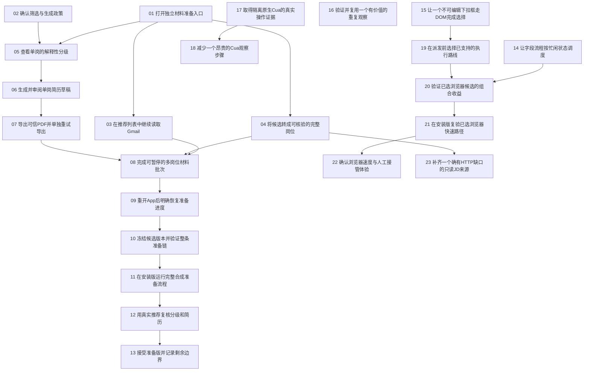

# 材料准备与浏览器能力：正式交付票

日期：2026-10-17。状态：**published**。用户已批准23张拆分及迁移，见[批准记录](approval.md)。

## 当前入口 — 2026-10-18

[全仓开放票整理与新增后继](../open-ticket-audit-2026-10-18/README.md)为当前导航。原批准23票仍为20结案、3人工待审；新补3张材料后继票，未领取、未执行。原表格及迁移文件记录批准当时的23票，不被覆写为新的批准清单。当前依赖只从子票读取：材料人审等待当前候选整链，真实单岗验收等待材料人审，浏览器体验等待真实单岗证据。

## 原批准规范入口

23张正式活动票已发布：材料准备13张、浏览器能力10张。**沿用现有子票的路径与身份**；本目录是统一导航与迁移记录，不另建重复issues目录。发布序号用于统一排序，不是对子票文件ID的改号。

每张票保留原Status、Assignee、Priority和Parent；AFK的Triage为ready-for-agent，四张HITL为needs-info。Triage不等于无阻塞：只有Status为open、Assignee为none且全部直接前置真实完成，才可领取。当前值仅保存在正式子票内。

三张旧材料票已行政合并并标明superseded，原文与承接关系保留；不计为工程完成。四张已完成基线/研究票及其领取、报告和资产字节保持不变。父地图和17项旧未完成任务未改动。

真实申请、上传、自动投递、最终Submit及联系人消息继续暂停。本轮仅发布与迁移，不领取或执行任务。

## 全部正式票与依赖

| 发布序号 | 正式子票（原身份） | 交互 | 直接前置 |
| --- | --- | --- | --- |
| 01 | [打开独立材料准备入口](../gmail-resume-preparation-2026-10-17/issues/02-preparation-only-runtime.md) | AFK | 无 |
| 02 | [确认筛选与生成政策](../gmail-resume-preparation-2026-10-17/issues/05-preference-grading-policy.md) | HITL | 无 |
| 03 | [在推荐列表中继续读取Gmail](../gmail-resume-preparation-2026-10-17/issues/03-gmail-incremental-paging.md) | AFK | [打开独立材料准备入口](../gmail-resume-preparation-2026-10-17/issues/02-preparation-only-runtime.md) |
| 04 | [将候选转成可核验的完整岗位](../gmail-resume-preparation-2026-10-17/issues/04-job-source-checkpoints.md) | AFK | [打开独立材料准备入口](../gmail-resume-preparation-2026-10-17/issues/02-preparation-only-runtime.md) |
| 05 | [查看单岗的解释性分级](../gmail-resume-preparation-2026-10-17/issues/06-grading-projection.md) | AFK | [打开独立材料准备入口](../gmail-resume-preparation-2026-10-17/issues/02-preparation-only-runtime.md)、[确认筛选与生成政策](../gmail-resume-preparation-2026-10-17/issues/05-preference-grading-policy.md) |
| 06 | [生成并审阅单岗简历草稿](../gmail-resume-preparation-2026-10-17/issues/08-source-bound-fact-findings.md) | AFK | [查看单岗的解释性分级](../gmail-resume-preparation-2026-10-17/issues/06-grading-projection.md) |
| 07 | [导出可信PDF并单独重试导出](../gmail-resume-preparation-2026-10-17/issues/09-draft-checkpoint-pdf-retry.md) | AFK | [生成并审阅单岗简历草稿](../gmail-resume-preparation-2026-10-17/issues/08-source-bound-fact-findings.md) |
| 08 | [完成可暂停的多岗位材料批次](../gmail-resume-preparation-2026-10-17/issues/07-bounded-batch-orchestration.md) | AFK | [在推荐列表中继续读取Gmail](../gmail-resume-preparation-2026-10-17/issues/03-gmail-incremental-paging.md)、[将候选转成可核验的完整岗位](../gmail-resume-preparation-2026-10-17/issues/04-job-source-checkpoints.md)、[导出可信PDF并单独重试导出](../gmail-resume-preparation-2026-10-17/issues/09-draft-checkpoint-pdf-retry.md) |
| 09 | [重开App后明确恢复准备进度](../gmail-resume-preparation-2026-10-17/issues/11-preparation-lifecycle-recovery.md) | AFK | [完成可暂停的多岗位材料批次](../gmail-resume-preparation-2026-10-17/issues/07-bounded-batch-orchestration.md) |
| 10 | [冻结候选版本并验证整条准备链](../gmail-resume-preparation-2026-10-17/issues/13-offline-batch-regression.md) | AFK | [重开App后明确恢复准备进度](../gmail-resume-preparation-2026-10-17/issues/11-preparation-lifecycle-recovery.md) |
| 11 | [在安装版运行完整合成准备流程](../gmail-resume-preparation-2026-10-17/issues/14-installed-preparation-acceptance.md) | AFK | [冻结候选版本并验证整条准备链](../gmail-resume-preparation-2026-10-17/issues/13-offline-batch-regression.md) |
| 12 | [用真实推荐复核分级和简历](../gmail-resume-preparation-2026-10-17/issues/15-real-preparation-pilot.md) | HITL | [在安装版运行完整合成准备流程](../gmail-resume-preparation-2026-10-17/issues/14-installed-preparation-acceptance.md) |
| 13 | [接受准备版并记录剩余边界](../gmail-resume-preparation-2026-10-17/issues/16-release-closeout.md) | HITL | [用真实推荐复核分级和简历](../gmail-resume-preparation-2026-10-17/issues/15-real-preparation-pilot.md) |
| 14 | [让字段流程按忙闲状态调度](../browser-efficiency-2026-10-17/issues/05-bounded-waits-readback.md) | AFK | 无 |
| 15 | [让一个不可编辑下拉框走DOM完成选择](../browser-efficiency-2026-10-17/issues/03-dom-first-controls.md) | AFK | 无 |
| 16 | [验证并复用一个有价值的重复观察](../browser-efficiency-2026-10-17/issues/02-dom-observation-references.md) | AFK | 无 |
| 17 | [取得隔离原生Cua的真实操作证据](../browser-efficiency-2026-10-17/issues/11-native-cua-baseline.md) | AFK | 无 |
| 18 | [减少一个昂贵的Cua观察步骤](../browser-efficiency-2026-10-17/issues/04-cua-binding-snapshot-overhead.md) | AFK | [取得隔离原生Cua的真实操作证据](../browser-efficiency-2026-10-17/issues/11-native-cua-baseline.md) |
| 19 | [在派发前选择已支持的执行路线](../browser-efficiency-2026-10-17/issues/06-hybrid-browser-routing.md) | AFK | [让一个不可编辑下拉框走DOM完成选择](../browser-efficiency-2026-10-17/issues/03-dom-first-controls.md) |
| 20 | [验证已选浏览器候选的组合收益](../browser-efficiency-2026-10-17/issues/07-paired-efficiency-regression.md) | AFK | [让字段流程按忙闲状态调度](../browser-efficiency-2026-10-17/issues/05-bounded-waits-readback.md)、[在派发前选择已支持的执行路线](../browser-efficiency-2026-10-17/issues/06-hybrid-browser-routing.md) |
| 21 | [在安装版复验已选浏览器快速路径](../browser-efficiency-2026-10-17/issues/08-installed-browser-efficiency.md) | AFK | [验证已选浏览器候选的组合收益](../browser-efficiency-2026-10-17/issues/07-paired-efficiency-regression.md) |
| 22 | [确认浏览器速度与人工接管体验](../browser-efficiency-2026-10-17/issues/09-browser-efficiency-acceptance.md) | HITL | [在安装版复验已选浏览器快速路径](../browser-efficiency-2026-10-17/issues/08-installed-browser-efficiency.md) |
| 23 | [补齐一个确有HTTP缺口的只读JD来源](../browser-efficiency-2026-10-17/issues/10-readonly-browser-job-source.md) | AFK | [将候选转成可核验的完整岗位](../gmail-resume-preparation-2026-10-17/issues/04-job-source-checkpoints.md) |

## 发布时可开始的任务（历史）

以下为发布时frontier快照，后续必须回读各子票：

- [打开独立材料准备入口](../gmail-resume-preparation-2026-10-17/issues/02-preparation-only-runtime.md)。
- [确认筛选与生成政策](../gmail-resume-preparation-2026-10-17/issues/05-preference-grading-policy.md)（需用户实际参与）。
- [让字段流程按忙闲状态调度](../browser-efficiency-2026-10-17/issues/05-bounded-waits-readback.md)。
- [让一个不可编辑下拉框走DOM完成选择](../browser-efficiency-2026-10-17/issues/03-dom-first-controls.md)。
- [验证并复用一个有价值的重复观察](../browser-efficiency-2026-10-17/issues/02-dom-observation-references.md)。
- [取得隔离原生Cua的真实操作证据](../browser-efficiency-2026-10-17/issues/11-native-cua-baseline.md)。

优先处理材料入口和浏览器固定等待；政策确认、窄DOM控件及原生就绪补测可独立推进。观察复用降后，只处理有实测价值的具体瓶颈。未领取状态保留，本轮没有自动开工。

## 执行与完成规则

- 先重新读取状态、领取和当前依赖，再写唯一Assignee；多人并行时协调共享模块。单一子票是状态事实来源。
- 19张AFK使用ready-for-agent，四张HITL保留needs-info，必须由用户实际回答/审阅/接受。批准拆分不代替这些后续业务决定。
- closed且Closure reason为superseded只表示承接，绝不是工作已完成。当前活动依赖不得指向此类票；新依赖必须沿Superseded by找到真正承接票。
- 浏览器基础候选为调度、窄DOM与派发前选路。若把观察缓存或原生Cua优化纳入发布，先补对应依赖并取得真实验证；没有原生证据时只声明DOM/人工接管范围。
- 每个切片都要独立演示或验证；保留身份、授权、未知停止及必要回读。未测得收益不扩建框架，不恢复原申请。

## 依赖图

## 迁移与历史

- [确定材料准备版范围、记录身份与验收契约](../gmail-resume-preparation-2026-10-17/issues/01-release-contract.md)：行政承接到[打开独立材料准备入口](../gmail-resume-preparation-2026-10-17/issues/02-preparation-only-runtime.md)、[确认筛选与生成政策](../gmail-resume-preparation-2026-10-17/issues/05-preference-grading-policy.md)；没有宣称实现完成。
- [阻止空选材简历并核验 PDF 输出质量](../gmail-resume-preparation-2026-10-17/issues/10-resume-output-quality.md)：行政承接到[生成并审阅单岗简历草稿](../gmail-resume-preparation-2026-10-17/issues/08-source-bound-fact-findings.md)、[导出可信PDF并单独重试导出](../gmail-resume-preparation-2026-10-17/issues/09-draft-checkpoint-pdf-retry.md)；没有宣称实现完成。
- [提供候选分级与简历集中审核工作台](../gmail-resume-preparation-2026-10-17/issues/12-candidate-material-workspace.md)：行政承接到[打开独立材料准备入口](../gmail-resume-preparation-2026-10-17/issues/02-preparation-only-runtime.md)、[在推荐列表中继续读取Gmail](../gmail-resume-preparation-2026-10-17/issues/03-gmail-incremental-paging.md)、[将候选转成可核验的完整岗位](../gmail-resume-preparation-2026-10-17/issues/04-job-source-checkpoints.md)、[查看单岗的解释性分级](../gmail-resume-preparation-2026-10-17/issues/06-grading-projection.md)、[生成并审阅单岗简历草稿](../gmail-resume-preparation-2026-10-17/issues/08-source-bound-fact-findings.md)、[导出可信PDF并单独重试导出](../gmail-resume-preparation-2026-10-17/issues/09-draft-checkpoint-pdf-retry.md)、[完成可暂停的多岗位材料批次](../gmail-resume-preparation-2026-10-17/issues/07-bounded-batch-orchestration.md)；没有宣称实现完成。

- [迁移清单：逐票身份、承接与SHA](publication.json)
- [发布验证](publication-validation.json)
- [批准前完整审阅稿](history/pre-publication/.scratch/tomorrowstar-ticket-consolidation-2026-10-17/README.md)
- [批准的逐票草案](draft-index.json)：drafts目录保持原字节，只作审批历史，不是可领取票。
- [旧票源文件快照](source-snapshot.json)及history/pre-publication：供审计回溯，旧validation是审阅时检查，不是当前状态。
- [旧任务与独立工作流快照](preserved-work.md)：其中统计是迁移前快照，旧任务实际文件未变。

## 资料与工期

[开源参考与取舍](../../research/browser-automation-reference-supplement-2026-10-17.md)包含既有43项目录及新增15个仓库研究，机制已经进入相关票，不默认增加执行框架。已完成研究不重新建票。

[整体预算](../../research/tomorrowstar-combined-delivery-estimate-2026-10-17.md)仍为45–80个Codex主动小时、风险情景总计65–105小时；包含已完成基线与研究，不是精确剩余时长。真实内容人审与账号等待另计。

父地图作为原范围与历史继续保留，本次不修改；当前执行契约以本导航链接的已批准子票为准。

2026-10-18 最新执行状态：23张正式票20 closed、3 open；剩余均为HITL（12、13、22）。21号独立安装合成工程复验已完成，见[最终报告与限制](../browser-efficiency-release-2026-10-18/branches-authorized/README.md)。精确两份合成测试授权不扩大到真实材料、真实申请或产品接受。
