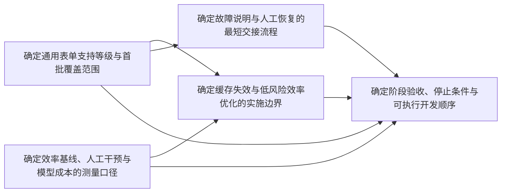

# 当前工作与开放 ticket 审计 — 2026-10-12

时区：Europe/Zurich。范围：当前公开 checkout、规划记录、本地 tracker、GitHub 开放记录及离线合成检查。
本页是带日期的审计快照。ticket 文件保存状态，主路线保存阶段验收；本页不建立第二套状态来源。

## 当前结论

- 主里程碑仍是完整职业图与恰好三个真实 JD 的假设验证。Phase 7、8 按首版 cutoff 完成；Phase 9 实现已交付，真实问题质量、readiness 与人工校准仍开放；Phase 10–14 尚未验收。
- worker 稳定性六张实施票均为 `closed`。下一阶段地图有五张 `open` 决策票，其中两张在 frontier，三张被其他开放决策阻塞。
- 职业清单旧地图另有两张 `open` 和一张 `claimed`。其范围没有明确区分已完成首版与待接受后继，不能用这些旧状态推翻首版验收，也不能据此自动接受后继。
- 五组 tracker 共 34 张子票：7 张 open、1 张 claimed、9 张 closed、17 张 resolved。开放记录共 8 张；其中 worker 5 张，职业清单遗留 3 张。没有把未开始的路线阶段扩写成新票。
- GitHub 本次只读查询没有开放 issue 或 PR。现有本地 Markdown tracker 是票状态入口。
- 当前分支为 `master`，HEAD 为 `e4a26d0c24311d014d478f7f92e58a88e6709b4b`。大量实现和证据尚未提交。HEAD 不能代表当前运行源码；本次检查另绑定 [123 项公开执行输入](inputs-before.json)。

来源：[主路线](../../.planning/ROADMAP.md)、[当前状态](../../.planning/STATE.md)、[三层访谈交付](../../docs/interview-delivery-2026-10-08.md)、[worker 地图](../application-worker-next-stage/map.md)、[原始 tracker 快照](tracker-snapshot.json)。

## 开放决策与依赖

五张票均为 HITL，均未领取。推荐默认值仍是待讨论方案。

| ticket | 类型 | 当前入口 | 关闭所需结果 |
| --- | --- | --- | --- |
| [确定通用表单支持等级与首批覆盖范围](../application-worker-next-stage/issues/04-coverage-contract.md) | grilling | **可领取，按 tracker 文件顺序为下一票** | 支持等级、动态字段边界、跨企业样本矩阵及退出条件；6–8 岗位只是建议 |
| [确定效率基线、人工干预与模型成本的测量口径](../application-worker-next-stage/issues/05-measurement-contract.md) | grilling | **可领取** | 分段计时、用户等待、失败/取消、介入、缓存、模型成本的统一口径；不从测试耗时推导岗位效率 |
| [确定缓存失效与低风险效率优化的实施边界](../application-worker-next-stage/issues/06-efficiency-contract.md) | grilling | 被支持等级和测量口径阻塞 | 已测瓶颈、输入失效矩阵、收益门槛及停止条件 |
| [确定故障说明与人工恢复的最短交接流程](../application-worker-next-stage/issues/07-recovery-handoff-prototype.md) | prototype | 被支持等级阻塞 | 最小交互稿及用户反馈；覆盖结果未知、页面关闭、记录冲突和批次暂停 |
| [确定阶段验收、停止条件与可执行开发顺序](../application-worker-next-stage/issues/08-stage-acceptance.md) | grilling | 被以上四张票阻塞 | 综合规格、退出证据、真实试点边界及实施顺序 |

已关闭依赖仍保留在各票的 `Blocked by`；表中只列仍开放的阻塞。

按既有规则，每次只解决一张人的决策票。下一次领取支持等级票。测量口径也已可领取，并须在效率优化前完成。
本次审计没有领取、关闭或代答 HITL 票。

## 职业清单的遗留状态

| ticket | 原状态 | 本次核对 | 后续处理 |
| --- | --- | --- | --- |
| [Reconcile Ambiguous, Excluded, and Unresolved Career Items](../phase-08-career-experience-inventory/issues/07-reconcile-ambiguous-excluded-and-unresolved-items.md) | claimed | 票内仍记录 Source-universe successor；主路线记录首版清单已接受，后来修正仍需精确接受 | 先核对该领取对应的后继修订与执行者，不推定 abandoned，不重复领取 |
| [Refresh the Phase 7 Independent Verification Prerequisite](../phase-08-career-experience-inventory/issues/08-refresh-the-phase-7-independent-verification.md) | open | 首版前置已有 2026-10-07 独立 passed 记录；当前 workspace.py、cli.py 已不等于该报告的输入 | 补清 cutoff/源码范围；历史完成和当前独立复验分别记录 |
| [Seal the User-Accepted Inventory Revision](../phase-08-career-experience-inventory/issues/09-seal-the-user-accepted-inventory-revision.md) | open | 首版封存已记录完成；没有本次新后继的精确接受证据 | 先区分首版状态补记与新后继任务，再按相应批准和来源链封存 |

来源：[首版独立前置验证](../../.planning/phases/07-career-source-custody-and-private-workspace/07-VERIFICATION-2026-10-07.md)、[后续交付边界](../../docs/interview-delivery-2026-10-08.md)、[当前机器状态](../../.planning/state.json)。
本次只核对公开记录，没有读取私人清单或用户回答。上述三票保持原状态，并追加审计定位。
现有首版完成记录不足以把票内的后继接受视为完成。旧 `claimed` 也不证明现在有活跃执行者。

## 当前证据与验收缺口

| 工作面 | 已有证据 | 仍未建立的结论 |
| --- | --- | --- |
| worker 稳定性 | 六票 closed；R8/R9 记录离线 858 passed、原生合成 86 passed | 当前九个变更文件不能继承旧版本的原生验收；真实 sleep/wake、真实站点恢复与独立 worker App 包仍未验收 |
| 历史 TargetClosedError | 历史 timer 异常传播机制已复现；最终诊断矩阵 26 passed；预期红测仍为 1 failed | 历史关闭发起方、完整原生产重放及生产恢复均未知/未验证 |
| 诊断 runner 后续修复 | finalization-fix 固定封存入口的独立两轴审查无发现；280 项副本回归通过 | 这些结果验证诊断归档与清理，不能扩大为新岗位分流或当前 worker 原生兼容性 |
| 岗位批量/人工精准分流 | 九项当前哈希与最近来源核查收据一致；本次当前 checkout 完整离线 897 passed | 当前原生浏览器与真实 ATS 兼容性需要新输入绑定的验收 |
| 表单覆盖 | 一个真实 Ashby 岗位的草稿保存/附件挂接；Lever、Greenhouse 真实空表只读证据 | 跨企业覆盖、完整真实 Lever/Greenhouse 填值上传和接收回执仍未验收 |
| 效率 | 已有缓存、观察和检查点可复用 | 分段岗位基线未定，不能声称性能改善 |
| 职业图验证 | 通用适配、三层执行、后继守卫及冻结合成试运行已交付 | 真实人工能力校准、reviewed Skill、完整确认图、三 JD 评价及最终独立决策仍开放 |

[最近来源与影响核查](../application-worker-hash-drift-review-2026-10-12/README.md)已经定位九项改动的来源。
本次重新核对，九项都与其最终收据一致；R8/R9 的 36 项清单中九项失配，27 项匹配，没有缺失。
历史输入下的 passed 保持有效；新代码需要新证据，不能覆盖旧日志或升级旧结果。

这张表列的是验收缺口，不是自动新建的决策票。已有开放票承担对应规格；先解决决策，再确定验证切片。
主里程碑验收仍以 ROADMAP/REQUIREMENTS 为准。worker 和求职辅助交付不计入职业图核心假设的验收进度。

## 本次检查

| 检查 | 本次结果 |
| --- | --- |
| 完整 checkout 离线回归 | **897 passed、87 deselected；129.30 秒**。XML 为 0 failures / errors / skipped |
| 输入绑定 | 123 项代码、测试、静态资源和依赖配置前后相同；[结束输入](inputs-after.json) |
| Ruff check / format | 维护源码、scripts、tests 和构建入口通过；112 份 Python 文件格式通过 |
| JavaScript 语法 | 3 份 portal 脚本通过；[逐文件结果](js-checks.json) |
| 依赖与状态 | worker 依赖无环，两个 frontier 入口；34 张票的 Status 均保留 |
| 文档导航 | 7 份新增或更新文档的本地链接通过；git diff --check 通过 |
| 主里程碑需求 | REQUIREMENTS 记录 7 项完成、25 项待验收；不是假设有效性比例 |

完整结果及输入变化核对保存在 [verification.json](verification.json)。
原始日志为 [offline.log](offline.log)，结构化结果为 [offline.xml](offline.xml)。
此套件按项目默认排除 `live`、`live_model` 和 `worker_browser`；没有真实 ATS、模型调用或浏览器故障注入。
检查不涉及个人能力或真实投递成功率。

领取下一张 worker 票前，复用[本地 frontier 查询](../application-worker-next-stage/README.md#wayfinding-operations)。
它每次读取实际 ticket 状态，不能以本快照替代实时查询。
