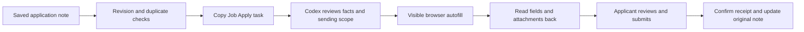

# Application autofill pilot

## Scope — 2026-10-20

The default product workflow is the [single-job application flow](single-job-flow.md),
with changes tracked in the [development plan](development-plan.md). This page
preserves the original prompt-copying pilot and its tested plugin revision.
It is an optional legacy tool, not a required handoff or approval stage.

Daily operation automatically processes recommended-email jobs one at a time,
reuses both libraries and existing login state, and prepares/fills/uploads normal
applications to the manual Submit boundary. High-value jobs receive complete
analysis and material drafts before the user makes precise adjustments. Only
important missing facts, actual conflicts, login challenges or unclear operation
results interrupt the current job; general prose is decided by the system.
After manual edits, one Continue action resumes remaining steps. Clear submission
results are recognized and recorded automatically. No separate material, sending
or receipt confirmation is required by the product design.

The instructions below describe this pilot's existing interface and historical
limits. They do not add platform, data-consent or per-application approval gates
to the product. This documentation update changes neither the plugin nor runtime.

This user-requested operational integration connects application notes to the
existing Codex Job Apply plugin. It does not change the career-graph milestone,
admit a Skill score or establish application success.

This page describes the original single-job Codex handoff. The separate
[independent worker](live-application-worker.md) now also supports a supervised live pilot.
It uses a dedicated Chromium process and does not require the Codex internal browser.

Use the [current worker workflow and test overview](application-worker-workflow.md)
for the shared worker, generic forms, resume generation and recovery.

The portal prepares one task. The user pastes it into a Codex conversation with
the plugin enabled. Codex uses its visible Browser surface to fill the form.
The applicant performs the final Submit or Send action.



## Retained pilot interface

1. Open **求职进度** and save a record with status **准备投递**.
2. Use a direct Lever or Greenhouse job URL. This pilot accepts `jobs.lever.co`,
   `jobs.eu.lever.co`, `boards.greenhouse.io` and `job-boards.greenhouse.io`.
   Embedded forms, search pages and other ATS platforms remain outside this pilot.
3. Reopen the saved record. Under **交给 Codex 填表**, choose **准备填表任务**.
4. Choose **复制任务** and paste it into a Codex conversation with Job Apply
   enabled. In a native window without clipboard API support, the text is
   selected for manual copying with `⌘C`.
5. Confirm the target, facts, answers and resume version when needed. Codex
   checks the note revision and live form before filling. Unknown answers,
   login, CAPTCHA, MFA, conflicts and ambiguous states require user handling.
6. Review the visible fields and attachment filename. Submit personally. Update
   the original note only after observing a confirmation page or confirmation
   email. A filled form alone does not establish receipt.

The button prepares a prompt; it does not start a background agent, open an
application, upload a resume or change the application status. The browser
execution and final-action boundary are governed by the Job Apply skill.
The portal does not enforce control of a live ATS Submit button.

## Installation and upstream provenance

Use the existing Codex plugin interface. The tested baseline is
[neonwatty/job-apply-plugin](https://github.com/neonwatty/job-apply-plugin),
revision `370204c58b1137d08c5a7e7449538ae6447be0b9`, plugin version `1.1.0`,
MIT license. Register the exact revision before installing:

```sh
codex plugin marketplace add neonwatty/job-apply-plugin \
  --ref 370204c58b1137d08c5a7e7449538ae6447be0b9
codex plugin add job-apply@neonwatty-plugins
```

Start a new Codex conversation if the current conversation does not expose
`$job-apply:job-apply` and `$job-apply:answer-memory`. The macOS App contains the
handoff surface; the plugin runs in Codex and is installed separately.

Classification for this handoff: **reuse externally**. The separate worker vendors
only the pinned answer helper; see its [provenance](../src/career_evidence_graph/_vendor/README.md).
Local divergence: restrict the portal entry to two ATS
families, read fresh application notes, reject stale revisions and duplicate
job identities, preserve the original status, and create a single review-only
task. The pinned version is a tested baseline, not a runtime verification of
future plugin updates. Revalidate after an update.

## Existing pilot data and state

The application note remains the source of application status. The task includes
its private path, SHA-256 revision, company, title and normalized job URL.
Query parameters and fragments are removed from direct job URLs. Copies belong
in the user's private Codex conversation, not public issues or system fixtures.

The portal copies no resume, applicant profile, source body or answer into a new
store. Job Apply retains its profile and answers in its own local store outside
the checkout, through its bundled storage helper. It owns answer scope,
confirmation, sensitive-value consent and resumable session records. The pilot
does not automatically extract new applicant facts from career documents.

The preparation API uses the existing Host, Origin, body-size and CSRF checks.
It creates no file and contacts no external service. Only `drafting` records
enter preparation. Another note for the same platform and job path blocks the
task even when URL tracking parameters or a Lever `/apply` suffix differ.
Unsaved browser edits clear a prepared task. A task's execution still needs a
fresh revision check because Obsidian can change a note after preparation.

## Historical verification interface

Use synthetic notes and the pinned plugin's isolated loopback fixtures.
Keep interface tests, synthetic browser replay and live ATS acceptance separate.

```sh
uv run --locked python scripts/run_pytest.py \
  tests/test_application_automation.py tests/test_career_portal_http.py -q
```

For a supervised plugin replay, use its `qa-replay.py` prepare, resolve, started,
reviewed, evaluate and cleanup commands. Resolve storage routing before any
store call. Use `--root` for every helper call. Never read or initialize the
normal applicant store in a synthetic replay. A replay validates only the
synthetic fixture. It cannot establish live form completeness or delivery rate.
