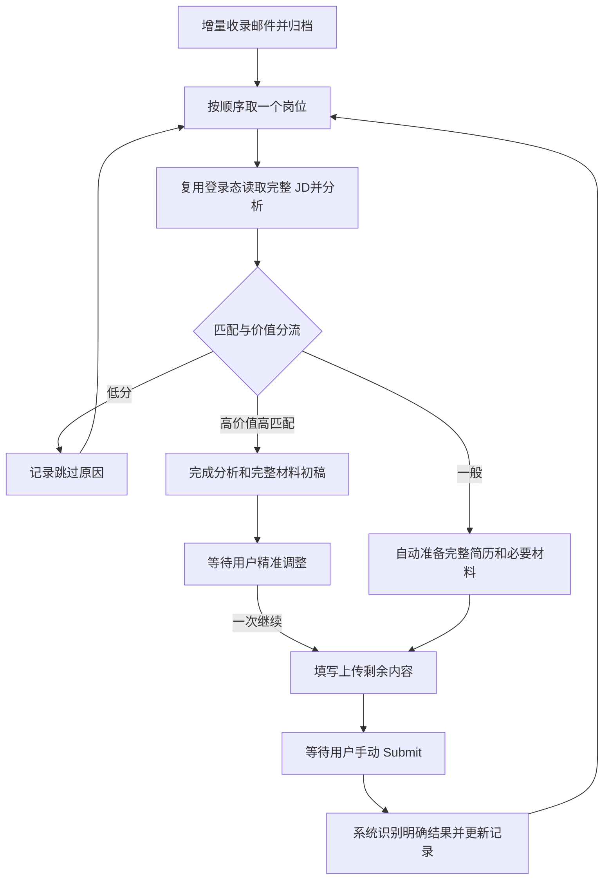

# 申请 worker：运行流程与测试总览

P07 的解析稳定观察、非空保护、集中差异与未知核对见[ATS 接续](ats-continuation.md)和[分层验证](../.scratch/resume-agent-delivery-2026-10-22/p07-source-verification.md)。旧接口记录保留；旧绿色测试不代表安装版或真实 ATS 接受。

## 当前产品规范 — 2026-10-20

产品行为以[单岗位流程](single-job-flow.md)为准，实施顺序见[开发计划](development-plan.md)。
本页区分目标与现存实现；修改文档不表示已修改代码、更新安装版或完成真实投递验收。
[Codex 交接](codex-handoff.md)、[实验路径](application-automation-lab.md)和合成预览是显式备用入口。

系统服务本地单用户。一次开启持续有效，增量收录工作平台推荐邮件，不自行搜寻岗位，
不设邮件数、岗位数或整轮时限。原邮件、推荐条目和链接持久保存即完成收录，再加专用标签并归档。
邮箱已读不等于系统已处理；后续岗位状态由系统记录，不反复读取邮件。

重要必要事实缺失、实际重要冲突、登录验证、操作超时、持续无进展或结果不明时，
停止当前岗位并提示用户。不能自行转去其他岗位，也不集中积攒问题；仅新邮件收录可继续。
用户可选择“跳过，处理下一个”，保留该岗位的材料、进度和停止原因，以后回来继续。
低价值措辞、why company 和 motivation letter 等内容由系统根据真实资料自主决定。

## 资料、材料与浏览器

| 部分 | 当前产品要求 |
| --- | --- |
| 职业事实 | 职业经历库为准。用户明确补充或更正直接写入，保留来源和修改历史；重要歧义才问。 |
| 申请信息 | 信息库保存申请信息、可复用答案及零碎信息。系统判断题意和适用范围，明确时直接复用。 |
| 简历及附件 | 系统完成选材、改写、检查、编译和上传。保留事实、合作责任和人工修改，不要求逐组或每份源/PDF批准。 |
| 局部更新 | 只更新实际受影响部分；人工修改版本是后续基础。配置变化不作废已有有效成果。 |
| 页面操作 | 有适配就复用，无适配就使用通用浏览器；Next、多步、正常草稿保存和预上传不因缺平台或请求许可而停。 |
| 提交 | 自动执行不点击最终 Submit，也不发送最终投递请求；用户提交后自动识别明确成功，结果不明才问。 |

来源不明或引用失败先标记对应条目，其他事实继续使用。保持事实诚实，不能把计划、团队工作或
工具协助虚构成本人完成，也不能从文案生成推导能力分数。独立 Grill-Me 评分研究的审核仍属于研究流程。

## 暂停、人工介入与恢复

用户手动介入时暂停页面自动操作，保留其修改；用户点一次继续后读取当前页面并完成剩余步骤。
正常运行的流程在 App 重开后从检查点自动继续，已完成操作不重复执行。主动暂停、等待回答、
等待精准调整或手动 Submit 的状态保持等待。仅无法确定中断前操作结果时提示用户。

保存结果和可观察页面是恢复依据；旧 PID、`page_open` 或过期心跳不能证明页面仍存活。
系统先自行核对现有检查点、页面与回执，不把恢复拆成核验、重新接管和再次授权等多个用户步骤。
记录同步失败只重试同步，不重复填写、上传或提交。可靠性检查在内部执行，不新增人工作业。

## 现存实现与待改差距

2026-10-20 源码审计发现的具体改动由开发计划跟踪。现存自动 pipeline 复用 WorkerService，
浏览器 runner 和原生 driver；普通主入口已能自动绑定 PDF，不能把旧准备模式的逐组审核说成其必经步骤。
但持续邮箱队列、三路分流、逐岗提交结果衔接、重要性判断、两库事实更新和局部失效仍需贯通。
旧 worker 还保留有限批次、固定问题别名、逐请求 grant、控制页租约及多段人工恢复；
旧材料准备模式仍有逐组与 PDF 审批。它们是待简化实现，不是产品要求。

需要维护旧接口时，参数与数据格式见[通用执行器](generic-application-worker.md)、
[旧托管表单试点](live-application-worker.md)及[合成预览](lever-worker-preview.md)。
这些命令会选择对应旧模式，不是普通使用必须完成的启动步骤。
本次文档整理没有启动命令、模型、浏览器、邮箱或申请动作。

以下为按原版本保留的测试与运行记录，不证明最新目标已实现，也不重新规定用户审批步骤。

## 历史测试清单

以下是各阶段的实际快照。全量套件多次重跑，**通过数不能相加**。
浏览器检查数、岗位实例数、表单回合数和真实岗位数分别计数。
`deselected` 表示该次命令未选择，不表示通过。

| 阶段与报告 | 本地结果 | 真实运行边界 |
| --- | --- | --- |
| [10-09 插件交接](../validation/application-automation/2026-10-09/README.md) | 系统 650 passed / 1 deselected；插件 308 passed；任务/HTTP 72 passed；新构建 App 验证通过 | 只读交接；初始 Lever 回放中断，failed 原报告保留；无真实申请 |
| [10-09 三轮浏览器回放](../validation/application-automation/2026-10-09/three-rounds-01/README.md) | Lever、Greenhouse 各一轮 9/9；缺失必填答案一轮预期拦截；72 项契约和 9 项异常回归 | 监督式合成浏览器回放，尚非独立 worker；第三轮完整 oracle 的 failed 保留 |
| [10-10 Lever 独立预览](../validation/application-automation/2026-10-10/lever-worker-preview/README.md) | 离线 669 / 7 未选；浏览器 6 passed；最终针对性 88 passed | 3 主轮、7 岗位实例、7 合成上传；另含故障路径；0 最终提交 |
| [10-10 Greenhouse 共用 worker](../validation/application-automation/2026-10-10/greenhouse-worker-preview/README.md) | 离线 671 / 16 未选；双平台浏览器 15 passed，两次回归 | 新增 3 主轮、5 GH + 1 Lever 实例、6 合成上传；0 最终提交 |
| [10-10 真实表单只读接入](../validation/application-automation/2026-10-10/live-worker-pilot/README.md) | 离线 687 / 21 未选；浏览器 20 passed / 16 未选；针对性 37 passed | Lever 真实岗位 14 字段 / 10 必填；Greenhouse 真实岗位 30 字段 / 23 必填；真实资料填值和上传未执行 |
| [10-10 岗位筛选](../validation/application-automation/2026-10-10/job-screening/README.md) | 离线 740 / 21 未选；筛选相关 136 passed；既有浏览器 20 passed | 桌面和移动筛选检查；语言与未知资格处理；无真实填表 |
| [10-10 通用控件与岗位简历](../validation/application-automation/2026-10-10/generic-worker-checks.md) | 离线 745 / 30 未选；浏览器 29 passed；新增公开读取许可后相关浏览器 14 passed | 独立简历生成、用户核验与表单预检分开；合成上传不证明真实保存 |
| [10-10 投递历史守卫](../validation/application-automation/2026-10-10/application-history-checks.md) | 离线 752 / 31 未选；浏览器最终 30 passed；针对性 87 passed | 首次浏览器 29 passed / 1 failed，修正同步冲突保留后重跑通过；不审计邮箱或平台账户 |
| [10-10 ElevenLabs 辅助填写](../validation/application-automation/2026-10-10/assisted-native-fill-checks.md) | 原生页面 7 必填回读；PDF HTTP 204 与附件挂接成功 | agent-browser 辅助操作；页面姓名曾显示但未保存，重新 blur 后保存；不是自动 worker 验收 |
| [10-10 ElevenLabs 独立自动保存](../validation/application-automation/2026-10-10/worker-autosave-upload-checks.md) | 离线 776 / 34 未选；新范围离线 24、浏览器 3；既有浏览器 30 passed | 同一真实岗位：前版 3 成功 + 最终版 3 成功，另保留 5 失败尝试；0 Submit、0 回执 |
| [10-11 流程整理与优化](../validation/application-automation/2026-10-11/workflow-consolidation/README.md) | 离线 777 passed / 37 未选；浏览器 36 passed；最终失联 UI 回归 1 passed | 无新真实填值、上传或模型调用；旧运行已退出，只恢复工作台服务 |
| [10-11 稳定性六票](../.scratch/application-worker-stability/evidence/acceptance.md) | 17 组合成验收；离线 808 passed / 67 未选；浏览器 66 passed / 809 未选；最后 UI 修正另 2 passed | 原生 crash 已观察；真实休眠、真实站点恢复与 App 打包未验收；0 自动 Submit，失败原始记录保留 |
| [10-11 稳定性复查修复](../.scratch/application-worker-stability/fixes/2026-10-11-r1-r3/README.md) | 新增 23 个回归；完整离线 823 passed / 75 未选；原生合成浏览器 74 passed / 824 未选；门禁全部通过 | 已完成动作恢复、同 attempt 网站重试及取消结算边界；旧验收和失败输出保留；真实 ATS / 模型 0，真实休眠和 App 打包未验收 |
| [10-11 第二次稳定性复查修复](../.scratch/application-worker-stability/fixes/2026-10-11-r4-r5/README.md) | 新增 15 个竞态回归；完整离线 835 passed / 78 未选；原生 77 passed / 836 未选；六项门禁通过 | 晚完成优先、取消命令边界与完整旧批次历史；首次 crash 超时和原断言复验保留；真实 ATS / 模型 0，真实休眠和 App 打包未验收 |
| [10-11 第三次稳定性复查修复](../.scratch/application-worker-stability/fixes/2026-10-11-r6-r7/README.md) | 新增 11 个回归；完整离线 843 passed / 81 未选；原生 80 passed / 844 未选；独立探针 12 passed；六项门禁通过 | 提前 recheck 保留原 attempt 的完成；旧格式顺序冲突停止写授权并可人工接管；取消与历史回归通过；首次 crash 超时根因仍未知，旧失败保留；真实 ATS / 模型 0 |
| [10-11 第四次稳定性复查修复](../.scratch/application-worker-stability/fixes/2026-10-11-r8-r9/README.md) | 新增 21 个回归；完整离线 858 passed / 87 未选；原生 86 passed / 859 未选；封存探针 14 passed；六项门禁通过 | 旧 R6 无绑定完成及同一申请历史阻止自动写；原时限 crash 注入复验通过；取消结算与人工边界保留；633 个旧文件未改；历史失败全部保留；生产 TargetClosedError 底层根因未宣称已解决；真实 ATS / 模型 0 |

通用简历阶段还分别回测了 PDF 绑定（1 passed）、归属与 Codex 边界
（18 passed / 1 skipped / 1 deselected）和精确公开 POST 许可（1 passed）。
完整命令、截图、分轮 JSON 和额外针对性结果由各行报告提供。
历史 App 验证属于插件交接构建；独立 worker 的原生 App 打包尚未验收。

## 真实回合和失败证据

ElevenLabs 是**一个真实岗位、多个独立表单实例**。11 个自动回合包含 5 个开发中失败与 6 个成功。
原页面的辅助填写单独计数，不混入自动成功回合。未据此计算成功率。

| 回合组 | 结果 | 原因与处理 |
| --- | --- | --- |
| 初期 1 回合 | 未填字段，暂停 | 已观察到的遥测被误判；两个路径继续阻断，但不再暂停草稿操作 |
| 初期 1 回合 | 3 个字段后暂停 | 单选框 HTML 默认值与服务端值不同；改用唯一服务端选项 |
| 初期 3 回合 | 6 个字段后暂停，未完成附件 | 上传原生 multipart 额外包含固定 PDF Content-Type；明确校验该项并保留未知字段拒绝 |
| 前版 3 回合 | `ready_for_review` | 每回合 6 次保存、1 次 PDF 上传和 1 次挂接；7 必填项服务端回读 |
| 最终版 3 回合 | `ready_for_review` | 修正快速响应交错后再执行；完成后暂停恢复不重复发送，填写中暂停恢复保持页面 |

每个成功回合核验批准 PDF 字节、HTTP 204、附件 ID / 文件名、无服务端错误及必填覆盖。
这些是草稿保存证据，不是招聘方收到最终申请的证据。
真实失败细节、许可及原始请求保留在私有运行目录，不复制到公开报告。

其他已记录失败包括：初始插件回放中断、缺失答案完整 oracle 的预期不满足、
本地浏览器启动 / 路由配置问题，以及历史守卫引入后丢失同步冲突的回归。
原报告仍保留。恢复成功不把此前 failed 改成 passed。

## 历史验收状态与优化 — 2026-10-11

| 能力 | 当前判定 | 限制 |
| --- | --- | --- |
| 队列、范围答案、PDF 内容绑定、原记录同步 | 本地通过 | 外部编辑器不使用系统锁，仍有最后复查到替换的竞争窗口 |
| 原生控件、待补问题、暂停 / 恢复、人工交接 | 合成浏览器通过 | 未覆盖所有真实动态控件和页面变体 |
| 已核验 Ashby 草稿保存 / 附件挂接 | 一个真实岗位通过 | 许可绑定具体岗位和完整请求，不能跨企业直接复用 |
| Lever / Greenhouse 真实空表 | 只读通过 | 完整真实个人信息与附件自动操作未验收 |
| 最终申请 / 招聘方接收 | 未执行 / 未观察 | 用户最终提交；接收来源另行核验 |
| 长期无人值守、登录 / CAPTCHA、多步跨页、其他平台、worker App 包 | 未验收 | 优先按实际高价值岗位做小样本核验 |

本轮修正通用链接的同步重试、关闭页面的草稿会话残留，以及无可自动执行岗位时的继续按钮。
工作台显示服务端核验的阶段和人工接管状态；未知保存结果给出具体提示。
失联时明确标记页面状态来自上次记录。用户核验后进入 queued 的岗位仍可开始恢复。
旧报告、源码清单及真实记录没有改写。本节保留当时的导航与优化结论；当前开发以本页顶部链接为准。

后续扩展先复用原生控件、队列、答案库和恢复逻辑。
只为实际遇到的身份、控件或发送路径补最小契约，并分别验收。
复杂登录与多步页面先交人工；没有需求时不增加框架、平台队列或模型调用。

### 2026-10-11 运行状态核对

旧 worker PID 和招聘浏览器调试端口均未发现。当前不能确认原 ElevenLabs 页面仍打开。
原检查点仍为 paused / needs_recheck / handed_off，保存的 `page_open` 属于历史状态。
运行错误为 `TargetClosedError`。退出原因未进一步确定，不由恢复工作台推断故障已修复。
本轮只恢复 `http://127.0.0.1:8769/#applications` 的工作台服务；没有启动招聘浏览器、恢复填表或上传。
下一次启动 worker 才会加载新代码。先核实最终提交状态和网站草稿；不能把磁盘记录当作原页面恢复。
