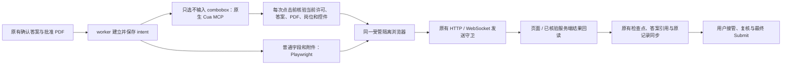

# CuaDriver 与申请 worker 的最小接入

当前流程以[单岗位申请工作台](single-job-flow.md)为准，改造顺序见
[开发计划](development-plan.md)。本页区分目标契约与现有技术限制；文档修订不表示
浏览器执行器已经完成改造。[Codex 交接](codex-handoff.md)与
[实验路径](application-automation-lab.md)保留为备用模式。

## 当前目标契约

- 使用通用浏览器线性处理一个岗位，正常读取、导航、自动保存和上传不受逐平台
  HTTP/query grant 审批。禁止自动最终 Submit；真实动作结果仍须观察。
- 重要事实缺失、实际冲突或结果不明时停当前岗等待，不转去其他岗；用户选择跳过
  才继续下一岗。等待期间仅收录新邮件。登录或验证需要人工时，保留页面与用户编辑，
  完成后一次“继续”，由系统检查后接着执行。
- 正常运行在重开后自动恢复；显式暂停和待答问题保留等待。能够确定的已完成操作
  不重复，未知结果先核对。无法定位页面或操作无进展时给出具体问题。
- 辅助功能和录屏权限是实际系统能力需求。只在用到该能力时检查，不能阻止本地
  资料保存或简历分析。稳定签名、同一 App 和安全更新继续保留。
- 包哈希、窗口/PID 版本、责任链、controller lease、epoch 和后台隐藏状态属于
  实现与诊断信息，不作为每次点击和恢复的批准条件。后台呈现失败可以报告并允许
  用户在原页继续，不因此重走材料或权限验收。
- 不设全轮时限或邮件/岗位数硬上限。超时用于识别一次操作没有进展；先跑通线性
  完整流程，再研究并发。保留可用记录和单实例、原子保存等本地正确性措施。

## 现有实现限制与历史诊断记录

下文保留已有接口、发送守卫、版本阻断和测试的原始说明。其中逐动作许可、精确
grant、强制隐藏窗口和人工恢复步骤是待收敛的实现限制，不能反向成为产品需求。
带日期的安装、候选与失败记录仅说明当时结果，不宣称当前安装状态或主链完成。

更新：2026-10-16。实现范围：checkout worker、macOS CuaDriver.app、隔离系统 Chrome。
不依赖 Hermes，不新增 Python 依赖，不调用新的模型/provider。

2026-10-16：[TomorrowStar 原生宿主 TCC 独立核验](../.scratch/cua-gui-host-tcc-2026-10-16/README.md)。
实际安装包通过 LaunchServices 运行固定的无窗口诊断入口。原生宿主、Python、MCP 代理及 daemon
的系统责任 PID 一致。辅助功能和录屏均未授予，生产后台调用在浏览器创建前返回
`cua_permissions_required`。本轮没有请求授权；GUI 宿主的完整浏览器验收仍待权限具备后复验。

2026-10-16：[修复版接入已安装 TomorrowStar](../.scratch/cua-installed-integration-2026-10-16/README.md)。
应用从自身 Resources 选择固定哈希辅助程序；缺失或不符即停止，不回退到外部版本。
官方 CuaDriver.app 的签名与原字节保持，原应用完整备份。包内路径的隔离合成验收与
GUI 宿主的 TCC 身份分开记录；该次安装验收没有启动 GUI 或授权系统权限。

2026-10-16：[最终修复审计与隔离复验](../.scratch/cua-final-repair-audit-2026-10-16/README.md)。
启动就绪与窗口绑定均拒绝超过原期限的快照；进程活性按内核启动代次确认，
不再把 worker 线程的 AppKit 查询缺失当作退出。未确认退出时保留自有 profile。
最终固定候选通过真实后台 scope、完整快照、未知回执及提前退出对照；
上游测试夹具另修复监听 FD 继承与恢复测试 daemon 遗留。仅显式候选路径更新，未安装。

2026-10-16：[启动注册竞态和完整快照超时的后继修复](../.scratch/cua-startup-snapshot-rootcause-2026-10-16/README.md)。
候选只在原 3 秒窗口等待同一 PID/启动代次的原生注册；隐藏、未激活和完成启动条件保持。
完整快照改为查询目标 PID 的应用元数据，避免扫描无关应用目录；原 MCP 15 秒期限保持。
checkout 固定新候选 SHA；仅显式选择时启用。已安装应用与默认版本准入保持。

2026-10-16：[修复候选的 checkout 接入与复验](../.scratch/cua-worker-owned-integration-2026-10-16/README.md)已完成。
仅显式设置 `TS_CUA_DRIVER_BINARY` 时选择该候选，执行前核对固定二进制 SHA；默认安装版准入阻断保持。
候选由 driver 持有 profile，原 worker tick 保活隐式 owner，刷新只结束 named scope，重新绑定原页面。
来源上限不自动扩张，未知结果不发送新请求或重启 scope；原 TTL 和到期清理保持。
候选窗口使用 normal 且应用 hidden，避免新标签还原已最小化窗口的动画；创建前后仍检查隐藏、未激活和零上屏。
下文 worker 自建 Chrome 与最小化流程为原版路径。本轮没有更新已安装应用、启用桌面运行或操作真实 ATS。

2026-10-15：已完成[上游无窗口后台启动与 scope 保留的本地候选](../.scratch/cua-upstream-owned-fix-2026-10-15/README.md)。
固定源码补丁通过隔离原生合成复验，复用隐式 transport owner，重建 named scope 后保留同一 Page 和附件。
该候选尚未接入本文件下述 worker 流程，也未安装或推送。原版 0.35.2/0.35.4 的版本准入阻断保持。
复验限于未过期 owner 内的 scope 重建，不表示支持跨 daemon 或到期后续权。

## 执行边界



| 范围 | 当前行为 |
| --- | --- |
| Cua 控件 | 已被 worker 识别的非可编辑 `input[role=combobox]`。只展开该控件并选择一个与已确认答案精确对应的主 frame 选项。 |
| 普通控件与附件 | 继续调用现有 Playwright 操作及已核验传输契约。没有新增通用上传许可。 |
| Cua 绑定 | 只接受本次 worker 创建的全新 profile、已核验的 PID / 原生窗口、允许变更的端点和唯一 URL 对应 tab。通过 bounded manifest 批准这一个资源；每次获取新的语义 ref。 |
| 输入校验 | 每次 Cua 点击前重新检查批次、controller lease、运行身份、岗位记录、PDF、答案 revision、问题形状及同一 DOM 控件。 |
| 发送守卫 | 始终保留现有 route 和 WebSocket 守卫。MCP 等待期间在 worker 所属线程泵送 Playwright 事件。Cua 不通过 `review` 人工接管路径操作。 |
| 结果未知或拒绝 | 保留 intent 并暂停受影响岗位。没有自动重试、自动切换点击路线或绕过选项歧义。MCP 结果未知后，该 transport 拒绝后续派发。 |
| 最终提交 | 自动层没有 Submit 操作。只有既有用户接管流程允许用户使用页面提交，并由用户确认提交与回执。 |
| 窗口 | 以 LaunchServices 隐藏方式启动无页面 Chrome，再创建隐藏工作窗口。工作页复用后台标签；只有用户点击人工复核才显示原窗口和原标签。 |

MCP 响应读取使用可停止的管道轮询。关闭客户端时先回收读取线程，再关闭流；
后端已退出但输出写端尚未释放时，客户端也能结束关闭。分块 UTF-8、最后一帧和
断线继续通过原 JSON-RPC 回执处理，未知动作不重发。此变更仅在 checkout 交付，
不重启现有 worker 或修改已安装 TomorrowStar 应用；合成复验见
[传输退出稳定性开发](../.scratch/cua-mcp-exit-stability-2026-10-14/README.md)。

这是一条具体控件的最小执行路径。按钮型 combobox、跨 frame 控件、多步导航、任意视觉点击与独立模型操作循环尚未接入。
驱动本身的更广能力不能扩大 worker 的支持声明。完整支持范围仍见[覆盖推荐草案](../.scratch/application-worker-next-stage/assets/form-coverage-proposal.md)。

## 显式启用

安装并授权本机 `/Applications/CuaDriver.app`。当前安装版本为 **0.35.2**，
此前完整原生浏览器集成验收使用 **0.21.0**。用户授权升级后，签名、原有权限、
回退包和纯 MCP 传输检查已通过；本次后台浏览器附着被新版前台风险守卫拒绝，
**新版完整后台浏览器接入尚未验收**。不会为消除拒绝自动切换 foreground delivery。
2026-10-15 的隔离对照确认：已存在的 CDP 端点不会取得 profile 授权；省略
`strategy` 只能返回 `already_prepared`，后续绑定仍拒绝。checkout 现将已确认不兼容的
**0.35.2** 在浏览器、profile、socket 和私有 daemon 创建前阻断，并在选定私有 runtime
的 `cua-runtime.json` 写入 `admission=background_unavailable`。这修复了无效启动，
没有恢复该版本的后台浏览器附着；其他版本也不因此获得兼容性声明。
详见[准入调查与复验](../.scratch/cua-035-background-attach-2026-10-15/README.md)。
同日后继核对官方 **0.35.4** 候选包和固定主分支：尚无受支持的无窗口后台
driver-owned 启动参数，跨会话连接复用也不解决首次启动条件。源码中的会话清理
还会终止 driver-owned 浏览器，不能直接代替现有跨 scope 刷新保留 Page/附件的模式。
checkout 同样提前阻断0.35.4，未升级本机安装；[后继调查](../.scratch/cua-driver-owned-lifecycle-2026-10-15/README.md)
分别记录真实候选 schema、源码推断和未执行的原生启动。
详见[升级回读](../.scratch/cua-driver-upgrade-readback-2026-10-15/README.md)和
[后台附着调查](../.scratch/application-worker-stability/issues/10-cua-035-background-attach.md)。
启动时读取辅助功能与录屏权限；缺少权限会停止，不自动修改权限或升级驱动。

在现有 portal 启动命令中加入：

```sh
--worker-cua --worker-cua-click-route dom_event
```

例如，沿用已保存的私有目录选择：

```sh
uv run --locked python scripts/run_career_portal.py \
  --worker-root "/absolute/path/to/private-worker-runtime" \
  --worker-live --worker-generic \
  --worker-cua --worker-cua-click-route dom_event --open
```

将示例 runtime 路径换成实际私有目录。不要同时传入 `--worker-headless` 或 `--worker-cdp-port`。
直接运行 checkout worker 的对应选项为 `--cua --cua-click-route dom_event`，其余目录和运行模式选项保持原要求。

`trusted` 是默认点击路线。本机 0.21.0 会拒绝后台 trusted click。
`dom_event` 是显式选择的合成 DOM 点击；它可能被真实站点忽略。两种路线都须回读，不会静默降级。
此次验收只使用合成表单，没有启动真实申请，也没有改变已有运行实例或安装包。

## 浏览器与生命周期

每次运行由 worker 创建全新临时 profile，通过 `open -n -g -j` 和 Chrome `--no-startup-window` 启动。
启动先核验新 profile 的 PID、AppKit launch date、隐藏状态与 loopback CDP 监听者，再创建工作 context。
Playwright 使用 `service_workers="block"`；保留一个隐藏空白 anchor，维持原生窗口身份，不将它交给用户复核。

Cua 使用私有 socket 和 bounded daemon。只读发现仅批准本次应用 PID；随后只批准已发现的 PID / window ID 和工作站点来源。
`browser_prepare` 只执行 `existing_profile` attach，并核验 `attached_existing_profile`、正确 PID 和零副作用。没有浏览器启动 fallback，没有全局 existing-profile grant，不读取或复制日常 Chrome profile。
记录中的 `existing_profile_grant=false` 指未设置全局 CLI grant；精确资源批准见 `capability_manifest`。

每个 manifest 的有效期和空闲期限均为 24 小时。遇到下一批新站点或会话接近到期时，重建该私有 Cua 会话并精确重绑原窗口。
Chrome、context、Page 与附件不因该刷新而重建。结果未知的 transport 仍停止，不通过重建重试未知动作。

运行诊断写入选定私有 runtime 的 `cua.log`、`cua-runtime.json`。后者记录驱动版本、二进制 SHA-256、点击路线、窗口策略、scope、session、启动页面数、进程和清理结果。
业务状态继续使用同一 `WorkerStore`，没有第二套答案库、任务队列、审批或检查点。
SIGTERM 停止后续操作，停止私有 Cua daemon，再按 PID 和 launch date 关闭本次 worker Chrome。不会关闭共享 daemon 或日常 Chrome。
新运行使用新 context；磁盘检查点不保证恢复旧 DOM，旧未知动作仍须人工核验。

## 验证

常规离线与 browser 回归沿用原 launcher。Cua 原生测试另需显式启用：

```sh
TS_CUA_NATIVE_TEST=1 uv run --locked python scripts/run_pytest.py \
  -q -o addopts= tests/test_cua_worker.py
```

不启用该变量时，安装驱动的原生测试为 skipped。其余边界测试使用协议替身或合成浏览器，不依赖 Hermes。
首次接入源码、实际结果和保留失败见[集成验收记录](../.scratch/cua-worker-integration-2026-10-12/README.md)。
此前工作窗口最小化记录见[后台窗口验收](../.scratch/cua-worker-hidden-2026-10-12/README.md)。
当前初始化、隐藏绑定和原页交接见[无窗口启动验收](../.scratch/cua-worker-windowless-startup-2026-10-13/README.md)。
此前[直接驱动原型](../.scratch/cua-direct-probe-2026-10-12/README.md)按原字节保留；它的 iframe、文件和窗口捕获结果不是本轮 worker 已支持的完整能力。

## 复用与来源

驱动是独立安装的外部运行时，通过其原生 MCP/JSON-RPC 接口使用；没有复制驱动或 Hermes runtime 源码，也没有把驱动打包进 TomorrowStar.app。
原生接口基线保留于[已安装工具契约](../.scratch/cua-direct-probe-2026-10-12/tools.json)与[CLI manifest](../.scratch/cua-direct-probe-2026-10-12/driver-manifest.json)。
本地差异是 worker 的输入校验、有限控件操作、发送守卫和状态回读；它们不属于上游驱动的投递策略。
没有完成真实 ATS、效率收益或原生 App 重新打包验收。

## 后台运行边界

启用 Cua 的 checkout worker 默认从无页面、隐藏应用启动，不需要新开关。
先确认 `startup_target_count=0` 和原生应用 `hidden=true`，再通过 CDP 创建后台、无焦点的最小化工作窗口。
创建首窗口时不设置 `Target.createTarget.windowState=minimized`；在已隐藏的应用中先创建窗口，再通过既有窗口接口最小化并回读。
2026-10-13 的[窗口闪现诊断与修复](../.scratch/cua-startup-flash-diagnosis-2026-10-13/README.md)确认，创建时的最小化可在 `hidden=true` 时仍触发屏幕动画，负载下还捕获到不透明窗口。
高频采样验证新顺序；采样结果不能声明逐帧绝对零闪现。
以受控短标题识别原生 window ID；标题歧义或屏幕上出现窗口时停止初始化。
隐藏状态同时使用 AppKit 与 Chrome 窗口状态核验，不能确认时暂停该岗位。
浏览器在暂停和等待答案期间继续常驻；同一运行的 DOM、文件选择和页面身份保留。

只有用户发出的 `review` 命令会请求显示工作窗口。显示前重新核验 Cua 的唯一页面绑定；成功后沿用既有人工接管流程。
AppKit 调用以状态回读判定成功，不根据本机桥接的返回值猜测结果。
窗口状态核验失败时保留发送守卫，并记录 `handoff=unknown`。不新建替代页面或重选附件。
已有人工接管页面时，后续后台页面使用 `keep_visible`，不再次隐藏用户正在复核的窗口。
最终 Submit 仍由用户操作。

本机原生验收确认初始化没有页面目标，工作期间应用隐藏、窗口不在屏幕上，人工复核显示原 target 并保留原 File 对象。
这是原生状态与 WindowServer 的采样验收，没有逐帧录屏；Dock 中仍可能显示独立应用图标。

四个原生表单场景共用同一浏览器、context 和窗口；最终一轮仅人工交接显示一次。
生命周期场景另用一个全程隐藏的 worker。常规完整 browser 回归使用 headless，跳过显式 opt-in 的原生场景。
此前无窗口启动验收只修改 checkout。2026-10-13 已[更新本机应用](../.scratch/cua-app-update-2026-10-13/README.md)：应用默认启用后台 Cua，复用原 live worker 目录。安装未启动应用或重启现有实例。没有运行真实 ATS 或模型调用。

## 控件身份检查与定位超时

2026-10-13 的合成计量基线保留了一次 `Locator.element_handle` 超时。
当时 combobox 已展开，定位器已找到可见控件，选项点击尚未发出。
后续检查通过 `Locator.evaluate_all` 在主执行上下文比较已保存的节点，要求它仍连接、
当前选择器只对应一个节点、且两者是同一节点。每次原生点击前仍检查答案、PDF、批次与许可。
这省去重复获取 `ElementHandle` 的等待及跨执行上下文转换，没有增加重试或延长期限。

诊断、受控故障注入与冷启动负载对照见[后继诊断记录](../.scratch/cua-locator-timeout-diagnosis-2026-10-13/README.md)。
原失败基线保持封存。并行负载与原始底层停滞的因果关系尚未确认。
该修复在 checkout 中验证；本轮没有重新构建或安装 TomorrowStar.app。

2026-10-13 后续窗口修复已[安装到本机应用](../.scratch/cua-startup-flash-diagnosis-2026-10-13/installation.json)。
应用只纳入首窗口创建顺序和上述同节点检查两处修复。其余引擎、依赖与原生程序保持，原包完整备份。
现有实例和暂停批次未重启；下次新 worker 使用修复代码。原前置窗口核验阻断的具体原因仍未确认，守卫未放宽。

2026-10-13 后续[前置核验采集与有界负载复现](../.scratch/cua-prewindow-capture-2026-10-13/README.md)
在 checkout 的 `cua.log` 加入 `event=cua_startup` 记录。每条包含 UTC 纳秒、单调时钟纳秒、相对启动时间与自有 PID。
记录启动请求、SingletonLock、隐藏确认、DevTools 端口、端点核验、只读 Cua 就绪、原始窗口列表和清理里程碑。
前置窗口拒绝后，在清理前读取同一启动代次的 AppKit 状态与一次新的窗口列表。诊断读取失败也保存其错误码；原拒绝保持。
无新增负载、一个离线测试进程、两个离线测试进程各 8 次，合计 24 次，均未自然复现阻断。
补齐端口里程碑后另做 6 次复验，最终针对性回归 34 项通过，含 5 项实际原生 Cua 合成场景。
历史失败窗口明细缺失，无法追溯补齐；本轮四份失败快照由明确标记的合成边界故障产生。
WindowServer 采样存在约 391 ms 的最大间隙；未捕获屏幕窗口不等于逐帧证明。原根因与并行负载的关系仍未确认。
本轮采集变更只在 checkout 验证，已安装应用保持此前两处修复。真实 ATS 和新增真实模型调用均为零。
