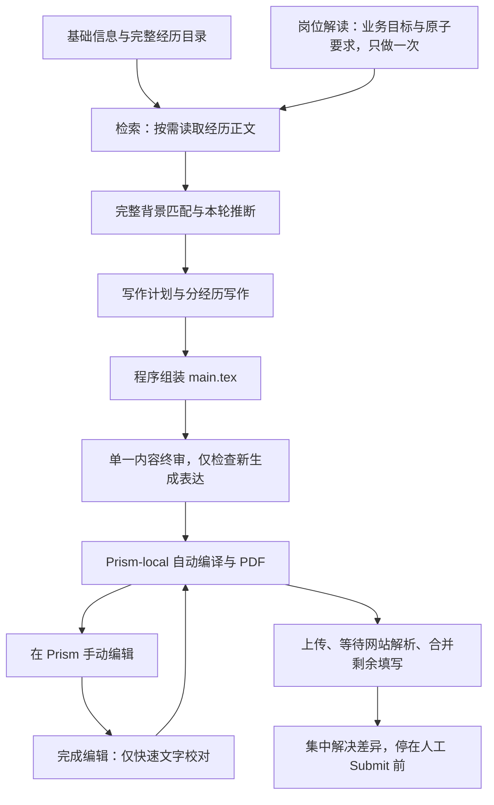

# 申请工具统一开发计划

## 当前 Module 迁移与 Codex 接管主线 — 2026-10-26

当前接口契约与迁移顺序见[正式设计](module-interfaces-and-migration-design.md)，
分步状态见[剩余开发地图](../.scratch/module-completion-2026-10-26/map.md)和
[当前交接](../.scratch/module-completion-2026-10-26/current-handoff.md)。
本节更新当前执行导航；下方历史开发与安装记录继续保留各自范围。
本轮可查询票据为 [MC-00–16](../.scratch/module-completion-2026-10-26/map.md#当前票据与硬依赖)：
MC-00 登记已完成基线；MC-01/02/04 三票已按源码/合成范围结案，MC-05 保留原负责人。
Resume 生命周期后继也已结案；常规准备与岗位调度后继已结案；当前合计 6 张 closed、1 张 claimed、10 张未领取；见
[实施记录](../.scratch/mc01-mc02-mc04-implementation-2026-10-26/README.md)。
Prism 远端更新按用户决定搁置，出现相关具体缺陷后再评估。硬依赖和文件冲突分开记录；
[并行规则](../.scratch/module-completion-2026-10-26/map.md#执行顺序与可并行范围)允许
T06 与材料模块按独占文件并行，T07 不等待完整 M3。真实模型、GUI、ATS 分票验收。

**此前三票统一验证通过。** 同一 665 文件快照完整默认离线 7,722 passed、
2 skipped，随后相关隔离合成浏览器 89 passed；JUnit 与收集清单精确一致，源码
运行前后不变。独立审查发现的候选正文绑定问题及重复恢复规则已修正并复核。
原失败和两次中断保留；两项跳过为未启用的显式 PDF 性能基准。
**此前 Resume 生命周期后继已结案。** 同一 668 文件快照完整默认离线
7,755 passed、2 skipped，随后相关隔离浏览器 102 passed；精确覆盖及独立审查修正通过。
**最新「M4 收拢剩余准备与岗位调度职责」已按源码/合成范围结案。** 同一 672
文件快照完整默认离线 7,804 passed、2 skipped，随后相关隔离浏览器 152 passed；
独立审查修正通过，见[本轮实施](../.scratch/mc13-preparation-scheduling-2026-10-26/README.md)。
剩余新接管统一控制由原 T09 票承接，Runtime 后继仍等待该前置。

**R6 本轮整批验收已完成，整体迁移仍未完成。** 同一 652 文件快照先执行完整默认
离线，再执行隔离合成浏览器：离线 7,458 passed、2 skipped；浏览器 594 passed、
21 skipped，615 项完整覆盖；均零失败/错误。运行前后摘要相同，Ruff、格式和 diff
检查通过。跳过项均为未启用的显式 opt-in；失败、中断批次和修复历史见
[正式验收记录](module-interfaces-and-migration-design.md#2026-10-26-修复与整批验收)及
[R6 汇总](../.scratch/module-completion-2026-10-26/serial-r6-verification-summary.md)。

T01–T05 已有对应源码与验证；T04/T05 的实际页面动作停止竞争仍需 T06 复验。
M1 Worker 固定执行 Interface、M2 取消/材料事务及 M3 Analysis/Resume 作者片段
已纳入本轮基线，不能据此关闭完整 M1–M6 或最终 AC01–AC27。

1. T06：[JSON 交接与 Codex 原页直接接管](module-interfaces-and-migration-design.md#codex-takeover-json-contract)。
   用户本轮更正取代旧自定义视觉动作方案。脚本失败后以 JSON 传递进度、阻塞、未决动作
   和 DOM/可访问性定位线索，Codex 直接接续原 Page；截图仅在实际视觉判断需要时按需使用。
   未完成的旧视觉草稿已撤回归档；JSON 源码与无截图 DOM 交接已接入，见
   [实现记录](../.scratch/module-completion-2026-10-26/json-handoff-implementation/implementation.md)。
   用户随后授权补底层原生会话交接；[原生源码、候选构建和独立审查](../.scratch/native-cua-session-handover-2026-10-26/README.md)
   已完成；最终 Python 离线 7,681 passed、2 skipped，随后 49 项相关隔离浏览器回归通过，
   同一 663 文件受验快照不变。
   实际 native 原页输入与活动模型尚未验收，
   MC-05 未关闭；既有单写者、停止及最终 Submit 规则保留。
2. T07–T09：绑定材料交付、可靠交回、App 自动派发和统一控制。
3. T10：新产品路径的合成整链及故障验收。
4. T11：实际 Codex 工具策略、签名 GUI 和适用真实 ATS 分层验收，各自遵守运行授权。
5. 剩余 M4–M6：收敛 Flow/Pipeline/Worker 分工、Runtime 和 UI，再按新实现执行
   回归与 AC01–AC27 最终审计。mapped-import 人工后继、信件契约与 Resume 生命周期
   已分别按所属票的源码/合成范围结案。

默认页面写入与自动接管仍关闭。本轮未操作真实申请、真实模型或更新已安装 App（以上为当时状态；2026-10-29 起自动接管默认开启，MC-10 已用真实模型验收一般场景，安装版已更新，见[地图](../.scratch/module-completion-2026-10-26/map.md)）；
源码/隔离浏览器结论不替代真实服务、原生 Cua 或签名 GUI 验收。最终 Submit 手动。
本轮三票源码结案不自动推进其余票或执行外部验收。

## 当前 v3 审计修复 — 2026-10-25

已修复[再次审计](../.scratch/post-audit-recheck-2026-10-25/README.md)确认的目录别名占用、反向跨岗执行、缓存文本字符限制、
预检恢复及两个旧 renderer 兼容问题。源码修复、统一冻结验证及独立复审均已通过，结论由
[本轮记录](../.scratch/v3-audit-repairs-2026-10-25/README.md)持有。此前的完整回归只证明各自原版本，不能作为当前 v3 的全套结论。
后续已获明确授权完成唯一主 App 同步及安装后验证，见[当前安装记录](../.scratch/v3-audit-repairs-2026-10-25/installation.md)。
原签名、实际权限、配置和人工材料保持；未执行真实申请，旧源码、审计及安装记录保留其历史范围。

## 后续审计修复 — 2026-10-25

已按用户 implement 指令修复[修复后审计](../.scratch/post-repair-audit-2026-10-25/README.md)确认的 PDF 复用格式、
重查大小上限、运行中匹配跨 Skip、并发配置保存及目录导航状态问题。源码实现、完整默认回归、相关隔离浏览器及独立复审均已通过；最终结论由
[本轮修复记录](../.scratch/post-audit-repairs-2026-10-25/README.md)持有。原审计、R01–R07 和安装历史保持原范围。
该源码修复阶段未更新 App、未执行真实申请；后继安装以[当前 v3 安装记录](../.scratch/v3-audit-repairs-2026-10-25/installation.md)为准。

## 职业经历库标准化整理 — 2026-10-25

当前用户将重点转为整理职业经历库，按[内容整理标准](career-experiences.md#职业经历库整理标准--2026-10-25)
区分经历主要内容、补充详情与整理依据。问答和讨论用于提炼事实，不逐条进入事实库。
此项不以查清膨胀最早发生在哪个历史阶段为前提，也不以扩大模型预算代替整理。

本轮已完成现有存量整理、条件保存、同经历目录归并和来源读取验证；原始历史及
独立基础信息保留。此结果是一次数据整理，不代表自动维护、章节检索或新的安装版
交付。后续自动保存/导入仍需另行实现，不能直接沿用本次派生组织记录。
本轮整理与验证顺序为：

1. 单经历整理候选：保留独特事实、责任、时间、状态和人工更正，列明每项旧记录去向。
2. 核对候选语义及来源追溯，复用现有条件保存与历史；保留旧引用对应，再推广到其余经历。
3. 整理存量事实输入、材料分层和派生目录，使问答、维护说明、历史和重复表达退出默认事实输入。
4. 验证完整信息保全、默认读取内容及体积变化，分别记录真实库与源码验证结果。

沿用现有两库和目录，不另建事实系统，不增加日常事实确认关卡。
本项整理没有启动模型、安装或岗位分析重试。

正文默认以整理后的单段经历主要内容为读取单位。大型经历可按实际工作方向组织，
仓库作为关联来源，不强制一仓库一章节；目录默认仍是一经历一条目。先整理并测量，
再对仍明显过大的个别经历细分读取，不普遍增加章节目录或预先分章的负担。

跨工作方向的同一事实保存一次，由多个方向引用。每个方向保留所属经历的稳定关联，
校验事实引用不跨经历；目录、按方向读取及事实汇总均能回到原经历，汇总按事实身份
去重。复用现有 JSON 存储和历史，不新增数据库；本次通过版本化附属派生记录保存
组织关系并校验引用。旧重复入口退出当前目录，不增加实时旧 ID 接续兼容；
自动维护和主契约扩展仍待实施，见[关联约束](career-experiences.md#经历工作方向与共享事实的关联)。

## Cover Letter 当前源码与验收状态 — 2026-10-25

此前的新页资料复用已完成源码验证、唯一安装版同步和真实申请提交前现场核验，范围见
[安装与实际测试记录](macos-app.md#2026-10-25新页资料复用安装同步)。原签名、权限、
材料及人工修改保留，最终 Submit 由用户完成。该记录中的单岗求职信不代表通用能力验收。

**通用 Cover Letter 已接入源码，并完成所列合成验证。**
[实施记录](../.scratch/cover-letter-integration-2026-10-25/implementation.md)和
[机器记录](../.scratch/cover-letter-integration-2026-10-25/verification.json)记录：
独立模板与正文版本、同岗简历／信件并发写作、局部恢复、人工修改保留、文本优先、
按需 PDF、填写／上传及回读已接入。该冻结源码的完整默认离线结果为
6,786 passed / 2 skipped，相关隔离浏览器为 48 passed。
合成作者 runner 的调用重叠只证明程序调度，不代表真实远程作者或内容质量。

[后续审计](../.scratch/work-audit-2026-10-25/README.md)确认五项 P2：配置保存丢失字段、
非当前岗刷新匹配、旧岗材料恢复跨岗执行、PDF accept 判断、原编译结果未只读取回。
历史全绿没有覆盖这些反例，不能作为缺陷已修复的证据。本轮已按
[修复计划](../.scratch/audit-repair-plan-2026-10-25/map.md)完成五项源码修复；
最终源码、组合回归和独立复审结论见[修复交接](../.scratch/audit-repair-plan-2026-10-25/implementation.md)。

此前 R01–R07 修复已在后续授权下完成唯一主 App 同步，见[安装与安装后验证](../.scratch/audit-repair-plan-2026-10-25/installation.md)。
该安装时点的包内引擎与已验证源码逐项一致；原固定签名、实际辅助功能与录屏权限、配置、人工材料和已有任务保持。
候选及安装后合成验证、安装包引擎定向回归、隔离原生窗口及正常退出检查均通过，完整原包回退已保留。
该记录取代源码验证结束时的安装差异导航；当时未安装的原始记录保持其历史范围。
本轮未进行真实申请、真实模型／Prism 调用或 ATS 交付，最终 Submit 继续手动。

模板及已确认规则见[独立信件模板与写作规则](../assets/templates/cover-letter/README.md)、
[产品约定](../.scratch/cover-letter-integration-2026-10-25/PRD.md)和
[原接入地图](../.scratch/cover-letter-integration-2026-10-25/map.md)。原七张决策票已关闭，
负责人及历史结论保持；这些状态不替代当前缺陷修复或真实验收。
生成消费同岗固定交付的 JD、匹配经历、适用信息及写作要求，不重复检索／匹配，
不编造能力、成果、责任或任职状态。正文随简历准备，有可选入口也默认交付；
文件按页面需要构建，未知动作与重要冲突仍停止。

后续真实验收仍需分别证明远程作者、用户 Prism 构建、安装版在真实服务与材料下的闭环、真实 ATS 的填写／上传
与回读、自然手动 Submit 后闭环及人工内容质量。此前真实申请现场记录只证明其原范围；
本轮源码及合成验证不补足这些证据，最终 Submit 继续手动。

## 职责审计与代码整理

[当前审计](codebase-responsibilities.md)按“一流程只做一件事”整理实际 Module Interface。
已收回固定交付判断、纯评分、原生回执验证、来源读取、信息语义和持久化观察的职责；
前端消费后端材料投影。来源/预算已消环，附稿生成已归材料 Module；Flow 交付明确
分析结果，执行入口复用固定资料和资格，纯目标核验不再构建 prompt。两轮审计发现的
职责迁移均已落地；独立复审和冻结源码的完整回归按各自范围单独记录。此前源码轮
未改变安装版或真实 ATS；后续安装及真实申请提交前测试以上方收尾记录为准。

## 当前开发主线：JSON 内容 → 固定模板 — 2026-10-24

最新设计见[JSON 内容与固定渲染](json-resume-design.md)，具体分包、文件所有权和
完成条件见[J01–J08 实施地图](../.scratch/json-resume-delivery-2026-10-24/map.md)。
**J01–J07 已接入源码；J08 已接通现有默认主流程，并完成实际作者、临时原生 Prism 与原页面浏览器的合成验证。**
见[J01/J02 验证](../.scratch/json-resume-delivery-2026-10-24/j01-j02-verification.md)、
[J03 验证](../.scratch/json-resume-delivery-2026-10-24/j03-verification.md)、
[J04 验证](../.scratch/json-resume-delivery-2026-10-24/j04-verification.md)、
[J05 验证](../.scratch/json-resume-delivery-2026-10-24/j05-verification.md)、
[J06 验证](../.scratch/json-resume-delivery-2026-10-24/j06-verification.md)、
[J07 验证](../.scratch/json-resume-delivery-2026-10-24/j07-verification.md)、
[J08 验证](../.scratch/json-resume-delivery-2026-10-24/j08-verification.md)
及[运行入口](json-resume-operations.md)。所有简历为英语；合成模板使用 LaTeX 默认字体，
实际接受模板保留原样式，不增加字体依赖。
J01–J08 源码验证轮未迁移私库。[选中真实输入记录](../.scratch/json-resume-delivery-2026-10-24/real-input-verification.md)
保留当时范围；后继已通过原条件保存接口转换初始全部当前申请经历，并保留原 ID、
原始资料、材料与历史。额外保留的研究身份已另存为仅供申请的记录，未重开研究审核。
人工接受措辞已回填引用与保护；当前读取及交付核验不可变来源，目录错误仍明确显示。
本轮职责整理之前的冻结源码已通过完整默认回归和 Ruff，覆盖无重复或漏项，前后源码稳定。
完整真实申请的实际分经历作者 JSON、单一独立内容终审、固定渲染与逐页 PDF QA
均已通过，见[完整真实输入记录](../.scratch/json-resume-delivery-2026-10-24/full-real-input-verification.md)。
原真实申请 P04 分析失败及历史保持原记录。后续已复用已保存 JD 和 JSON 经历，
完成同 ID 任务源码快照的 P04、JSON 写作、终审及 PDF 导出，见
[P04 与主流程记录](../.scratch/json-resume-delivery-2026-10-24/p04-mainflow-verification.md)。
原运行目录由安装版进程持锁，未改动该运行状态；未更新安装版或操作真实 ATS。
上述 P04/导出记录所列冻结源码的完整默认回归、Ruff 和独立审查已通过，范围见该记录；
本轮职责重构的最终检查由[职责审计](codebase-responsibilities.md)另行记录。
下方 P01–P08 记录继续证明其原范围，不能作为新
JSON 方案或当前冻结源码已全套通过的证据。不重开原票或更改其负责人。

主线是：经历事实 JSON + 本轮写作要求 JSON → 一经历一 subagent 的内容 JSON →
程序检查字段/经历 ID/引用/结构 → 完整内容 JSON 与单一终审字段补丁 → 固定模板
每经历生成一个 `\subsection` → 完整 TeX → 既有 Prism-local 编译 PDF。
信息收集、检索、匹配、写作与修订都不再以排版原文为业务格式；TeX/PDF 是构建
产物。PDF 没有独立业务接受状态或复用判断，仍核验实际构建和上传对应关系。

| 顺序 | 工作包 | 交付 |
| --- | --- | --- |
| J01 | 最小内容契约与合成样例 | 事实、作者输入/输出、完整内容及字段补丁 JSON |
| J02 | 单经历纵向切片 | JSON 校验 → 一个 subsection → 完整 TeX 与合成 PDF |
| J03 | 经历事实结构化与导入 | 现有库保存语义 JSON，默认分析只读事实，原 TeX 与历史保留 |
| J04 | 读取/匹配交付与恢复 | 复用固定 JD 说明，只续失败步骤，停止空补查 |
| J05 | 分经历写作与终审接入 | 实际 subagents 输出 JSON，局部返工，采用内容版本 |
| J06 | Prism/Git diff 与构建接续 | 人工内容回填、未归并修改保护、内容版本下的 PDF |
| J07 | 申请记录 JSON 主存储 | 保留 ApplicationStore Interface，旧 Markdown 作 Adapter |
| J08 | 组合、QA 与交付准备 | 分层举证，不将源码/合成等同真实材料接受 |

关键链 J01 → J02 → J03 → J04 → J05 → J06 → J08；J07 在 J01 后可独立推进，
组合前完成。先证明单经历切片，再迁移。现有四个 P2 分别归入 J03/J04/J06，
不因格式改造自动视为已修复。Prism Git 部署和人工 diff 回填需实际核对；不能
假设 Git 留存就等于 JSON 已同步。J03 已修改现有系统的保存、同步与默认分析事实
接口，并提供显式预览/导入。J04 已直接重构现有读取/匹配流程：结构化事实按 ID
交付；无未读候选时停止补查；失败重试复用已完成 JD、读取和资料包。每次尝试、
原失败与人工材料均保留。已完成分析经语义输入检查后，可跨无关资料或诊断元数据
变化复用。J05 在同一材料 CLI 中交付 `content-writing/v1`，真实作者交回内容
JSON；程序校验、固定模板填充、单一 JSON 终审与内容版本采用沿用现有任务和草稿存储。
当前计划/内容分别为 `resume-template-plan/v1`、`resume-template-content/v1`，只含
可变正文和申请/模板绑定；固定样式、姓名、LinkedIn、网站、邮箱与教育均写在显式
LaTeX 模板，不按岗位从信息库重新注入。固定资料更正另行更新模板。
局部返工保留成功作者；人工 JSON 措辞、顺序和省略受保护。没有内容映射的人工
TeX 由 J06 按精确 renderer 范围接回；无法唯一定位或表达的修改仍保留原稿并停止
覆盖。人工列表结构随下一轮写作保存，finishing 重开采用已有回执，不重复未知调用。
J07 将当前申请记录改为 JSON，旧 Markdown 原字节、ID 和历史保留，显式导入处理
变化与冲突。J08 为新任务固定内容 JSON 契约，旧任务按原契约恢复。默认模板选择
回到已归档固定模板；已绑定 Worker 的人工 Prism 修改先成为候选，单次 Continue
核对原页面后采用对应 PDF。Worker 的答案读取、更正及发送检查使用 Flow 同一声明
信息库。验证层次见 J08 记录；后继当前申请经历的完整转换与完整真实申请材料验证，
由[完整真实输入记录](../.scratch/json-resume-delivery-2026-10-24/full-real-input-verification.md)单独持有。
显式用户保存的申请事实不受研究分类限制，读取和交付仍核验不可变来源。
完整真实申请的独立材料验证已完成内容终审、固定渲染及 PDF QA；上述 P04 与主流程记录
另行证明同 ID 源码快照已完成 P04 → 写作 → 终审 → 导出并到达 `materials_ready`。
这些历史范围不能代替本轮职责重构的最终检查；用户 Prism 服务与安装更新另列。

以下 P01–P08 的“一步一职责、固定上游、局部恢复、保留人工稿、最终 Submit
手动”继续适用；其中 TeX 写作片段、TeX 业务主版本和 PDF 独立复用设计由上方
JSON 目标替代。旧运行 Interface 与历史记录保留到对应包迁移完成。

## P01–P08 已有交付基线

更新：2026-10-24，Europe/Zurich。P01–P07 源码与 **P08 本轮组合验证、独立审查和交付准备** 已交付，见[组合说明](combined-delivery.md)和[分层验证](../.scratch/resume-agent-delivery-2026-10-22/p08-source-verification.md)。正常连通组合修复了已交付材料进入 Worker 的旧全局校验接缝，并保留具体联系人更正的发送保护；最终完整默认离线通过，前后源码与回归指纹一致。P08 源码轮未构建或安装；随后按用户同步指示，已固定同一生产候选、备份并更新唯一主 App，完成安装版回归、隔离浏览器、临时 Prism 接回和显式材料准备重开，见[安装验证](../.scratch/resume-agent-delivery-2026-10-22/p01-p08-installed-verification.md)。签名、配置值、原状态与两库保留；真实申请继续暂停。用户 Prism 服务、原私人案例和真实接受仍分层待验。

本页持有唯一当前方案与优先顺序；[实施地图](../.scratch/resume-agent-delivery-2026-10-22/map.md#implementation-2026-10-23)持有分步工作、依赖与具体验收。[APP-01–18](single-job-flow.md)保留产品编号；[经历检索](career-library-retrieval.md)、[生成契约](resume-agent-generation.md)、[Prism 接续](prism-resume-review.md)细化对应职责。旧源码、安装票和验收按其原范围保留，不能证明本轮新方案已交付。

## 当前原则：一步一职责，信任上游交付

每一步使用已交付的固定输入与结果，只负责自己的工作。后续读取资料不等于再次审核上游；不重评用户自述可信度、研究 Skill 评分或已完成岗位匹配。需要新资料或重做某步时，明确创建该步的新结果，保留旧稿与历史；库、JD、模型、提示词、App 或登录元数据变化不自动使全部下游失效。

## 已对齐的目标行为

### 两库、主要正文与目录

- **基础信息库**保管个人事实、申请答案、偏好和适用范围，提供统一经历目录入口；不再定义为“零碎信息”。**职业经历库**按经历条目维护一份完整事实正文，内部可按子项目/工作方向分节，并关联仓库、论文和补充材料。事实只维护一份，目录自动从经历内容生成与同步，不由两库分别维护。先复用既有存储、稳定 ID 和来源关系，逻辑分工不要求搬库或二次录入。
- 正文包含身份/角色/时间/状态、背景目标、实际工作、方法技术、合作交流、结果产物与关联入口。不按当前 JD 或简历篇幅删掉独特事实；详细代码、实验明细和长资料留在补充层。没有某字段不阻止整段经历使用。
- 目录的默认筛选输入包含稳定经历 ID、技能与技术检索词、工作内容/问题领域短摘要、详情入口及版本。名称用于识别展示；机构和日期等留在完整经历中，有明确筛选条件时按需读取，不是每次筛选的必带信息。责任归属、协助方式和完成状态也保留在完整经历中，不是目录初筛的必带字段或准入条件；选中后读取正文，供匹配判断和写作使用。技能与检索词从正文、明确自述及有效详情提取，不代表个人独立掌握或熟练度评分；同一经历聚合去重，不为每个技能另建经历。摘要支持语义发现，不能仅按同名技能标签过滤；改名/移动文件不改变经历身份。见[目录筛选内容](career-experiences.md#目录的筛选内容)。
- 首次整理完整建立现有经历入口，之后按正文与关联资料变化增量更新。生成摘要失败也保留可检索的基本条目和原文入口，明确索引待补而不隐藏经历。整理只检查是否遗漏/改变已有事实，不要求用户重新证明自述；明确更正按原库历史与作用域生效。
- 同一 TeX/PDF、复制件与同内容导出只索引一次；查看产物、历史、日志、依赖与自动生成文件不平铺成经历候选。有独特内容的补充资料仍可按需读取，不能按扩展名一刀切。生成简历及其 PDF 不反向成为新的职业事实来源。
- 库内容与用户自述在应用流程中直接接受。没有考试记录不降低已告知的语言水平；研究审核和大型项目能力评分尚未完成不影响投递使用，也不补造审核结果。保留实际角色、团队归属、日期、适用范围与计划/进行/完成状态。

### 岗位解读、检索与背景匹配

- **岗位解读仅做一次**：理解完整 JD 的业务目的、工作产出和方法用途，形成固定要求与评分框架。复合条件拆为可分别检索和判断的子项，保留原组关系；重复要求去重，拆分不增加组总权重。检索、匹配、写作直接复用，不各自重新解释 JD。
- 权重围绕业务目标和有意义的要求组确定，不按关键词次数或 JD 句数累计。模型可在岗位解读时提出权重与短理由，确定后由程序计算，下游不得修改。不在本文冻结此前讨论过的 2:1、旧代码的 3:1 或任意置信度折扣；具体数值、组内分配和路由阈值须在对应实施步骤以固定样例明确，不能伪称已确认或以旧常量覆盖业务目标。区间路由不能把未知引起的低下限当作低适配并自动跳过。
- P02 的[已实现规则](job-brief.md#计分规则)：业务组权重归一到 100，组内按原 AND/OR 关系聚合；每项由模型在判档范围内打满足度、程序锁档后加权（2026-10-31）。固定 Quant 工程样例为业务 80、方法 20，不是通用岗位权重。沿用无数值自动跳过策略，不新增低分淘汰阈值。
- 当前默认每岗读取**完整轻量目录**，结合关键词与语义发现候选，再按需读取正文及关联详情；不每次读取全库原文，不以固定 top-K、页数或已得高分作为结束条件。大型资料分段处理，不静默截断。向量检索是后续有规模依据时的候选加速手段，本轮不新增向量库。
- 检索完成条件：目录入口覆盖完整、岗位目标与全部要求均有查找覆盖、相关候选必要原文已取得、未读/读取失败/未发现对应记录分别表达。引用错误、漏检、截断和读取失败是执行未完成，不能计为申请人资料未知、能力不足或降低分数；修正相应步骤，不重审核用户经历。
- 匹配度衡量**完整背景与岗位的适配**，不受简历篇幅、选材、重复文件或措辞影响；资料覆盖率与最终简历覆盖情况分别展示。明确资格门槛单列，不被其他优点抵消；资料不足显示匹配区间，判断完整后显示单一分数。只有已有事实明确不符才是“不满足”；没有记载不是明确缺点，未知不自动扣分也不自动算满足。
- 日常界面先展示业务导向的匹配概览、主要优势/不适配理由与待补项，目标为一屏内快速理解。逐句 JD、公式、内部引用/哈希、批次控制折叠；不再铺开无关待处理岗位。最终 PDF 与编辑入口可直接访问。

### 推断接口与生成责任

- 推断只在匹配步骤执行：直接记录、确定性推导、语义推断分别标明依据类型，不作为可信度高低。输入是固定岗位说明、原子要求、可信事实集合与通用推断策略；输出绑定要求 ID、事实引用、判断、关系及简短解释/可表达范围。
- 模型可理解同义、工作上下文、跨学科与可迁移经验，并合并事实；不因缺少同名字段自动判未知。精确等级、数字成果、角色与日期来自已有记录或确定性计算，不能补造。程序约束 ID 与结构、固定要求/权重、计算数字、限定结果写入本次记录；不声称 JSON Schema 能证明语义正确。语义行为用离线正反例与变形测试控制，不加第二模型逐项审核。推断不自动写入永久库。
- 写作计划从完整匹配对应和资料包中选择经历、排序、分配篇幅，区分直接业务贡献与可迁移方法。匹配输出的“简历预选集合”不再是生成准入上限；生成不能修改背景匹配分。主 agent 负责全局摘要/技能等块，一经历一实际 subagent 写片段。
- 写作者接收分配的正文、事实与推断范围、重点篇幅、已有人工内容，输出 TeX 片段及使用引用。缺细节只提出具体读取需求；不重复扫描整库、判断岗位匹配或提交可信度证明。程序只检查块归属/完整性/结构/保留内容并组装单文件 `main.tex`，不再建立片段内容批准关卡。
- **单一内容终审只审 AI 新生成表达**：是否超出已交付事实/推断、是否重复矛盾、是否落实写作计划和保留人工内容。它不重新判断业务目标、匹配、推断或经历可信度。可输出局部措辞/结构补丁由程序应用；实质重写或缺资料仅退回对应写作者，其余片段不重跑。结论对应程序应用补丁后的最终候选。

### Prism、人工编辑与最终 PDF

- **Prism-local 负责编辑与预览；最终 PDF 由 App 用 tectonic 在临时副本中编译当前 TeX**（2026-10-31 决定，自动流程不依赖 Prism 运行），不每次预览/下载强制 build、不增加人工保存后编译开关。采用与当前源对应的成功 PDF；是否对应当前编辑内容仅涉及 TeX 和实际编译依赖，PDF 自身保留文件完整性检查。
- PDF 区并列“打开最终 PDF”“在 Prism 中编辑”。进入人工编辑后暂停系统写该 TeX；用户明确点击“完成编辑，返回校对”后接回，不能以关闭窗口猜测编辑完成。
- **人工返回只快速校对**明确拼写、语法、大小写、标点、重复词小错；不质疑事实、不润色重写、不改排版/顺序/TeX 命令、不重新做内容终审。输出局部文字补丁并记录；歧义或专有名词保留原文，仅提示。人工事实/表达意图优先，本次修改不自动回写两库。
- 人工修改产生新的源内容，Prism 自动编译预览；接回后 App 编译最终 PDF。编译失败或结果未明保留上一版终稿；当前状态表达为“有未导出的修改/等待对应结果”，不能称旧 PDF 内容失效。新成功 PDF 采用后旧稿仍可访问。迟到旧编译结果不得覆盖新源/新终稿。
- 不以全目录、源库/JD版本、App/提示词/登录配置或编译器升级作废历史终稿。生产上下文只作历史记录；显式新生成/更新才消费新上游。新 PDF 生成不表示网站附件已替换，上传记录指向实际使用的 PDF 版本。

### 填写、上传和人工 Submit

- 先读取当前表单并保存非空基线/附件，再在必要时上传最终 PDF，等待网站解析后补剩余内容。附件上传成功与简历解析完成分别记录；明确解析结束信号优先，缺信号使用连续字段稳定窗口自动接续，并持续监测迟到自动填充。稳定观察不是永久完成保证，无法稳定/超时无法判断时暂停当前岗写操作。
- 优先使用网站“保留已有信息/仅上传”能力。既有人工或来源不明非空值均保护：与适用信息语义一致则保留，空白可填，明确新解析错误可修；非空差异集中展示当前值/资料值/可知来源，由用户选择保留、采用或手改，不自动覆盖表单或永久信息库。电话/日期等按实际含义归一比较。网站若改写受保护值，记录前后差异而不默默恢复可能过期的原值；未解决的重要差异阻止标记提交就绪，但其他无冲突字段可继续。
- 填写前重读目标，填写后读实际值与校验错误；发现用户操作或网站继续填充则暂停自身写入。使用既有 intent/attempt：结果不明先观察，目标已达则接续，明确未执行/已结束失败才重新执行，第三种值转差异，无法确认则保留待核对。同名附件不能证明同版；不新建申请、不盲重放上传/填写/导航。
- 只有已识别的中间 Next/Continue 可自动执行；最终按钮、Enter、form.submit 或最终网络请求始终交用户。必填、网站错误、差异、附件、解析状态与未知操作核对完成后停在 Submit 前。提交结果/下一岗仍按 APP-12 观察实际行为，本轮没有真实提交验收。

## 替代的旧设计

| 旧规则或混合职责 | 本轮替代规则 |
| --- | --- |
| 信息库仅零碎信息；文件堆砌作为检索单位 | 基础事实+统一经历目录入口；经历正文为检索单位，产物去重 |
| 检索/匹配/写作各自解读 JD | 岗位解读一次前置；下游复用固定说明 |
| 匹配预选决定简历允许来源；简历篇幅改变匹配分 | 完整背景匹配与简历覆盖分离，写作独立选材 |
| 无字段/未审核/无考试即降级；引用失败转能力未知 | 信任库及自述，允许受约束语义推断；执行错误单列 |
| 每片段、组装、终审都做内容批准 | 片段/组装仅结构交接，AI 新表达仅一个终审 |
| 人工保存触发重新内容审核或岗位匹配 | 返回仅快速文字校对；保留人工内容与排版 |
| 自动流程依赖 Prism 运行，或每次预览/下载强制编译 | App 仅在导出终稿时用 tectonic 编译当前 TeX；Prism 保留编辑与预览 |
| 全库/任务输入/配置哈希变化使全部材料 stale | 固定步骤结果继续有效；当前 TeX/依赖与 PDF 对应单独表达 |
| 网站填写从空表开始、未知结果直接重试 | 基线保护、稳定窗口、集中差异与原动作结果核对 |

## 当前实施顺序与接受条件

详见[地图 P01–P08](../.scratch/resume-agent-delivery-2026-10-22/map.md#implementation-2026-10-23)。P01 源码及受影响合成验证已交付，见[P01 记录](../.scratch/resume-agent-delivery-2026-10-22/p01-source-verification.md)；P02 源码、回归和审查见[P02 记录](../.scratch/resume-agent-delivery-2026-10-22/p02-source-verification.md)。P03 源码、回归和审查见[P03 记录](../.scratch/resume-agent-delivery-2026-10-22/p03-source-verification.md)。P04 源码、回归和审查见[P04 记录](../.scratch/resume-agent-delivery-2026-10-22/p04-source-verification.md)。P05 源码、回归和审查见[P05 记录](../.scratch/resume-agent-delivery-2026-10-22/p05-source-verification.md)。P06 源码、完整离线回归和审查见[P06 记录](../.scratch/resume-agent-delivery-2026-10-22/p06-source-verification.md)。P07 源码、完整默认离线回归、隔离浏览器和独立审查见[P07 记录](../.scratch/resume-agent-delivery-2026-10-22/p07-source-verification.md)。P08 组合、完整默认离线与独立审查见[P08 记录](../.scratch/resume-agent-delivery-2026-10-22/p08-source-verification.md)。本次安装版合成接受见[安装验证](../.scratch/resume-agent-delivery-2026-10-22/p01-p08-installed-verification.md)；真实私库、用户运行服务与自然 Submit 后接受仍另记。不重开原 01/02 子票，不改既有负责人和接受历史。

| 顺序 | 工作包 | 完成后可交付的结果 |
| --- | --- | --- |
| P01 | 两库/经历正文/自动目录与去重 | 既有条目不遗漏，正文与检索词增量同步，无自述审核门槛 |
| P02 | 一次岗位解读与评分框架 | 业务目标、原子要求、组权重固定且可复用 |
| P03 | 完整目录召回与按需读取 | 相关原文资料包；读取故障与未记录分开 |
| P04 | 匹配、受控推断与区间 | 完整背景匹配、资格、资料覆盖、简历覆盖分别表达 |
| P05 | 写作交接、程序组装、单一终审 | 无重复岗位/可信度审核的候选终稿及局部修订 |
| P06 | Prism 编辑返回、快速校对、局部版本 | 自动编译结果复用，人工修改/历史终稿不被上游变化作废 |
| P07 | ATS 解析接续、差异选择与未知核对 | 保留已有值和附件，只补剩余步骤，停在人工 Submit 前 |
| P08 | 组合回归与后续交付准备 | 分层记录源码/真实 subagent/Prism/ATS/安装接受，不冒称整链已验 |

依赖顺序是 P01、P02 → P03 → P04 → P05 → P06 → P07 → P08。P01/P02 可在无共享文件冲突时并行；其余按接口交付，不按整库/整张旧票关闭等待。P08 源码/合成组合与交付准备已完成，后续已授权的主 App 安装同步及安装版合成接受另记；原私人案例和真实接受继续按各自范围执行。

### 验收基线

- 用跨领域项目（合成名 Crossfield Lab）、Python、语言信息案例检查一般目录/检索/推断链路；真实资料与结果留私库，公库仅用等价合成，不加项目或 JD 专属名单。
- 对比名称/措辞变化、同内容 PDF/TeX 增加、无考试记录、未完审核等变形输入：已有事实的适配不应因此降低；加入真实新事实才影响相应判断。
- 复合拆分权重守恒；资料未知扩大区间，明确不符合才贡献不符合；故障不进入能力分；简历选材/篇幅改变不改变背景匹配分。
- 用实际 subagent 编排验证一经历一片段、部分失败仅恢复该片段、程序组装与唯一内容终审；不能用多次普通模型调用冒称实际 subagents。
- 人工 Prism 编辑退出只触发快速校对，内容/排版不被系统改回；复用自动编译结果，库/JD/配置/登录变化不让已有终稿失效。
- 网站解析延迟、无结束信号、迟到改写、用户改值、重复文件名及上传/填写未知结果均有明确分支；差异集中，最终自动 Submit 动作始终为零。
- 前后对比原任务、人工 TeX、材料、答案作用域、已填字段、附件及历史；新增步骤结果可追加，旧记录不得被清空或重放。安装在明确授权后固定已验证候选、备份、更新唯一主 App 并保留回滚；本次同步已单独授权并接受，不改写此前源码轮禁止安装的边界。

## 原票、历史与本轮边界

36 等旧票继续持有原负责人、身份及历史；本轮不把整个新流程附加为原票自动收尾条件。库明确更正仍按作用域直接保存；本次申请修改不静默写回两库。旧票中“资料/JD变化自动重评当前 TeX”“所有来源当前性作材料门槛”的说明被上方固定交付与终稿规则替代；需要显式更新时仍以人工版本为基础。

[原生成/安装交付](../.scratch/resume-agent-delivery-2026-10-22/evidence/README.md)和[安装证据](../.scratch/resume-agent-delivery-2026-10-22/installation/README.md)保留其原时点意义。源码检查、安装检查、真实材料、网站行为和用户最终提交分别验收。前轮方案归并仅查文档内容、链接、依赖和改动范围；本轮 P07 源码与回归见对应记录，不以合成验证代替真实网站接受。

2026-10-20–23 旧开发顺序、原票结论与交付记录（仅历史，不是本轮待办或当前门槛）

更新：2026-10-23，Europe/Zurich。本页是唯一当前开发顺序；按[产品规范](single-job-flow.md) APP-01–18 及本轮明确的 TeX 内容核对规则执行。地图与原票持有身份、详细工作和接受条件；本轮审计不是另一套长期队列。

## 当前事实

### 当前指定交付：分经历生成与安装同步

按用户本轮wayfinder指示建立[交付分经历简历生成并接续实际使用](../.scratch/resume-agent-delivery-2026-10-22/map.md)。先实现分经历写作、程序组装与单一终审，再同步唯一主App。用户随后明确将“操作结果不明时如何继续”移入真实使用过程测试，再据反馈决定；取消旧任务核对对安装的依赖，对应后继票按范围调整关闭，不表示已修复。原有票负责人及历史不变，不把新设计塞进已结案材料票或事实更新票。

当前交付进度：分经历交接、程序组装和单一终审已接通，完整默认离线及静态检查通过，真实 subagent 合成稿已终审并编译。唯一主 App 已从固定候选同路径更新；包内默认入口、CLI、真实合成编译导出和原生进度面板已验证。七个正式状态根及四份配置安装后完整读回不变，两份旧包备份可回滚。详见[安装记录](../.scratch/resume-agent-delivery-2026-10-22/installation/README.md)、[源码验证](../.scratch/resume-agent-delivery-2026-10-22/evidence/README.md)及[调用入口](resume-agent-operations.md)。初次安装未恢复旧真实任务或重放 needs_recheck/fill intent。随后按用户授权接续现有真实岗位材料：安装版正式材料 CLI 已完成真实 subagent 分经历写作、程序组装、单一终审和实际 Prism HTTP 编译导出，保留原人工内容与已有材料。真实使用发现的兼容修复已固定候选并同路径安装。2026-10-23后继已修复取消任务阻挡及重新选择岗位再次建任务的问题；新增正式入口核验既有终稿/PDF后接回原任务。完整离线与独立审查通过后，固定后继候选同路径更新唯一主 App；安装版已实际接回到材料就绪，并验证重开、重新选择岗位仍复用原任务和同一终稿。人工内容、旧材料、资格确认和取消历史保留，回滚包可用；没有新模型、编译、ATS操作或未知重放。本次是材料接回验收，ATS整链及最终人工Submit仍保持各自接受范围。

#### 本轮统一开发方案

| 顺序 | 工作与交付 | 开始/完成条件 |
| --- | --- | --- |
| 先开发 | [接通分经历写作、程序组装和单一终审](../.scratch/resume-agent-delivery-2026-10-22/issues/01-experience-agent-generation.md)：准备按经历分组的来源入口；主Codex分派写作者；程序拼接main.tex；单一终审；复用材料采用与编译 | 生成源码及验证已交付；后续安装也已完成。实现步骤、责任边界、故障恢复和验证范围只维护在该票。 |
| 后安装 | [将已验证生成候选同步到唯一主App](../.scratch/resume-agent-delivery-2026-10-22/issues/02-install-generation-candidate.md)：固定候选、保全、同路径更新、生成入口有限安装检查及回滚 | 已完成固定候选、备份、唯一主 App 更新及有限安装验证；不依赖旧任务恢复、真实上传或Submit。 |
| 使用中反馈 | Workable额外附件、复杂ATS/请求保护、未知操作结果如何继续、速度与接管、真实材料质量 | 保持现有实现；实际遇到后记录场景、处理方式和结果，再决定工程改动。不是本轮生成/安装的阻塞。 |

最初规划后，用户已先后授权并完成生成实现与安装票。正式私人任务保留；本轮安装没有恢复真实申请。不新增通用agent平台、恢复框架或逐材料用户审批。

### 当前执行方式：先使用，再按反馈调整 — 2026-10-22

用户已明确开始投入实际使用：由 Codex 配合现有工具接续具体申请，高度自动化实现保持现状，不以独立App运行、平台适配完整性或新生成设计实现作为开始使用的前置条件。最终Submit仍由用户操作。既有未知结果、人工修改和任务历史先核对，不盲目重放。

Workable额外附件上传限制留在原20号票待办中，暂不修复、不关闭；实际遇到时由Codex检查网页并使用可用的正常上传入口，不能将适配器限制当作网站本身不可用。无法确定上传结果时先核对原页。

实际使用记录具体任务、遇到的问题、Codex/用户如何处理及结果，再据此决定哪些步骤值得自动化；不为假设中的复杂ATS覆盖继续扩建。下方开发顺序保留工程历史，当前不主动执行高度自动化改造。上方/下方旧“真实申请继续暂停”按其记录时点解释，本次用户指示允许开始实际使用，不授权自动最终Submit或例行改动真实邮箱。

### 2026-10-22新增生成设计：Codex按经历分工

用户明确 TomorrowStar 是由 Codex 驱动的大型 skill，而非必须独立运行的自动化App。新增[按职业经历并行生成设计](resume-agent-generation.md)：选中经历后默认一经历一subagent，分别读取来源并生成对应表述；程序单独组装main.tex，一个终审agent检查整体并反馈修订，再编译。该设计替代“全职业库进入一次完整LaTeX请求”的前提；当前128000字节保护仍是旧实现边界，不能将职业库大本身列为已证实使用阻碍。

分经历生成的源码和验证由上述交付票承接；不是36号票自动追加目标，不改原票状态或结案历史。后续复用共享材料、来源、人工稿保留和编译路径，具体实现另行安排。下方源码与安装结果仍按各自时点解释。

### 36号票当前管理结论：两库与本次申请分开

用户维护职业经历库和信息库。一次申请读取适用事实生成简历；用户可修订本次简历，之后继续和更新以该稿为基础。本次修订不能静默回写成两库的全局事实。用户明确对库事实作补充/更正，仍走原库的显式保存、作用域和历史路径。已有适用材料可按原规则复用，不把这个边界误写成禁止跨岗材料复用。

**36负责事实、来源、适用范围和影响判断；共享材料生成/编译仍归40消费，不另建生成器或通用分组系统。** JD由系统读取，不是用户需要维护的事项；JD变化只保留兼容能力。PDF成功编译即可使用，不增加单独审核。

| 分类 | 当前结论与处理 |
| --- | --- |
| 正确，保留 | 两库复用、明确更正与历史、全局/岗位例外；本次人工稿保存和按影响合并；未影响文字及人工省略保持；来源/责任/固定学历保护。 |
| 已纠正的错误说明 | “还差新增整段内容”不准确。已有回归可以追加段落，公开入口独立探针还可新增小节并保留其他人工内容。缺少内部新分组协议，不等于用户不能增加内容。 |
| 取消的扩张目标 | 不再把内部新分组/重分组协议、通用依赖图、JD维护或PDF缓存优化列为36自动追加的收尾门槛。保留已有兼容代码和历史证据。 |
| 必须收回的管理方式 | 不再按每个内部边界无限追加切片；每项剩余工作必须对应原接受条件和可复现用户场景。测试数量不代替主线接受。 |

本轮只核对以下两条主线，结果如下；不据此追加第三项工程目标：

1. **本次修订的隔离与继续：通过，无需生产修复。** A保存人工措辞/省略后，两库和原底稿字节不变；B通过公开Store从两库独立生成，不把A修订或申请专属邮箱当成全局事实；A继续导出仍保留人工稿。B未启动第二活动Flow，适用材料的显式复用规则保持。
2. **库里明确更正学历：已复现并修复。** 旧代码把明确更正再次送入待确认；历史已接受材料还会因旧整稿绑定误拦人工稿或后续更正。现在仅核验已应用更正、旧稿来源和当前学历后，对可唯一定位的相应字段作确定替换；未变学历、其他人工内容及旧接受记录保持。已覆盖先人工修订、同组两凭证只改一项、连续更正、再编辑和导出。无法唯一定位或更正记录损坏时保留原稿核对，不扩大为任意TeX格式改写。

本轮新增15项回归（S1一项、S2十四项），统一受影响及完整默认的准确结果以[本轮记录](../.scratch/ticket36-two-mainlines-2026-10-22/README.md)为准；全套运行前后核对冻结输入。不重复旧安装证明，不追加分组、生成器、PDF或JD维护目标。Status=claimed、Assignee=01a15ab3/root及原依赖保持；本轮未擅自关闭整票，App不更新，真实申请继续暂停。

[此前管理审计](../.scratch/ticket36-realign-2026-10-22/audit.json)按其时点保留；当时S1/S2为证据缺口，现由本轮公开入口核对替代。历史报告中的内部新增分组边界不再作为本票自动扩展的门槛。

### 36号票前期工程记录（保留时点，不作为当前新增待办）

2026-10-22最新后继：[新增未映射上下文的影响判断与合并](../.scratch/ticket36-new-context-2026-10-22/README.md)推进本轮指定切片：将新文档、结构化来源及档案附加上下文与实际人工TeX核对，明确判断受影响组及依据；无关变化可保留全文，有关变化合并现有来源、待核对与JD影响的并集，只替换指定组。新增引用限定本轮变化的有效来源，保留原关联；原始上下文不能自行成为能力证据。重要冲突待核对，采用来源缺失、谱系损坏和未知外部修改仍停。36原状态、负责人及接受历史保持，准确验证见报告；App不更新，真实申请继续暂停。

2026-10-22前一切片：[人工省略内容后的来源更新与影响映射](../.scratch/ticket36-omitted-source-map-2026-10-22/README.md)已补齐指定源码切片。省略组只保留最小来源关联供影响判断，不恢复正文，不进入模型待合并分组；多轮来源更正、原始上下文变化及删除可继续保留实际TeX。共享来源仍更新被采用的组；当前人工改绑优先，重新纳入后按采用组判断。映射绑定实际不可变父稿并核验；旧谱系兼容，新增加且无法定位的上下文或采用来源缺失仍保留原稿并停止。原36继续claimed、第9项较广范围仍部分，负责人和历史记录保持；成功编译即默认PDF可用，不更新App，真实申请继续暂停。

2026-10-22前一切片：[待核对稿后续人工修改的自动合并](../.scratch/ticket36-unresolved-manual-merge-2026-10-22/README.md)已补齐本轮指定切片。以最新保存/捕获的人工TeX为实际底稿，只将最新待核对候选补入模型输入，重评待核对、资料变化与JD变化组的并集；无关人工措辞、删除、增加与重排保持。真实冲突继续停当前岗，不把待核对候选当成已确认事实。恢复后支持后续人工编辑和JD更新，固定学历与历史接受来源保持；谱系/源漂移不能核验时保留原稿。原36仍claimed、第9项较广映射范围保持部分，负责人、依赖及旧接受记录不变。准确测试与冻结证据见本轮记录；不更新App，真实申请继续暂停。

2026-10-22前一切片（其中待核对稿自动合并边界已由上方后继补齐）：36号票[TeX资料/JD按影响更新切片](../.scratch/ticket36-tex-impact-2026-10-22/README.md)以最新已采用完整TeX（含人工修改）为基础，合并职业资料和JD影响的分组并集，其他组逐字保留。未打印资料更正可复用正文，联系方式直接更新页首而不重写职业正文；JD新增/删除要求及目标元数据变化均核对实际TeX。重要事实冲突停当前岗，修正后一次Continue刷新输入并按需重分析。待核对候选又有人工修改时保留当前源并停止，尚未实现其自动合并；旧稿缺少可核验JD正文或来源无法映射时同样保留原稿。第9项仍部分，36继续claimed、原负责人及依赖不变；不要求PDF单独审核，成功编译即默认可用。测试、失败历史和冻结输入见本轮记录；未更新App，真实申请继续暂停。

2026-10-22：[两处缺陷修复及 TeX 编译规则](../.scratch/two-fixes-remaining-2026-10-22/README.md)已完成源码切片：无事实绑定的资格确认不再跨分析继承；当前岗明确取源失败后一次 Continue 可明确重试，重复请求和未知派发不重放。内容以 TeX 核对事实、措辞、学历和人工修改；成功编译即默认 PDF 可用，自动材料不再要求独立 PDF 检查或确认。已有接受记录保留，不扩展 PDF 缓存/版本采用方案。受影响回归及完整默认结果见本轮记录；未更新 App，真实申请继续暂停，原工单身份、状态、负责人和依赖保持。

### 本轮开始前的审计基线

2026-10-22：[本轮工作与代码审计](../.scratch/work-audit-2026-10-22/README.md)按实时tracker核对：128张，111已关闭/解决，17未关闭（11 open、6 claimed），依赖错误0。39/40/41已按源码范围结案，不再列源码待做；30等既有安装证据不扩为最新36修复已安装。17项的原状态、负责人、依赖及下一步见[当前清单](../.scratch/work-audit-2026-10-22/remaining-tickets.md)。生产代码与4672通过的冻结输入一致；本轮有界112通过、静态检查通过。审计发现及复现范围见报告；不修改生产或工单状态，App更新和真实申请继续暂停。

### 阶段记录（按各记录时点解释）

以下保留原交付、失败和安装时点；其中“未安装”“仍claimed”不覆盖上方当前事实与实时工单。

2026-10-22：36第9项[材料/PDF独立有界核对](../.scratch/ticket36-material-pdf-inputs-2026-10-22/README.md)3项通过。省略location仍被完整材料消费，前后486355字节且摘要不同，两边均在128KB限制前停止，零材料模型/编译；未证明确有无关重生成，不改生产。缩小对照中未打印地点时归档相同，实际Flow是否仍重复导出留待有界复现；打印地点则有真实核对项。旧PDF/接受/unknown/fill intent保持，36仍claimed/第9部分；App及真实申请继续暂停，不重跑旧矩阵。

2026-10-22：36第9项[省略来源更正的分析复用切片](../.scratch/ticket36-omitted-source-2026-10-22/README.md)已先红后绿。实际prompt相同却清空分析的问题已修复为不可变结果再采用，零模型调用，原报告、attempt及未变事实确认保留。受影响200通过，独立竞态2通过，默认4672通过/2 skip；全套后仅单测试隔离参数强化并局部复验，生产字节不变。材料/PDF仍独立判断，第9及36仍部分/claimed；新源码未安装，不重跑旧矩阵、不恢复真实申请，unknown/fill intent保持。

2026-10-22：36号票已[复用30/34/27/37及同一主App证据核对11项](../.scratch/ticket36-evidence-reconciliation-2026-10-22/README.md)，1—8/10/11满足、9部分；继续claimed及原负责人。联系/资格/配置分离、直接更正历史、语言作用域全链及同JD分组合并不再列待做。剩余仅按实际消费证明更广职业资料/JD更新的结果复用；先选“被分析省略来源更正、实际prompt不变”的确切切片，不先建通用依赖图或宣称已复现bug。本轮无新测试/App/旧矩阵，不重问既有事实；未知结果和fill intent保持，真实申请暂停。

37号票已[复用30/34/27及同一主App证据按当前8项结案](../.scratch/ticket37-evidence-reconciliation-2026-10-21/README.md)：一次Continue、人工字段/附件保留、原页合成人工Submit、明确结果归属、未知不重放、skip返回与重开已有适用证据，无新增工程缺口。34真实Submit→结果→下一岗仍未验且暂停；本轮不跑测试/App或旧矩阵，未知结果和fill intent保持。

27号票已[复用30及同一主App恢复证据按当前5项结案](../.scratch/ticket27-installed-reconciliation-2026-10-21/README.md)，原负责人和历史保持。实际存储/进程竞争与G3暂停同页重开分层记录；真实编译器原生在途故障注入、非空未知intent安装恢复未新测，历史根因unknown不扩成现行门槛。本轮无新测试/App/旧矩阵，未知结果和fill intent保持，真实申请继续暂停。

34号票已[复用30及同一主App安装证据核对当前9项](../.scratch/ticket34-installed-reconciliation-2026-10-21/README.md)：1—7及9满足，第8部分满足，继续claimed，Triage为awaiting-real-acceptance。当前只剩真实人工Submit→系统明确结果→下一岗的实际接受；源码收尾和实际worker加载映射不再列缺口。真实申请继续暂停，本轮不运行App/测试或旧矩阵；下方较早阶段性待办保留其历史含义。

30映射后继已在用户明确授权后[完成同一主App更新及一次实际worker验证](../.scratch/ticket30-worker-loaded-mapping-2026-10-21/README.md)，当前8项结案，原负责人和历史保留。48项相关回归及实际PID/run/完整角色映射均有据；首夹具失败及实际回滚保留，正式四根/配置和旧unknown/fill intent未变。总体readiness/旧compatibility诊断unknown不当作全绿。34及真实接受保持原范围，真实申请继续暂停，不重跑旧矩阵。

2026-10-21安装后继：[同一主App维护与隔离验收](../.scratch/main-app-maintenance-2026-10-21/README.md)已完成v3更新及G0—G3有限场景；最终安装、配置/四正式根保全和失败限度均有回执。28已复用现成证据按其当前7项精简范围[结案](../.scratch/ticket28-installed-evidence-2026-10-21/README.md)，原负责人及历史保留。下方较早“未安装/App暂停”记录是维护前时点；30/34和真实接受仍各守原范围，真实申请继续暂停。

源码已经具备持续收录、顺序选岗、匹配分流、完整简历及必要附稿、原页材料更新、一次继续、跳过/返回、人工 Submit 结果观察和默认统一入队。不能把旧验收未勾选理解为这些功能完全未实现。

42邮件设置/进度与33 Ashby初始化源码已交付。最新34/30集成后继：真实Pipeline/Flow/Worker/Runner新增7项组合，修复来源固定HTML的有界fetch合成响应兼容，不重写主流程。完整默认离线4608通过、2跳过、561 deselected；812项输入前后相同。受影响197通过、隔离浏览器18通过，Ruff通过；2项跳过为显式opt-in PDF性能/渲染benchmark，不宣称性能通过。

[34/30集成、冻结候选与调用清单](../.scratch/ticket34-30-integration-preparation-2026-10-21/README.md)；[原负责人最小安装验收准备](../.scratch/ticket34-30-integration-preparation-2026-10-21/owner30/README.md)。423项是父阶段源码候选；最新G1/G2后继425项也只是源码候选，未构建安装。父任务已冻结交接。原负责人已补齐[G1邮件/设置桥与G2 Ashby固定场景](../.scratch/g1-g2-synthetic-entrypoints-2026-10-21/README.md)源码入口，复用现有NativeLaunch、Intake、Pipeline、Worker和请求guard。受影响434通过，814项输入不变；本后继完整默认4632通过、2跳过、562 deselected；隔离浏览器19通过、77 deselected，814项输入不变。七步目标仍不能当成已验证的原生安装整链；没有新增审批或另建主流程。34/30仍claimed，原owner/验收/历史保持。

[42/33原交付](../.scratch/mail-settings-implementation-2026-10-21/README.md)的4597/2、43浏览器及更早808项/4552/2/372均保留为各自基线，不与最新结果相加。

已安装主 App 没有随这些源码更新。抽查七份打包生产文件均与当前源码不同；实际安装、源码验证和真实体验必须分开。App 暂不更新、真实申请继续暂停，最终 Submit 人工。

30/34的[剩余验收后继](../.scratch/ticket30-34-remaining-2026-10-21/README.md)已核对8+9项，修复缺国家Continue死路，并补真实Flow参与的人工结果→下一来源及跨来源skip/return组合。受影响309通过，旧等待记录兼容已补齐，最终完整默认4641通过、2跳过、562 deselected，814项输入不变；未改安装/真实暂停，也不把39的状态副本收敛或40/41的共享/退役清单冒称完成。需要用户决定的仅为后续何时恢复App更新/安装验收、何时恢复真实申请验证，当前不要求立即确认。

## 首个可用里程碑

39/40/41的[源码收尾后继](../.scratch/ticket39-41-source-2026-10-21/README.md)已由01a15926/root按源码范围结案：页面状态由Worker派生，材料复用读取保留的材料记录，默认总览与控件复用同一Pipeline。共享/兼容保留调用及逐项结果见该记录；不新增主控或审批。App更新和真实申请暂停不变。

先补确证的小功能，集中准备同一候选，在已支持的路线完成推荐收录 → 单岗材料 → 字段/附件 → 用户最终 Submit 前交接及明确结果的模拟续岗。提供支持/未支持矩阵、恢复/未知结果边界和回滚清单。它是完整目标的有限里程碑，不是删掉其他原验收，也不以所有历史诊断或 P2 清理先关闭为前提。

源码工作完成不自动更新 App 或恢复真实申请。安装组合由既有负责人集中执行，之后真实材料和自然手动 Submit 的体验仍需用户参与；不得为验收强迫投递。日常材料/每次 Continue 不新增审批。

## 当前开发顺序与责任

| 优先级 | 下一步 | 交付范围与责任 |
|---|---|---|
| P0，源码已交付 | [接通邮件处理设置与独立进度展示](../.scratch/single-job-application-flow-2026-10-16/issues/42-mail-processing-settings-status.md) | 42已按有限源码/合成范围关闭；原35/41继续持有安装、真实邮箱与整体体验接受。配置/JSON清单已交付。 |
| P1，源码已补，真实待验 | [核验 Ashby 公开初始化读取的精确请求边界](../.scratch/single-job-application-flow-2026-10-16/issues/33-ashby-public-bootstrap-review.md) | 真实Runner的合成RED/GREEN已完成，支持公开岗位/组织Query与fragment；33保持claimed，安装/真实初始化仍未验，不操作历史未知open。 |
| P1，原负责人继续 | [支持 Workable 普通简历字段的受控上传与回读](../.scratch/single-job-application-flow-2026-10-16/issues/20-workable-resume-upload.md)、[支持已观察到的通用 ATS 自定义必填控件](../.scratch/single-job-application-flow-2026-10-16/issues/18-generic-ats-controls.md) | 不重做已通过控件/普通 resume；目标需要时补 autofill/附稿，导航先选准确可复现路径。两者共享 Runner 时串行协调，不承诺任意 SSO。 |
| P2，指定两条主线已核对 | [复用两库事实并按影响保存更正与更新](../.scratch/single-job-application-flow-2026-10-16/issues/36-information-reuse-impact-updates.md#two-mainlines-results) | 本次修订隔离通过；明确学历更正的误核对及旧绑定拦截已修复。仅补对应回归，不再自动追加第三项工程目标，整票状态和负责人保持。 |
| P2，原页真实接受 | [支持当前岗位已确认邮箱的更正](../.scratch/single-job-application-flow-2026-10-16/issues/23-current-job-email-correction.md) | 当前邮箱更新源码已交付，适用原页真实回读仍待验；39/40/41已源码结案，消费其既有接口与调用清单。 |
| P3/独立支线 | 历史 Chrome/冷启动归因；职业图研究按原图 | 保留失败、未知原因和用户接受，不作为当前功能开发总门槛。后台生命周期剩余组合为 P2，不冒称已全闭合。 |

默认顺序先按票头 Priority，再按文件顺序；机械 frontier 列表本身不表示优先级。原 claimed/Assignee 不变，不抢占他人票；未知研究 owner 保持未知。除明确分工外，Pipeline/Flow/Runner 同一段由一位负责人修改；设置小节与浏览器协议可以并行。

## 依赖重排规则

- 删除的是“等整张源码+安装+真实票关闭”的粗等待；继续消费当前目标、owner/锁、来源与文件、原子保存、intent/attempt、未知不重放及独立 Submit 保护。旧边逐条保存在审计账本。
- 原邮件票把 Native 标签配置和独立进度明确委托唯一新源码票；默认入口票也等待这份产物，不能未满足原 UI 验收就结案。
- 主编排/安装组合可先消费已验证公开接口并做有限候选。各票原有适用验收未满足时，不得因此关闭整票；安装合成通过不代替真实接受，也不反向等待真实票关闭。
- 不新增一套权限、版本、事实或队列服务，不批量清历史、不重做已交付材料引擎。当前 Scope 与旧历史不同的部分保持清楚，原验收和失败不改写。

## 当前未关闭票及下一步

以下已按2026-10-22实时tracker核对为17项；当前字段仍以tracker查询为准。42有限源码票已关闭，33由01a15ee0/root/ashby_bootstrap领取且保留安装/真实接受。其余原票的状态、负责人和验收保持；35/41只追加源码交接。详细验收只在原票。

| 票名 | 状态 / 负责人 | Triage / 下一步 |
|---|---|---|
| [调查 Cua 冷启动前置窗口阻断](../.scratch/application-worker-stability/issues/07-cold-start-prewindow-investigation.md) | open / root | deferred-diagnostic；历史冷启动前窗口归因保留，不作为当前正常功能候选前置。 |
| [调查 CuaDriver 0.35 后台浏览器附着拒绝](../.scratch/application-worker-stability/issues/10-cua-035-background-attach.md) | open / root | awaiting-app-update；当前GUI后台链长暂停/未知结果专门验收留原票；不成为全部功能建设总门槛。 |
| [确认浏览器速度与人工接管体验](../.scratch/browser-efficiency-2026-10-17/issues/09-browser-efficiency-acceptance.md) | open / none | awaiting-real-acceptance；浏览器速度与接管体验仍需用户实际反馈，不能代答，不阻源码功能。 |
| [接受准备版并记录剩余边界](../.scratch/gmail-resume-preparation-2026-10-17/issues/16-release-closeout.md) | open / none | awaiting-real-acceptance；材料接受仍由用户决定，不把产品接受变成逐份普通材料批准。 |
| [在安装版验收真实新岗位完整简历生成](../.scratch/gmail-resume-preparation-2026-10-17/issues/25-installed-real-job-full-cv.md) | open / 01a15491/root | awaiting-real-acceptance；保留准确已生成草稿及真实模型/材料后继；不为本次重排重生成。 |
| [Reconcile Ambiguous, Excluded, and Unresolved Career Items](../.scratch/phase-08-career-experience-inventory/issues/07-reconcile-ambiguous-excluded-and-unresolved-items.md) | claimed / 未记录；不推断 | needs-info；独立研究；先核实历史领取，再由用户接受准确后继，不阻普通申请。 |
| [Seal the User-Accepted Inventory Revision](../.scratch/phase-08-career-experience-inventory/issues/09-seal-the-user-accepted-inventory-revision.md) | open / 未记录；不推断 | needs-info；独立研究；先核实历史领取，再由用户接受准确后继，不阻普通申请。 |
| [通过 App 用 Gmail 真实岗位验证至人工提交前](../.scratch/single-job-application-flow-2026-10-16/issues/11-gmail-real-job.md) | open / 01a146b9/root | awaiting-real-acceptance；主App真实岗位与自然手动Submit/明确结果/下一岗仍暂停，源码绿色不能替代。 |
| [核对交付范围并关闭单岗位主流程地图](../.scratch/single-job-application-flow-2026-10-16/issues/12-delivery-closeout.md) | open / 01a146b9/root | closeout-after-user-acceptance；最终交付关闭保留原真实/用户接受前置；先列准确交付范围，不以全票关闭数代替用户可用。 |
| [支持已观察到的通用 ATS 自定义必填控件](../.scratch/single-job-application-flow-2026-10-16/issues/18-generic-ats-controls.md) | claimed / 01a15ab3/root | bounded-navigation-followup；已有控件与有界Next不重做；新reload/跨路径/SSO须先有具体可复现路径，不承诺所有平台。 |
| [支持 Workable 普通简历字段的受控上传与回读](../.scratch/single-job-application-flow-2026-10-16/issues/20-workable-resume-upload.md) | open / 01a146b9/workable_upload | source-followup；普通resume已测；仅补正常autofill/目标确需附稿，消费已交付控件与Submit出口，不等通用控件整票。 |
| [支持当前岗位已确认邮箱的更正](../.scratch/single-job-application-flow-2026-10-16/issues/23-current-job-email-correction.md) | open / 01a146b9/root | awaiting-real-acceptance；已交付当前邮箱原页更新；真实回读归原票，取消事实库整票等待。 |
| [复现并修复 Chrome 原生启动崩溃](../.scratch/single-job-application-flow-2026-10-16/issues/26-native-chrome-startup-crash.md) | open / 01a155fd/root | deferred-diagnostic；历史崩溃因果独立保留，不阻功能候选。 |
| [核验 Ashby 公开初始化读取的精确请求边界](../.scratch/single-job-application-flow-2026-10-16/issues/33-ashby-public-bootstrap-review.md) | claimed / 01a15ee0/root/ashby_bootstrap | source-verified-awaiting-real-acceptance；岗位/组织公开初始化及fragment已通过真实Runner合成回归；安装/真实仍暂停。 |
| [接通邮件到人工最终确认的后台流程](../.scratch/single-job-application-flow-2026-10-16/issues/34-email-to-review-pipeline.md) | claimed / 01a15926/root | awaiting-real-acceptance；当前1—7及9满足，第8部分；仅待适用真实岗位的人工Submit→明确结果→下一岗实际证据。保持暂停，复用既有安装/映射/组合，不重跑旧矩阵。 |
| [增量保存邮件岗位后标记归档并延后取得JD](../.scratch/single-job-application-flow-2026-10-16/issues/35-mail-capture-label-archive.md) | claimed / 01a15ab3/root | source-followup；42已交付native标签配置与状态UI，账号/保存/归档收据及原验收仍由本票持有。 |
| [复用两库事实并按影响保存更正与更新](../.scratch/single-job-application-flow-2026-10-16/issues/36-information-reuse-impact-updates.md#two-mainlines-results) | claimed / 01a15ab3/root | bounded-impact-followup；本轮S1隔离通过、S2学历明确更正已修复；两条主线均有回归，不追加新工程目标。原整票状态/接受项保持；App及真实申请继续暂停。 |

## 需求与执行票覆盖

编号对应产品规范 APP-01–18；子票持有详细范围和验收，本表只索引。邮件设置/独立进度的源码细节统一由[接通邮件处理设置与独立进度展示](../.scratch/single-job-application-flow-2026-10-16/issues/42-mail-processing-settings-status.md)持有，原邮件/入口票继续持有整体接受。

| 需求 | 承接票 | 验证方向 |
| --- | --- | --- |
| APP-01 来源收录归档 | [增量保存邮件岗位后标记归档并延后取得JD](../.scratch/single-job-application-flow-2026-10-16/issues/35-mail-capture-label-archive.md) | 原邮件条目与链接保存后label/archive，JD后取 |
| APP-02 增量去重 | [增量保存邮件岗位后标记归档并延后取得JD](../.scratch/single-job-application-flow-2026-10-16/issues/35-mail-capture-label-archive.md)、[接通邮件到人工最终确认的后台流程](../.scratch/single-job-application-flow-2026-10-16/issues/34-email-to-review-pipeline.md) | 采用既有未处理项，持续追加与全局去重 |
| APP-03 持续线性 | [统一岗位主控并派生浏览器执行状态](../.scratch/single-job-application-flow-2026-10-16/issues/39-single-orchestrator-derived-state.md)、[接通邮件到人工最终确认的后台流程](../.scratch/single-job-application-flow-2026-10-16/issues/34-email-to-review-pipeline.md) | 默认一个岗位推进者，等待/下一岗明确 |
| APP-04 两库更正 | [复用两库事实并按影响保存更正与更新](../.scratch/single-job-application-flow-2026-10-16/issues/36-information-reuse-impact-updates.md)、[支持当前岗位已确认邮箱的更正](../.scratch/single-job-application-flow-2026-10-16/issues/23-current-job-email-correction.md) | 职业库与信息库分工，直接保存来源历史 |
| APP-05 自主复用 | [复用两库事实并按影响保存更正与更新](../.scratch/single-job-application-flow-2026-10-16/issues/36-information-reuse-impact-updates.md) | 重要且确实未知才问，普通叙述自主处理 |
| APP-06 匹配路由 | [接通邮件到人工最终确认的后台流程](../.scratch/single-job-application-flow-2026-10-16/issues/34-email-to-review-pipeline.md) | 低分跳过、普通自动、高价值完整初稿后精调 |
| APP-07 完整材料 | [共享完整材料生成与自动检查](../.scratch/single-job-application-flow-2026-10-16/issues/40-shared-complete-materials.md)、[在安装版验收真实新岗位完整简历生成](../.scratch/gmail-resume-preparation-2026-10-17/issues/25-installed-real-job-full-cv.md) | 共享生成/编译/自动检查，真实质量另验 |
| APP-08 浏览器 | [支持已观察到的通用 ATS 自定义必填控件](../.scratch/single-job-application-flow-2026-10-16/issues/18-generic-ats-controls.md)、[支持 Workable 普通简历字段的受控上传与回读](../.scratch/single-job-application-flow-2026-10-16/issues/20-workable-resume-upload.md)、[核验 Ashby 公开初始化读取的精确请求边界](../.scratch/single-job-application-flow-2026-10-16/issues/33-ashby-public-bootstrap-review.md) | 适配与通用fallback，必要附件正常上传 |
| APP-09 登录验证 | [支持已观察到的通用 ATS 自定义必填控件](../.scratch/single-job-application-flow-2026-10-16/issues/18-generic-ats-controls.md)、[核验当前安装身份与在途版本交接](../.scratch/single-job-application-flow-2026-10-16/issues/28-installed-readiness-version-handover.md) | 复用登录态，实际本人验证时才等待 |
| APP-10 一次继续 | [一次继续人工交接并观察Submit结果和可恢复跳过](../.scratch/single-job-application-flow-2026-10-16/issues/37-manual-submit-observation-continuation.md)、[收敛默认入口与重复执行控制](../.scratch/single-job-application-flow-2026-10-16/issues/41-consolidate-entrypoints-controls.md) | 保留人工编辑，只做剩余工作 |
| APP-11 人工Submit | [独立限制最终Submit并退役请求批准](../.scratch/single-job-application-flow-2026-10-16/issues/38-independent-submit-boundary.md) | 独立限制先成立再撤请求批准，人工仍可提交 |
| APP-12 结果与下一岗 | [一次继续人工交接并观察Submit结果和可恢复跳过](../.scratch/single-job-application-flow-2026-10-16/issues/37-manual-submit-observation-continuation.md)、[接通邮件到人工最终确认的后台流程](../.scratch/single-job-application-flow-2026-10-16/issues/34-email-to-review-pipeline.md) | 观察明确结果，不要求例行用户声明 |
| APP-13 断点恢复 | [诊断原生会话中断并验证阶段恢复](../.scratch/single-job-application-flow-2026-10-16/issues/27-native-interruption-recovery.md)、[统一岗位主控并派生浏览器执行状态](../.scratch/single-job-application-flow-2026-10-16/issues/39-single-orchestrator-derived-state.md) | 以各模块真实结果恢复，不凭重复状态副本 |
| APP-14 skip返回 | [一次继续人工交接并观察Submit结果和可恢复跳过](../.scratch/single-job-application-flow-2026-10-16/issues/37-manual-submit-observation-continuation.md)、[收敛默认入口与重复执行控制](../.scratch/single-job-application-flow-2026-10-16/issues/41-consolidate-entrypoints-controls.md) | 保存材料、进度、原因、人工修改，入口可返回 |
| APP-15 按影响更新 | [复用两库事实并按影响保存更正与更新](../.scratch/single-job-application-flow-2026-10-16/issues/36-information-reuse-impact-updates.md)、[共享完整材料生成与自动检查](../.scratch/single-job-application-flow-2026-10-16/issues/40-shared-complete-materials.md) | 无关结果有效，人工版本为更新基础 |
| APP-16 异常处理 | [诊断原生会话中断并验证阶段恢复](../.scratch/single-job-application-flow-2026-10-16/issues/27-native-interruption-recovery.md)、[收敛默认入口与重复执行控制](../.scratch/single-job-application-flow-2026-10-16/issues/41-consolidate-entrypoints-controls.md) | 具体操作超时，无总轮限时，不全局锁控制台 |
| APP-17 最小检查 | [核验当前安装身份与在途版本交接](../.scratch/single-job-application-flow-2026-10-16/issues/28-installed-readiness-version-handover.md)、[统一岗位主控并派生浏览器执行状态](../.scratch/single-job-application-flow-2026-10-16/issues/39-single-orchestrator-derived-state.md) | 去除证明/租约门，保留原子性、互斥、intent |
| APP-18 事实与证据 | [扩充安装版最小合成验收覆盖本轮故障](../.scratch/single-job-application-flow-2026-10-16/issues/30-installed-minimal-regression.md)、[通过 App 用 Gmail 真实岗位验证至人工提交前](../.scratch/single-job-application-flow-2026-10-16/issues/11-gmail-real-job.md)、[核对交付范围并关闭单岗位主流程地图](../.scratch/single-job-application-flow-2026-10-16/issues/12-delivery-closeout.md) | 行为、安装、真实闭环及研究验收分开 |

## 组合验收与完成标准

先通过既有公开接口写最小失败用例，再实现对应行为。按变更运行受影响测试；共享存储/编排变更按 CONVENTIONS 完成完整默认离线。文档规划只查链接、票依赖和diff，不为此启动业务。

| 场景 | 必须观察的结果 |
| --- | --- |
| 邮件保存后归档，任一步中断 | 本地原邮件条目与链接完整；归档未知可核对；仅补失败步骤，JD失败不丢来源；初始化采用既有未处理项而不重复入队 |
| 多页和重复扫描 | 继续分页且不以3封/10岗停止；仅新收录项进队，API页大小不成为总限额 |
| 低分、普通岗与高价值岗 | 过低自动跳过并记原因；普通岗自动生成/填传至Submit前；高匹配、目标公司或高薪岗选定经历和结构后、撰写前由用户确认或给意见重选，路由可解释，未臆造能力 |
| 当前岗缺重要事实/实际冲突 | 查完两库再说明一次；当前岗及主队列等待；用户skip才下一岗 |
| 人工更改字段后一次继续 | 保留人工值与材料；读当前页决定后续动作，不重复“核验/接管/恢复”三连确认 |
| 用户最终Submit | 最终按钮/Enter/form.submit/最终POST等自动动作均为零；普通Next可自动走，实际最终投递的Continue必须交人；观察明确结果后写本地记录并处理下一岗，未知结果才询问 |
| skip及冷重开 | 保存材料、进度、原因和人工修改，页面尽量保留，不能要求永久占页；正常运行重开自动继续，主动暂停或等待仍等待；已完成工作不重跑，不把skip记取消或已投递 |
| 信息和配置更新 | 仅重算受影响结果，适用答案自动复用，未受影响材料和用户编辑保持 |
| 新平台、登录与请求 | 正常公开读取、草稿保存、上传可进行；适配器不足有通用fallback，确需本人验证时一次继续 |
| 超时/崩溃/无进展 | 保存同任务/页面/产物，显示具体阶段；没有20分钟总轮停机，无未知上传或提交盲重放 |

组合工程通过后，用唯一主App验证一个不同的真实岗位，覆盖收录/归档、普通自动生成/填传、用户自然手动Submit、自动结果记录及下一岗。不能为测试强迫用户投递；尚无自然手动Submit→自动结果→下一岗证据时，必须明确APP-12真实验收未完成，不能只到Submit前就宣称整个APP-01至18通过。高价值、低分、恢复和skip可用合成场景先补分支，再记录适用真实体验。历史Chrome根因、完整包权限矩阵或职业图接受没有全部关闭，不构成禁止该产品验收的理由。

交付时列出已实现、已测、实际安装、真实操作及仍待用户体验的范围；不得用本计划、绿测试或票关闭数冒充材料质量、真实成功提交或雇主接收。

## 本轮审计与历史

[当前工作审计、源码证据和依赖变更账本](../.scratch/usable-first-wayfinder-audit-2026-10-21/README.md)；[重排前票据与开发计划原字节](../.scratch/usable-first-wayfinder-audit-2026-10-21/tracker-and-plans-before.tar.gz)。原系统精简设计、日期收据与未关闭诊断保留，不再把旧“尚未实现”或旧批次失败当作当前源码缺口。本次只重排，没有运行 App、模型、邮箱或真实申请，没有改产品代码。

