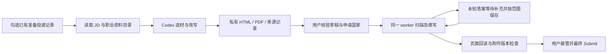

# 通用填表与岗位简历草稿

## 产品要求 — 2026-10-20

当前产品行为以[单岗位流程](single-job-flow.md)为准，开发顺序见[开发计划](development-plan.md)。
这次文档对齐不表示下述旧执行器限制已从代码或安装版移除。

系统逐岗执行。有平台适配就复用，没有就根据实际页面使用通用浏览器完成字段、
多选、Next/Continue、多步页面和必要附件。平台不在名单、没有逐请求 grant，
或需要正常的自动保存、预上传，本身都不是暂停理由。系统识别并避免最终 Submit；
网页要求用户登录、二次验证或处理验证码时，才交给用户。

普通岗位自动准备完整简历及必要材料并填写上传。高价值、高匹配岗位先完成分析、
简历和必要材料初稿，再等待用户精准调整。系统自动检查来源、责任、文档内容和版式，
不要求逐来源或每份 PDF 再确认。一般动机问题和 motivation letter 自主撰写，
不得虚构经历。职业事实读职业经历库，申请信息及可复用答案读信息库；适用范围由系统判断。

只有重要必要事实确实缺失、实际重要冲突、操作超时、持续无进展或结果不明时，
停在当前岗位提示用户，不处理下一岗位，也不集中攒问题。用户可选择跳过后再恢复。
人工改完点一次继续；重开时正常流程从检查点自动续跑，主动暂停或等待用户的保持等待。
用户手动 Submit 后，系统识别明确成功页面或确认邮件、更新记录并继续下一岗；
仅提交结果不明才询问。仅新邮件收录可以在岗位等待时继续。

<a id="默认流程"></a>

## 现存旧通用入口与待改差距

以下记录旧入口的实际参数、控件和请求机制，供维护与故障定位；其中的人工材料确认、
固定别名、最多三个岗位、平台/grant限制和分阶段恢复属于待移除限制，不是当前产品规范。



已有 PDF 是可选入口。默认不要求用户提供私人文件路径。
每个岗位仍绑定独立、已核验的具体 PDF 内容版本。生成草稿不会自动启动填表。

简历入口读取现有 CareerCatalog。它使用结构化个人资料、相关研究及工作陈述，
以及有明确本人责任的 Contribution 范围。明确的设计范围可以与 Codex 实现并存；
责任表和限制必须一起保留。设计及研究范围保留来源原文，已完成的工作陈述允许改写。
未确定责任的项目正文不自动转成个人成果。
候选 Skill 用于定位资料，不形成熟练度、评分或新增技能主张。
此入口不是完整职业图验证或正式能力评估。

Codex 使用已有只读 CLI 边界。每份草稿最多一次调用，超时为 180 秒。
调用输入包括 JD 和允许选用的来源文字、责任及限制，不包括联系方式、答案库或 PDF。
结果只允许引用现有来源。原文、改写、模型结果和来源版本保存在私有运行目录。
引用有效不证明语义忠实；用户须核验改写是否保留计划、完成状态和责任边界。
同一申请版本、资料版本和取材输入可复用现有草稿，不重复调用模型。

当前使用简洁 A4 后备模板。模板资源未随 make-resume skill 一起安装。
HTML 可编辑，PDF 保留可选择文字。视觉风格较少，不保证与该技能的完整模板一致。
工作台默认展示 PDF 及原文、改写和责任归属。已有 PDF 模式作为例外保留。

<a id="启动"></a>

## 旧入口启动参数

```sh
uv run --locked python scripts/run_career_portal.py \
  --port 8769 \
  --worker-root "$HOME/Library/Application Support/TomorrowStar/application-worker" \
  --worker-live --worker-generic --worker-cdp-port 9231 --open
```

<a id="控件与发送路径"></a>

## 旧执行器差距

| 现存限制 | 对应产品要求 |
| --- | --- |
| 显式 generic 开关、最多三个岗位、有限控件；多选、额外附件及普通多步页可触发停止。 | APP-03/08：持续逐岗，无总量上限；适配不足时通用浏览器继续正常操作。 |
| GET 读取集合、公开 POST 请求哈希和专用上传 grant；未知发送路径停止。 | APP-08/11：不把逐请求批准当平台能力；单独避免实际最终投递。 |
| 固定答案别名和逐岗 PDF 绑定，未知题统一等待。 | APP-04/05/07：查两库、自主判断重要性和范围，普通材料自动核验使用。 |

2026-10-20 源码已停止读取 `public-read-grants.json`、`lever-upload-grants.json`
和 `ashby-draft-grants.json`。独立最终提交检查先于读取、草稿和上传判定；
已识别的 Ashby 单项读取/草稿与 Lever 简历解析不再要求人工制作请求许可。
当前岗位、答案意图、PDF 字节和结果核对继续保留。无法识别用途的写入仍等待核验；
通用多步导航、安装版和真实站点的组合验收仍未完成。

下列为历史格式，旧文件原样保留。`public-read-grants.json` 的既有 schema 是
`{"schemaVersion":1,"grants":[{"job_url":"…","url":"…","body_sha256":"…"}]}`；
此处只说明旧数据格式，不要求操作者为新岗位逐请求制作许可。
下列请求标识仍用于定位既有适配路径，旧 grant 文件不再参与运行判定。
历史实现及结果见[2026-10-10 自动保存与上传验证](../validation/application-automation/2026-10-10/worker-autosave-upload-checks.md)。
最终投递约束针对实际行为，不以平台、按钮名称或传输白名单代替。

## 已核验的 Ashby 草稿传输：旧实现参考

本节描述旧版使用的许可：`ashby-draft-grants.json` 与公开读取许可共同使用。
许可绑定完整岗位 URL、五个完整 GraphQL 文档的 SHA256，以及明确的上传 URL。
名称本身不构成许可。仅匹配已核验的全文文档和当前字段的变量。

| 请求 | 校验 |
| --- | --- |
| `ApiJobPosting` | 岗位 ID、标题、表单 ID、字段路径与定义 |
| `ApiSetFormValue` | 当前操作、当前答案版本、具体字段和确认值；核验服务端回读 |
| `ApiAutocompleteGeoLocation` | 确认的国家文字、Country 类型和唯一提供方 ID |
| `ApiCreateFileUploadHandle` | 批准 PDF 的名称、字节数、MIME 类型和 NonUserFormEngine 上下文 |
| 原生 multipart 上传 | 返回的签名字段、固定 PDF Content-Type、批准 PDF 的 SHA256；响应须为 204 |
| `ApiSetFormValueToFile` | 已上传的 handle、当前简历字段；核验附件 ID 和文件名 |

文本控件显式 focus 和 blur。单选框通过唯一服务端选项映射实际传输值。
上传依赖的响应须先完成校验。响应读取期间出现依赖请求时，同一响应只处理一次。
每个发送操作前继续检查岗位记录、重复申请、简历版本和控制页心跳。
未知请求、GraphQL 错误、表单错误或回读不一致均停止该岗位，并保留页面和未完成操作。
自动层不重试未确认的发送，也不提供 Submit 操作。

已观察到的 Ashby 遥测端点仍被阻断。其被阻断不等同于草稿保存失败。
当前源码不再读取这些许可。为保留旧进程中的页面，代码更新不会强制重启浏览器。

<a id="验证边界"></a>

## 历史验证边界 — 2026-10-10

合成浏览器测试覆盖标签、必填覆盖、匿名附件、答案补充与恢复、组合框、
HTTP GET/POST 自动保存阻止、WebSocket 截留、最终按钮不点击和旧平台回归。
真实空页面读取与个人资料填入、附件预上传及最终提交是不同阶段。
2026-10-10 的早期真实测试通过原生浏览器辅助接管，核验了一张 Ashby 表单的
7 个必填项及批准 PDF 的预上传和挂接。自动 worker 仍因未核验的发送路径暂停。
该结果不证明自动 worker 的自动保存已跑通，也不能给出真实填表成功率。
姓名的页面显示曾与服务端值不一致；原生 blur 后的保存回读才确认成功。
最终 Submit 未执行，原申请记录仍为准备投递。
详见[辅助填表验证边界](../validation/application-automation/2026-10-10/assisted-native-fill-checks.md)。
私有岗位研究、实际草稿和个人测试报告保留在系统 checkout 外。

同日后续开发接入上述草稿传输。最终代码在 ElevenLabs 同一真实岗位完成三个独立表单回合。
每回合六个答案均通过服务端回读，批准 PDF 上传返回 204，附件挂接成功。
完成后恢复不重复上传；填写中暂停后可以继续。原人工接管页面未重启，仍保持打开。
这验证了该岗位的自动填表和草稿保存。最终 Submit 未执行，仍没有投递回执。
三回合不是三个独立岗位，也不是跨平台成功率。
详见[自动保存与上传验证](../validation/application-automation/2026-10-10/worker-autosave-upload-checks.md)。
