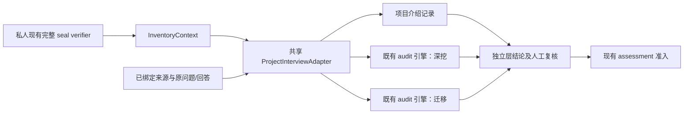

# 状态、私人适配与访谈质量交付 — 2026-10-08

用户要求完成状态同步、通用审查与关联后继、三层执行与问题/评分质量验证。
状态、实现和合成验证已落地。真实回答、个人 mastery 档内值及 confidence 的人工
校准还没有完成，正式个人问答仍暂停。合成参考标签和助手审阅不能替代人工真实标签。

## 交付边界

| 工作 | 已交付 | 仍需人工或后续实证 |
| --- | --- | --- |
| 状态同步 | ROADMAP、32 项需求映射、STATE、机器状态、README、架构和工作流一致 | Phase 9–14 的真实审查和假设验证仍开放 |
| 通用私人适配 | 接受清单、Experience、Contribution、来源身份/哈希、原问题与原回答绑定；全清单队列 | 实际 Contribution 结论复核与 Skill 准入 |
| 关联后继封存 | 完整 parent seal 与 review 祖先复验、原 candidate 保留、精确 approval、create-only 发布和过期绑定拒绝 | 新补充事实的精确用户接受；新发布前刷新独立输入验证 |
| 三层执行 | 介绍 → 全部深挖 → 全部迁移；独立难度阶梯、原判据、上下文请求、暂停续接与逐层复核 | 私人准备包的 readiness review |
| 问题试运行 | 三次生成、原始语义审阅、显式修订后继；修订计划 3/3 通过 | 每份真实计划仍须语义复核 |
| 回答与锚点试运行 | 9 类冻结合成样本 × 3 次，27 项观察符合参考标签；关键错误 0，不稳定项 0 | 真实能力档位、档内依据、confidence 和人工分歧裁决 |

Phase 7 已按独立本地 MVP 验证完成。Phase 8 已按首版用户接受 cutoff 完成。
这表示 2/8 个阶段边界，不表示核心假设已经获得 25% 的有效性证据。
后来的未接受补充不会改写原先已接受的身份，也不会自动进入能力审查。
历史失败、旧执行记录和首轮审查报告均保留。

## 最小实现

- `interview.py` 负责三层顺序、绑定和队列。它复用 `transition_audit`，没有第二套评分器。
- `begin_inspected_audit` 从已查阅 facts 与计划开始。旧 STOA fixture 和入口保留。
- source-specific 私人 bridge 复用原 seal verifier；来源提取和个人 seed 保留在私人仓库。
- 每次操作重验当前接受版本。旧 session 保持可读；新接受版本阻止旧绑定续答。
- 同一 snapshot 分别保留介绍、深挖和迁移结果。迁移不创建新的实做或多场景经历。
- readiness review 绑定计划与上下文哈希，并随 session 保存。没有复核的私人 start 被拒绝。
- 模型失败保留经脱敏的 stdout/stderr。错误输出不会被当成有效判断。

可信边界是单用户本地操作员。此实现没有扩展到并发事务、恶意写入防护或生产服务。
来源成员关系由完整 seal verifier 核验；facts 的解释与 Contribution 责任仍需实质审查。

## 冻结试运行与保留的失败

输入为全合成缓存设计；没有加载或向模型发送个人资料。
配置沿用已有 Codex CLI 边界：`gpt-5.6-luna`、medium、read-only、原生 JSON schema。
模型为可变 alias；每次配置、schema、prompt hash 和原始输出均保留，不能声称不可变模型复制。
最终运行保存完整 prompt 与 runner，供同一输入复验。

| 运行 | 结果与修复 |
| --- | --- |
| 001 | native schema 拒绝 `propertyNames`；使用固定 criteria 属性替代，保留补充诊断 |
| 002 | 第二份计划拼接来源 locator；拒绝并保留原输出 |
| 003 | Experience ID 被改写；改用原生 schema 绑定身份和来源，仍由领域校验器重验 |
| 004 | 三次生成结构通过；回答输出违反既有 BoundaryDecision 的字段关系；补齐明确契约 |
| 005 | 三次生成与三次评估通过结构；归属路由缺少现有工作流信号，保留三项分歧 |
| 006 | 三次生成结构通过；三次评估覆盖全部冻结样本，27/27 参考判断一致，关键失败 0、不稳定项 0 |

v1 合成样本还存在判据与正例不一致的问题。v2 保留 parent corpus hash 和修订原因，
增加真正符合判据的迁移正例，并将任务/模块责任的提问判据与所观察行为对齐。
旧 v1 输入与失败预期保持原样；没有追改失败运行。

最后一轮语义审阅逐项检查来源、责任、问题负担、判据与问题关系、迁移条件和高阶边界。
原始问题计划中 **1/3 可接受，2/3 需要修订**。缺陷包括题目未问的判据，以及高一阶边界
重复当前考察。修订创建新的计划和 parent hash；修订后 **3/3** 结构及助手语义审阅通过。
这说明计划必须经过语义复核，不能直接接受模型输出。它不是独立人工审查结果。

证据入口：[合成说明与重跑命令](../validation/calibration/interview-v2/README.md)、
[最终逐项评估](../validation/calibration/interview-v2/runs/trial-006/report.json)、
[原计划缺陷与修订链](../validation/calibration/interview-v2/runs/trial-006/question-semantic-review.json)。

## 验证

| 检查 | 结果 |
| --- | --- |
| 完整 checkout 离线套件 | 627 passed，1 opt-in deselected，133.10 秒 |
| 最后模型错误留存改动的重点回归 | 47 passed，1 deselected |
| 私人仓库全部合成测试 | 30 tests，OK |
| 原接受清单完整语义、来源、审阅与覆盖复验 | 通过；封存字节保持原样 |
| 真实私人准备包 `prepare` | `valid: true`、`preparation-only`，三层绑定有效 |
| 未复核私人准备包 `start` | 拒绝，未创建访谈 |

Ruff 通过，113 个 Python 文件格式通过，11 个主要导航文档未发现失效本地链接，`git diff --check` 通过。合成运行中保留的历史 runner 源码属于证据，已从 Ruff 的格式和 lint 范围排除，以免改写失败输入。
完整离线测试不包含本次显式 live 合成运行；二者分开记录。

## 真实校准的最后入口

私人工作区已创建只读来源绑定的复核包。它包含三层计划、已接受版本和来源、
既有原始责任问答、去掉预期标签的合成题表，以及仍为 pending 的 readiness draft。
私人 README 定位该包。当前原始问答只回答了谁设计、谁复核、谁执行，
它没有验证实做能力，不能据此产生 mastery 或 confidence。

[项目协议](../.planning/PROJECT.md#acceptance-boundary) 明确要求
“Question-quality trials and reviewed answer/anchor calibration remain required before personal scoring.”
真实能力和锚点参考判断需要明确的人工复核者。待复核者核对实际回答、行为证据与分歧后，
创建新的 readiness review。当前 draft 和既有回答保持原样。

本次没有接受新的 inventory、增加个人分数、提交、推送、部署或向其他人发送材料。
