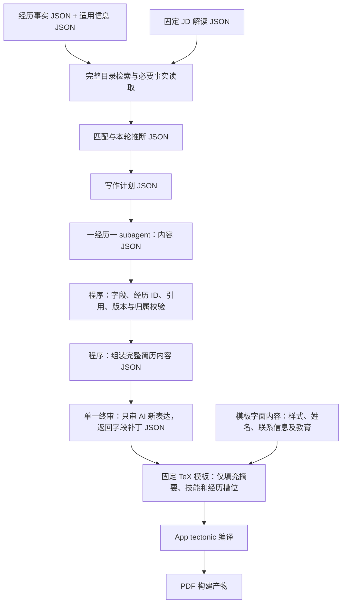

# JSON 内容与固定简历渲染设计

日期：2026-10-24，Europe/Zurich。状态：**J01/J02 英文合成切片、J03 经历库和
J04 默认读取/匹配重构、J05 内容写作/终审/采用、J06 人工接回、J07 申请 JSON
主存储及 J08 主流程组合已接入源码并完成合成验证。** [操作入口](json-resume-operations.md)、
[J01/J02 验证](../.scratch/json-resume-delivery-2026-10-24/j01-j02-verification.md)、
[J03 验证](../.scratch/json-resume-delivery-2026-10-24/j03-verification.md)、
[J04 验证](../.scratch/json-resume-delivery-2026-10-24/j04-verification.md)、
[J05 验证](../.scratch/json-resume-delivery-2026-10-24/j05-verification.md)、
[J06 验证](../.scratch/json-resume-delivery-2026-10-24/j06-verification.md)、
[J07 验证](../.scratch/json-resume-delivery-2026-10-24/j07-verification.md)与
[J08 验证](../.scratch/json-resume-delivery-2026-10-24/j08-verification.md)区分实现范围。
本轮没有迁移私人数据、调用真实岗位模型、更新安装版或重跑真实材料验收。[统一开发计划](development-plan.md)
持有优先顺序；[J01–J08 实施地图](../.scratch/json-resume-delivery-2026-10-24/map.md)
持有依赖、工作范围和完成条件。P01–P08 的交付与失败记录保留其原范围。

## 设计决定

**事实、可变写作和修订使用语义 JSON；固定样式及固定个人资料直接保存在 LaTeX 模板。**
JSON 不是装着 Markdown、HTML 或 `latex_fragment` 的信封。程序与模型消费同一份
结构化内容契约，不靠标题、行号或排版宏推测经历身份。内存中可用现有 Pydantic
对象和字典；持久化、模型交接及补丁使用版本化 JSON，不为每个函数增加序列化往返。

所有简历输出为英语，使用 LaTeX 默认字体；不建立中文简历排版目标。
固定姓名、LinkedIn、网站、邮箱与教育是模板中的字面内容，不是每轮 JSON 字段。
固定资料需要更正时单独更新模板，不按岗位从信息库覆盖。J05 的当前契约为
`resume-template-plan/v1` 与 `resume-template-content/v1`，均不包含 `profile`/`education`。
经历库原始资料仍可保留其原语言。J01/J02 当前使用固定合成响应，并未运行真实
作者或语义终审；J05 已将 JSON 作者与终审接入现有任务。J06 已接回可唯一定位
的人工文字、链接、删除和顺序，未归并稿保留。J08 已连通申请 JSON、正常两库
分析、内容交接、采用、导出及 Worker 材料绑定；实际作者和临时原生编译单独举证。

新 Flow 任务保存 `material_contract="content-writing/v1"`，固定本轮内容契约。
缺少结构化经历事实时返回 `resume_content_material_required`，不会新建旧 TeX
写作任务。无该标记的历史任务及已有旧交接仍按原契约接续。



终审在内容 JSON 上进行；必要时可查看程序渲染预览，不再修改 TeX 字符串。
预览与最终构建调用同一 renderer。经历库保留完整事实，简历内容只保留本次选材；
后者不能反向成为永久事实或 Skill 评分。写作者和终审不重新解读 JD、匹配或审核自述。

“统一 JSON”适用于内部业务交接。原邮件、JD 原文、论文、旧 Markdown/TeX/PDF
仍保留原件及来源定位；它们经明确导入后才能成为结构化事实输入。
PDF 是最终交付格式，TeX 是排版格式，仓库文档继续使用 Markdown。

## 当前代码地图：复用什么，替换什么

以下是 2026-10-24 的源码状态，不代表安装版或真实材料接受。行号是定位入口，
实施时按函数名重新确认。

| 当前 Module / 定位 | 已有能力 | 需要改变的 Implementation |
| --- | --- | --- |
| `career_experiences.py` | J03 在现有 `ExperienceStore` 实现 v2 内容字段、内容完整性校验、不可变历史与字段派生目录 | 旧 `body` 只作兼容读取；显式导入后成为结构化版本，不能用旧正文降级覆盖 |
| `application_career_library.py`、`career_experience_import.py` | J03 已接保存/同步/分析；逐事实交付责任、状态、作用域和版本；预览导入检查原文覆盖与引用 | 尚未迁移私人记录；未覆盖或新增补充材料保持待导入，程序覆盖检查不证明语义等价 |
| `application_information.py:349,779` | `profile.json`、`answers.json`、适用范围和更正历史 | 匹配及表单继续复用；当前写作不从信息库逐岗注入固定身份/教育，模板维护单独进行 |
| `career_portal_data.py`、`scripts/run_application_records.py` | J07 保留 `ApplicationStore` 的字典接口、申请状态与历史，当前主记录使用版本化 JSON | 旧 Markdown 读取/显式预览导入保留原 ID、原字节和历史，双侧变化拒绝覆盖 |
| `application_job_brief.py`、`application_matching_pipeline.py` | J04 在现有流程保存固定 JD 说明、阶段结果及输入绑定；失败尝试保留 | 显式重试只续未完成阶段；可核验的已存结果在本地采用，结果不明不盲重放 |
| `application_retrieval.py`、`application_material_packet.py` | J04 按 ID 选择完整结构化事实，程序交付全文、引用和责任；按输入复用读取回执 | 旧长原文保留分段 Adapter；事实/引用/责任变化时只重读受影响来源，无未读候选不补查 |
| `application_flow.py`、`career_portal.py`、`application_match.py` | J04 阶段恢复与 J08 默认 JSON 主流程组合；新任务固定内容契约，完成分析核验已选事实和语义配置后复用 | 无关全库或诊断元数据变化不重跑模型；缺少内容事实停止写作，历史交接仍可恢复 |
| `application_experience_latex.py`、`application_experience_content.py` | J05 沿用持久任务、CLI 和实际作者交接；结构化交付采用 `content-writing/v1`，逐经历 JSON 校验及局部恢复 | 旧任务继续原契约；新作者不提交 `groups[].latex`/`latex_fragment`，终审只补允许内容字段 |
| `application_writing.py` | J05 从固定事实/推断及显式 LaTeX 模板建立 `resume-template-plan/v1`；模板绑定沿用 `bind_latex_base` | 固定样式及身份/教育保持模板原文；缺失语义事实不静默省略，没有内容映射的人工 TeX 停止覆盖；J06 接回后保存人工列表结构保护 |
| `application_resume.py`、`application_source_reuse.py`、`application_full_latex.py` | J03 默认事实投影排除历史 TeX；教育交付适用 profile JSON，历史查询保留 | 旧生成器仅在兼容生成阶段读取材料档案；J05 已接内容写作与采用，J06 已接人工修改及构建，不回灌事实集 |
| `application_resume_versions.py` | J05 在原草稿版本中保存并核验内容 JSON、渲染 manifest、TeX 及补丁后终审绑定；旧版本保持可读 | J06 已接入人工 diff、内容版本下的构建及 finishing 恢复 |
| `application_prism.py` | 编辑器读取、条件保存、实际依赖、原生结果读取及 Git 出处 | 生成项目支持已有根 Git 和同步状态；不启用同步，元数据不进入依赖，程序从 blob 生成 diff |
| `application_pdf_reuse.py` | 历史 JD/PDF 候选继续兼容 | 新内容交付及未归并稿不进入独立 PDF 业务复用，已有实际构建由现有版本入口采用 |
| `application_bound_materials.py`、`application_single_binding.py` | J08 保留原页的候选材料、Prism 返回及 Worker 绑定接续 | 候选源/PDF 先暂存，原绑定保留；一次 Continue 核验后采用，未知结果不重放；适用信息从可信本地任务选定目录核验 |

J03 已同时收窄 `career_source_snapshot()` 和 `snapshot_for_analysis()` 的默认事实
入口；旧原文仍可由显式导入适配器读取。目录和事实交付读取明确字段，不将新经历
对象交给 `str(body)` 继续旧抽词。

## 目标 Module 与 Interface

内容契约和渲染各有窄文件；J03 另提取纯导入覆盖校验，供库接口和同一 CLI 复用。
存储、同步和发布仍由原拥有者处理，不要求一次大规模改名。
本节使用 Codebase Design 的术语：Module 隐藏 Implementation；Interface 包含输入、
不变量、错误与副作用；Seam 是替换行为的位置。Adapter 只在真实格式差异处存在。

| Module | 最小 Interface（概念） | 深度与职责 |
| --- | --- | --- |
| 现有 `ExperienceStore` / `CareerLibrary` | `get(id)`、`save(record, expected_revision)`、`directory()` | 隐藏事实版本、更正、来源关联、目录派生和旧格式 Adapter；调用者不解析文件格式 |
| `career_experience_import.py` | `prepare_experience_import(previous, request)` | 纯函数检查原文范围、事实/来源映射、重复项上下文及未表达项；发布沿用现有锁、条件写入和历史 |
| 新 `application_resume_content.py` | `validate_fragment(payload, assignment)`；`assemble_content(plan, fragments, retained)`；`apply_content_patch(base, patch, *, allowed_targets)` | 纯数据操作，集中 schema、经历身份、引用作用域、字段归属、顺序和人工保护；不读取库或输出 TeX；补丁权限由程序独立传入 |
| `application_resume_render.py` | `render_resume(content, *, template=...) -> RenderedResume` | 当前契约只填固定 TeX 模板的三个槽位，经历生成一个 subsection；模板外文字原样保留，集中正文转义及构建映射；历史完整 JSON renderer 保留兼容 |
| 现有 `application_experience_latex.py` / `application_writing.py` | 继续 `prepare`、`writer_context`、`submit`、`assemble`、`review`、`adopt` 现有入口 | 复用持久任务、实际 subagent 交接、局部恢复与版本采用；调用内容/渲染 Module，不再判断 TeX 内容归属 |
| 现有 `application_resume_versions.py` / `application_prism.py` | 继续编辑会话、完成编辑、条件保存、读成功构建结果 | 隐藏内容版本→构建、人工 diff 接回、失败保留、迟到结果隔离；不另建编译器或审核平台 |
| 现有 `ApplicationStore` | 保留已有读取/创建/修改 Interface | JSON 为新记录主存储；Markdown 只在历史导入/导出 Adapter 内解析 |

这两个新文件各有真实职责：删掉内容 Module，校验与保护会散回各调用者；删掉
renderer，转义和模板规则会散回作者与组装器。无需新增 agent/provider 协议、
通用文档树、数据库或第二套事件/版本存储。旧文件名中的 `latex` 暂留兼容，
待调用者切换后再判断是否值得改名。

## 最小数据契约

J01/J02 原完整 JSON 合成契约保留为历史兼容。当前 J05 使用模板绑定的
`resume-template-plan/v1` 和 `resume-template-content/v1`；不复制固定个人资料。
这些契约不直接冻结完整职业图谱。
文本字段可以包含完整自然语言段落；章节、列表、链接和引用须有明确结构，
不能靠 Markdown 标记、HTML 标签或 LaTeX 命令表达结构。

| JSON 记录 | 必要含义 | 不应承担的职责 |
| --- | --- | --- |
| 经历事实 | 复用 `candidate_id`；身份/机构/角色/日期/状态；可选子项目分组；带稳定 ID 的事实条目；来源与实际责任 | 不是为某个 JD 压缩的简历 bullet；不推断学历授予或完成状态 |
| 固定写作输入 | 契约版本、任务/分配版本、当前经历事实、允许引用、本轮匹配/推断及表达范围、写作要求、需保留的人工内容 | 不塞入全库，不把旧简历作为新的事实权威 |
| 单经历写作结果 | 经历 ID、分配版本、完成或缺资料状态；有稳定 ID 的正文条目及逐条引用 | 不生成标题宏、列表宏、字体/间距、整篇 TeX；不自由改姓名或学历 |
| 当前简历内容 JSON | `application_id`、`template_revision` 等绑定元数据，可变摘要/技能、经历及顺序/省略、人工修订来源 | 无 `profile`/`education`，不复制模板固定资料；不内嵌 TeX |
| 内容补丁 | 基线内容版本、允许字段/条目 ID、预期旧值及新值 | 不用 TeX 行号作为业务身份；不允许无目标的整篇重写 |

单经历输出示意（全部为合成数据；精确字段在 J01 确定）：

```json
{
  "schema_version": "experience-writing/v1",
  "assignment_revision": "assignment-demo-1",
  "experience_id": "experience-demo-1",
  "status": "complete",
  "items": [
    {
      "id": "item-demo-1",
      "text": "Implemented a data validation workflow with the project team.",
      "fact_refs": ["fact-demo-1"],
      "inference_refs": []
    }
  ]
}
```

`experience_id` 映射既有 canonical `candidate_id`，不能只是作者自取的非空字符串。
固定标题、机构、日期从分配的事实快照由程序填入。缺资料结果与完成结果互斥，
通过明确 `requests` 引用本经历的缺项；失败不能静默输出空 subsection。
事实本身可以不完整，不把所有可选事实字段都设为生成门槛。

引用按已交付的经历/事实/推断版本验证。程序验证 ID 存在、类型正确、属于当前
作者分配集合；每条 AI 新表达有对应引用，汇总 `used_refs` 不能代替逐条关联。
Schema 不能证明语义真实，越界表达仍只由单一终审处理。
人工新增表达记录 `origin=human` 及编辑来源，不因库无引用否定其意图；
它留在本次申请，不自动更新永久经历库。

全局职业定位、摘要与技能沿用同一纯内容原则，由主 agent 负责，不把全篇交给任一经历作者。
责任、AI/工具协助等内部来源记录不输出到雇主简历；实际团队责任仍体现在措辞中。

## 渲染与构建

1. 程序验证内容后，按写作计划组装完整内容 JSON；唯一终审修订允许字段。
2. 必须显式绑定固定 `.tex` 模板及其归档。模板包含字面姓名、网站、邮箱、LinkedIn、
   教育、样式和章节标题；renderer 不重新生成它们。程序仅替换显式槽位的正文，
   槽位之外原文精确保留；经历正文内部每段生成一个 `\subsection`。
3. 所有内容字符串作为字面文本转义，集中处理 `% & _ # $ { } ~ ^ \\`、Unicode
   和换行。链接使用经过验证的链接字段。输入中的命令不能成为可执行模板。
4. 生成单文件 `main.tex` 与内容 ID→渲染范围映射。映射属于构建元数据，行号
   可以变化；经历/条目 ID 不变。不让模型抄写模板或执行转义。
5. App 用 tectonic 编译并读取成功结果（Prism-local 仅编辑与预览）；失败保留内容、诊断及旧 PDF。

当前模板必须各含一次 `%% TOMORROWSTAR_SUMMARY %%`、
`%% TOMORROWSTAR_SKILLS %%`、`%% TOMORROWSTAR_EXPERIENCES %%`。
章节标题写在模板里，renderer 只填槽位正文。模板缺失、标记重复或版本不符会停止。
已有模板选择继续用 `bind_latex_base`，不另建生成模板或注入个人资料的入口。
新模板可额外声明一次 `%% TOMORROWSTAR_HEADLINE %%`，接入可变 `headline: ContentItem`。
主作者按已交付岗位说明生成简短职业定位，例如 Quantitative Research 或 Data Science，
不能虚构当前职位、资历或熟练程度。该项使用逐项引用、独立终审及人工保护；缺项停止
新写作，人工明确删除的项保持删除。renderer v3 输出单独段落，不生成列表项目。
旧模板不含该槽位时保持原字节与 renderer，旧 JSON 不补空字段，原内容哈希仍有效。
默认申请及材料准备模式均读取显式模板配置；模板选择不依赖是否显示独立审阅页面。
写作时归档固定模板并绑定版本；下一岗位默认回到已采用内容的原模板基线，
不把上一份已填正文的 TeX 当模板。候选必须通过槽位和版本核验；较新的历史
成稿没有槽位时继续查找更早的有效模板。新任务首次绑定使用现有生成项目策略，
支持已有根 Git，Git 元数据不进入归档；固定原文不作旧版排版压缩。

若技术表达确实需要数学排版，先用当前实例判断；v1 不开放任意 `raw_tex`、
HTML 或通用富文本树。模板升级有独立版本。固定信息由用户在模板中单独更正；
更正信息库或换岗位不会静默改写模板及已完成的申请稿。

可变内容 JSON 是正文业务记录，固定 LaTeX 模板另行绑定。完整 TeX、PDF、辅助
文件和编译回执归在两者共同确定的构建记录下：

```text
既有申请材料版本目录
  可变内容修订：content.json + 父版本/修订历史
    构建：固定模板归档/版本 + renderer 版本 + 实际编译依赖
      main.tex / PDF / 构建映射 / 回执
    失败尝试：原始输出、错误、恢复断点（保留）
```

这里只规定归属，不创建另一套独立版本库。内容引用绑定固定快照；renderer、
模板版本属于构建身份。写作片段复用以内容契约、分配输入和人工保护判断，
模板变动通常只需重渲染，不应让作者重写。旧 TeX fragment 不能被当成新 JSON
结果复用；可继续作为旧任务历史。显式重新生成才消费新库/JD/写作要求。

PDF 没有独立业务接受状态、复用推理或材料版本；仍保留文件完整性、实际构建
对应关系和网站上传记录。相同内容/模板/依赖应可重现内容与版式，不要求 PDF
字节完全相同。预览下载读已有结果。旧 PDF 和旧 TeX 不因新架构被删除。

## Prism / Git diff 的最小接续

用户说明 Prism-local 用 GitHub 留存和备份，人工或 Prism agent 的 diff 是修改
依据。J06 已只读检查实际 Prism 源码及接口，并在临时合成 Git 工程验证。现有
生成项目及原生依赖绑定支持已有根 Git 目录与同步状态；不启动同步、provider 或
自更新，不提交或推送，不把 `.git` 纳入源归档和编译依赖。符号链接、重定向、
嵌套 Git 与不支持的配置仍拒绝。外部源码含既存修改，不能将临时验证记作纯基线
提交、用户服务或安装版接受。

只读 Git blob 与当前 TeX 由程序生成 diff，不运行可能执行 clean filter 的工作树
差异命令。每次记录确切 HEAD、diff 来源及源身份；已自动提交时空 diff 仍保留
真实状态，不拿上一提交变化代替本次变化。归档的编辑前后源才是内容接回基线。

保留直接编辑 TeX 的入口，使用以下最小策略，避免增加通用双向转换器：

1. 打开编辑前，记录内容/模板版本、生成 TeX、内容定位映射；Git 可用时记录
   确切 base/head 和 diff 来源。系统仍暂停写同一编辑稿。
2. 完成编辑时，以基线和 diff 找出受影响条目。对能由固定渲染映射明确还原的
   文字、链接、删除和顺序变更，保存新的人工内容 JSON 子版本；程序核验基线及精确重新渲染。多个替换不能唯一辨识身份时保留为未归并，不猜原 ID/引用。
   不对任意 TeX 做启发式剥除，也不默认新增一次语义审核或用户批准。
3. 人工稿只做原有快速文字校对；校对补丁只作用于确定的可变条目范围，并保留记录；固定资料和经历标题不由校对改写。
   不借回填 JSON 重写事实、措辞或排版。条件保存仍检查编辑期间的新变化。
4. 无法表达的宏、排版或跨块修改保留原源、Git diff 和旧结果；记录尚未归并的
   修改，并暂缓会覆盖它的自动重建。人工稿仍可编译/预览/导出。不把未归并稿
   冒称为已完整同步 JSON，也不将任意 TeX 塞回内容字段。
5. 常用排版修改若确需后续复用，在实际样例中归入模板版本；不能为了统一 JSON
   丢弃用户修改。仅实际冲突/无法映射时要求用户选择，不把所有编辑变成审批。

未归并标记保存在既有编辑会话/内容版本关联中，并绑定人工源及 diff 身份。
这期间的手工构建不能标为“仅凭旧 JSON 可重建”；采用或恢复结果仍须核验实际
人工源与依赖。受影响内容不能用旧 JSON 自动重建或跨岗复用，已归并且无关的
片段仍可复用。原任务可继续使用已有手工构建，不因此增加 PDF 业务接受状态。

J08 将已绑定 Worker 原页的 Prism 返回作为暂存候选处理。候选草稿和实际 PDF
保留在材料更新记录中，旧 Worker 绑定继续有效；一次 Continue 核验原页、授权、
输入及实际文件后采用新版本。无变化或失败不替换旧材料，未知结果保持待核对。
发送前读取可信本地任务中选定的信息库，核对适用联系人与资格，不另读默认空库。

Git diff 证明改了什么，但不自动提供经历字段语义。**任意 TeX 自由编辑与完全
无损自动回填 JSON 不能直接同时保证。** J02 的渲染映射和 J06 的真实编辑样例
决定 v1 可自动接回的范围；未支持部分必须清楚保留，不能隐藏丢失。

## 迁移与检查重点

- 使用既有版本存储发布内容新版本。保留旧文件、历史、独有事实、来源定位和
  用户更正；不原地批量 strip，不把“能编译”当成“事实已保全”。
- 导入先出字段映射、重复/冲突/未表达项和旧新对应清单；保留未决材料，不能
  静默少事实。迁移检查不等于重审自述可信度或要求用户重讲已保存事实。
- 原申请 Markdown 到 JSON 迁移单列 J07。继续保留完整 JD 原文，仅提取现有
  company/role/location/URL 等实际需要字段；复用 P02 解读，不建立庞大 JD schema。
- 四个 P2 按拥有模块分别处理：J03 交付结构化默认事实读取；J04 修复跨阶段失败
  重跑成功上游和耗尽候选后空补查，并保留仍有未读候选的补查路径。人工校对
  J06 已接入 finishing 捕获源、响应、条件写入与采用结果的中断接续。源码及合成结论各见对应 J 包验证，不改写安装版
  或真实材料接受。原审查见[报告](../.scratch/p01-p08-flow-audit-2026-10-24/README.md)。
- 单一终审保证职责集中；JSON 校验只保证结构/关联。真实 PDF 仍需本轮版式和内容
  QA，不能将编译成功推定为完整接受，也不增加日常 PDF 批准关卡。

## 预期收益与接受状态

确定的设计收益是：模型不再承担 TeX 语法、程序可定位到单条内容、错误与重试
集中到对应经历、渲染规则只维护一处。效率改善尚无实测；JSON 也有字段开销，
模型与编译仍耗时。J08 的固定输入录制比较检查调用、重试和事实保全，不能推断
真实 provider 延迟或提速比例，也不证明 30 秒达标。

J01/J02 的独立源码与英文合成纵向切片已完成，见[验证记录](../.scratch/json-resume-delivery-2026-10-24/j01-j02-verification.md)。
J05 的真实 subagents 合成验证与源码回归分别记在本包验证中；J06 的当前实际 Prism
工作树与临时工程验证单独记录。用户服务、安装版和私人材料接受仍待后续执行。交接说明中的
真实材料/PDF 尚未通过状态不在本轮改写。本轮未查询私人运行状态。
J03 已修改现有保存、同步、事实投影和默认分析接口，见[J03 记录](../.scratch/json-resume-delivery-2026-10-24/j03-verification.md)。
J04 已重构现有默认读取、匹配与恢复流程，见[J04 记录](../.scratch/json-resume-delivery-2026-10-24/j04-verification.md)。
J05 已接入现有分经历任务、内容 JSON 终审和版本采用，见[J05 记录](../.scratch/json-resume-delivery-2026-10-24/j05-verification.md)。
J06 已接回人工编辑、未归并保护、finishing 恢复及内容版本下的实际构建；
J07 已使 ApplicationStore 当前记录使用 JSON，保留旧 ID、Markdown 原件及历史。
J08 已完成源码与合成主流程组合，并用两位实际经历作者、独立终审及临时 Prism
当前工作树验证原生编译和页面人工编辑，见[J08 记录](../.scratch/json-resume-delivery-2026-10-24/j08-verification.md)。
私人真实申请、用户 Prism 服务、安装版和真实 ATS 未在本轮接受。未迁移私人数据或更新安装版。
