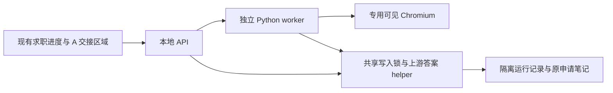

# Lever / Greenhouse 本地可用预览

## 合成工具范围 — 2026-10-20

产品行为以[单岗位流程](single-job-flow.md)为准，待改代码与验证顺序见[开发计划](development-plan.md)。
本页是隔离合成预览和旧接口的复现说明。下文集中问题、三页容量、逐岗确认、
手动提交声明及控制页失联暂停是该夹具/旧 worker 的行为，不是日常产品规范。
测试数据隔离用于避免混淆结果，不应派生用户批准每份简历或每个请求的流程。

产品严格逐岗处理，重要问题停当前岗位；用户选择跳过才推进下一岗，仅邮件收录可继续。
普通岗位自动到 Submit 前，高价值岗位先完整初稿再人工精调；用户介入后一次继续。
正常流程重开自动续，明确提交结果由系统自动记录。最终 Submit 始终由用户操作。
新目标的验收应按这些行为更新夹具，不能把旧夹具断言当作必须保留的产品需求。
本次没有运行安装、预览或浏览器测试，也不改变下列历史结果。

2026-10-10：已实现独立 worker、现有门户入口、集中补充答案和逐岗位复核。
预览使用隔离的 Lever / Greenhouse 合成页面，不启用真实 ATS。
另有显式开启的[真实填表模式](live-application-worker.md)。模型同义判断仍未启用。
它执行实际浏览器、文件和原记录操作，不依赖 Codex 对话或 Codex 内置浏览器。

本页说明隔离合成预览。全系统当前状态及真实测试另见[流程与测试总览](application-worker-workflow.md)。

## 现存合成夹具的启动与操作

从 checkout 启动。首次安装固定的浏览器：

```sh
uv sync --locked
PLAYWRIGHT_BROWSERS_PATH=0 uv run --locked python -m playwright install chromium
uv run --locked python scripts/run_lever_preview.py --open
uv run --locked python scripts/run_application_preview.py --platform greenhouse --open
uv run --locked python scripts/run_application_preview.py --platform mixed --port 8768 --open
```

启动器创建隔离的合成申请记录、答案库和 PDF，打印其临时目录。
它不读取已保存的私人工作台配置，也不导入旧 Job Apply 个人资料。
默认地址为 `http://127.0.0.1:8766/#applications`；端口可用 `--port` 指定。

1. 在求职进度勾选已有记录，点击“准备填表批次”。
2. 逐岗位确认国家并选择启动器生成的 PDF。预览显示本次目标和附件。
3. 点击“开始／继续”。左侧集中补充未知问题，右侧显示每岗位进度及其简历。
4. 答案默认保存并在确认范围内复用。“仅本次”只解除所选岗位的等待。
5. 点击“接管并复核”。worker 撤销该页的自动执行权，由用户编辑及最终 Submit。
6. “我已人工提交”记录用户确认。接收回执另填来源；两种记录分别同步原笔记。

关闭控制页面后会尽力发出暂停请求；失联检查也会暂停批次。
默认失联宽限 60 秒。重连后由用户继续。暂停保留仍有效的招聘页面。
默认同时保留三页；到达上限后等待用户处理并释放页面。
worker 或浏览器重启后不承诺恢复 DOM，先暂停并要求核验，不自动重传不明附件。



## 实现与复用

- `application_worker.py`：批次准备、资料绑定、范围检查、答案保存、控制连接与原记录同步。
- `application_worker_browser.py`：两平台共用的单个顺序进程、执行锁、浏览器动作、断点与人工交接。
- `ats_forms.py`：固定的平台字段、页面与附件状态选择器；两平台使用各自的已验证合成上传路径。
- `lever_worker.py`：保留旧导入路径，调用同一执行器；没有第二套队列、答案库或浏览器运行时。
- `career_portal.py`、`portal_static/worker.js`：复用 Host、Origin、CSRF 和现有笔记编辑入口。
- `ApplicationStore.write_lock()`：标准库 `flock` 串行化系统写入，保留 revision 检查和原字节备份。
- [Job Apply helper 的来源与许可证](../src/career_evidence_graph/_vendor/README.md)：固定源码，不修改安装插件。
- Playwright Python `1.63.0`、Chromium build `1243`，本机浏览器版本 `153.0.8010.12`。
  安装与可见浏览器行为依据[官方文档](https://playwright.dev/python/docs/library)。

原记录同步失败保留浏览器结果与待同步内容。只重试写回；遇到新 revision，先核验再合并。
Obsidian 等外部编辑器不使用系统共享锁。最后复查与替换之间仍有竞争窗口，不能承诺任意外部竞争下无损。

## 合成验证入口与历史边界

```sh
uv run --locked python scripts/run_pytest.py -q
uv run --locked python scripts/run_pytest.py -q -m worker_browser \
  tests/test_lever_worker_browser.py tests/test_greenhouse_worker_browser.py
uv run --locked ruff check .
uv run --locked ruff format --check .
```

浏览器测试需已安装对应 Chromium，并在本机允许浏览器启动的环境运行。
默认离线套件不启动浏览器、不调用模型、不访问真实 ATS。
结果见[三轮主流程与故障验证](../validation/application-automation/2026-10-10/lever-worker-preview/README.md)。
Greenhouse 接入和 Lever 回归见[双平台验证报告](../validation/application-automation/2026-10-10/greenhouse-worker-preview/README.md)。

当前字段执行仅验证合成页面的文本、选择列表和 PDF 附件。
同义复用采用已测试的固定别名；不明确的语义、国家条件或选项会等待用户。
模型数据隔离、真实 Lever 页面／上传路径、动态控件、真实接收和安装包尚未验收。
Greenhouse 的名、姓使用各自确认答案，不从完整姓名推断。资格和担保仍分开并限定国家。
Greenhouse 夹具的字段模型参考[官方 Job Board 文档](https://docs.greenhouse.io/job-board.html)，
包含数值选项值和独立标签；这些合成 DOM 与上传路径不代表真实托管页面已被验证。
预览启动器保持合成模式。真实模式的只读检查与当前验收边界见[接入报告](../validation/application-automation/2026-10-10/live-worker-pilot/README.md)。
职业图、Skill 评分和当前职业验证里程碑未改变。
