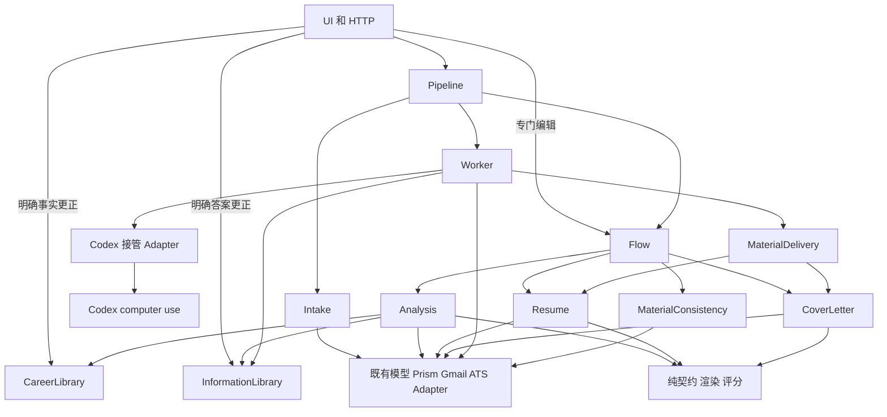
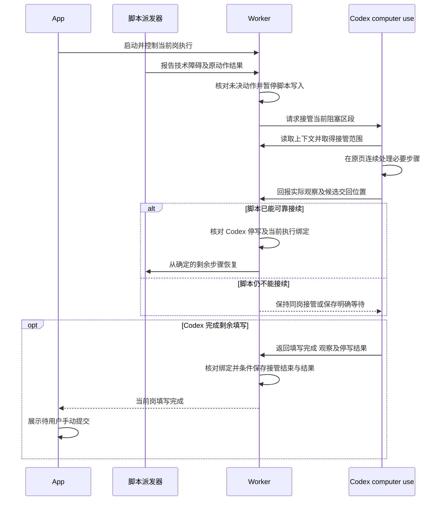
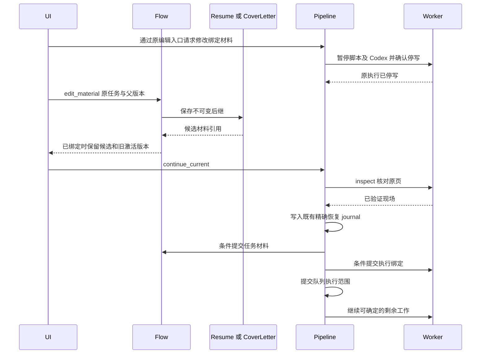
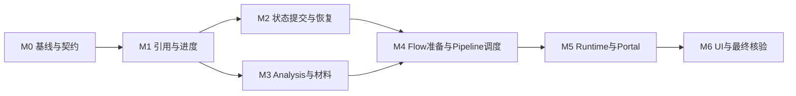
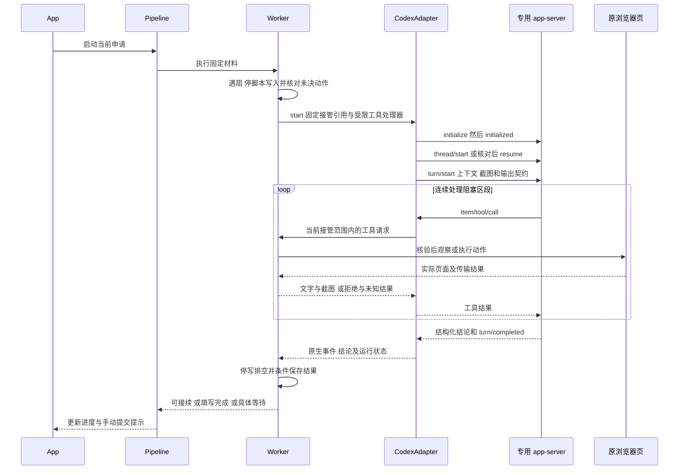
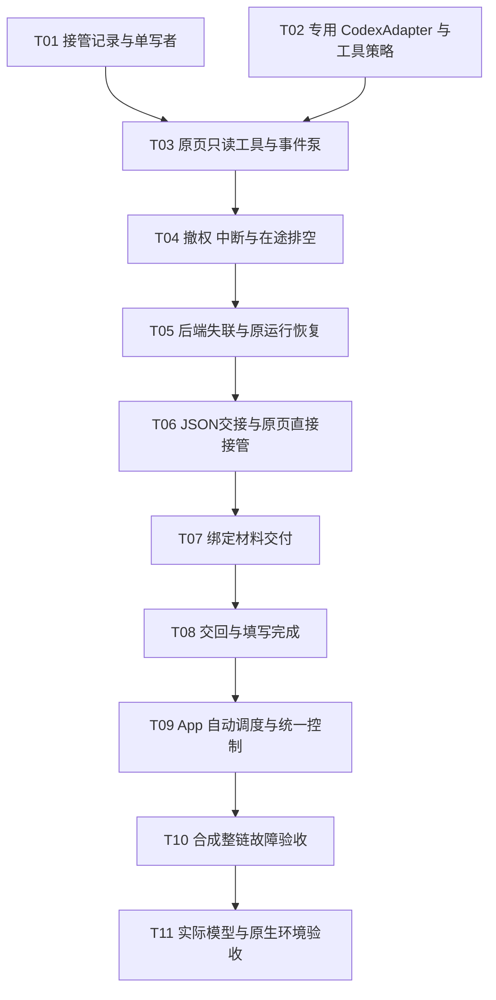

# Module 接口依赖与迁移设计

日期：2026-10-26，Europe/Zurich。状态：**最终 R6 同一 652 文件快照完整通过：全量离线 7,458 passed、2 skipped；隔离合成浏览器 594 passed、21 skipped；零失败/错误，运行前后摘要相同。原 R3 与后续失败/中断记录分别保留。该历史截点 T06–T11 和完整 M3–M6 未完成；当前后继验收见下。默认页面写入与自动接管仍关闭。**

**当前接管契约已于本轮更正：** 脚本失败后以 JSON 交接进度与 DOM 定位线索，
由 Codex computer use 直接接续原 Page；见 [T06 当前契约](#codex-takeover-json-contract)。
该契约取代本文件中与之冲突的自定义视觉动作和默认截图交接设计。旧实现证据保留原范围。

最新实现与证据见 [T04/T05](../.scratch/codex-assist-t04-t05-2026-10-26/implementation.md)、
[T03](../.scratch/codex-assist-t03-2026-10-25/implementation.md) 和
[剩余开发地图](../.scratch/module-completion-2026-10-26/map.md)。已接入受限原页只读、停止与
恢复；没有模型 turn 或页面写入入口，源码验证不代表安装版、真实模型或真实 ATS 验收。

本设计收紧默认逐岗申请流程的 Module Interface，减少调用者对内部状态、文件布局和
恢复顺序的了解。采用渐进式重构：保留 Pipeline、Flow、Worker 的实际职责，收回跨
Module 写入和状态解释，随后集中运行装配。Interface 名称是目标表达，不代表当前
代码已经提供同名方法，也不要求为每个 Module 新建类或 Protocol。

**日常用户入口是 App。** 用户从 App 启动和控制申请，脚本遇阻时由 App 经 Worker
调用 Codex computer use 接管；可接续时交回脚本，否则处理到 Submit 前并返回“填写完成”。
App 接收结果、更新进度并提示用户手动提交。不要求用户预先打开 Codex 聊天、复制任务、
选择会话或人工领取接管。本次入口约定优先于历史“由 Codex 配合工具使用”的导航说明。

本设计不改变申请产品规则、现有私人数据或历史记录。实现授权、安装更新和真实服务
验收不由本设计文档授予。最终 Submit 继续由用户操作。

### 2026-10-27 MC05 原 T06 限定验收完成

[最终验收](../.scratch/remaining-tickets-2026-10-26/mc05-native/final-acceptance-r5.md)与
[独立证据审查](../.scratch/remaining-tickets-2026-10-26/mc05-native/r5-native/final-acceptance-evidence-review.md)
确认受控agent/合成原Page/实际native工具层满足原MC05五项条件：同一1799项快照，
完整offline7843 passed/2显式skips、affected browser224/5显式skips、actual native8/0。
JSON进度无截图必需，原Page单控制者接续、当前目标核验、unknown不重放、在途排空、
保存失败原占用及Submit守卫均有对应证据；public拒绝不外推内部guard stage。
MC06/T07 已按普通页面结案，MC07/T08 交回与填写完成已于 2026-10-27 按源码/合成/原生验收结案；后续产品自动派发、完整M4、AC01–AC27仍未完成；
实际模型/effective policy、唯一签名App与真实ATS按MC10–12原要求验收，最终Submit手动。
本结论不改变以下目标契约；原失败与两份旧静态日志原文覆盖例外见最终报告。

## 阅读导航

- [设计依据和范围](#设计依据和范围)
- [职责与状态所有权](#职责与状态所有权)
- [已确认的设计决定](#已确认的设计决定)
- [Interface 共用契约](#interface-共用契约)
- [Module Interface](#module-interface)
- [依赖关系](#依赖关系)
- [完整流程](#完整流程)
- [文件迁移映射](#文件迁移映射)
- [迁移顺序](#迁移顺序)
- [2026-10-26 修复与整批验收](#2026-10-26-修复与整批验收)
- [M0 Codex 接入核验与可行方案](#m0-codex-接入核验与可行方案)
- [Codex 接管的最小实施任务](#codex-接管的最小实施任务)
- [验收标准](#验收标准)
- [兼容与停止条件](#兼容与停止条件)
- [待核对的契约细节](#待核对的契约细节)

## 设计依据和范围

### 规范关系

| 内容 | 所属文档 | 本设计的关系 |
| --- | --- | --- |
| 产品行为与手动提交 | [single-job-flow.md](single-job-flow.md) | 约束本设计，不增加新的日常审批 |
| 当前实现 | [ARCHITECTURE.md](../ARCHITECTURE.md)、[职责清单](codebase-responsibilities.md) | 作为现状依据，不因提案自动改写为已实现 |
| 工作优先级 | [development-plan.md](development-plan.md) | 本文给出迁移依赖，不改变现有票、负责人或执行状态 |
| 内容与固定模板 | [json-resume-design.md](json-resume-design.md) | 保留 JSON 主内容、固定模板与历史 Adapter |
| 领域术语 | [CONTEXT.md](../CONTEXT.md) | 保留 Career Fact、Job Match Analysis、Application Receipt 等语义 |
| 私人数据与验证 | [data-boundaries.md](data-boundaries.md)、[CONVENTIONS.md](../CONVENTIONS.md) | 沿用分离工作区、合成验证和 checkout 启动器 |

源码定位以文件和符号为准。行号会随实现变化；迁移开始时必须重新确认调用者和持久契约。

### 设计原则

**Module** 是具有 Interface 和 Implementation 的功能集合，可以包含多个文件。
**Interface** 包含输入输出、错误、副作用、顺序、不变量及必要性能约定。
**Seam** 是 Interface 所在的可替换位置；**Adapter** 是实际满足该 Interface 的实现。

**Depth** 衡量调用者学习少量 Interface 后获得的功能。**Leverage** 是这种能力在多个
调用者和测试中的复用；**Locality** 是规则修改能够集中在所属 Module。

本设计采用以下判断：

1. 先复用现有 Module，不为文件长度机械拆分。
2. 调用者与行为测试跨同一外部 Seam；内部故障注入 Seam 不必暴露给普通调用者。
3. 删除一个拟议 Module 后，如果业务知识只是在调用者间重新散开，它才有实际价值。
4. 只为真实变化保留 Adapter，例如生产模型与受控 runner、Prism 与合成实现。
5. 不把所有 JSON 类型化，不增加通用工作流、命令总线、存储框架或统一材料基类。

### 必须保留的行为

- 同时只推进一个岗位；等待时仅推荐收录可继续。
- 普通材料准备、填写和上传不增加重复审批；最终 Submit 手动。
- 重要事实、真实冲突和未知结果只阻止依赖该条件的必要操作，不一概拒绝材料准备。
- 人工措辞、顺序、省略、原源与历史保留；普通材料修订不自动成为全局事实。
- 明确失败与未知结果分开；重开、Continue 或更换请求 ID 都不能盲目重放未知动作。
- 旧任务按其保存契约恢复；不根据 runner 对象身份推断业务格式。
- 申请事实、研究能力分数、JD 匹配和雇主结果保持不同含义。

## 已确认的设计决定

以下决定来自 2026-10-25 的设计核对，取代“单个控件完成后立即交回”的早期讨论。

| 决定 | 采用的规则 |
| --- | --- |
| 用户入口 | App 启动、展示和控制申请；Codex 是 App 调用的执行能力，不是用户必须先进入的入口 |
| 整岗取消 | Pipeline 统一协调，Flow 取消准备，Worker 停止执行；保留原稿、页面及未知回执 |
| 实际调用者 | App 自身及 Codex；没有其他程序直接调用。Codex 是产品执行链的一部分 |
| 接管范围 | Codex 连续处理当前阻塞区段，脚本能够可靠接续时交回；否则可继续至最终 Submit 前 |
| 接管方式 | 同一岗位、原页和材料上下文中切换执行者；脚本与 Codex 不同时写页面 |
| 返回结果 | Codex 返回“填写完成”；App 据此显示“待用户手动提交”，不要求用户再次确认完成或填写回执 |
| 正常生成等待 | 本次准备交付的求职信仍正常生成时，等待生成及页面交付完成再返回“填写完成”，不因网站允许先提交而提前宣告本次工作完成 |
| 可选求职信失败 | 生成或必要交付阶段已明确失败且自动恢复未成功时允许交回，App 提示具体失败并保留可用正文/重试入口；不静默省略，不把未知当失败 |
| 最终提交 | Codex 仍是自动执行者，不取得人工最终 Submit 权限 |

HTTP/CLI 用于读取任务、接管协调和结果回报；computer use 工具用于实际页面操作。
二者不互相替代。不要求 HTTP 与 CLI 永久同时支持每个操作，但 App/Codex 实际使用的
入口必须保留或在调用者迁移后替换。

## 职责与状态所有权

所有权表示该 Module 解释合法状态转换、提交更新并处理恢复。多个内部函数或执行进程
可以在同一协议下写入；外部调用者不能修改它们的状态字典。

| Module | 所有状态与规则 | 隐藏的 Implementation | 主要代码归宿 |
| --- | --- | --- | --- |
| Pipeline | 队列、当前岗、控制、整岗取消、Skip/Return、跨步骤推进与执行准入 | 调度循环、队列格式、通知去重与取消协调 | `application_pipeline.py` |
| Intake | 推荐收录、来源取得、邮件处理结果 | 抓取、抽取、分页、来源记录布局 | `application_intake.py`、`application_recommendations.py` |
| Flow | 单岗准备任务、尝试、材料候选与采用、一致性任务 | 作者接续、分支更新、局部恢复 | `application_flow.py` 及内部编辑协调文件 |
| Analysis | 固定 JD、检索读取阶段、判断、分数交付与分析复用 | 模型阶段、checkpoint、来源包与回执 | `application_matching_pipeline.py`、`application_match.py` |
| Resume | 简历内容、人工后继、构建与归档版本 | handoff、manifest、integrity、renderer 兼容 | `application_resume.py`、`application_resume_versions.py` |
| CoverLetter | 信件正文、人工后继与按需 PDF 版本 | 作者与审查、固定开头结尾、构建记录 | `application_cover_letter.py` |
| MaterialConsistency | 确切版本对的一致性检查结果 | 检查回执与既有审查复用 | `application_material_consistency.py`；任务预留和采用归 Flow |
| Worker | 执行占用、原页、动作、观察、Codex 接管/交回、附件与提交结果 | browser、intent、当前操作执行者、检查点与 readback | `application_worker.py`、`application_worker_browser.py` 及内部文件 |
| MaterialDelivery | 页面材料要求、字段映射、文本或文件交付 | 页面要求到已有版本的交付选择 | `application_materials.py` |
| CareerLibrary | 职业事实、来源交付、修订与历史 | 私库布局、目录派生与来源核验 | `application_career_library.py`、`career_experiences.py` |
| InformationLibrary | 适用答案、scope、冲突、撤回与更正 | 答案存储、别名与历史 | `application_information.py` |
| Runtime | 装配、恢复顺序、启动与关闭 | 依赖连接、资源清理与模式选择 | 拟新增 `application_runtime.py` |
| Portal | HTTP 输入输出、访问防护和兼容转换 | routes、静态资源和响应编码 | `career_portal.py` |

Runtime 不保存新的业务主状态。跨 Module 采用继续使用现有 journal，不建立新的事务系统。

## Interface 共用契约

### 身份与交付

引用来自所属 Module 对持久记录的解析。调用者不能用任意路径或自行拼装的引用绕过校验。
现有 ID、摘要算法和历史 schema 不因引入类型而改变。

| 契约 | 必须保留的含义 | 产生者与消费者 |
| --- | --- | --- |
| `ApplicationRef` | 申请记录 ID 与相关版本 | ApplicationStore → Intake/Flow/Pipeline |
| `TaskRef` | 单岗任务 ID 与预期任务版本 | Flow → Pipeline/编辑调用者 |
| `AnalysisRef` | 分析 ID、结果版本与固定输入身份 | Analysis → Flow/材料 Module |
| `TemplateRef` | 明确模板及其版本 | 配置/材料 Module → 材料准备 |
| `MaterialRef` | 所属申请、材料版本与保存契约；按契约携带内容或源版本及固定交付关联 | Resume/CoverLetter → Flow/MaterialDelivery |
| `PdfRef` | 构建、源依赖和 PDF 字节身份；内容/模板/renderer 身份按保存契约核对 | 材料 Module → MaterialDelivery/Worker |
| `ExecutionRef` | 已登记尝试，关联岗位、材料和执行所有者 | Worker → Pipeline |
| `AssistanceRef` | 当前执行中的接管尝试，绑定岗位、页面、材料及实际执行者 | Worker → Codex Adapter/回报入口 |
| `SourceDelivery` | 已保存岗位与来源身份 | Intake → Pipeline |
| `FactDelivery` | 固定事实、责任、状态、来源及不可用项 | CareerLibrary → Analysis |
| `InformationDelivery` | 适用答案、scope、缺失与冲突 | InformationLibrary → Analysis/Worker |
| `AnalysisDelivery` | 固定 JD、要求、事实、判断、分数、资格和写作依据 | Analysis → Flow → 材料 Module |
| `ExecutionDelivery` | 当前岗、已采用材料及可信执行绑定 | Pipeline 协调构造 → Worker |
| `AssistanceDelivery` | 阻塞原因、原页与材料、适用答案、已完成操作、未决动作及接管范围 | Worker → Codex |
| `AssistanceReport` | 实际操作与观察、当前位置、未决结果、建议交回点或“填写完成”结果；观察来源保留 | Codex → Worker |

`materials` 表示已采用材料引用的集合，不增加材料集合主存储或新的全局版本。
业务内容版本、TeX 源身份和 PDF 字节摘要必须分别核对。PDF 相同不能证明岗位适用性。

当前 JSON 路径仍要求其完整内容、模板与 renderer 绑定；legacy 和未映射人工 TeX 按原
保存契约核验源归档与构建。未映射源可以保留父内容引用，但不能把父 JSON 版本冒充
当前内容版本。读取契约差异由材料 Module 内部 Adapter 处理。

只对实际写入所依赖的版本做并发核验。不把无关目录 metadata、诊断变化或轮询时间
变成整个任务的失效条件。当前页观察与保存检查点必须保留不同字段。

单任务进度只投影请求任务，不顺带构建全部历史页面和材料。完整队列视图可以遍历其
请求范围，并复用一次调用内的身份索引；不以性能为由跳过既有完整性检查，也不默认
引入跨请求缓存。本设计不承诺未测量的端到端时延。

### 副作用

| 操作 | 允许的效果 | 禁止的效果 |
| --- | --- | --- |
| `read/progress/snapshot` | 读取并验证已有记录 | 写业务状态、启动外部调用或业务恢复 |
| `inspect` | 观察现有执行现场，可保存观察 | 填写、上传或重放导航 |
| `reconcile` | 核对原尝试，可补记已证实的回执 | 重新构建、重发未知模型或浏览器动作 |
| `prepare/build/continue` | 登记并启动当前允许的工作 | 绕过当前岗、材料、所有权或版本检查 |
| `save/edit/adopt` | 条件保存、采用后继并保留历史 | 覆盖不匹配后继或丢弃人工内容 |
| `cancel_current/cancel_execution/cancel_preparation` | 阻止新派发，登记和核对停止结果，保留已有记录 | 抹除未知、回滚已发送动作或自动推进下一岗 |

`reconcile` 不是纯读取，它可以修复本地记录。其保证是核对原动作，不启动同一动作的新尝试。
`prepare` 返回已登记尝试的当前进度，不承诺同步完成模型、编译或页面操作。

### 错误与等待

| 情况 | 契约 |
| --- | --- |
| 输入非法 | 明确拒绝，不产生外部动作 |
| 当前岗或相关预期版本变化 | 返回冲突，保留已保存候选与当前结果 |
| 存储/配置不可用 | 明确错误；不以旧记录静默替代当前主记录 |
| 必要事实、登录或人工选择缺失 | 正常等待状态，保留所需上下文 |
| 外部明确失败 | 保存失败与尝试；是否可接续由所属 Module 决定 |
| 外部结果未知 | `needs_recheck`；不能先改成失败再重试 |
| 人工 TeX 无唯一内容映射 | `unmapped_edit`；保留原源、差异及手动构建路径 |

这些是统一语义分类，不要求批量重命名既有错误码。Portal 负责 HTTP 错误映射。

### 幂等与执行核验

有副作用的操作复用现有 request/attempt 身份，不增加全局命令账本。同一身份和相同
输入返回原操作关联及其当前可核验进度，不再次派发；同一身份对应不同输入应报冲突。
新请求 ID 也不能绕过尚未解决的旧未知动作。不承诺第三方系统无法验证的 exactly-once。

进度查询不是执行授权。命令接纳时在原写锁下核对当前岗、版本和执行范围，真正派发前
再次核对登记仍有效。保留 `Pipeline guard → application write lock` 的既有锁顺序；
Flow 在 application 锁内调用准入检查时不能反向取得 Pipeline guard。

## Module Interface

下列 Python 是契约示意，不是可直接运行的类声明。省略的配置、返回记录字段和
高级兼容入口沿用实际需求，不由本设计扩展成统一框架。

### Runtime

```python
open_runtime(config, *, model_runner, prism_client, mailbox, browser, codex_assist_config=None) -> ApplicationRuntime
runtime.close() -> None
```

实际签名（MC-14/MC-15）：`open_runtime(application_root, career_workspace, *, static_root, static_files, ..., resume_model_mode=None, flow_automatic_latex_base=None) -> ApplicationRuntime`；参数为显式关键字而非配置对象，后两项仅合成运行使用并在 Pipeline 构造前生效；`runtime.flow_view` 为页面只读投影。


Runtime 取得所有权、构造未开始业务派发的对象、连接依赖、核对必要能力、恢复保存状态，
然后启动控制循环。它向入口交付 Pipeline、Flow 和库 Interface，不充当全局依赖查询器。

打开 Runtime 不自动开启原本关闭的申请；健康断点按保存意图接续，主动暂停保持暂停，
未知结果保持核对。初始化失败应清理已取得资源和已启动执行器。关闭停止新派发，
保留原任务和页面，按既有退出语义落盘；重复 `close/shutdown/server_close` 必须幂等。

关闭也覆盖正在接管的 Codex：先撤销新增操作范围，再请求停止；无法确认停止时保存
未知状态和原执行占用，不以 App 进程退出证明 Codex 已停止。重开先核对原执行者，
不能直接建立第二个操作执行者。原脚本 suspend 协议不能替代 Codex 的实际停止能力核验。

模型文字生成 runner 与 Codex computer use Adapter 是两种能力，不能互相假定可用。
未配置接管能力不阻止本地保存或材料分析；真正遇到脚本不能处理的技术障碍时，保存
现场并报告接管不可用。M0 已核对推荐接入协议，实际工具和原页能力仍须按其验收表验证，
不凭名称放行。`codex_assist_config` 是可序列化的窄配置，不是后端持有的运行 Adapter；
独立 Worker 内构造实例，不跨进程传 Python 工具处理器或 Page 对象。
会话取得和调用方式是技术接入事项，不改变 App 入口，也不能退化为要求用户打开聊天、
复制交接提示或手动选择执行会话。

### Pipeline

```python
snapshot() -> QueueView
enable(*, request_id) -> QueueView
pause(*, request_id) -> QueueView
cancel_current(expected_current, *, request_id) -> QueueView
begin_material_edit(expected_current, *, request_id) -> QueueView
continue_current(expected_current, *, request_id) -> QueueView
skip_current(expected_current, *, request_id) -> QueueView
return_to(application_id, expected_current, *, request_id) -> QueueView
```

`QueueView` 交付启用/控制、当前岗位和任务、队列、业务进度、等待原因、材料引用、
执行观察摘要及可用操作。`expected_current` 绑定调用者看到的当前岗，不依赖页面心跳。

Pipeline 只调度收录、单岗准备、执行和手动提交后的结果观察。Skip 保留原岗与未知记录。
已进入申请执行的岗位，只有可归属提交成功才作为“已提交”自动推进；产品规范允许的
重复、已失效或其他明确排除路由可以按政策记录原因后进入下一岗。低匹配路由只能使用
已定义策略，不能从未知区间推定低分或在本设计中另设阈值。显式 Skip 是独立队列操作。

`cancel_current` 核对当前岗并停止新派发，协调 Worker 停止执行和 Flow 取消准备。
停止结果无法证实时保留待核对，不提前宣告所有外部操作已停止；已发送动作及未知回执
继续保存。取消不关闭雇主页、不删除材料、不自动移到下一岗，也不把任务记为提交。
已取消的原准备任务不能由 Continue 复活；以后重做须核对原结果并使用允许的后继/新尝试。
需要可恢复等待或处理下一岗时，分别使用暂停或 Skip/Return。

`begin_material_edit` 表示既有编辑按钮的内部协调，不增加用户步骤。已绑定执行时，先
暂停对应脚本/Codex 写入、撤销原接管范围并确认停写，再允许人工编辑。停止结果未知
则保留等待。可复用现有 manual_entry 与 paused_job 检查，不要求新增 HTTP route。

### Intake

```python
refresh(*, request_id) -> IntakeProgress
acquire(recommendation_id, *, request_id) -> IntakeProgress
progress(run_id) -> IntakeProgress
source_delivery(run_id) -> SourceDelivery
```

收录原始推荐后才能执行对应邮件处理。推荐收录不表示 JD 完整或已申请。
等待岗位时只继续 capture/ingestion，不获取和执行另一岗位。来源未知保留原尝试。

### CareerLibrary 和 InformationLibrary

```python
career.directory() -> CareerDirectory
career.read(selection) -> FactDelivery
career.save_experience(candidate_id, changes, *, expected_revision, actor) -> ExperienceRef

information.applicable(context) -> InformationDelivery
information.save_answer(answer, scope, *, expected_revision, actor) -> InformationRef
information.history(fact_id) -> InformationHistory
```

CareerLibrary 隐藏目录、固定来源读取和事实版本。索引失败不能隐藏已保存事实。
InformationLibrary 拥有别名、scope、撤回和冲突规则，不按最近保存顺序消解不可比较范围。
Worker 的信息库配置由可信 Runtime/任务绑定确定，不接受浏览器提供的任意路径。

保存事实不授予 mastery；同岗填写记录和生成材料不自动成为全局事实。明确更正保存
后立即适用于当前剩余步骤和后续适用岗位，仍保留旧版本。

### Analysis

```python
prepare(application, inputs, *, request_id) -> AnalysisProgress
progress(attempt_id) -> AnalysisProgress
reconcile(attempt_id) -> AnalysisProgress
read(analysis_ref) -> AnalysisDelivery
```

Analysis 拥有 JD 解释、检索读取、匹配、纯评分调用和 checkpoint 接续。
`inputs` 明确 JD 版本和来源选择配置；完成结果使用实际消费事实的身份核验复用。
它不写材料、更新事实或确认个人 mastery。

### Resume

```python
prepare(task, analysis, *, template, base_material=None, request_id) -> ResumeProgress
read(material) -> ResumeVersion
edit_content(parent, patch, *, request_id) -> ResumeVersion
begin_prism_edit(parent) -> EditSession
capture_prism_edit(session) -> EditOutcome
capture_compiled_pdf(material, expected_source, *, request_id) -> BuildProgress
build_pdf(material, *, request_id) -> BuildProgress
read_pdf(pdf) -> VerifiedPdf
reconcile_build(attempt_id) -> BuildProgress
```

调用者传固定交付和明确模板，不传材料目录。内部 `adopt_reviewed_content` 负责核验
终审身份、内容、模板、renderer、人工保护以及完整版本发布和回读，不作为普通调用者步骤。

人工 TeX 只有唯一映射才形成内容后继；未映射源仍保留手动构建/导出能力，不能用陈旧
JSON 覆盖。固定身份和教育保持模板字面内容。构建与读取是不同操作。

默认 Prism-local 可以自行自动构建。`capture_compiled_pdf` 保留现有同名能力：以确定的
材料和源身份登记捕获，核验原 Prism 构建并形成 PdfRef，只补写本地回执，不请求新 build。
因此，即使 App 从未发起构建，也可取得并复用原 PDF。它是 Flow 使用的材料 Interface，
不增加用户确认步骤。`read_pdf` 读取归档，`reconcile_build` 核对 App 已登记尝试，三者不同。

### CoverLetter

```python
prepare(task, analysis, *, template, sibling_resume=None, request_id) -> LetterProgress
read(material) -> LetterVersion
edit_body(parent, text, *, request_id) -> LetterVersion
build_pdf(material, *, request_id) -> BuildProgress
read_pdf(pdf) -> VerifiedPdf
reconcile_build(attempt_id) -> BuildProgress
```

正文、固定开头/结尾和 PDF 身份分别保留。`sibling_resume` 是固定版本的表达一致性上下文，
不是重新匹配依据。正文完成不要求 PDF；构建失败保留正文。原构建核对不再次编译。

Resume 和 CoverLetter 的相似方法不要求建立公共父类；各自保留实际生命周期差异。

### MaterialConsistency

```python
check(task, resume, letter, *, request_id) -> ConsistencyProgress
read(check_ref) -> ConsistencyOutcome
```

只消费确切版本对；复用已适用审查或执行必要一致性判断。检查结果绑定两份材料身份，
不修改兄弟材料、不重解 JD、不重算分数。Flow 拥有检查任务预留和结果采用。

### Flow

```python
create(application) -> TaskRef
progress(task_id) -> TaskProgress
prepare(task, *, request_id) -> TaskProgress
continue_preparation(task, *, request_id) -> TaskProgress
reconcile_preparation(task, *, request_id) -> TaskProgress
edit_material(task, parent, edit, *, request_id) -> EditOutcome
cancel_preparation(task, *, request_id) -> TaskProgress
```

Flow 负责分析到材料的内部接续。`prepare` 建立或复用尚未开始的必要工作；
`continue_preparation` 在等待处理后接续当前允许工作；`reconcile_preparation` 只核对原尝试。
`TaskProgress` 分别保留分析、简历、信件和一致性结果，并交付整体准备状态。

`cancel_preparation` 只停止本 Module 的新准备工作和结果采用，保留已发生调用及迟到结果。
它不是 UI 的整岗取消入口，不调用 Worker。旧 Flow cancel 的用户效果由 Pipeline 协调
入口承接；兼容 Adapter 不能悄悄退化成“只停材料、继续填表”。

整体状态可表达未开始、运行、等待、需要核对、明确失败、材料就绪和取消。这是读取
投影，不要求新增持久枚举。缺资格信息不自动等同材料不可准备。

未绑定 Worker 时，合法后继可以由 Flow 直接采用。已绑定 Worker 时，编辑先保存候选，
原任务激活材料保持；Pipeline Continue 协调原页核验和 journal 提交。Flow 不调用
Worker 控制方法，也不直接改执行记录。

这里的“编辑先保存候选”以 Pipeline 已协调对应执行停写为前提，不表示边自动填写边
修改绑定材料。人工开始编辑后，旧材料的 claim/报告只能保留历史，不能清除候选或恢复
写权。Continue 核对原页并完成指定候选换绑后，才以新上下文接续。

现有 journal 协调器使用 Flow 的内部提交 Seam：

```python
commit_material_candidate(task, candidate, expected_binding, *, update_id) -> TaskProgress
```

该操作在原写锁与精确 old/new 条件下采用指定候选，同一 update_id 可恢复重复提交。
它不增加 UI 接受步骤，不允许选择“最新材料”，也不派发 Worker 动作。

提交必须匹配原任务、父材料、原执行绑定与对应 journal；候选所需内容、一致性检查及
本次实际需要的构建均有确定结果。原页通过检查不能替代这些准备条件，也不普遍要求
信件生成 PDF。条件不满足时原 active 仍指旧版本。

### Worker

```python
prepare(task, materials, *, request_id) -> ExecutionProgress
progress(execution) -> ExecutionProgress
continue_execution(execution, *, request_id) -> ExecutionProgress
pause(execution, *, request_id) -> ExecutionProgress
cancel_execution(execution, *, request_id) -> ExecutionProgress
inspect(execution, *, request_id) -> ExecutionProgress
reconcile(execution, resolution=None) -> ExecutionProgress
adopt_materials(execution, materials, *, request_id) -> ExecutionProgress
```

这里的 `prepare(task, materials)` 消费已通过可信绑定校验解析的 `ExecutionDelivery`；
TaskRef 本身不是允许执行的证明。Worker 在实际操作处继续核对当前页、所有权和材料。

`ExecutionProgress` 区分检查点、最近观察及时间、控制状态、等待、材料绑定、未决动作、
人工提交现场和可归属的提交结果。材料就绪、页面可人工提交和申请已提交不是同一状态。

需要排队的 inspect 复用现有 inspection/request 身份，并把结果绑定到本次执行、页面
及材料更新。重复请求返回同一次观察操作的进度；普通 progress 轮询不能排队 inspect。
相同目标已有未完成检查时返回原进度。只有检查完成，且原页、所有者、材料和文档身份
仍匹配，才可用于本次换绑；pending、过期或其他目标的观察不能证明现场就绪。

`resolution` 只接受既有核对流程支持的事实或明确用户说明，不接受任意“标记成功”字典。
`adopt_materials` 参与原 journal 的条件提交，保留旧材料和未知回执。没有 Submit、任意
click、脚本或网络请求的业务 Interface。

`cancel_execution` 同时约束脚本和正在接管的 Codex：阻止新页面操作，保存正在停止或
尚未核对的状态。取消不能证明已发送动作未生效；迟到回执进入历史，不能恢复派发。

### Codex 接管与交回

App 经 Worker 发起 Codex 接管，接管属于 Worker 内部执行 Seam；Pipeline 只消费其业务
进度，不参与逐控件决策。触发的是当前岗技术障碍，不要求用户转去 Codex 聊天启动。
下列方法由 Worker 的既有入口与 Codex Adapter 实现，不要求新增顶层协调 Module。

```python
request_assistance(execution, obstacle, *, request_id) -> AssistanceProgress
assistance_context(assistance) -> AssistanceDelivery
claim_assistance(assistance, executor_id, *, request_id) -> AssistanceProgress
report_assistance(assistance, report, *, request_id) -> AssistanceProgress
resume_script(execution, assistance, *, request_id) -> ExecutionProgress
```

1. **提出接管。** 脚本确认技术障碍后，由 Worker 停止新的页面写入，保存原运行、页面、
   文档、材料、答案和障碍上下文。未知动作先核对，不能用切换执行者绕过；必要时 Codex
   可以只观察原结果，但未证实前不能重做该动作。事实缺失、登录验证和最终 Submit
   继续使用原等待规则，不伪装成技术障碍让 Codex 猜答案。
2. **取得操作范围。** 同一接管只有一个有效执行者；脚本派发器在 Codex 操作期间停写，
   可做不干扰的观察和控制处理。claim 是内部执行协调，不是要求用户再领取或审批。
3. **连续处理区段。** Codex 使用原页与固定材料，可处理连续阻塞步骤及必要中间导航，
   不限定一次点击或一个控件，也不扩展到其他岗位。到达能可靠接续的位置才交回；若
   后续均不适合脚本，则继续到人工 Submit 前。接管不触发 JD、材料或事实的重新生成。
4. **保存实际结果。** report 记录页面、字段/附件实际值、操作和观察来源、未决结果及
   建议接续位置；一句“成功”不够。报告结论与 Worker 已核验结论分开；迟到报告可保留
   为历史，但不能覆盖更新后的岗位/材料或重新取得操作权。
5. **交回脚本。** `resume_script` 先确认 Codex 已停止新操作，再核对同岗、原执行、
   当前页面/文档、材料、未决动作以及脚本对下一步骤的读取和操作能力。不能通过实际
   写入试探能力。pending、旧观察或 Codex 自报“可交回”不能直接启动脚本；不能可靠
   接续时由 Codex 保持当前接管或保存等待，不能强行交回造成往返。
6. **保持提交限制。** Codex 不是用户。不得用现有人工 review/handoff 路径放开 Submit
   请求，也不把 Codex 动作记录为 manual_submit。最终就绪与提交结果仍须有具体观察，
   未解决或歧义结果保持等待。

Codex 一直处理到 Submit 前时，根据实际页面通过同一接管 Interface 返回“填写完成”。
该结果表示本次要求的填写及必要附件交付已完成，不表示申请已提交。App 接收结果后
显示“待用户手动提交”；这是 App 的状态投影，不是要求 Codex 返回的另一种业务结果。
Worker 核对原岗、页面、材料及报告范围，保留 Codex 观察来源；不强制脚本再次独立读懂全部
控件，不把这种同步变成另一轮内容审查或用户确认。必要的页面回读和记录由后台完成，
不要求用户逐项验收、导入报告或再填回执。缺失、歧义或未知仍不能宣称完成。

完成提示展示“填写完成”这一结果；App 同步失败只核对/补做原结果保存，不因此重新
填表、上传或提交。“填写完成”不等于 Submitted Application，后者仍依赖
用户实际 Submit 及其可归属结果。

返回“填写完成”的分支同样要求 Codex 已停止新增页面操作，不能只在交回脚本时检查。
Worker 在同一次本地条件保存中记录当前报告、接管结束、采用结论及可选失败项，App
据此幂等展示。若尚未确认停写，报告可以先留存，但不能作为已完成结果发布。
暂停、Skip、取消或材料变化优先于迟到报告：报告可留在原岗历史，不得覆盖控制状态、
把新当前岗显示为待提交或触发下一岗。完成观察绑定页面/文档及时间，后续人工或网站
变化仍按现场规则处理；本地原子保存不能保证网页永久不再变化。

“网站允许提交”和“本次填写工作完成”分别表达。即使求职信入口标为可选，只要本次
准备交付且正在正常生成，就等待其生成、填入或上传并读回，再返回“填写完成”。App
显示实际准备进度；等待由原异步任务推进，不要求 Codex 持续空转或用户另行确认。
不预设模型必定几秒完成，也不把正常等待改成整轮硬期限。若生成或必要交付阶段已明确
失败，沿用可选材料失败应明确显示且允许后补的规则；自动恢复未成功后仍允许返回“填写完成”，
但返回结果同时保留可选求职信失败项，App 展示失败及后续重试入口。用户无需先把可选
信修好才能手动提交。未知调用仍核对原结果，不能当作可选失败跳过；必需材料失败仍
阻止就绪。明确失败不伪装成仍在生成，也不静默宣称该材料已经交付。

可选性由保存的 JD 与当前页面要求共同确定，页面未标必填不能覆盖 JD 明确要求。
正文成功但 PDF 超限、格式不支持、文本过长或页面交付失败，应保留正文并记录对应
构建/交付失败，不记成正文生成失败。页面有未解决校验错误、人工候选、重要事实冲突
或未知动作时，不能用“可选”绕过。要求发生变化后重新判断必需性，不能继承旧的可选
失败可完成结论；不因此重写其他已成功材料。

暂停、取消、Skip、人工接管及材料变化在原控制规则下影响本次接管。撤销操作范围后
旧执行者不能开始新动作；若停止或已发送动作结果不明，记录未知并核对，不能假装可以
立即交回或在另一执行者上重放。实际调用能力和可停止性须在实施时验证。

整岗执行占用仍由 Worker 持有，区段接管只切换其内部有效操作执行者，不通过并行新建
旧 codex lane 抢占同一岗位。取得接管必须先确认脚本停止新写入，超时本身不能抢占。
每次新写入继续核对范围及当前现场，保护迟到人工修改。接管不隐含修改程序、持久站点
策略、职业库或生成材料的权限；这类改变仍由各自明确操作承担。

现有 DOM/Cua 控件路由、`inspect-handoff/verify-handoff` 和独立 Codex handoff 各有已有能力，
但它们不共同证明上述自动接管闭环已实现：现场检查回执明确不授予执行权限；旧 handoff
是独立任务/占用模式，不可直接冒充当前 Worker 的区段接管。M0 推荐并核对了专用
app-server 的协议入口，M4 仍须通过实际工具闭环验证自动请求、回报及交回，不预设
`codex exec` 必然提供桌面 computer use 能力。

### MaterialDelivery

```python
prepare_delivery(execution, requirements, materials, *, request_id) -> DeliveryProgress
read_delivery(delivery_ref) -> VerifiedDelivery
```

它消费 Worker 的页面要求和已保存版本，选择文本、文件以及必要的按需构建。
`prepare_delivery` 可触发已明确需要的 PDF 构建或原构建核对；`read_delivery` 只读。
文件大小、格式与页面字段约束在交付处核验。文本适用时不强制 PDF。

交付前先查当前版本已有的构建及未决尝试。已有未决构建只核对原结果；仍未知时返回
需要核对，不能调用新 build。已验证产物优先读取，只有确定需要且尚未执行时才新建构建。

页面特定 Motivation Answer 保留独立作用域，不能一概替代 Cover Letter。
该 Module 对应现有 `application_materials.py`，不是新增统一材料框架。

### 纯 Module 和研究 Module

内容契约、renderer、评分和表单决策继续直接接受输入、返回结果。研究 audit、assessment、
interview、JD 与正式验证存储保留其 reviewed Contribution/Skill 和证据保管语义。
这些 Module 不依赖申请调度，也不成为普通申请的新审核步骤。

## 依赖关系

箭头表示调用 Interface，不授予读取或修改对方内部状态的权限。



这是目标业务依赖图，不是当前 Python import 图。Runtime 构造以上对象，Portal 保留
传输 Adapter；它们不进入下层的业务依赖。引用类型可以共享，不能因此反向加载控制器。
外部 Codex 调用的上下文读取、claim 和回报经 HTTP/CLI Adapter 进入同一个 Worker Interface。
M0 推荐的内置接管通过 Worker 内部工具处理器进入同一实现，不为此强制新增 HTTP/CLI。
协议消息是双向的，但 Adapter 不反向 import Pipeline/Flow 或修改它们的状态。

| 调用方 | 允许依赖 | 必须隐藏或移除的知识 |
| --- | --- | --- |
| Pipeline | Intake/Flow/Worker 命令和业务结果 | 作者错误字段、版本文件、browser intent |
| Flow | Analysis、材料版本与一致性结果 | Pipeline 队列状态、原页和进程检查点 |
| Analysis | 两库、纯评分和模型 Adapter | Flow、Worker、材料生成 |
| Resume/CoverLetter | 固定交付、模板、纯契约、模型和 Prism | 实时全库、Pipeline、浏览器状态 |
| Worker | 固定执行交付、MaterialDelivery、适用信息、ATS 与 Codex 接管 Adapter | Flow task 字典、作者流程、重新匹配 |
| Codex 接管 Adapter | Worker 交付的上下文与限定任务；通过结构化入口回报 | 私有状态字典、其他岗位和人工 Submit 权限 |
| MaterialDelivery | 页面要求、保存版本及按需构建 | 队列选择、JD 解释、能力评分 |
| Libraries | 自身存储、来源与纯契约 | 执行器、申请调度、材料生成 |
| 纯 Module | 明确输入和纯函数 | IO、线程、模型或全局 Runtime |

禁止的新依赖包括 Analysis→Flow、Resume→Flow、CoverLetter→Worker、InformationLibrary→Worker、
Flow→Pipeline 和纯内容/渲染→流程状态。现有兼容耦合应按迁移阶段收回，不能仅重命名隐藏。

### 依赖替换策略

| 依赖类别 | 本项目处理 |
| --- | --- |
| In-process | 内容、评分、渲染、绑定计算直接调用，不加 Adapter |
| Local-substitutable | JSON、目录、锁和版本存储在临时目录中用真实实现验证，不造内存 Repository |
| 跨进程或外部 | 复用已有模型 runner、PrismClient、邮件和 ATS；computer use 接管单独核对实际 Adapter 能力，不与模型 runner 混同 |
| 装配 | Runtime 连接真实变化的依赖，不为每个函数建立 Protocol 或插件槽 |

## 完整流程

### 普通申请

1. 用户在 App 开启申请，Pipeline 启用推荐收录，Intake 发布 SourceDelivery。
2. Pipeline 选择当前岗，通过 Flow 建立或复用单岗任务。
3. Flow 调用 Analysis，取得固定分析和写作交付。
4. Flow 准备简历与求职信，程序校验、终审、版本采用和一致性检查按需要接续。
5. Pipeline 消费整体准备结果并核对执行准入，Worker 建立当前执行。
6. Worker 按原页要求取得文本或文件，脚本执行填写、上传和读回；遇到技术障碍时由
   App 经 Worker 调用 Codex 接管，不要求用户复制任务或另开聊天。
7. 能可靠接续时 Codex 交回脚本；否则完成当前岗剩余操作并返回“填写完成”。App
   更新为待用户手动提交，用户在原页实际 Submit。
8. Worker 核对可归属结果，Pipeline 据此决定是否进入下一岗。

允许的自动排除/跳过路由按政策单独记录，不能冒充提交成功；未知或未完成不属于该路由。

同岗作者或信件可以并发，但未结束的旧岗回调仍按既有规则占用执行范围，不能因此跨岗。

### 取消整个岗位

Pipeline 接纳当前岗取消，先禁止该岗新派发，再分别调用 Worker.cancel_execution 和
Flow.cancel_preparation。任一部分未能确认停止，返回该部分实际状态并保留可核对记录，
不回滚已确认停止的部分，也不允许继续普通派发。重复请求核对同一取消，不重新创建任务。
恢复只完成原取消协调；它不标记未知结果为失败，不自动推进下一岗。

### Codex 处理阻塞区段



Codex 可到最终 Submit 前，但不代替用户提交。脚本没有独立读懂某控件时，不强制每次
交回脚本验证该控件；Codex 可继续处理区段并保留具体观察。是否可恢复脚本取决于后续
步骤的可接续性，不能把一份主观成功报告当作原动作已核验或下一步骤已支持的证明。

### 人工材料修改与跨存储恢复



图表示逻辑责任；journal 的实际写入顺序和兼容格式沿用现有协议，不按图重写旧历史。
任一步中断都只按原 task/material/execution 身份核对 old/new 状态。已保存但未引用的
版本可以保留，不能按“最新版本”自动采用。恢复先协调对应日志，再读取严格绑定；
恢复提交本身不派发浏览器动作。

journal 校验和各所有者的精确 old/new 本地提交由现有 application write lock 保护。
部分提交中间态只允许恢复和安全暂停，禁止普通采用与执行派发。恢复入口不能先经过
要求完整新绑定的 progress/snapshot；提交完成并释放锁后，再另行核验和接纳 Continue。

### 未知结果

`progress → needs_recheck → reconcile` 只核对原尝试。证实成功则采用原结果；证实明确失败
则保存原尝试，由所属 Module 决定允许的后续尝试；证实尚未派发才允许接续；仍未知则
等待。核对本身不派发后续工作。无需为诊断、包身份或原回执增加日常材料审批。

## 文件迁移映射

阶段编号见下一节。表中“联动”表示只在调用契约改变时适配，不要求为参与调用链而改文件。

### 新增文件

| 拟议路径 | 职责 | 阶段 | 文件级验收 |
| --- | --- | --- | --- |
| `src/career_evidence_graph/application_contracts.py` | 少量跨 Module 不可变引用；进度类型留所属 Module | M1 | 无 IO、调度、配置容器或重复持久模型 |
| `src/career_evidence_graph/application_runtime.py` | 完整装配、恢复、启动、部分失败清理和幂等关闭 | M5 | 不存新业务状态，不接收整块业务闭包 |
| `src/career_evidence_graph/application_codex_assist.py` | T02 专用进程；T03 有界事件队列、显式只读工具服务和图像内容返回 | M4 部分 | 不保存第二份岗位状态；progress 不执行页面工具；无模型 turn/写入；不扩展现有材料模型 Adapter |

### 流程与执行

| 文件与现有锚点 | 职责与调用迁移 | 阶段 | 文件级验收 |
| --- | --- | --- | --- |
| [application_flow.py](../src/career_evidence_graph/application_flow.py) `start/analysis_outcome/material_outcomes/cancel` | 接回准备与材料写入；cancel 明确为准备取消，旧整岗效果由 Pipeline 兼容承接 | M1/M2/M4 | 查询不写；单一调度；不越权取消 Worker |
| [application_pipeline.py](../src/career_evidence_graph/application_pipeline.py) `_match/_materials/_observe_worker` | 稳定进度与跨步骤调度；整岗取消和材料编辑停写协调；保留路由/准入 | M2/M4 | 两部分均停或明确未决；取消不跳岗；编辑先停写 |
| [application_worker.py](../src/career_evidence_graph/application_worker.py) `snapshot/request/WorkerStore` | 明确执行取消、接管 request/context/claim/report/resume_script；同岗单一操作执行者 | M1/M2/M4 | progress 不派发；取消约束 Codex；旧 claim/报告不恢复写权 |
| [application_worker_browser.py](../src/career_evidence_graph/application_worker_browser.py) `main/tick/dispatch_current/authorize/select_fill_route` | Worker 内装配 CodexAdapter；事件队列回原页线程；新增有限视觉 intent，保留回执与提交 guard | M2/M4 | 等待模型不阻塞控制/事件泵；无并行写入；未知不重放；Codex 不走人工 review |
| [application_material_edit.py](../src/career_evidence_graph/application_material_edit.py) `_adopt_letter_content/edit_material/_adopt_material` | 协调保留；正文后继保存归 Letter，任务采用归 Flow，执行换绑归 Worker | M2 | 不直接修改跨所有者字典；冲突保留候选；相同编辑幂等 |
| [application_bound_materials.py](../src/career_evidence_graph/application_bound_materials.py) `_commit/recover_commit/advance` | 保留原 journal，调用三个所有者的精确提交/恢复；页面核验留 Worker 内部 | M2 | exact old/new 收敛；先恢复后严格读取；恢复无浏览器动作 |
| [application_single_binding.py](../src/career_evidence_graph/application_single_binding.py) `check_single_binding/verify_material_lineage` | 保留只读身份/资格/血缘核验；逐步通过所属 Interface 读取固定交付 | M2/M4 | 伪造绑定拒绝；不重跑匹配；无关变化不误失效 |
| [application_match_refresh.py](../src/career_evidence_graph/application_match_refresh.py) `refresh_match/reconcile_failed_match_refresh` | 保留分析调用/回执；task.match_rechecks 的条件采用归 Flow | M2/M3 | 换 request ID 不重放未知；分析不擅改上传材料 |
| [application_match_recheck.py](../src/career_evidence_graph/application_match_recheck.py) | Flow 内部核对，采用经所属操作提交 | M2/M3 | 核对不重分析；原稿与结果保留 |
| [application_material_batch.py](../src/career_evidence_graph/application_material_batch.py) | preparation 批次控制保留，复用单岗准备 Interface | M4 联动 | 不把有限批次规则带入默认持续队列 |
| [application_handoff.py](../src/career_evidence_graph/application_handoff.py) `CodexHandoffService/main` | 旧整岗交接与历史占用 Adapter 保留；区段接管由 Worker 主持，不直接复用独立 handoff 状态机 | M0/M4 联动 | 旧记录可读，旧 lane 不与当前 Worker 抢占；不带入重复人工审批 |
| [cua_driver.py](../src/career_evidence_graph/cua_driver.py) `CuaMcpClient/CuaDriver` | 保留现有原生 MCP/浏览器能力，核对与 Codex computer use 的实际连接和原页关联 | M0/M4 核验 | 原 Cua helper 可用不等于自动 Codex 会话可用；不得重建替代页面冒充原页 |

`Pipeline._materials` 必须按职责拆分：作者恢复、生成和导出选择归 Flow；后段国家信息、
队列路由与 Worker 准入留 Pipeline。不能按整个函数搬移。

### 材料与版本

| 文件与现有锚点 | 职责与调用迁移 | 阶段 | 文件级验收 |
| --- | --- | --- | --- |
| [application_resume.py](../src/career_evidence_graph/application_resume.py) `ApplicationResumeStore` | 作为 Resume 外部 Interface，隐藏 handoff/版本/构建；保留 capture_compiled_pdf 捕获 Prism 自动构建 | M3 | read 无新调用；无 App build 尝试也可捕获原 PDF；旧入口兼容 |
| [application_resume_versions.py](../src/career_evidence_graph/application_resume_versions.py) `persist_content_generation/validate_content_generation` | 集中完整版本采用与回读；内部采用直接复用现实现 | M3 | 响应丢失复用原版本；损坏拒读；人工保护完整 |
| [application_resume_author.py](../src/career_evidence_graph/application_resume_author.py) `_call/execute_content_generation` | 保留作者调度、intent/result 和局部返工，不掌握版本文件布局 | M3 | 暂停停止后续调用；仅续缺失部分；未知不重放 |
| [application_experience_latex.py](../src/career_evidence_graph/application_experience_latex.py) generation/review/adopt | 保留持久 handoff 与历史契约分派，采用调用版本所有者 | M3 联动 | 旧任务恢复；仅局部返工；已采用版本不可变 |
| [application_experience_content.py](../src/career_evidence_graph/application_experience_content.py) submit/assemble/review | 保留 JSON 内部实现；仅适配采用调用及输入契约 | M3 联动 | 引用不跨经历，人工顺序和省略保留 |
| [application_writing.py](../src/career_evidence_graph/application_writing.py) | 保留固定写作要求、分配和保护范围；减少跨文件私有规则调用 | M3 联动 | 不实时检索或重新匹配；生成与回读保护一致 |
| [application_cover_letter.py](../src/career_evidence_graph/application_cover_letter.py) generate/edit/read/export/reconcile | M2 先接回已有人工后继保存和核验，M3 再完成正文及按需 PDF 版本 Interface | M2/M3 | 文本无编译；构建失败保正文；固定文本与历史 renderer 保留 |
| [application_material_consistency.py](../src/career_evidence_graph/application_material_consistency.py) check/read | 计算与回执保留，输入为确切材料对；预留和采用归 Flow | M2/M3 联动 | 后继不沿用错误版本检查；不改兄弟材料 |
| [application_materials.py](../src/career_evidence_graph/application_materials.py) `SupplementalMaterials.prepare` | 页面要求/文本文件选择保留，Letter 正文与版本决定迁出 | M3 | 懒 PDF、格式限额、人工非空值和动机问答作用域保留 |
| [application_existing_materials.py](../src/career_evidence_graph/application_existing_materials.py) | 保留已有材料 Adapter，经所属 Interface 读回 | M3 联动 | 不重生成/编译，不绕过完整性核验 |
| [application_existing_handoff.py](../src/career_evidence_graph/application_existing_handoff.py) | 保留同岗新页面尝试与历史交接，改用 Flow/Worker 明确查询提交 | M2/M4 联动 | 新页不继承旧成功回执；不重复建岗；查询不重建执行所有者 |

### 分析与两库

| 文件与现有锚点 | 职责与调用迁移 | 阶段 | 文件级验收 |
| --- | --- | --- | --- |
| [application_matching_pipeline.py](../src/career_evidence_graph/application_matching_pipeline.py) `analyze_with_retrieval/checkpoint/_resume_evaluation` | Analysis prepare/progress/reconcile/read 主要落点，接回 Portal 的阶段解释 | M3 | 成功阶段复用；未知不重发；进度不推进 |
| [application_match.py](../src/career_evidence_graph/application_match.py) `reuse_analysis/_analyze_loaded_job/analyze_job` | evaluator、语义复用及 legacy Adapter 保留；明确内部 Seam，减少反向私有调用 | M3 | 无关资料不重跑；消费事实变化拒绝错误复用 |
| [application_job_brief.py](../src/career_evidence_graph/application_job_brief.py) create/validate/find_saved | 固定 JD 与框架保留，由 Analysis 决定时机 | M3 联动 | JD 身份不符拒绝；成功解释不重复；不迁入评分 |
| [application_retrieval.py](../src/career_evidence_graph/application_retrieval.py) `plan_retrieval` | 保留分页及本次回执，跨阶段补查归 Analysis | M3 联动 | 成功页复用；未知页不重发；耗尽候选不补查 |
| [application_material_packet.py](../src/career_evidence_graph/application_material_packet.py) | 保留固定读取、事实包和回执，由 Analysis 调用 | M3 联动 | 必要读取失败不能当完成；引用与范围完整 |
| [application_explanations.py](../src/career_evidence_graph/application_explanations.py) | 消费已核验交付和稳定进度，不通过展示重判已完成 P04 | M1/M4 | 展示不写、不重检无关全库 |
| [application_career_library.py](../src/career_evidence_graph/application_career_library.py) `index/snapshot_for_analysis` | 固定事实交付保留，目标 directory/read 适配现接口 | M1/M3 联动 | 来源漂移可见，原身份、责任与状态保留 |
| [career_experiences.py](../src/career_evidence_graph/career_experiences.py) `directory/get/save` | 原则上不改，不重建 Store、不迁移真实数据 | 保护依赖 | 条件写入、历史、索引失败保护保持 |
| [application_information.py](../src/career_evidence_graph/application_information.py) read/applicable/put/history | 语义保留；独立后续项改用纯文档验证，消除替换 vendor Path 的技巧 | 后续独立项 | 只读不初始化，scope/撤回/冲突及状态保持 |
| [_vendor/job_apply_store.py](../src/career_evidence_graph/_vendor/job_apply_store.py) loader | 小范围提取纯 answers/profile 验证，原 loader 与只读 Adapter 共用 | 先于信息库适配 | 接受/拒绝行为保持，不靠私有字段布局 |
| [_vendor/README.md](../src/career_evidence_graph/_vendor/README.md) | 仅在 vendor 实际修改时记录 divergence | 随后续项 | upstream revision、许可与实际差异一致 |

不把事实契约搬家列为默认前置。只有事实与 writer 真正独立演化时才考虑调整
`ExperienceFacts` 所在文件，保持原 schema 和兼容导出。

### 收录与入口

| 文件与现有锚点 | 职责与调用迁移 | 阶段 | 文件级验收 |
| --- | --- | --- | --- |
| [application_intake.py](../src/career_evidence_graph/application_intake.py) refresh/acquire/source_delivery | 保留收录和取得区别，交付进度与身份 | M1/M4 联动 | 等待时仅收录；未知获取不重试；来源查询只读 |
| [application_recommendations.py](../src/career_evidence_graph/application_recommendations.py) | 保留去重和来源身份，Intake 封装来源操作，Pipeline 持有顺序 | M4 联动 | 重复来源不重复建岗；推荐不等于完整 JD |
| [career_portal.py](../src/career_evidence_graph/career_portal.py) `create_server` 与闭包 | 所有者 Interface + Runtime；App/Codex HTTP Adapter 共用取消和接管实现，保留访问防护 | M2 至 M5 | 不读私有字典准入；默认模式不能靠绕过 flow-scoped 检查调用 Worker |
| [application_readiness.py](../src/career_evidence_graph/application_readiness.py) | 保留诊断投影，消费所属 Module 事实，不建第二状态机 | M5 联动 | 诊断不成为重复审批，动作处核验保持 |
| [macos/server.py](../macos/server.py) main/创建后合成替换 | 保留原生桥、parent pipe、ready 和模式；复用 Codex 路径解析，把窄配置交 Runtime，合成 Adapter 提前注入 | M5 | GUI 收窄环境可解析；ready 时完整装配；模式与两库身份不混用 |
| [portal_static/application_flow.js](../src/career_evidence_graph/portal_static/application_flow.js) | 后端先兼容原 JSON，随后默认界面移除内部 stage 推断。MC-15 起默认界面读取 FlowView 的 `preparation_activity` 与 Pipeline `notice`；仍保留部分本地阶段状态规则，见 [MC-15 结案记录](../.scratch/module-completion-2026-10-26/issues/15-m6-ui-compatibility-identity.md) | M6 | 单次 Continue、草稿/焦点/历史导航保持 |
| [portal_static/worker.js](../src/career_evidence_graph/portal_static/worker.js) | 仅在投影变化时适配专门 Worker 模式 | M6 条件联动 | 不新增前端准入判断，暂停与输入保留 |
| [portal_static/resume_review.js](../src/career_evidence_graph/portal_static/resume_review.js) | 原则保留，后端转换材料引用 | M6 条件联动 | 原编辑与 PDF 不误替换 |
| [portal_static/handoff.js](../src/career_evidence_graph/portal_static/handoff.js) | 保留被使用的旧显式模式；不把新自动接管做成复制任务、claim 和重复确认 UI | M6 条件联动 | 默认接管不要求用户手动传递任务；旧模式含义不被偷换 |
| [scripts/run_codex_handoff.py](../scripts/run_codex_handoff.py) | 保留 Codex 实际使用的 CLI 和旧任务语义；新接管若使用 CLI，须适配同一 Worker Interface，不直接修改 run.json | M0/M4/M6 | 实际命令、输入输出及退出码兼容；不能用旧整岗 claim 冒充区段 claim |
| [scripts/run_application_worker.py](../scripts/run_application_worker.py) | 保留独立执行进程启动与源身份；窄配置随 `application_worker.py:spawn` 传入，Worker 内部实例化 Adapter | M4/M5 联动 | 不跨进程传 Python 对象；启动器不是任意外部写状态入口；包内路径和身份完整 |
| [loaded_code.py](../src/career_evidence_graph/loaded_code.py) 模块清单 | 按实际 controller/worker 职责核对新文件和运行身份覆盖；覆盖由 [tests/test_loaded_role_coverage.py](../tests/test_loaded_role_coverage.py) 强制：实际加载的包模块（含应用写路径中延迟导入的模块）须在某个角色中或列入带理由的豁免表 | M1/M4/M5 | Adapter 在源测量前加载或由现有机制明确覆盖后加载代码，启动时不必启模型；旧证据不重写 |

Portal 闭包按下表拆分，不能整体搬入 Runtime：

| 现有职责 | 归宿 |
| --- | --- |
| analyze_flow_task 的 task/attempt 接纳与采用 | Flow |
| checkpoint、分析回执解释和复用合法性 | Analysis |
| execute_flow_generation、简历版本与构建核验 | Resume；运行是否仍允许由 Flow/Pipeline 所属准入决定 |
| 求职信生成、读取和后继 | CoverLetter |
| 一致性任务预留与采用 | Flow；比较实现保留 |
| worker_reference/prepare/control/现场观察 | Worker；队列准入留 Pipeline |
| capture_write_state/readiness/check_preparation | 先拆为各所属 Module 事实，Runtime 只注入 package/host provider |
| 依赖连接、模式构造与资源关闭 | Runtime |
| HTTP 编解码、CSRF、Host 和旧 JSON | Portal |

### 保护的既有 Implementation

以下文件不因参与调用链而自动修改。只有实际调用契约变化才做必要适配。

| 文件 | 保持的职责 |
| --- | --- |
| [application_resume_content.py](../src/career_evidence_graph/application_resume_content.py) | 纯内容契约与人工保护，不加入 IO |
| [application_resume_render.py](../src/career_evidence_graph/application_resume_render.py) | 固定模板、转义和字符范围 |
| [application_content_reconcile.py](../src/career_evidence_graph/application_content_reconcile.py) | 受限精确映射，不采用材料 |
| [application_prism.py](../src/career_evidence_graph/application_prism.py) | compile/read_compiled 分离的现有 Adapter |
| [application_full_latex.py](../src/career_evidence_graph/application_full_latex.py) | 历史契约恢复，不扩展新主线职责 |
| [application_group_review.py](../src/career_evidence_graph/application_group_review.py) | 专门人工编辑；版本 Interface 变化时才适配 |
| [application_match_scoring.py](../src/career_evidence_graph/application_match_scoring.py) | 固定输入纯计分 |
| [application_material_sources.py](../src/career_evidence_graph/application_material_sources.py) | 共享来源投影与定位 |
| [application_input_limits.py](../src/career_evidence_graph/application_input_limits.py) | 统一显式限额 |
| [application_execution.py](../src/career_evidence_graph/application_execution.py) | owner、占用与迟到释放 |
| [application_form_state.py](../src/career_evidence_graph/application_form_state.py) | 纯表单决策和显式时间 |
| [application_form_runner.py](../src/career_evidence_graph/application_form_runner.py) | Worker/Browser 内部实现，不增加宽 RunnerProtocol |
| [codex_cli.py](../src/career_evidence_graph/codex_cli.py) | 进程和原始回执，不负责业务语义 |
| [career_portal_data.py](../src/career_evidence_graph/career_portal_data.py) | 申请记录与旧 Markdown Adapter，不统一所有 Store |

研究 [domain](../src/career_evidence_graph/domain/)、[audit](../src/career_evidence_graph/audit/)、
[assessment](../src/career_evidence_graph/assessment.py)、[interview](../src/career_evidence_graph/interview.py)、
[研究 JD](../src/career_evidence_graph/jd.py)、[workspace](../src/career_evidence_graph/workspace.py)
及 [validation](../src/career_evidence_graph/validation/) 保留。

原生 [App.swift](../macos/App.swift) 不承载 Codex 业务逻辑；仅在真实 GUI 核验发现必要时
最小传递非敏感配置。[main_app.py](../macos/main_app.py)、签名和权限工具不需随 Interface
重构更改。研究 CLI、checkout 启动器、ATS Adapter 和测量实现保持各自契约。

## 迁移顺序



| 阶段 | 前置 | 迁移交付 | 完成条件 |
| --- | --- | --- | --- |
| M0 | 明确实施范围 | 基线、旧任务/故障清单；调用清单、Codex 协议与原页方案、分层验收 | 源码/schema/隔离握手已核验；真实能力缺口和 M4–M6 待验项目明确，不能据此启用自动接管 |
| M1 | M0 | 少量共享引用、Flow/Worker 只读进度，旧 snapshot 保留兼容 | 新读取不派发、不写业务；没有第二份主状态 |
| M2 | M1 | 条件提交、人工后继、精确换绑和整岗取消协调；保留原 journal | 部分取消和部分提交可恢复；外部不直接改对方字典 |
| M3 | M1 | Analysis 全阶段 Interface、Resume/Letter 版本和构建 Interface | 读/核对/新效果分离；局部恢复、人工保护及旧格式保持 |
| M4 | M2/M3、M0 已核对接管能力 | Flow/Pipeline 分工与 Worker-Codex 区段接管/交回；复用可信入口 | 单岗单写者；可接续才交回；未知不重放；Submit 防线保持 |
| M5 | M4 | 业务闭包先收回所有者，Runtime 再负责装配关闭 | 完整连接后启动；初始化失败清理；关闭幂等；Portal 只传输 |
| M6 | M5 | 默认 UI 业务投影，App/Codex 调用迁移、兼容和运行身份核对 | 两类实际调用者均覆盖；新接管场景独立通过，不以旧测试代替 |

M2/M3 可在文件所有权明确后分别推进，共享 `application_flow.py`、`career_portal.py` 的
编辑需串行协调。同一流程不能让旧控制器和新 Interface 同时调度。

M2 仅先提取已有保存结果的必要所有者操作，继续使用现有材料格式和调用入口，不依赖
M3 的完整 prepare/build Interface；信件后继保存属于 M2 的必要子项。M3 随后收拢完整
材料契约。若某条路径无法独立切出，应先完成对应 M3 子项，再迁移该调用点。

新接管是目标协议。M0 已确认现有 DOM/Cua 和旧显式 handoff 不提供该闭环，推荐专用
app-server 与 Worker 原页工具，核验范围见下节。缺失的自动请求、工具派发、停止及区段
交回属于后续实现，不能称为函数搬移。选定版本的实际工具/配置尚不满足要求时，对应
实施项保持未就绪，不影响已可独立验证的进度和取消整理。

首个可独立验收范围为 M1 和 M2。信息库 vendor 验证、共享锁工具与事实契约位置属于
独立后续项，不阻塞主线。M1–M3 已有部分源码迁移，当前进度和审计缺口见
[开发交接](../.scratch/module-completion-2026-10-26/current-handoff.md)。本表是目标顺序，
不把局部通过更新为 M1–M6 整体完成，也不替代既有票状态。

## 2026-10-26 常规准备与岗位调度实施后继

「M4 收拢剩余准备与岗位调度职责」已按源码/合成范围结案。Flow 拥有普通准备推进、
接续、原回执核对与候选准备，Pipeline 消费业务结果并保持唯一岗位调度，Worker
提供固定执行范围的只读准备许可。已有任务/材料准入和执行引用兼容桥保留，实际
Worker 操作仍由 Worker 拥有；原候选、材料历史与三方 journal 不重建。

同一 672 文件快照完整默认离线 **7,804 passed、2 skipped**，随后相关隔离合成浏览器
**152 passed**；精确 JUnit 覆盖、源码前后相同，静态检查和独立审查修正通过。
详见[实施报告](../.scratch/mc13-preparation-scheduling-2026-10-26/README.md)及
[最终验证](../.scratch/mc13-preparation-scheduling-2026-10-26/final-verification.json)。
新接管派发、编辑停写/排空仍由 T09 承接；本票不是整个 M4 或 AC 整体验收。
未更新安装 App、Prism 上游或执行真实模型/Prism/ATS；下方记录保留历史范围。

## 2026-10-26 Resume 生命周期实施后继

「收拢 Resume 准备、版本和 PDF 生命周期」已按源码/合成范围结案。
准备、复用、模板选择、终审采用和完整材料回读归 Resume；Flow 保留任务准入、
attempt 和条件采用。构建、已有 PDF 捕获、归档读取和原尝试核对分别保持副作用，
未知不能用新 ID 绕过或在核对时重新捕获，丢响应复用原完整归档。
固定 handoff 与 PDF 内容/模板/renderer 引用按真实保存合同核验；原人工版本和历史保留。

同一 668 文件快照完整默认离线 **7,755 passed、2 skipped**，随后相关隔离合成浏览器
**102 passed**；JUnit 精确覆盖、源码不变，静态检查及两路独立审查修正通过。
详见[实施报告](../.scratch/mc03-resume-lifecycle-2026-10-26/README.md)与
[最终验证](../.scratch/mc03-resume-lifecycle-2026-10-26/final-verification.json)。
中断/失败批次保留且不计入通过。未更新安装 App 或 Prism 上游，未运行真实模型、
Prism/ATS 验收。M4 准备调度解除硬阻塞；JSON 原页接管、新控制、Runtime/UI 与
最终 AC 审计保持各自后续范围。下方历史记录保留原快照与当时状态。

## 2026-10-26 三票实施后继

「核对并补齐 M1/M2 剩余职责迁移」「修复映射导入材料的 Prism 人工后继」和
「收拢 CoverLetter 与材料一致性契约」已按各票源码/合成范围结案，详细操作与验收
由[本轮记录](../.scratch/mc01-mc02-mc04-implementation-2026-10-26/README.md)及各票持有。
Worker 收回附稿条件提交，Prism 导入后继采用真实映射/模板依据，信件生命周期和
准确版本对检查归所属模块。审查发现的候选正文绑定问题和重复恢复规则已闭环。

最终统一冻结为 665 文件：完整默认离线 7,722 passed、2 skipped；随后相关隔离
合成浏览器 89 passed，零失败/错误。两份 JUnit 与选中清单精确一致、互不相交，
运行前后源码相同；Ruff、格式与 diff 检查通过。两项跳过为未启用的显式 PDF
性能基准。机器结果见[最终验证](../.scratch/mc01-mc02-mc04-implementation-2026-10-26/final-verification.json)。

下方 R6 与较早 native handover 保留原快照范围，不与本轮数量相加。两次中断批次
保留且不计入最终通过。本轮没有更新 Prism 上游或安装 App，也没有真实模型、
Prism 服务、原生 GUI 或 ATS 接受。完整 Resume 生命周期、新接管及剩余 M4–M6/AC
仍按原后续票推进；原页检查/编辑控制与准备调度的具体残留已承接到 T09/M4。

## 2026-10-26 修复与整批验收

本节记录当前 checkout 的源码验收。默认页面写入和自动接管仍关闭；未操作真实申请、
真实模型或已安装 App。隔离浏览器验收使用临时合成数据和 loopback 页面，不外推为
签名 GUI、真实 computer use 模型或真实 ATS 验收。

### 已修复的职责与行为

| 范围 | 实际修改与保留的约束 | 主要文件 |
| --- | --- | --- |
| 固定执行 Interface | Worker 提供准备、纯引用、条件控制及选择；Flow 持有任务绑定与材料检查，Portal 只装配和兼容投影；旧两键/六键交付保留 | `application_worker.py`、`application_flow.py`、`career_portal.py` |
| 取消与材料事务 | Pipeline 协调整岗取消，Flow 只取消准备；沿用原 journal，三方各自校验/提交；完成后的迟到重试不回退，上传迟到失败不被旧成功遮蔽 | `application_pipeline.py`、`application_bound_materials.py`、`application_material_edit.py`、Flow/Worker |
| Analysis 调用与恢复 | 原生超时及不完整回执保持未知；所有阶段核验明确终态或未派发证明；活跃尝试按岗位/JD 互斥，未知不能通过新请求或显式恢复重派 | `application_match.py`、`application_matching_pipeline.py`、相关 brief/retrieval 记录 |
| 实际准备准入 | 默认 matching 项尚未发布 active 执行字段时，只允许当前项准备；暂停手动 refresh 绑定本次入口、TaskRef 和原意图，重复 Pause 撤权，邮件收录不误撤；原 Flow 锁内检查时序保留 | Pipeline、Flow |
| Resume 作者 | Resume 拥有作者执行和无新调用的回执核对，Flow 核当前任务/attempt/输入；完整 Resume 准备/导出迁移仍未完成 | `application_resume.py`、Flow、Portal |
| 来源档案与后继 | 当前 Analysis 联系方式基准保留；已采用 Resume 的来源另行核验；只沿 `local-material/v1` 的固定 raw-SHA 父链定位档案，真实 imported 兼容保留 | `application_single_binding.py` |
| 固定来源选择 | fixed/content 两契约均按原请求和外部固定输入回执验证唯一实际版本；默认自动路径无中间 handoff 时，只允许 raw-SHA 固定原 content 根的唯一 selected 版本；存在冲突证明不能回退，local 后继必须先沿父链 | 单岗绑定、`application_experience_latex.py` 既有纯摘要校验 |
| 代码身份 | 实际参与材料、后端身份和固定来源校验的 Implementation 纳入对应 loaded role；Worker 在测量前预载，保留兼容函数别名 | `loaded_code.py`、`application_worker_browser.py` |

旧 lineage/JD 测试按真实保存契约补齐已登记尝试、原生终态证明和真正 legacy 归档，
原未知拒绝、精确错误码、历史字节保留和 JD 复用断言均保留。没有通过补造生产资料或
放宽来源/未知校验来使测试通过。

### 全量结果

| 轮次 | 精确选择 | 结果 | 源码稳定性与证据 |
| --- | --- | --- | --- |
| 第一轮默认离线 | 7,433 | 7,409 passed，2 skipped，17 failed，5 errors；未通过 | 650 文件前后相同；[完整记录](../.scratch/module-completion-2026-10-26/batch-offline/summary.md) |
| 第二轮默认离线 | 7,447 | 7,427 passed，2 skipped，18 failed；未通过 | 651 文件前后相同；18 项同属旧 fixed-writing 来源版本误判；[完整记录](../.scratch/module-completion-2026-10-26/batch-offline-r2/summary.md) |
| 原第三轮默认离线（R3） | 7,460 | **7,458 passed，2 skipped；零失败/错误** | 原 651 文件前后相同；[完整记录](../.scratch/module-completion-2026-10-26/batch-offline-r3/summary.md) |
| 首轮隔离合成浏览器 | 615 | 577 passed，21 skipped，17 failed；未通过 | 与原 R3 的 651 文件相同；[完整记录](../.scratch/module-completion-2026-10-26/batch-browser/summary.md) |
| 首批浏览器夹具补修后离线 | 7,460 | 7,458 passed，2 skipped；零失败/错误 | 当时 652 文件前后相同；[完整记录](../.scratch/module-completion-2026-10-26/batch-offline-final/summary.md) |
| 首批补修后浏览器 | 615 | 593 passed，21 skipped，1 failed；未通过 | admission readback 瞬时 notice 竞态；[完整记录](../.scratch/module-completion-2026-10-26/batch-browser-final/summary.md) |
| 离线与浏览器重叠实验（final2） | 离线 7,460；浏览器 615 | 中断、未完整，不能计为通过 | 临时 Swift setup 超时及浏览器 deadline 证据保留，未测定具体资源瓶颈；[离线记录](../.scratch/module-completion-2026-10-26/batch-offline-final2/summary.md)、[浏览器记录](../.scratch/module-completion-2026-10-26/batch-browser-final2/summary.md) |
| 前次先离线后浏览器：离线 | 7,460 | 7,458 passed，2 skipped；零失败/错误 | 当时 652 文件前后相同；[完整记录](../.scratch/module-completion-2026-10-26/batch-offline-serial-final/summary.md) |
| 前次先离线后浏览器：浏览器 | 615；仅回报 592 | 570 passed，21 skipped，1 failed；中断、未完整 | reload 时 driver 断连，teardown 忙循环；另 23 项未回报，单例通过不抵充覆盖；[完整记录](../.scratch/module-completion-2026-10-26/batch-browser-serial-final/summary.md) |
| **最终 R6 全量离线** | **7,460** | **7,458 passed，2 skipped；零失败/错误** | **652 文件前后相同；1856/1856/1856/1855/37 精确分组；584.75 秒；[完整记录](../.scratch/module-completion-2026-10-26/batch-offline-serial-r6/summary.md)** |
| **最终 R6 隔离合成浏览器** | **615** | **594 passed，21 skipped；零失败/错误** | **与最终离线同一 652 文件快照；205/205/205 精确分组与完整 JUnit；954.91 秒；[完整记录](../.scratch/module-completion-2026-10-26/batch-browser-serial-r6/summary.md)** |

最终 R6 在全量离线退出后才启动浏览器，二者没有重叠。默认离线 manifest 与浏览器
manifest 无交集；每批内部精确分组无重复、无遗漏。两个离线 skip 是显式 opt-in 的
PDF 性能基准，本轮未启用、未执行；21 个浏览器 skip 分别为 16 个 measurement baseline
和 5 个 native Cua opt-in，均未启用、未执行。普通离线组与浏览器组使用拒绝真实
Codex 执行的临时 guard；CLI 合同组单独运行。浏览器使用 bundled Chromium、临时
profile、合成网络路由及记录编译器，移除 API key 和真实模型/原生 opt-in。

最终冻结清单 SHA-256 为
`c31d2b53ea7dd878191db392f2d025e996e009c525a16fb6bf258a895e798992`。
[最终核验 JSON](../.scratch/module-completion-2026-10-26/final-verification.json) 核对全部
退出码、615 个 JUnit 身份逐项覆盖、skip 类别、当前 652 文件摘要及生产基线。
父进程另行只读重算离线五组结果、全部 JUnit 身份/结果、当前摘要和两个 manifest，
结论一致，未重复执行 pytest。全局 [Ruff](../.scratch/module-completion-2026-10-26/ruff-serial-r6.log)、
[格式](../.scratch/module-completion-2026-10-26/format-serial-r6.log) 与
[diff](../.scratch/module-completion-2026-10-26/diff-serial-r6.log) 检查通过。

### 浏览器夹具合同补修

17 项失败均保留原日志。最初夹具补修改变 6 个测试路径（含新增 helper），随后两个
时序用例各增加一个测试路径；最终 R6 相对原 R3 共 8 个测试路径变化。生产源码、脚本、
macos、assets 与根配置相对原 R3 逐字节相同，见
[最终差异清单](../.scratch/module-completion-2026-10-26/r6-test-contract-changes.json)。

- ATS/P07 原夹具绕过单岗绑定核验，却未提供材料交付；现显式提供限定申请、URL、PDF
  的合成上下文。原 8 个失败和两个完整模块恢复，27 项通过；这不是原生固定交付证明。
- Workable 的旧档夹具经既有可信 provider 读取其真实保存的 legacy 记录，不补造 native
  JobBrief，也不放宽生产来源读取器。原 6 个边界不改，相关原页组 25 项通过。
- 信件用例配置公开模板和录制编译器，保留真实 Runner/导出、四次调用、材料绑定和
  零提交；确认正文复用与单次按需构建。两例通过，未调用真实 Prism。
- 旧 Flow 整岗取消测试改走实际兼容 HTTP → Pipeline。后端保持活跃至 Continue 校验，
  精确因已取消拒绝；原页、完整 Worker job、journal 字节与零 POST 断言保留。两参数
  及 25 项核心组合通过。早期过早关闭后端的较弱绿记录已标注，不用作最终证明。

- admission readback 用例用可释放的真实 GET `/api/pipeline/state` Route 屏障保留
  中间 unknown 检查，再放行实际回读；原 9 条 Python assert 与 6 条 UI expectation
  保留，无假 JSON、sleep 或额外 POST。见
  [独立复核](../.scratch/module-completion-2026-10-26/admission-readback-diagnosis/review.md)。
- 丢 HTTP 回复的新 attempt 用例在原“读取最新状态”点击后，等待完整持久回读成功
  notice、原按钮 enabled 及 `aria-busy=false`，再执行原真实 reload；原 4 条 Python
  assert 和 2 条 UI expectation 全保留，无 sleep、dialog handler、错误吞掉或生产修改。
  原模块 4 passed 是基线，不称 RED；最终模块 4 passed、相关 API 47 passed，见
  [独立复核](../.scratch/module-completion-2026-10-26/handoff-reload-diagnosis/review.md)。
  原 driver 崩溃和未完整覆盖证据保留于
  [诊断](../.scratch/module-completion-2026-10-26/lost-response-driver-diagnosis/README.md)，
  未捕获逐事件 dialog 时间线，不声称重复 handler 或重复 accept 已被证实。

独立只读复核确认原核心断言保留，见
[夹具契约审查](../.scratch/module-completion-2026-10-26/browser-fixture-contract-review.md)。
最终 R6 的完整新批次独立覆盖所有默认离线与隔离浏览器节点；旧失败、被中断批次和
定向绿结果均不抵充该覆盖。真实模型、原生 Cua、签名 GUI 与真实 ATS 本轮未验。

### R6 当时的未闭范围（历史截点）

当时 T06–T11、完整 M3–M6 及最终 AC01–AC27 验收仍按各自前置推进；后继状态以本文顶部及当前票据地图为准。本节通过也不代表默认
接管可开放。已确认的 mapped-import → Prism 编辑保存契约缺口另列
[复现](../.scratch/module-completion-2026-10-26/mapped-import-prism-gap.md) 与
[最小方案](../.scratch/module-completion-2026-10-26/mapped-import-prism-plan.md)，未在本批
来源校验修复中冒充完成。Resume 作者入口当前按 ID 选择保存本体的限制见
[定向审查](../.scratch/m3-resume-author-2026-10-26/review-closed.md)。

## M0 Codex 接入核验与可行方案

### 首轮结论与证据等级

2026-10-25 核验的推荐方案是：**App 后端经 Worker 管理专用本地 `Codex app-server`，
Codex 根据截图决定操作，受限工具在持有原页的 Worker 中执行。** 这是 Codex 使用项目提供
的 computer use 工具；不声称独立 CLI 自动继承 ChatGPT/Codex 桌面插件或本聊天的工具。
方案在协议和源码层面可行，尚未证明真实模型能在本 App 中完成接管。

| 已核验内容 | 结果及证据边界 |
| --- | --- |
| App 启动链 | `App.swift:start` 用 bundle 内 Python 启动 `server.py`，以管道控制后端；GUI PATH 被收窄，不能由终端成功推断 GUI 可用 |
| Codex 解析 | `macos/server.py:find_codex_executable` 已支持显式路径、PATH 和 Applications 内置 CLI；应复用，不复制查找逻辑 |
| 本机 CLI | 查得 `codex-cli 0.164.0-alpha.11.1`；`app-server --help` 有 stdio；帮助输出有 PATH alias 写入受限警告，不影响本次握手，但不是 GUI 完整启动证明 |
| 当前版本协议 | `generate-json-schema --experimental` 成功，含 `thread/start.dynamicTools`、`item/tool/call`、图像工具结果、`turn/start.outputSchema` 和 `turn/interrupt` |
| 2026-10-28 版本更新（MC-10） | 本机 CLI 自动更新为 `codex-cli 0.165.0-alpha.1.2`；空 HOME 下 `generate-json-schema --experimental` 离线核对 Adapter 所用方法、参数、响应、通知与条目类型均兼容，产品固定版本改为该版本；有效 MCP 表序列化与 `--disable` 名称仅能实际 C0 核验，Adapter 对其失败即关闭。见 [核对表](../.scratch/remaining-tickets-2026-10-26/mc10-live-model/protocol-0.165-check.md) |
| 隔离握手 | 临时 HOME/CODEX_HOME，不载入用户配置、插件或凭据；禁用通用执行/浏览器工具，仅发送 `initialize`、`initialized`，收到有效结果，stdin EOF 后进程以 0 退出 |
| 功能开关 | 本机 feature 清单中 `computer_use`、`browser_use` 为开启；这只说明配置，不证明工具宿主、权限、原页附着或外部控制可用 |
| 现有执行能力 | `codex_cli.py:run_codex_exec` 是结构化模型调用；`CuaDriver.fill` 是有限控件执行；`inspect-handoff` 是只读观察，均不是新区段接管闭环 |
| 当前停止能力 | App 关闭管道并终止后端 PID；正常后端退出撤销 Worker 控制并保存暂停，执行子进程和页面可保留；尚无 Codex 接管进程、在途工具排空和停写回执的实现 |

首轮没有创建 Codex thread/turn、调用模型、启动 App/浏览器、读取个人资料或凭据值。
隔离探测只在临时目录生成 schema 和诊断结果；文档记录结论，临时文件不作为运行依赖。
以下续轮增加了已有登录和 thread 范围工具目录核验，仍未启动模型 turn 或操作页面。

### 续轮：App 等效环境中的登录与工具实测

2026-10-25，使用已安装 App 的 `Resources/python/bin/python3.13 -I -B`，复现
`App.swift:start` 的 PATH、LANG、真实用户 HOME 与 TMPDIR；未继承 shell 的
CODEX_HOME、API key 或代理。macOS 自动加入的 `__CF_USER_TEXT_ENCODING` 也被记录。
CLI 由包内 `server.py:find_codex_executable` 解析，不在探测中复制另一套查找逻辑。

**这是 App 环境仿真，不是由 LaunchServices 启动的签名 App 验收。** 已安装 App 的
`server.py`、Worker、browser、Codex CLI Adapter、CuaDriver、Pipeline 源码与 checkout
字节相同；manifest 中 App.swift 的源码摘要吻合。这只建立检查对象的一致性，不证明
运行中 GUI、TCC 责任链或真实浏览器已通过。现有 `--permission-check` 只检查 CuaDriver
权限，不支持 Codex 登录或工具探测，故未反复启动它或请求系统授权。

| 探测 | 实际结果 | 能得出的结论 |
| --- | --- | --- |
| App 等效环境查找 CLI | 包内解析器找到 `codex-cli 0.164.0-alpha.11.1` | 收窄 PATH 不妨碍既有 Applications 后备查找 |
| 只读登录检查 | `codex login status` 返回 `Logged in using ChatGPT` | 该 HOME 下存在可读取的 ChatGPT 登录记录 |
| 沙箱内 app-server | initialize 前以 `EPERM` 退出 | 当前探测沙箱阻止启动；不能判为 App 登录失败或 Computer Use 不可用 |
| 主机权限下同一环境 | initialize 成功；`account/read(refreshToken=false)` 返回账户存在、类型 `chatgpt` | 实际 app-server 能读取已有登录，不需要本轮重新登录或复制 token |
| 认证状态接口 | `account/rateLimits/read` 成功；未保存额度值、邮箱或原始账户响应 | 当前账户状态接口可调用；未证明某个模型推理请求成功 |
| 默认 MCP 目录 | 无 thread 的元数据含 5 个 server、347 个工具名 | 默认接入含广泛工具元数据；不是受限原页工具集，也不是当前模型的完整可执行工具清单 |
| 临时 thread 的 Computer Use | `ephemeral=true`、只读 sandbox、禁止 hooks；该 thread 下 `computer-use` 为 `disabled`、工具数 0 | 该 CLI 接入没有启用此 MCP；不是仅无 thread 的目录遗漏 |
| 对应配置 | 只读 `codex mcp get computer-use --json` 的过滤结果为 `enabled=false`、stdio transport | 禁用有配置依据；本轮未启用它、改全局设置或安装插件 |
| 临时 thread 的 Node REPL | `node_repl` 为 `connected`；列出 `js`、`js_add_node_module_dir`、`js_reset`、`turn_ended` | 只证明此 MCP 连接和目录可读，不证明其中存在 `cua`、原页绑定或控制权限 |
| 专用进程回收 | 两次主机探测的 app-server 均在 stdin EOF 后以 0 退出 | 空闲专用进程可回收；不是活动模型/页面动作停止证据 |

上述 `account/read` 同时返回 `requiresOpenaiAuth=true`。该字段表示当前 provider 要求
OpenAI 认证，**不表示尚未登录**；不能据此给用户弹出重登提示。解释依据为
[App Server 的账户字段说明](https://learn.chatgpt.com/docs/app-server#auth-endpoints)。
`authStatus=unsupported` 也不能直接解释为认证失败；本次 Computer Use 不可用的直接
证据是 thread 内的 `runtimeStatus=disabled` 和配置 `enabled=false`。

工具目录来自实际协议请求，但 MCP 元数据不包含全部内建/浏览器工具，也不保证所列
工具能执行。不能从 Computer Use MCP 工具数为零推断所有原生能力不存在；不能从
Node REPL 已连接推断可使用桌面版 `cua`。本聊天已具备的工具不属于该子进程的能力证明。
默认目录还包含无关写操作的工具名，进一步说明添加 `dynamicTools` 不会自动形成最小
工具集；新 Adapter 必须独立核对有效工具和本地执行策略。

### 续轮判定：原页与可靠停止尚未具备（实施前记录）

以下表格保留 T01/T02 实施前的 M0 判定，不是当前 checkout 能力清单。此后已新增
元数据 Adapter、占用记录及 T03 显式原页只读链路，见实施记录；原页写入接管、自动
派发和活动停写仍未具备。已安装 App 没有随这些源码变更更新。

**登录记录和账户状态接口不是当前接管的阻塞点；现有 App 尚未实现本设计的原页
接管链，也未通过活动停写验收。** 该结论基于实际目录和实现检查，不是要求用户重新
登录、开一个 Codex 聊天或先开启全局 Computer Use。

| 所需能力 | 当前缺口 | 对结论的影响 |
| --- | --- | --- |
| App 自动启动 Codex 接管 | 安装包和 checkout 都没有拟议的 CodexAdapter；现有模型 Adapter 仍只执行结构化 `codex exec` | 登录成功不能自动形成接管会话 |
| Codex 控制 Worker 原页 | 无动态工具→原 Page 执行路径；`inspect-handoff` 明确不授予执行权限 | 不能把只读检查或另一浏览器演示作为原页操作通过 |
| 视觉动作授权 | 当前 browser `authorize` 仅有 `open/fill/upload/advance`，有限 Cua 控件路线也不是通用 Codex 接管 | 仍需 M4 的有限视觉 intent、观察与实际回读，不能直接透传任意点击 |
| 停止在途操作 | 无新接管的撤权、排空及效果核对；`permitted()` 未证明后端异常失联后会拒绝新工具动作 | EOF 成功、后端 PID 消失或原脚本 suspend 均不能证明可靠停写 |

本轮创建了一个无模型的内存临时 thread，只读取目录；未启动 turn、调用模型或执行
任何浏览器工具。未控制真实 Worker 页面、发送申请资料、改变登录/插件/权限设置、
更新或重启 App。已有正常 App/Worker 进程未被本轮探测主动关闭。协议进程只回收本轮
专用实例；探测没有覆盖活动模型中断、在途上传、后端强杀和原页恢复。

继续验证原页和可靠停止，需要先实现最小的 Worker 内接管路径及 M0-C06–C11/C15 的
控制条件；这不在本轮“只核验、不修改代码”的范围。当前选择仍是专用 app-server +
Worker 原页工具。该方案不以启用现有全局 `computer-use` MCP 为前提；两条工具路线
不能混为一谈，也不应为了推进验收临时制作另一套跨进程页面桥来冒充产品实现。

**M0 已增加 App 等效环境的登录/目录实证；原生 GUI、实际模型、原页和活动停写仍未通过。**

### 方案比较与选择

| 方案 | 可行性与取舍 | 本设计选择 |
| --- | --- | --- |
| 专用 app-server + 客户端动态工具 | stdio 管理生命周期；工具请求直接回 Worker，返回文字及截图；少一层工具服务。`dynamicTools` 是实验字段，需绑定版本和 schema | 推荐先验证这一条完整闭环，不同时实现多套 |
| 同一 app-server + 项目受限 MCP | 保持同一原页/动作契约，用 MCP 提供工具；可避开动态工具字段，但多出 transport、认证及工具宿主生命周期 | 仅当前一条在选定版本不可接受时替换工具传输，不改变 Worker 所有权 |
| 直接控制桌面版 Codex 的 Computer Use 插件 | 官方说明需要桌面插件和实际系统/应用权限；本轮未找到足以证明第三方 App 可直接启动、停止并绑定原页的公开闭环 | 保留调查，不使用私有端口、UI 点击聊天或复制本聊天工具作为默认产品方案 |
| 给 `codex exec` 配置工具 | CLI 可运行工具，不等于当前固定材料生成 Adapter 已支持。一次进程输出不提供本设计所需的完整运行控制 | 保留现有模型用途，不扩大 `run_codex_exec` 的材料契约 |
| Responses/托管浏览器路线 | 属于不同模型调用/运行环境；云端新浏览器不能直接证明复用本机 Worker 原页、登录态和附件 | 不作本次默认接入，不静默更换 provider、计费或浏览器 |

选择依据是对当前代码的推论。官方协议支持 app-server 与自有工具，但没有替项目保证
原页、提交守卫或停写语义。app-server 本身标为实验能力；不能把“有文档”写成生产稳定承诺。
桌面原生插件若将来证明满足同一契约，可以替换 Adapter，无需改变 App 入口。

官方依据：
[App Server](https://learn.chatgpt.com/docs/app-server)、
[CLI Reference](https://learn.chatgpt.com/docs/cli/reference)、
[MCP](https://learn.chatgpt.com/docs/extend/mcp?surface=cli)、
[Computer Use](https://learn.chatgpt.com/docs/computer-use)、
[Configuration Reference](https://learn.chatgpt.com/docs/config-file/config-reference)。
实施时以选定二进制生成的 schema 核对字段；例如本机 `DynamicToolSpec` 的函数类型
需要 `type`，不能照抄其他版本示例。文档版本、CLI 版本和实际验收结果分别记录。

### 启动、上下文与工具隔离



1. **懒启动。** App 正常启动不必创建 Codex 接管会话。遇到可接管的技术阻塞时，Worker
   先持久保存接管意图、同岗引用与写者切换，再由其内部 Adapter 启动专用子进程。
   argv 无 shell；使用已解析的绝对路径和私有运行目录。不要附着或停止用户日常 Codex 进程。
2. **配置和登录。** 复用已选 Codex 登录机制；真实 GUI 环境中核对可用状态，不复制认证
   文件或提取桌面 token。若需要不同 CODEX_HOME 或代理，作为明确配置核对，不整体继承
   shell 环境。不更改实际 HOME 来掩盖路径问题。未登录或配额不足显示具体原因，不影响
   无需 Codex 的本地保存和已可执行步骤；不重置额度、退出登录或重新生成材料。
3. **初始化和恢复。** 每连接先 `initialize` 再 `initialized`，动态工具需声明
   `capabilities.experimentalApi=true`。本地确认与原生事件保存顺序须可恢复：请求已发但
   thread/turn 创建结果丢失时，不能盲目再建；先核对或终止原专用运行。`thread/resume`
   只恢复上下文，不授予页面写权限。岗位/材料/控制变化后，旧工具请求仍必须被拒绝。
4. **上下文最小化。** 只交付当前岗、保存的答案、材料引用、阻塞点、当前观察和未决动作。
   截图和内容进入模型调用是实际能力验收的一部分；只对获授权的申请资料执行。截图、
   会话历史和日志按现有私人运行目录规则保存，不能写入系统仓库或公共诊断输出。
5. **工具范围。** 提供原页观察、单次受限页面动作、绑定材料交付等必要能力。截图结果为
   图像输入，不能只回传一个模型不可读取的本地路径。滚动/点击/输入/按键保持有限可校验
   参数；不暴露原始 CDP、任意 JS、任意文件路径、打开其他岗位或人工 `review`。
6. **防止旁路。** 在专用配置中关闭无关 shell、浏览器、桌面、插件和其他 MCP 能力，核对
   全部实际工具及系统策略；不得修改用户全局开关。仅配置受限工具不会自动隐藏内建工具，
   `sandbox=read-only` 也不约束所有外部工具。不能证明无旁路时，本路线不取得页面写权限。
7. **版本约束。** 保存可执行文件身份、版本及协议能力记录，在更新后重新核对。不能只设
   `experimentalApi` 就假定工具可用。优先复用 Python 标准库管道与 JSON 处理，无需新 JS
   运行时或 SDK 依赖；版本兼容失败应清楚报错，不静默降级为桌面聊天。

现有 Worker 是独立子进程。推荐让 Adapter 驻留该进程，工具请求经队列交到同一页面线程；
后端 Runtime 传入窄配置，通过 Pipeline/Worker 控制链间接启动、停止及读取进度。
不跨进程传 Python 对象，不让 Portal 直接创建 Codex，再另建 RPC 来操作 Worker 的 Page。
Codex 不可用只影响该接管，不能使原 Worker 页面丢失。

现有 App 已显式传入 HOME 并限制 PATH；本轮不修改其签名、权限、环境或安装。
若真实接入需调整非敏感配置传递，只在后续实现中最小修改 `App.swift`/`server.py`。

### 内部 Adapter Interface 与状态归属

以下是 Worker 使用的内部 Seam，不增加用户操作或另一套业务状态：

```python
start(assistance_ref, *, request_id, readonly_handler=None, pump=None) -> AssistRun
progress(run) -> AssistRunProgress
service_readonly(run=None) -> AssistRunProgress | None
stop(run, *, request_id) -> AssistStopProgress
```

- `start` 只启动已保存意图对应的运行；重试同一请求只返回原句柄，原创建结果未知则先核对。
  `AssistRun` 引用专用进程实例、原生 thread/turn 与接管代次，不凭 PID 单独认定身份。
- `progress` 消费或读取事件和运行结果，不新建 turn、不执行新的页面动作；工具派发由独立
  事件处理路径交还 Worker。原生完成事件与业务“填写完成”分开。
- T03 的 `service_readonly` 是显式事件服务入口，每次最多执行一次原页观察；`progress`
  仅排队请求。Worker 原线程提供 `readonly_handler` 和只处理控制/浏览器事件的 `pump`。
  无回调时保持 T02 的工具拒绝策略；本阶段没有模型 turn 或页面写入入口。
- `stop` 撤销该运行的新增工具派发，发中断并核对专用进程/turn 状态；返回请求已接受、
  已停止或停止未知等实际状态。Worker 合并本地在途动作后，才决定是否可交回。
- Adapter 隐藏 JSON-RPC、分块读取、进程清理和版本差异，不解释事实、材料就绪或岗位结果。
  Worker 提供受限 `tool_handler`；Adapter 不反向 import Worker，不由 Runtime 承载业务闭包。
  后端 Runtime 装配配置和控制依赖，关闭时经 Worker 请求清理；实际 Adapter 在 Worker 内
  装配，不把后端对象直接传给执行子进程。

进程关系为 `App → 后端 Runtime/WorkerService → 独立 Worker → CodexAdapter → 专用 app-server`。
后端控制连接、Worker 内的模型 stdio 和浏览器资源是不同生命周期，不能由一个 PID 的
退出推断整条链已停。配置从 `WorkerService.spawn` 进入原 worker 启动器和 browser `main`，
保持当前源身份、无 shell argv 和包内路径核验；密钥不放进 argv/工具上下文。

Worker 保留唯一业务记录：接管 ID/代次、当前写者、固定 run/page/document/material 引用、
原生运行句柄、工具 intent/结果、控制状态及完成报告。以上复用执行日志与条件提交，不另建
通用事件平台。传输 request ID、模型 `callId` 与 Worker 动作 ID 分开映射；重复回报只读
已有结果。同一 callId 换参数须拒绝；进程重连或新 callId 也不能重放未决原动作。

Adapter 读取线程只解析帧并入队；工具请求须回到原 Worker 的页面线程。Worker 短轮询
处理控制、工具和 Playwright 事件，不等待整轮模型结束，也不持业务写锁长等 RPC。
接管时保留 HTTP/WS 守卫，存储和暂停须可响应。它切换内部写者，不是把全局用户暂停
解释成 Codex 可写。每个动作重核同岗、页面/
文档、观察版本和材料。页面操作引发的上传/草稿仍须符合既有 intent 与 ATS 契约，不能
仅因“这是 Codex 的点击”放行陌生网络写。未支持路径明确等待，不扩大守卫以换取成功。

当前 `authorize` 的动作是 `open/fill/upload/advance`，不能把任意坐标或 Enter 伪装成
既有 `fill`。M4 需保存有限视觉 intent、观察与页面绑定、派发和回读；用截图/实际观察
及已保存答案支持复杂控件，不强求旧解析器必须先理解该控件，随后仍核验实际效果。
这项新增授权契约是实现工作，不是普通填写前新增用户审批。

### 控制与停止协议

| 触发 | 必须发生的顺序与结论 |
| --- | --- |
| 可接续交回 | Codex 停新动作 → 本地工具排空 → 核对原页和未决动作 → 条件保存交回 → 脚本取得新操作范围 |
| Codex 返回填写完成 | 原生结论/turn 结束 → 收回操作权且工具无在途写入 → 保存实际字段、附件及可选失败项 → App 提示手动提交 |
| 用户暂停/整岗取消/Skip | Pipeline 先协调 Worker 撤销新增动作，取消另由 Flow 停准备；再停止 Codex。保留原页/材料/未知结果，不让迟到完成覆盖控制 |
| App 正常退出 | 经 Worker 撤销本地工具权限 → interrupt 活动 turn → 核对在途动作 → 关闭专用 transport/进程；后端退出通常保留原 Worker，页面按既有恢复契约处理，不为停 Codex 杀 Worker |
| 后端崩溃或强杀 | 工具执行入口必须独立核验当前控制者存活/连接；不得依赖 finally。失联后停新增派发；在途效果保存为实际结果或未知，重开先核对 |
| 中断或停止超时 | 保留原占用及停止未知；仅对可证明属于此运行的进程执行分级终止，不杀共享桌面 App。强杀 Codex 不等于回滚页面动作 |
| 重新打开/Continue | 先确认旧执行者、控制状态和动作结果；旧占用未释放时不能启动第二写者。继续新 turn 也要重新取得范围，不隐式复活旧代次 |

`turn/interrupt` 返回 `{}` 只表明请求已接受；须继续读取终态并核对本地执行。
`thread/unsubscribe`、关闭进度 UI 或断开事件订阅都不等于停止。隔离握手的 stdin EOF
退出也只验证空闲进程，不能替代活动工具的退出验收。stop 操作不能为了停 Codex 直接
终止承载原页的 Worker/Chrome；App 整体退出沿用既有退出与恢复规则，不许承诺跨退出
页面一定存活。恢复缺少原页时明确等待，不能另开空白页当作同一现场。

现有 `permitted()` 尚未证明在后端失联时停止派发；已有 heartbeat/lease 字段也不能当作
已执行过期判定。M4 必须补齐每次工具派发前的有效控制者核验与异常失联停写，记录
检测窗口内已发送的动作；不能仅依赖 App 正常关闭路径或解释器 finally。

最终 Submit 必须同时受工具动作检查与实际请求守卫约束，包括 Enter、快捷键、导航及
隐式请求。Codex 接管不能进入 `handed_off_pages` 的人工放行分支。只有 Codex 已停写、
结果保存且按现有产品方式交给用户时，才能切入人工最终提交。未知站点或无法识别的
提交路径不得宣称完成全站自动支持；新路径的提交判别和传输守卫验收是接入条件。

### M0 分层验收与后续实施顺序

| 编号 | 验收内容 | 通过标准 | 本轮状态 |
| --- | --- | --- | --- |
| M0-C01 | 现状与调用链 | 列 App→后端→Worker、CLI 发现和现有 CUA/handoff 的真实职责 | 已核验源码 |
| M0-C02 | 精确版本与 schema | 同一二进制支持所用字段、文字/图像工具结果和中断；记录实验性质 | 已核验，未证明模型工具调用 |
| M0-C03 | 无模型协议 | 隔离配置 initialize/initialized 成功，EOF 回收专用空闲进程 | 已通过 |
| M0-C04 | 原生 GUI 配置 | Finder/LaunchServices 收窄环境下能找到指定 CLI、取得已授权登录；缺失登录/工具时准确提示 | 包内 Python + App 等效环境的登录/账户接口已通过；签名 GUI/责任链仍待验 |
| M0-C05 | 实际工具闭环 | 使用合成资料与 loopback 页面，真实 Codex 调用观察并消费截图，完成至少一次受限动作及回读；不能由录制结果代替 | 待实际模型验收 |
| M0-C06 | 原页与单写者 | 同一 run/page/material 下连续接管及交回；同 URL 新文档、错页/旧材料、脚本未停写均拒绝 | 待实现及合成验收 |
| M0-C07 | 无旁路工具 | 枚举实际工具；尝试 shell、原始 CDP、任意 JS、其他页面、人工 review 均不可绕过本地授权 | thread 范围 MCP 目录已核验，Computer Use 为 disabled；完整模型工具集及旁路负例仍待验 |
| M0-C08 | 提交限制 | 在声明且已验收的站点/请求路径/传输范围内，Submit 按钮、Enter、快捷键、HTTP/WS 和隐式发送负例的自动最终提交数均为 0；正常填写/上传仍可完成，不外推所有网站 | 待实现及隔离浏览器验收 |
| M0-C09 | 排空与取消竞争 | interrupt 与在途 click/upload 竞争，先撤权；原结果或 unknown 保留，无重放，无第二写者 | 待故障注入验收 |
| M0-C10 | 退出/崩溃/重开 | 正常退出、parent EOF、后端强杀及停止超时；新请求拒绝，原占用不丢，重开先核对，不凭旧 PID 误杀进程 | 待生命周期验收 |
| M0-C11 | 重复/丢失响应 | start、工具 call、回报及最终保存分别丢响应；去重不丢结果，未知不新建运行或重复动作 | 待故障注入验收 |
| M0-C12 | 完成与材料等待 | 真实结论映射“填写完成”；正常信件生成等待，可选明确失败提示；活动工具/校验错误/未知时不宣告完成 | 待实现及行为验收 |
| M0-C13 | 登录、限额与协议错误 | 不泄露 token、截图或私人正文；中断/拒绝不自动重登、换 provider、消费额度重置或修改全局设置 | 登录及账户状态读取已验证并过滤输出；失效/限额/协议故障处理仍待验 |
| M0-C14 | 安装与真实站点 | checkout 合成通过后，分别记录唯一签名 App 的 GUI 验收与获授权的真实 ATS 验收；最终 Submit 始终人工 | 本轮未执行，不由设计授权 |
| M0-C15 | 事件泵与动作授权 | 模型长等待、分块输出和工具调用时，暂停/保存/网络守卫仍可响应；视觉 intent 不冒充旧 fill，不要求旧解析器识别全部控件 | 待执行线程和授权负例验收 |

不为完成 M0 在本轮编写执行器或运行真实申请。C04/C07 已有等效环境登录和 MCP 目录
证据，仍须补齐原生 GUI 与专用工具策略。M1/M2 可独立推进，M4 再实现最小原页闭环及
C05–C12/C15；不能以现有登录/目录探测代替它们。M5 接入统一退出，
M6 核对 GUI/打包/调用兼容。C09/C10 不能拖到真实岗位试用后才补。C14 单独记录，不能由
协议握手、旧 CUA 测试、SDK 名称或设计评审推断已通过。

## Codex 接管的最小实施任务

更新：2026-10-26。T01/T02 与 T03 源码已落地，对应证据分别见
[T01/T02](../.scratch/codex-assist-t01-t02-2026-10-25/implementation.md) 与
[T03](../.scratch/codex-assist-t03-2026-10-25/implementation.md)。T04/T05 源码及对应定向、
独立复核已通过，见[实施记录](../.scratch/codex-assist-t04-t05-2026-10-26/implementation.md)。
R6 整批回归已通过，见[正式验收](#2026-10-26-修复与整批验收)；2026-10-27 T06/MC05 已按顶部所述分层范围验收，T07–T11 仍按原票推进。
下列任务契约保留，用于逐项验收，不授予后续页面写入、模型、
安装更新或真实申请权限。不能只以方法存在或旧 CUA 回归通过关闭任务。

T01 当前仅建立首代 requested/claimed 元数据，所有页面权限均为 false；T02 当前仅支持
metadata thread，不发送 `turn/start`，有效 MCP 配置无法明确验证为空时不建立 thread。
T03 提供明确绑定的只读原页观察；T04/T05 已落地撤权、排空及后端失联/原页只读恢复。
这不等于 T06 实际页面动作竞争或 T11 活动模型验收；T08 的 release/交回已由 MC07 实现，见[回程 JSON](#codex-return-json-contract)。

这条实施线复用现有 WorkerStore、控制命令、材料交付和浏览器执行线程。新增生产文件
限于拟议的 `application_codex_assist.py`；不先建通用 RPC、MCP 框架、第二个状态库或
新的浏览器。`application_runtime.py` 尚未实施时，先在当前入口装配窄配置，后续 M5 再
收拢；不以完成全库 M1–M6 为前置。M1/M2 中确实需要的引用、单写者和条件保存纳入 T01。

### 依赖与启用顺序



T01/T02 可分别实现，集成前仍须满足共同引用契约；对 `application_worker.py` 和
`application_worker_browser.py` 的共享编辑串行协调。T03 只读，**首次新增页面写入须
先通过 T01–T05，并在 T06 同时验证动作授权与实际提交守卫**。T06–T10 使用受控假
agent 和合成页面。T09 只完成自动派发接线，T10 通过不等于可以启用真实岗位；T11.1
先验证真实有效工具集及无旁路，再给予真实模型合成原页写权。真实岗位默认接管仍须
通过 T11 的适用验收层；未通过前仅能在明确的受控验收范围内运行。

每项随实现完成自己的有效回归；T10 只补跨任务故障闭环，不把基础测试推迟到最后。
M0 的已完成登录/目录探测是输入证据，不是任一页面任务的完成证明。

### T01 接管记录、固定引用与单写者

**前置：** 已确认的接管契约；不依赖 Codex 进程。对应 M0-C06/C11、AC03/06/10。

**文件：** [application_worker.py](../src/career_evidence_graph/application_worker.py)
的 WorkerStore、request/进度及命令采用；
[application_worker_browser.py](../src/career_evidence_graph/application_worker_browser.py)
的控制读取和派发准入。

**最小交付：** 在原执行记录内保存接管 ID/代次、有效写者和固定 run/page/document/material
引用；接纳请求与实际派发分别核验。保留 script、codex、无有效写者的区别，不借全局
用户暂停表示“脚本让位”。未决旧动作先核对，不能借接管获得新重试。

**验收：** 重复 claim 不产生第二写者；旧代次、错岗、同 URL 新文档和材料变化拒绝；
条件保存失败不授予操作权。旧任务无新增字段时按原模式读取，不自动取得 Codex 权限；
迟到请求和更换请求 ID 均不能重放未知动作。

### T02 专用 CodexAdapter、窄配置与工具策略

**前置：** 可独立实现；接到 Worker 时使用 T01 引用。对应 M0-C02/03/07/13、AC14/16。

**文件：** 拟新增 `src/career_evidence_graph/application_codex_assist.py`；
[macos/server.py](../macos/server.py) 的现有 CLI 解析；
[application_worker.py](../src/career_evidence_graph/application_worker.py) 的 `spawn`；
[application_worker_browser.py](../src/career_evidence_graph/application_worker_browser.py)
的 `main`；[scripts/run_application_worker.py](../scripts/run_application_worker.py)
及 [loaded_code.py](../src/career_evidence_graph/loaded_code.py) 按实际身份覆盖联动。

**最小交付：** 复用 CLI 查找，传递可序列化窄配置；Worker 内创建 Adapter 和专用 stdio
app-server。实现 `start/progress/stop` 的协议部分、分块事件读取和版本错误，不修改
`codex_cli.py` 的材料生成用途。后台读线程只入队。接管配置明确关闭无关工具，不继承
全部 connector，也不启用当前全局关闭的 `computer-use` MCP。

**验收：** 用受控子进程替身覆盖分块 UTF-8、乱序响应、EOF、启动失败、缺字段、版本
不兼容及拒绝请求；同一启动请求幂等，启动结果未知不盲目再建。工具策略无法建立时
只能报能力不足，不能开启页面写入。stdin/事件读取可停止，argv 无 shell/密钥，清理不
影响用户日常 Codex。新增实现进入正确源码身份，加载模块不必启动模型。实际模型的
工具集合与可执行旁路仍须 T11 验证，配置声明和受控替身不能单独证明隔离成立。

### T03 原页只读工具与非阻塞事件泵

**前置：** T01/T02。对应 M0-C05/06/15、AC01/21。

**文件：** [application_worker_browser.py](../src/career_evidence_graph/application_worker_browser.py)
的 `observe_owned_page/tick` 与原页观察内部逻辑；拟议 CodexAdapter 的事件队列。

**最小交付：** 在接管模式复用已有原页绑定、截图和观察，形成只读工具；不能直接把
仅 paused 可用的旧 `inspect-handoff` 当作写权限。所有 Page 调用回原 Worker 线程，
图像以模型可消费的内容返回，输出不含整份私人库。

**验收：** 指向实际保留的 Page，不能创建替代页；旧截图、同 URL 新文档和错页拒绝。
模型无输出、工具请求等待或分块读取时，控制命令、保存和 HTTP/WS 事件仍可响应；
不持业务写锁等整轮模型。只读工具的执行不填写、不上传、不触发后续业务派发。

**源码交付：** `observe_assistance_page` 核验 claimed 引用、源码身份、原 Page、文档 UUID、
材料和答案版本；`assistance_read_permitted` 在事件泵中复核。UUID 只读 descriptor，
不调用会初始化页面属性的旧 helper；固定 DOM 在 isolated world 读取，截图不隐藏光标
或改变动画。输出限量、密码值去除，协议返回 `inputText` 与 PNG `inputImage`。
截图后的暂停、撤权、同 URL 换文档或协议损坏均阻止返回图片。读线程仅排队；每次
显式服务最多一次观察。控制专用 tick 保留排队页面命令，不执行它们，也不派发下一步。

**验收范围：** 受控协议 peer 验证无输出/分块/背压等待和暂停；Page 替身验证身份、
限量、线程、业务锁及超时；本机回环隔离浏览器验证真实 CDP、PNG、同 URL 换文档及
零输入/DOM 变更，并补验沉默 peer 等待中的实际 HTTP 响应和受阻 WS 路由回调及暂停。
完整离线 7136 passed、2 skipped，定向 172 passed，浏览器 3+1 passed；独立复核通过。
没有真实模型 turn、真实 ATS 或安装 App 验收。T02 的 CLI 版本预检
和进程收尾仍为独立有界等待，不声称在这些等待中持续运行事件泵。结果见
[T03 实施记录](../.scratch/codex-assist-t03-2026-10-25/implementation.md)。

### T04 先撤权、再中断、处理在途动作

**源码状态：** 已实现并通过对应定向与独立审查，见 [T04/T05 记录](../.scratch/codex-assist-t04-t05-2026-10-26/implementation.md)。后续 T06 必须补实际合成页面动作竞争。

**前置：** T01–T03；先用只读工具与受控在途动作验证。对应 M0-C09/11/15、AC06/12/22/25。

**文件：** 拟议 CodexAdapter；
[application_worker.py](../src/career_evidence_graph/application_worker.py) 的取消/暂停及回执；
[application_worker_browser.py](../src/career_evidence_graph/application_worker_browser.py)
的工具派发、结果采用和事件循环。

**最小交付：** Worker 先撤新增工具操作权，拒绝排队与迟到请求，再请求 interrupt；
分别记录原生 turn 终态和本地工具是否排空。已派发动作保存实际结果或 unknown。
stop 重复幂等，超时保留原占用；需要终止时只作用于可证明属于本次的专用进程。

**验收：** 中断回执成功而工具仍未结束时不能报告已停写；模型结束、断线或专用进程
被杀时，未决效果仍保留。迟到回包不恢复权限；不杀承载原页的 Worker/Chrome，不把
终止进程当作回滚动作。T06 后必须再用真实合成页面动作重跑停止竞争。

### T05 后端失联、退出与原运行恢复

**源码状态：** 已实现并通过对应定向与独立审查；实际 Chrome 只读恢复及模拟退出窗口单独记录。原页核对成功仍暂停，等待 T08，不冒充已恢复填写。

**前置：** T04；首次新增页面写入前完成。对应 M0-C09/10、AC10/12/22。

**文件：** [application_worker.py](../src/career_evidence_graph/application_worker.py)
的 `suspend_backend/start_run`；
[application_worker_browser.py](../src/career_evidence_graph/application_worker_browser.py)
的 `permitted/recover-backend/main`；
[application_pipeline.py](../src/career_evidence_graph/application_pipeline.py) 的 `close`；
[career_portal.py](../src/career_evidence_graph/career_portal.py) 的后端关闭路径。

**最小交付：** 复用当前后端控制者身份，补齐授权有效性和失联判定；检测失效后不派发
新 Codex 动作，检测窗口内的在途效果保持可核对。正常关闭与强杀都能恢复原占用和
未决动作；重开先核对原 Worker、专用进程、原页和接管代次。

**验收：** parent EOF、后端 SIGTERM/SIGKILL、停止超时和重开不产生第二写者；PID
复用不能导致误杀或错误恢复。既有 UI heartbeat 消失仍运行的语义保留：不得将 UI
不轮询误判为后端控制者死亡。按当前 App 2 秒 TERM、4 秒 KILL 的退出竞争验证，不用
延长 UI 等待掩盖失联保护；不能依赖 finally。新 Worker 或 `thread/resume` 不能冒充
原页恢复，找不到原页时明确等待。

<a id="codex-takeover-json-contract"></a>
<a id="t06-有限视觉动作真实回读与提交守卫"></a>
### T06 JSON 交接与 Codex 原页直接接管

**2026-10-26 用户更正与确认，取代下方旧视觉动作方案：** 系统脚本先填写，遇到自身无法
处理的控件或页面后，将当前工作交给 Codex computer use，直接接续同一个原页。
交接信息必须用 **JSON**。不另建自定义截图观察与 click/type/key/scroll 执行通道，
也不增加“先从截图推断进度，再决定是否接管”的中间步骤。

**前置与不变量：** 保留 T01 的单写者和原执行引用，T04/T05 的撤权、在途排空和
未知结果保护，以及现有网络/最终 Submit 守卫。具体工具通过已有接管能力操作原页；
采用哪项能力必须由实际可用性与同页绑定证明，不能用 JSON 交付成功代替直接接管验收。
既有 T02/T03 的 metadata/只读源码与证据仍按原范围保留，不代表直接接管已实现。

**JSON 交接内容：** 程序从已有 Worker、form_state、动作回执和材料记录生成有界快照。
复用原身份与原记录，不另存一份可独立修改的业务进度。至少表达：

- `schema_version`：交接结构版本。
- `assistance_ref`：已有固定接管引用，包含原岗位、run/Page/文档及材料绑定。
- `progress`：已有明确证据的完成项，以及仍未完成的工作；状态来自记录，不能从截图猜测。
- `blocker`：脚本无法继续的原因，以及相关字段或控件线索。
- `pending_actions`：尚在执行或结果不明的动作及原回执引用；不能把 unknown 当作未执行。
- `page_context`：带观察时间和文档身份的当前 DOM/可访问性摘要及定位线索。
- `materials`：当前已绑定材料的既有引用；不把未采用的稿件作为可交付材料。
- `next_step`：接续工作的建议，不是可执行脚本或自动重试授权。

以下仅展示结构，所有身份和来源在实际交接时取自现有记录；示例不含个人信息：

```json
{
  "schema_version": 1,
  "assistance_ref": {
    "id": "existing-assistance-id",
    "generation": 1,
    "binding": {"application_id": "existing-application-id", "page_id": "original-page-id"}
  },
  "progress": {"completed": [], "remaining": []},
  "blocker": {
    "code": "unsupported_control",
    "message": "脚本无法操作当前下拉框",
    "field_hint": {"role": "combobox", "label": "Country"}
  },
  "pending_actions": [],
  "page_context": {
    "observed_at": 0,
    "document_ref": "existing-document-reference",
    "fields": [{"id": "country", "name": "country", "role": "combobox", "label": "Country"}]
  },
  "materials": [],
  "next_step": {"kind": "inspect_control_and_continue", "field_id": "country"}
}
```

示例中的 `assistance_ref.binding` 是节略展示；实现必须复用完整既有引用，不能据此
缩减其校验字段。完成项、未决动作和材料项应指向现有记录，具体字段复用所属 Interface。
输出前校验 JSON 结构、类型、身份、来源与大小；缺失与 unknown 明确表达，不用说明文字
冒充结构化字段，也不在传输时编造动作结果。

<a id="codex-return-json-contract"></a>
**回程 JSON（T08，2026-10-27 用户确认）：** Codex 交回与完成同样只用带版本的 JSON，
与上面的交接结构成对。两端（Adapter 读取、Worker 保存）都严格校验，结构外的文字、
无法通过校验的消息或其他 turn 的消息都不算回报。两个结构都存于已有 `job.assistance`，
不另建存储。

- `assistance-report/v1`：Codex 在本 turn 结束前给出的**声明**，只表示它的结论，从不当作已核实。
  `claimed.status` 取 `blocked_segment_resolved`（本段已处理，可考虑交回）、`ready_for_review`
  （声称已填完）、`needs_input`、`needs_recheck`；`unresolved_action_ids` 列出仍未决的动作。
- `assistance-outcome/v1`：Worker 停写、排空、收回原生会话并只读核对原页后**才**写入的结果。
  `kind` 为 `script_checkpoint`（交回脚本）或 `filling_complete`（填写完成，等待手动 Submit）；
  时间须满足 停写观察 ≤ 收回会话 ≤ 原页核对 ≤ 采用。`attributed_fields` 把每个改动字段
  归属到一次已观察的原生调用，脚本此后跳过这些字段。
- 同一岗位最多一次 `script_checkpoint`（`return_count` ≤ 1）；之后再接管只能以
  `filling_complete` 或等待结束。`filling_complete` 不是已提交，不设置 manual_submission。

```json
{
  "protocol": "assistance-report/v1",
  "request_id": "report-existing-run-id",
  "native_turn_id": "existing-turn-id",
  "received_at": 0,
  "claimed": {
    "status": "blocked_segment_resolved",
    "summary": "已选择 Country 下拉框中的 Switzerland",
    "unresolved_action_ids": [],
    "fields": [{"field_id": "country", "state": "filled"}],
    "next_step": {"kind": "return_to_script", "field_id": "phone"}
  },
  "claimed_sha256": "sha256-of-canonical-claimed"
}
```

```json
{
  "protocol": "assistance-outcome/v1",
  "kind": "script_checkpoint",
  "report_sha256": "sha256-of-the-adopted-report",
  "stop_request_id": "existing-stop-request-id",
  "session_reclaimed_at": 0,
  "page_verification": {"at": 0, "document": {"frame_id": "…", "loader_id": "…", "url": "…"},
                        "fields": [{"id": "country", "required": true, "valid": true, "value_empty": false, "file_count": 0}],
                        "worker_source": "existing-source-sha256"},
  "verified": {"materials": [], "optional_failures": []},
  "attributed_fields": [{"field_id": "country", "call_id": "existing-native-call-id"}],
  "checkpoint_field_id": "phone",
  "return_count": 1,
  "adopted_at": 0
}
```

暂停、取消、Skip/换岗、材料或答案变化、更新的接管代次之后到达的报告只保留为历史，
不形成 outcome，也不恢复任何写入。存盘丢失时，只在无上述变化时重新只读核对并重存
同一 `report_sha256` 的结果，不重填、不重传。

**定位与信息粒度：** 优先传递已取得的 DOM/可访问性摘要和 label、role、id/name 等线索，
而非整份原始 HTML。线索不等于可靠像素坐标，也不是永久 selector。Codex 操作前应通过
当前实际接管工具重新核对原文档和目标；页面变化后旧定位不得继续使用。文字说明属于
JSON 的字段，不在 JSON 外另建进度渠道。对话/页面内容只是数据，不是更改工具权限的指令。

**截图的用途：** 不作为交接进度的默认载体。只有实际控件需要视觉判断时，才由现有
接管工具按需观察。JSON 交接本身不要求先生成截图，更不启用新的截图执行器。

**验收：** JSON 与原记录一致且可校验；不依赖截图即可说明完成项、阻塞与未决动作；
DOM 线索绑定当前文档并在操作前重新核对；脚本失败后只让位给一个 Codex 控制者，
继续操作原 Page。撤权、在途排空、断线及未知动作不得重复执行；人工内容与原历史保留，
最终 Submit 始终手动。源码、隔离合成页、实际接管工具、安装版与真实 ATS 分别举证。
JSON 生成与无截图 DOM 上下文已完成源码接入。用户随后明确授权扩展 CuaDriver 的
底层原生会话交接；本轮新增 opt-in 原生接管源码，验证仍按下述层级记录。
见[JSON 源码实现与验收](../.scratch/module-completion-2026-10-26/json-handoff-implementation/implementation.md)。
现有 `read_application_context` 只传输 JSON，不是页面动作工具；`start_json_assistance`
仍不启动 model turn 或授予写权限。

**用户授权后的原生扩展：** `start_native_assistance` 使用单独的可信配置、新原生接管
引用和精确构建摘要；旧只读引用不能原地升级。Driver 复用原 trusted session 的资源
namespace，由原 host 将权限移交给经过活连接和内核进程身份核验的专用 Codex proxy。
保留原 target/tab、manifest 和绝对到期时间，不复制浏览器资源或操作实现。
模型收到 JSON 后调用 Driver 原有 `get_browser_state`、`browser_click`、`browser_type`；
每次写入前自动核对当前范围、已确认答案及持久化意图，Python 不执行页面动作。
此路径不自动安装或开启。源码、构建、替身协议测试与真实 native 输入分别举证；见
[原生会话交接记录](../.scratch/native-cua-session-handover-2026-10-26/README.md)。

**本轮能力边界：** 当前原文档本地控件的原生读、点击和空字段插入不包含导航或文件上传。
原 HTTP/WS 与最终 Submit 守卫保留；触发尚未核验的 autosave、Next 或其他发送路径时停止。
普通控件的源码/合成测试不能证明完整 ATS 填写完成。T07 材料交付、T08 可靠交回、
T09 自动调度和 T11 活动模型验收仍按各自前置推进，不通过本轮测试提前关闭。

<details>
<summary>历史：已被用户更正取代的自定义视觉动作契约（不再实施）</summary>

#### 旧 T06 有限视觉动作、真实回读与提交守卫

**前置：** T03–T05，且 T02 的受限工具策略成立。对应 M0-C06–C09/C15、AC03/06/11/21。

**文件：** [application_worker_browser.py](../src/career_evidence_graph/application_worker_browser.py)
的 `authorize/dispatch_current` 和 HTTP/WS guard；
[application_form_state.py](../src/career_evidence_graph/application_form_state.py)、
[application_form_runner.py](../src/career_evidence_graph/application_form_runner.py) 与
[hosted_ats.py](../src/career_evidence_graph/hosted_ats.py) 仅在实际 intent/传输契约需要时联动。

**最小交付：** 为观察绑定的有限 click/type/key/scroll 建立视觉 intent，不伪装成旧
`fill`。使用已保存事实与答案，动作后记录页面/字段/附件及传输观察；旧解析器不认识
控件时可依实际视觉观察处理。网络效果仍受原 guard 和已验收站点契约限制。

**验收：** 单次动作前重核写者、代次、原页/文档和观察；同 callId 重复不重做，改参
拒绝，新 callId 不绕过旧 unknown。合成表单中 Submit、Enter、快捷键及已声明 HTTP/WS
隐式提交路径的最终接收数为 0，普通授权填写仍成功；不进入人工 `review` 放行分支。
无原始 CDP、任意 JS、其他页面或外部工具旁路。未支持的发送路径明确等待，不扩大
守卫；测试结论仅覆盖记录的站点/路径。T04/T05 的停止竞争在本任务随真实页面动作复验。

**2026-10-26 实施契约复核：** 以下是待实施契约，不表示写权限已开放。

- 写授权必须在首个接管引用产生前由可信 Runtime/Worker 配置决定。默认保留 v1 和
  `page_writes_enabled=False`；visual/v2 的首个引用必须真实标记为 `True` 并绑定
  `policy_digest`。HTTP 或工具参数不能开启它，已有 v1 引用不能原地升级。
- 初始 `assistance_ref` 保持不可变。`current_document` 单独保存原 Page、主 frame、
  loader、完整 step、父文档及所属 navigation call。首次文档沿用 T03 UUID 核验；
  后续文档使用实际 loader 世代，不通过初始化页面 UUID 伪造连续性。
- 使用 `observe_visual(ref)`、`act_visual(ref, observation_id, call_id, operation)`、
  `reconcile_visual(ref, call_id)`。观察引用绑定根引用、当前文档、viewport、截图摘要和
  时间，一次动作消费。进度读取和 reconcile 不重放动作。
- `operation` 只接受有限坐标 click、`type(value_ref)`、白名单 key 和有界 scroll。
  Worker 解析当前任务适用且版本有效的已保存事实/答案引用；工具不接收任意正文、
  URL、selector、JS、CDP 或文件路径。初版 key 拒绝 Enter 和提交快捷键。
- 先核验授权和观察，再在短锁内保存 visual intent 并消费观察，然后锁外在原线程操作
  原 Page，最后条件保存实际读回和传输证据。派发后异常或保存失败保留 unknown。
  同 call 同参数返回原回执，改参拒绝，新 call 或新截图不能绕过未决动作。
- 导航必须先有独立在途 intent。在途事件泵检查稳定执行范围并禁止第二个动作，不能
  因正常 loader 变化误停。只有原 Page、受支持的同岗非最终目标及明确结果均成立，
  才采用文档父子链。普通动作意外换页或未知导航不换绑；T03 严格只读 checker 不放宽。
- 固定只读 hit-test 拒绝已知 Submit、文件选择等不适用目标。visual intent 使用独立
  HTTP/WS 精确许可；最终提交先拒绝，未知发送路径等待。不放宽脚本 `permitted()`，
  不进入人工 `handed_off_pages`。动作 `observed` 不等于字段语义已核验或整岗完成。
- T04 撤权与排空顺序保持；handler 未返回时 `drained=False`，退出进程不能清除效果。
  合成 grant 额外限制精确 loopback origin；生产实现走相同执行代码，真实启用仍等待
  T11 工具策略证明及适用验收，不用测试专用执行器冒充产品实现。

保存值引用的具体复用点及不足已作只读核验，见
[valueRef 映射](../.scratch/module-completion-2026-10-26/t06-value-ref-map.md) 和
[窄范围复核](../.scratch/module-completion-2026-10-26/t06-value-ref-review.md)。已有答案
context/validator 不包含 Worker 的 OTHER 资格特例，新 resolver 必须保留该规则。
profile-only 联系方式也不自动属于 confirmed answers；当前没有独立的 visual profile
解值 Interface。不得通过会初始化数据的旧 profile loader 补齐只读查询。此处仍为
实施约束，不能据映射文档宣称 T06 已提供完整事实 catalog 或页面写入能力。


</details>

### T07 已绑定材料的文本与文件交付工具

**前置：** T06；复用当前材料 Interface，不等待整套 M3 重构。对应 M0-C05/11/12、AC08/27。

**文件：** [application_materials.py](../src/career_evidence_graph/application_materials.py)
的既有交付；[application_worker.py](../src/career_evidence_graph/application_worker.py)
与 [application_worker_browser.py](../src/career_evidence_graph/application_worker_browser.py)
的材料引用、intent 和回读。

**最小交付：** 工具只接收当前任务的材料引用，内部解析已核验正文/文件；复用文本
优先、按需 PDF 及原上传路径。需要的生成仍正常等待，不重启 JD 分析或材料作者。

**验收：** 任意文件路径、错版本、旧材料和错岗拒绝；内容、实际附件和回读绑定一致。
响应丢失先核对原上传而不重传。按 JD 与页面共同判定必需性；正常求职信生成等待，
可选明确失败保留正文和具体失败/重试项，必需失败、校验错误和 unknown 不冒充完成。

### T08 可靠交回与“填写完成”结果

**前置：** T04/T06/T07。对应 M0-C06/09/12、AC21/24–27。

**文件：** [application_worker.py](../src/career_evidence_graph/application_worker.py)
的接管报告/继续操作；
[application_worker_browser.py](../src/career_evidence_graph/application_worker_browser.py)
的接续位置检查；
[application_pipeline.py](../src/career_evidence_graph/application_pipeline.py) 的执行结果投影。

**最小交付：** 可可靠接续时，在 Codex 已停写、工具排空和原页核对后交给脚本；否则
Codex 连续处理剩余区段。完成回报与停写结果在 Worker 条件保存，App 从其结果展示
手动提交；不要求脚本重新理解全部复杂控件，也不增加用户完成确认。

**验收：** 同页复杂控件后交回，以及无法接续时持续至 Submit 前，两条路径都通过。
“填写完成”不变成“已提交”；仅一句成功或仍有在途工具不能完成。暂停/取消/Skip/
材料变化后的迟到报告仅保留历史；App 同步丢响应只重试保存，不重填、不重传。

### T09 App 自动派发与统一控制接入

**前置：** T05–T08。对应 M0-C04/10/12、AC04/18–20/22/23。

**文件：** [application_pipeline.py](../src/career_evidence_graph/application_pipeline.py)；
[application_flow.py](../src/career_evidence_graph/application_flow.py) 的准备取消；
[career_portal.py](../src/career_evidence_graph/career_portal.py) 的当前任务入口；
[application_material_edit.py](../src/career_evidence_graph/application_material_edit.py) 的编辑协调；
[macos/server.py](../macos/server.py) 的配置装配。拟议 Runtime 存在后再收拢装配，
[portal_static/application_flow.js](../src/career_evidence_graph/portal_static/application_flow.js)
只在后端投影确需适配时改动。

**最小交付：** 脚本确认技术阻塞后，App 当前任务链自动请求一次接管。Pipeline 统一
协调暂停、整岗取消、Skip/Return 和材料编辑停写；Flow 仅停止准备，Worker 停实际
执行。App/Portal 先经 Pipeline 完成编辑前停写，再进入 Flow 的候选保存；材料 Module
不反向调用 Pipeline。既有 HTTP/CLI 调用共用所属实现，不为内置接管增加多套状态或
复制聊天入口。

**验收：** 无用户手动 claim、会话选择或重复审批；脚本处理不了的情况（控件、页面结构、
登录/验证、结果未知）都交给 Codex，仅事实缺失走信息库提问（2026-10-27 用户修订）；取消不自动换岗，等待时仅收录推荐。编辑前先确认停写，候选未采用前旧
绑定仍受保护；能力失败保留现场和具体原因，不重生成材料或修改全局工具设置。

### T10 产品路径的合成整链与故障验收

**前置：** T09，各项自己的定向回归已通过。对应 M0-C06–C13/C15 与相关 AC。

**文件：** 新 Seam 的测试及
[application_worker_fixtures.py](../src/career_evidence_graph/application_worker_fixtures.py)
的现有合成现场。预计按 Adapter 协议、原页工具、生命周期三组组织新增用例，文件名
随实际归属确定，不为每个任务建一层测试框架。

**最小交付：** 经实际 Worker Interface、受控假 app-server 和 loopback ATS 覆盖
启动→原页观察/动作→材料交付→交回/完成→停止/恢复。对启动、工具、回报和最终保存
分别注入丢响应/断线/保存失败，核对原动作及唯一写者。

**验收：** 每个未决效果有结果或 unknown，无重放、无第二页、无第二写者、无自动
最终提交；旧任务和实际 App/Codex 调用兼容。原有人工编辑/原页/取消故障用例继续
成立。既有 CUA 或独立 handoff 测试不替代新链；记录实际执行清单，合成模型不冒充
真实 Codex 能力。没有新失败或未决风险时，不重复扩大测试范围。

### T11 实际 Codex、签名 GUI 与安装身份分层验收

**前置：** T10；外部运行、安装更新或真实站点需各自已授权范围，本任务清单不代为授权。
对应 M0-C04/05/07–C10/C14/C15、AC14/23–27。

**文件：** 使用 T01–T10 的真实实现路径和私人验收记录；
[macos/App.swift](../macos/App.swift)、[macos/main_app.py](../macos/main_app.py)、
[macos/build.py](../macos/build.py) 及 [loaded_code.py](../src/career_evidence_graph/loaded_code.py)
仅在实际配置/打包缺口需要时最小联动，不新增 App 或改签名身份。

**最小交付与验收分三层记录：**

1. **checkout + 真实模型 + 合成原页：** 先以只读探测和无副作用负例核对实际工具策略与旁路拒绝，再让
   实际 Codex 消费截图，通过 T06/T07 操作 Worker 保留的同一 loopback Page。分别证明活动 turn 中断、
   真实页面动作在途排空和失联拒派发；不能用空闲 EOF 或本聊天 CUA 代替。
2. **唯一签名 App 的 GUI：** 从 Finder/LaunchServices 启动，核对真实登录、原页与
   工具宿主/所需权限、退出和重开。包身份与实际执行源码一致；不因 shell 仿真或
   源码摘要吻合直接通过。更新只沿现有主 App 流程，不例行重置 TCC。
3. **获授权的真实 ATS：** 单独记录站点和请求路径的填写/上传/停止证据及限制；
   最终 Submit 保持人工。前两层通过不能外推这一层已通过。

### 复用测试与合并范围

| 任务范围 | 优先复用的现有测试 | 仍需新增的核心反例 |
| --- | --- | --- |
| T01/T03 | [test_worker_current_dispatch.py](../tests/test_worker_current_dispatch.py)、[test_worker_handoff_inspection.py](../tests/test_worker_handoff_inspection.py) | 接管代次、原页观察、模型等待时的控制/事件泵 |
| T04/T05 | [test_cua_mcp_lifecycle.py](../tests/test_cua_mcp_lifecycle.py)、[test_worker_runtime_continuity.py](../tests/test_worker_runtime_continuity.py) | Codex interrupt 与本地排空分离、后端强杀、UI 心跳不误判、PID 复用 |
| T06/T07 | [test_submit_boundary_browser.py](../tests/test_submit_boundary_browser.py)、[test_hybrid_browser_routing.py](../tests/test_hybrid_browser_routing.py) | 新视觉 intent、实际网络 guard、重复调用和未知上传 |
| T08/T09 | [test_pipeline_current_job.py](../tests/test_pipeline_current_job.py)、[test_bound_material_commit_recovery.py](../tests/test_bound_material_commit_recovery.py)、[test_pipeline_controls_browser.py](../tests/test_pipeline_controls_browser.py) | 连续接管/交回、迟到完成、编辑前排空、整岗取消协调 |
| T10/T11 | [test_macos_portal.py](../tests/test_macos_portal.py)、[test_current_native_host.py](../tests/test_current_native_host.py) | 新链实际工具、签名 GUI 与真实站点的分别验收；旧测试不能代证 |

上述任务是可验收的工作单元，不强制一任务一 PR；共享文件内的相邻小改可合并，仍须
逐项满足前置与验收。T02 不需要复制 CLI 查找，T07 不需要重构全部材料作者，T09 不
需要先搬完 Portal/Runtime。全局 M4 承接 T01–T10 中与接管相关的最小变更，M5 收拢装配
和已经实现的关闭协调，不能到 M5 才补 T04/T05；M6 承接 GUI/调用兼容。实现先后以本节
停写和提交守卫条件为准。

## 验收标准

### 行为与结构验收

| 编号 | 必须成立的结论 | 验证入口 |
| --- | --- | --- |
| AC01 | read/progress 连续调用不写业务文件，不触发模型、构建或浏览器操作 | 新 Interface 行为测试；既有 Worker 读取回归 |
| AC02 | 原始 intent、stage 错误和版本布局不再由 Pipeline/Portal 解释 | 迁移调用点清点与代码审查，不只看测试通过 |
| AC03 | 当前岗或相关材料变化时，旧请求不作用于新岗/后继 | 命令接纳与实际派发竞争测试 |
| AC04 | 绑定材料编辑先确认脚本/Codex 停写；编辑幂等，旧请求不覆盖候选，旧激活版本保留 | 编辑/接管竞争、停止未知、重复请求与冲突测试 |
| AC05 | 任意跨存储保存点中断可按原 journal 恢复，恢复先于严格绑定读取 | 精确 old/new 故障注入和公开 Continue |
| AC06 | 未知结果不重放；同 request 或新 request 都不绕过原未知 | 模型、构建、浏览器未知回归 |
| AC07 | 成功 JD/读取/作者/终审可复用，实际相关输入变化拒绝错误复用 | 阶段恢复和语义输入反例 |
| AC08 | 按保存契约分别核对内容、模板、renderer、源依赖、PDF 与附件；父内容不冒充未映射源的当前内容 | 当前/legacy/未映射版本及附件读回测试 |
| AC09 | 人工 TeX 未映射时原源/diff/手动导出保留，不从旧 JSON 再生覆盖 | 映射与不支持编辑用例 |
| AC10 | 同时只推进一岗；暂停和未知保持等待；Skip/Return 保留现场 | 队列与迟到回调测试 |
| AC11 | 最终 Submit 仍无自动 Interface；只有可归属结果建立已提交 | 提交防线与观察测试 |
| AC12 | Runtime 完整装配后启动，关闭撤销并请求停止脚本/Codex；停止未知保留原占用，重开不建第二执行者 | 生命周期、Codex 接管中退出/停止未知、parent EOF 和关闭竞争测试 |
| AC13 | 旧 ID、历史、字节、来源、人工稿与旧任务契约保持，不迁移真实数据 | legacy 和归档读回测试 |
| AC14 | 新执行逻辑进入正确 loaded-code 身份，打包不会漏文件 | 源码/打包身份检查 |
| AC15 | 事实、匹配、研究 mastery 和雇主结果不互相冒充 | 两库、研究准入与聚合回归 |
| AC16 | 新行为测试与调用者使用同一 Interface，可替换等价的私有布局测试 | 测试 Seam 审查和故障覆盖映射 |
| AC17 | Prism 已自动构建且 App 无 build 尝试时，能够捕获/复用 PDF，新增编译调用为零 | 既有 capture_compiled_pdf 路径与版本回归 |
| AC18 | 整岗取消阻止准备、脚本与 Codex 新派发，原页/历史/未知保留；部分停止不冒称全部成功 | 未绑定、已绑定、接管中及部分取消失败回归 |
| AC19 | 同岗只有一个有效操作执行者；过期 claim、迟到报告、Skip/取消后回调不能重新取得写权 | 脚本/Codex 切换及并发派发反例 |
| AC20 | Codex 可处理连续阻塞区段；仅脚本可靠可接续时交回，不逐控件强制往返 | 多控件、必要中间导航和无可接续点场景 |
| AC21 | 未知动作不因接管重放；报告成功不等于已核验；交回不重复已完成操作 | 丢失响应、未知上传/导航与迟到人工编辑场景 |
| AC22 | Codex 接管不取得人工 Submit 权限，不记录为 manual_submit | 接管期间提交请求防线与停止在 Submit 前回归 |
| AC23 | App/Codex 的实际 HTTP/CLI 调用可用且共用所属实现；无人使用的内部入口无需永久兼容 | 调用清单、序列化、任务范围及命令退出码核验 |
| AC24 | 许可的自动排除路由与提交成功分开；未知不冒充排除，取消不自动跳岗 | 重复/失效/明确排除、未决与取消队列回归 |
| AC25 | 填写完成前确认 Codex 停写并条件保存报告/结束/失败项；App 显示待手动提交；迟到完成不覆盖暂停或新岗，同步失败不重做页面 | 结束/回报保存竞争、暂停/Skip迟到结果、同步丢失和人工 Submit 场景 |
| AC26 | 用户始终从 App 使用申请；遇阻时 App 调用 Codex，无需用户先开聊天、复制任务、选会话或手动领取 | 从 App 开始，经脚本遇阻、Codex 接管/返回、App 更新的完整链路 |
| AC27 | 正常生成等待；按 JD/页面确定可选性，生成或交付明确失败可带具体失败/重试项交回；正文保留，必需失败/页面错误/人工候选/未知不冒充完成 | 可选慢生成、PDF/文本/上传失败、必需性变化、编辑候选和未知场景 |

“测试通过”不能单独证明 AC02 或 Module 的 Depth。还需检查删除旧入口后，内部知识
是否真正集中在所属 Module，而不是转移到新的宽参数或 Runtime 闭包。

### 现有测试映射

以下是可复用的测试入口，不是当前方案已经通过的证明。

| 范围 | 现有测试 |
| --- | --- |
| 只读职责 | [test_worker_stage_responsibility.py](../tests/test_worker_stage_responsibility.py)、[test_information_module_responsibility.py](../tests/test_information_module_responsibility.py)、[test_material_source_interface.py](../tests/test_material_source_interface.py) |
| 编辑和跨存储恢复 | [test_cover_letter_edit.py](../tests/test_cover_letter_edit.py)、[test_bound_material_commit_recovery.py](../tests/test_bound_material_commit_recovery.py) |
| 分析接续 | [test_matching_stage_recovery.py](../tests/test_matching_stage_recovery.py)、[test_j04_flow_analysis_recovery.py](../tests/test_j04_flow_analysis_recovery.py)、[test_analysis_consumed_source_reuse.py](../tests/test_analysis_consumed_source_reuse.py) |
| 作者、回执与固定内容 | [test_application_resume_author.py](../tests/test_application_resume_author.py)、[test_cover_letter_receipts.py](../tests/test_cover_letter_receipts.py)、[test_json_resume_template_content.py](../tests/test_json_resume_template_content.py)、[test_p06_versions.py](../tests/test_p06_versions.py) |
| 原页、队列和迟到结果 | [test_pipeline_current_job.py](../tests/test_pipeline_current_job.py)、[test_pipeline_inflight_match_refresh.py](../tests/test_pipeline_inflight_match_refresh.py)、[test_worker_current_dispatch.py](../tests/test_worker_current_dispatch.py) |
| 材料交付与提交限制 | [test_supplemental_material_module.py](../tests/test_supplemental_material_module.py)、[test_submit_boundary_browser.py](../tests/test_submit_boundary_browser.py) |
| 运行生命周期 | [test_macos_portal.py](../tests/test_macos_portal.py)、[test_pdf_export_shutdown_race.py](../tests/test_pdf_export_shutdown_race.py)、[test_current_native_host.py](../tests/test_current_native_host.py) |
| UI与运行身份 | [test_pipeline_controls_browser.py](../tests/test_pipeline_controls_browser.py)、[test_packaged_loaded_mapping.py](../tests/test_packaged_loaded_mapping.py) |
| 事实与旧记录 | [test_structured_career_store.py](../tests/test_structured_career_store.py)、[test_j07_application_json.py](../tests/test_j07_application_json.py) |
| 既有 DOM/Cua 与旧交接 | [test_hybrid_browser_routing.py](../tests/test_hybrid_browser_routing.py)、[test_application_handoff.py](../tests/test_application_handoff.py)、[test_worker_handoff_inspection.py](../tests/test_worker_handoff_inspection.py)；只证明各自路径，不证明新区段接管 |

AC18 至 AC27 的新增场景须在实施中通过实际新 Interface 验证。现有取消/回执用例可复用；
旧 DOM/Cua 或独立整岗 handoff 的测试通过，不能替代自动请求、独占接管、连续处理、
交回和取消 Codex 的新场景。测试文件名按实际归属确定，本次不创建测试或执行器。

先验证改动 Interface 的有意义用例。共享流程或存储契约完成后，运行完整默认离线及
相关隔离浏览器回归，核对实际执行清单和源码稳定性。默认 pytest marker 不被随意替换；
浏览器、模型和原生 opt-in 分别记录。源码、安装版、真实服务和人工内容验收保持分层。

旧测试只有在等价行为已由新 Seam 覆盖后才替换；独有故障回归保留。不要为低影响搬移
增加镜像实现的测试，也不要删除未知结果和部分提交场景来获得绿灯。

## 兼容与停止条件

实际调用者范围是 App 自身（含原生入口、UI、仓库内脚本）和 Codex，没有其他程序。
Codex 是产品执行链调用者，不能因“没有仓库外脚本”删掉它使用的 HTTP/CLI。

迁移期间保持上述实际调用依赖的 routes/JSON、作者命令、CLI 输入输出/退出码、
`create_server` 参数和 `server.application_*` 兼容入口。HTTP/CLI 是薄 Adapter，必须调用
同一个所属 Module；不能各自保存或解释一套接管状态。新接管默认使用 App 当前任务范围
内的可信入口，不能为了方便启用默认模式明确拒绝的独立 `/api/worker/*` 控制路径。

preparation 和 legacy handoff 的数据/恢复契约保留，但不要求永久保留无人使用的内部
函数、测试 factory 或每个参数形状。M0 列出真实调用者，完成迁移和等价验证后可删除
无用别名。删除兼容本身不是成功条件，也不把旧 claim/review/submitted 多段确认带回默认流程。

新增 Python 文件后核对 [loaded_code.py](../src/career_evidence_graph/loaded_code.py) 的角色清单。
现有 [构建后端](../_career_evidence_build.py) 和 [原生构建脚本](../macos/build.py) 采用包文件
收集，不预设必须修改；仅在打包核验发现实际遗漏时调整。保留原签名、权限和唯一 App 身份。

实施完成时更新 [ARCHITECTURE.md](../ARCHITECTURE.md) 和 [职责清单](codebase-responsibilities.md)，
只记录已落地状态；不重写历史验收，不把本文阶段状态当成已关闭工作票。

以下不列入本次重构：微服务、数据库替换、通用 workflow/Repository、事件溯源、全 JSON
类型化、统一材料父类、历史格式批量迁移、真实私库整理、App 安装更新或真实申请执行。

判断完成的依据是修改局部性：作者状态变化主要集中在 Flow，材料布局变化集中在材料
Module，浏览器检查点变化集中在 Worker 内部；普通调用者和测试只依赖明确 Interface。

## 待核对的契约细节

M0 已给出推荐方案和实际协议证据，不再保留“App 还是 Codex 聊天充当入口”的问题。
后续须验证选定版本在真实 GUI 环境中的配置/登录、受限工具和原页能力，再按 M0-C04
至 M0-C14 分层记录结果。未通过的能力不当作存在，不自行增加材料审批、换新浏览器、
放开提交守卫或把任务转为用户复制到聊天。实验协议的版本维护成本仍需实际验证后决定
是否接受；如需替换工具传输，保持同一 Worker Interface 与本节验收不变。
