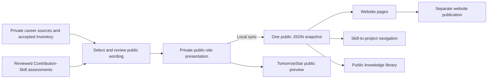

# Personal website integration

TomorrowStar owns the career information. The existing personal website presents
an explicitly selected public view. The website remains a static Astro project.
This integration adds no database, provider, cloud runtime, or assessment policy.



Selection is an editorial step. No automatic read of the full inventory,
source vault, application notes, reports, or interview answers occurs during export.
The initial selection preserves the existing website wording. Migration does not
refresh factual claims, bind them to accepted inventory, or review capability.

## Content ownership

| Content | Maintained in | Presented by |
| --- | --- | --- |
| Public profile, education, experience, research and selected projects | Private `reports/public-site/site-content.json` | Existing homepage and category pages |
| Selected learning map | Same private public presentation | Existing learning-map section |
| Public skill topics and their selected project connections | Derived from the public presentation | `/skills/` |
| Public papers and project reports | `knowledge` in the public presentation | `/knowledge/` |
| Private source bodies, reports, interview answers and assessment records | Their existing private locations | Local TomorrowStar only |
| Blog articles, PDF/image assets and website layout | Existing website checkout | Existing website routes |

The source uses `public-site-source/v1`. Set `publication_status` to `public`
to select the whole presentation for export. AI/finance projects and library
items also require `visibility: public`; omitted visibility excludes the item.
Profile and learning-map fields form one selected public block. Remove an entry
from that block to withdraw it. New personal wording needs a publication review.
Marking a presentation public does not establish factual or mastery acceptance.

The exported `public-site/v1` snapshot contains only typed presentation fields.
It rejects unknown fields, local file locators, unsafe links and unsupported HTML.
It does not export raw source IDs, private hashes, confidence, verified duration
or mastery. Its revision hashes only the selected public presentation. Hidden
project changes do not change that revision.

Skill topics have `authority: declared`. Project tags and course topics cannot
establish mastery. No score is computed or published by this integration.
Responsibility, assistance, completion and limitations must remain accurate in
the selected public wording. Schema checks do not replace that editorial review.

## Connect and sync

From the website checkout, connect the explicitly selected folders once:

```sh
npm run sync:career -- --system "/path/to/TomorrowStar OS" --workspace "/path/to/private/career-data" --save-config
```

The ignored website-local `.tomorrowstar-sync.json` stores those folder selections.
The reusable command is then:

```sh
npm run sync:career
```

`npm run dev` and `npm run build` also sync when local settings exist.
Cloud builds do not need personal folders. They use the public snapshot committed
with the website. A configured but invalid connection fails the local build;
a cloud checkout without local settings builds from the existing snapshot.

The direct checkout launcher is also available:

```sh
uv run --locked python scripts/run_public_site.py check --workspace "/path/to/private/career-data"
uv run --locked python scripts/run_public_site.py export --workspace "/path/to/private/career-data" --website "/path/to/website"
```

The private workspace must pass the existing separate-Git-workspace boundary.
The selected website must be an existing Astro checkout outside both the system
and private workspace trees. Validation completes before the single snapshot is
atomically replaced. Unchanged content does not replace it. Removal from the
selection withdraws the entry on the next successful sync.

In the local TomorrowStar Web UI, **公开展示** reads the same selected presentation.
It previews the public projects and skill topics. It does not push, deploy, or
change the accepted inventory. An already installed native App needs a new build
to include this checkout's new panel.

## Publication and verification

Review the public snapshot and the built website before Git publication or
Cloudflare deployment. Neither sync nor build publishes remotely.

Synthetic tests cover hidden-item exclusion, withdrawal, repeated sync, invalid
content, private errors and linked-file rejection. The website build and browser
checks establish integration behavior. They do not establish the correctness of
the user's career claims or complete the full-career/JD hypothesis milestone.

Local verification on 2026-10-10:

- Complete checkout suite: **740 passed, 21 deselected**. Live model and worker
  browser markers remain excluded by the existing default policy.
- Ruff lint, format checks, JavaScript syntax and diff whitespace checks passed.
- The actual website build generated all nine routes without warnings.
- A temporary source-only checkout without local folder settings also built all
  nine routes. It reused the installed dependencies with a separate cache;
  public assets were omitted, so its font warning is not a deployment result.
- Browser checks passed for skill search, empty results, the library's rendered
  links and the TomorrowStar public-preview panel.
- Every original website field and original list order survived migration.
  Defaults and exact project anchors were added by the typed export.

The local native App also includes the public-preview panel and `⌘5` menu entry.
A new build is retained separately; the existing installed App is not replaced.
Its synthetic relocation check reads the new public projection and checks strict
signing again after runtime reads. Native window interaction needs its own visual
check; the Web UI browser verification does not substitute for that check.

No remote Git publication, Cloudflare deployment, external-link permission
review, accepted-inventory reconciliation or new capability assessment occurred
in this integration pass.
