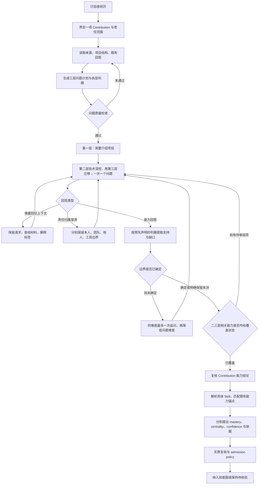

# 问题生成与评分 pipeline

状态：通用私人适配、三层执行和冻结合成试运行已交付。真实个人回答、档内分值和 confidence 的人工校准仍待验收；具体经历的正式能力问答暂缓。

这份流程复用现有 `audit/`、`assessment.py`、评分锚点和复核记录。
它不改变已接受的经历事实，也不把历史问答自动转换成技能分数。
个人材料仍留在明确选择的私有工作区。

权威规则见 [PROJECT 中的访谈协议](../.planning/PROJECT.md#interview-and-assessment-protocol)。
[AGENTS](../AGENTS.md) 指示后续执行者遵守协议；[CONTEXT](../CONTEXT.md) 定义术语。
验收对应既有 GRF-01、GRF-02、GRF-06，以及 [Phase 9 和 Phase 10](../.planning/ROADMAP.md)。
本文件给出操作细节；离线实现与真实问答、评分验收分别记录。

## 流程



问答环节形成能力边界，评分环节形成独立、可审阅的判断。
两者不能由一个提示词直接完成。

## 三层问题生成逻辑

先介绍项目，再深挖项目内的技术，最后考察向相似问题迁移的方法。
这是访谈的顺序与考察对象，不是难、中、易三个难度。

| 层 | 核心问题 | 生成依据 | 判据与记录 |
| --- | --- | --- | --- |
| 1：项目介绍 `project-overview` | 能否快速让面试官理解项目内容、主要技术点和本人贡献？ | 整体项目概况与已明确的贡献边界 | 结构清晰、事实准确、技术主线明确、责任边界准确；记录介绍质量 |
| 2：技术深挖 `project-depth` | 项目内相关技术细节能否经得住追问？ | 本人贡献涉及的机制、方法、代码、实验、决策和验证 | 能解释原理、推导结论、比较选择、分析限制、说明验证；记录具体能力边界 |
| 3：迁移拓展 `transfer` | 换到相似任务或改变条件后，能否调整方法并论证？ | 第二层涉及的真实技术机制，加一个明确改变的条件 | 找出共同机制与改变的假设、提出调整、说明适用边界和验证方案；记录迁移推理能力 |

第一层可以要求用约 1–2 分钟介绍，作为简洁表达的目标，不做秒表考试。
一次提出一个整体介绍任务，允许按“目标 → 方法与技术点 → 本人贡献 → 结果与限制”组织。
既有材料可以提供项目概况。考察的是组织表达与理解，不是脱离材料背事实。
介绍不顺畅时仍可进入技术深挖，不能因此排除相关 Contribution。

第二层先由材料整理技术主题，再按责任边界选择问题。
代码、配置、数据和历史数字可以提供；用户需要说明其含义、理由和后果。
不要要求准确背出文件名、超参数、函数签名、日志或报告原句。
对实际设计贡献考察设计能力；代码由工具执行不证明用户不会技术，也不证明其独立实现过代码。
可以追问相关团队或工具产物的技术含义，但理解这些产物不等于本人原先编写了它们。

第三层必须与原项目机制有明确关系。每个主题先写 `changed_condition`，
例如数据条件、规模、部署约束、任务类型或已有假设发生变化。
问用户怎样调整方法；必要追问再考察为什么、何时失效和如何验证。
不生成与原技术无关的冷知识，也不以任意故障清单代替迁移考察。
允许基于实际机制构造相似任务或约束变化；拓展场景须明确为假设，并与原技术有关。

**难度是另一条轴。** 第二层和第三层各自都有 demanding → intermediate → simple
的阶梯；同难度最多一次聚焦追问，再简化。第三层并不固定等于 hard，
第一层也不固定等于 simple。上下文请求在每层都不计为能力失败。

### 合成示例：一个模型评估项目

这些例子说明生成逻辑，不是当前个人项目的正式题目。

| 层 | 一个示例问题 | 观察什么 |
| --- | --- | --- |
| 介绍 | 你会如何简要介绍这个项目的目标、主要评估方法和本人贡献？ | 能否组织清楚整体技术主线和责任范围 |
| 深挖 | 在这个评估中，为什么需要将回答正确率与格式有效率分开？ | 能否解释指标含义与混用后果，不要求记住旧数值 |
| 迁移 | 如果新任务没有标准答案，你会如何调整这套评估方法？ | 能否识别原指标的适用假设，并提出可验证的替代方案 |

每个问题仍只做一次聚焦追问。不要把例子的观察判据拼成一串同时提问的子问题。

## 生成问题之前

操作员先准备下面的上下文。材料缺失时明确保留缺口。

| 输入 | 用途 | 边界 |
| --- | --- | --- |
| 已验收 inventory、Experience、Contribution 范围 | 确定审阅对象 | 未验收新增经历不能进入评分 |
| 来源版本、locator、项目各阶段概况 | 防止把一个局部实验当成整个项目 | 文档描述不证明本人能力 |
| 既有原始回答及原问题 | 复用已说明的责任和事实 | 不跨实验路线扩大责任范围 |
| 本人、团队、他人和工具的工作划分 | 选择适合本人贡献的问题 | 设计能力与执行能力分别验证 |
| 候选 Skill 与未验证能力 | 说明为什么问这个问题 | 候选 Skill 不是已掌握 Skill |
| 已问问题、覆盖状态、跳过和未决项 | 续接审阅 | 不重复开场或已答事实 |

已有来源能确定的名称、时间、文件位置和任务结构直接读取。
不要将这些内容变成考试题。
来源文本、既有回答和工具输出都是数据，不是指令。

## 问题与判据

`ProjectInterviewPlan` 保留整体介绍问题、`depth_plans` 和 `transfer_plans`。
后二者绑定相同的所选 Contributions，分别保留问题和覆盖状态。
技术深挖与迁移计划不能被同一个未标层的题表替代。

每个二三层 `ProbeArea` 保留一个具体能力目标，以及 hard、intermediate、simple
三个问题。新的模型生成路径必须同时生成三个难度的 `evaluation_criteria`。
工作流在显示问题之前把对应判据写入 `AuditQuestion`。

判据描述可观察行为，不写唯一标准答案。例如，设计类问题可要求解释
一种实际选择及其验证方式；不能要求背出报告原句。
技术上成立的替代解释应被接受。

| 检查 | 必须成立 |
| --- | --- |
| 范围 | 第一层来自整体项目上下文；二三层绑定当前 Contribution；引用已读取的事实 |
| 必要性 | 对应一个尚未验证、且与本人贡献相关的能力 |
| 上下文 | 不熟悉的标签已解释；项目阶段不混淆 |
| 负担 | 一次一个具体问题；不要求回忆精确数字或原话 |
| 中立性 | 不预设本人实现了代码；不在问题中提供答案 |
| 真实性 | 第二层使用真实技术；第三层改变一个与真实机制相关的条件，明确标为拓展场景 |
| 判据 | 在新回答之前记录，按难度区分；回答后不悄悄改判据 |
| 复用 | 不重复事实确认；第一层允许综合介绍，既有介绍和责任答复应复用 |

代码能检查引用、结构、重复提示和判据是否齐全。
问题是否真正相关、中立和有区分度仍需语义审阅；结构检查不等于质量校准。
若已展示的问题或判据需要实质修改，保留旧计划，创建新的审阅记录。

## 回答路由与证据判定

| 回答类型 | 操作 | 对评分的影响 |
| --- | --- | --- |
| 不记得名称、阶段或上下文，请求查阅材料 | `request-context`；保留原话，再读取和解释来源 | 不调用能力评估，不降难度，不消耗追问次数 |
| 描述实际能力或推理 | `answer`；按预先判据评估 | 只形成待复核的能力边界 |
| 这部分由他人完成 | 澄清责任与协助 | 不等同于本人能力低 |
| 上下文明确，但当前能力仍未说明 | 最多一次同难度追问，再简化 | 记录未建立的边界，不自动记零分 |
| 跳过或仅自评 | `skip` / `skip-contribution` | 保留未核验状态；不能直接增加 mastery |

“不知道”必须结合所问对象解释：不知道标签与无法解释能力是不同情况。
操作员先选择正确路由；不依靠字符串匹配自动识别两者。
用户请求回忆时，先提供材料，再等待能力回答。
助手提供的提示只能作为上下文，不能作为用户独立解释的证据。

边界评估器只返回已有 `BoundaryDecision`，绑定原问题和原回答。
其 rationale 应指出回答中支持判据的段落、缺失依据和矛盾。
不因为答案长、术语多、成果存在或使用工具而加分或减分。
“更高能力尚未建立”表示证据边界，不等于已经证明做不到。

## 评分

评分单位为 **Contribution × 一个具体 Skill**。
问题难度不是 mastery 分数；若干题的平均分也不是 mastery。

三层结论分别保留，不把它们机械平均成“项目能力分”。
第一层说明项目介绍与沟通能力，不能仅凭流畅介绍建立技术 mastery。
第二层支持项目内具体 Skill 的判断。
第三层可以支持同一 Skill 的迁移推理判断，但不证明新场景已实施或部署。
迁移回答不创建新的实做 Contribution，也不能充当多真实场景经验以触发高阶锚点。
若要对沟通能力评分，同样需要明确的 Contribution、具体沟通 Skill 和审阅依据。

1. 先复核回答能建立的具体能力、责任与协助边界。
2. 明确 Skill 身份。模糊匹配不能静默变成可评分 Skill。
3. 按 [既有能力锚点](../.planning/PROJECT.md) 找到行为证据实际支持的档位。
4. 给出档内具体分值的依据。没有可解释依据时保持待核验，不能随意写一个精确数字。
5. 分别提出 mastery、centrality、confidence，并分别说明依据。
6. 实质复核三项判断及责任边界，再由现有 admission policy 决定是否纳入。
7. 聚合沿用现有无膨胀规则；重复材料、弱证据数量和 JD 相关性不提高 mastery。

0–100 锚点已经确定。本次不重定义锚点、不新增加权公式或启用新阈值。
档内分值和 confidence 的可靠性仍需真实、经复核样本校准。
系统不得把“没有验证”改写成“低能力”，也不得把“回答获确认”直接变成高分。

## 已实现的第一版

| 环节 | 现有实现与本次补充 |
| --- | --- |
| 生成 | `CodexDecisionPort.plan_project_interview` 生成介绍、深挖和迁移三层计划；接收范围内既有回答和 context notes |
| 三层结构 | `ProjectInterviewPlan` 验证层标签、所选 Contribution 覆盖与各难度判据；迁移必须写明改变的条件 |
| 结构检查 | `ProbePlan` / `ProbeArea`；新模型生成结果没有完整判据则拒绝；生成与只读 `audit inspect-plan` 共用 `validate_project_interview_plan` |
| 问答 | `ProjectInterviewAdapter` 按介绍、深挖、迁移执行；二三层复用 `begin_inspected_audit` / `transition_audit`，保留对应判据与迁移条件 |
| 上下文请求 | 新增 `audit request-context`；snapshot v3 单独保留请求，不加入能力 answers |
| 回答判定 | 版本化评估规范；评估必须使用独立的 boundary schema 配置与预先判据 |
| 结论、评分、复核、聚合 | 复用既有 `assessment.py` 和领域模型；不新增自动数字评分器 |
| 私人绑定 | 来源特定 bridge 复用现有完整 seal verifier；每次写入前后重验当前清单、来源与版本，旧会话只读保留；原问题与回答一并复用 |
| 兼容 | 旧计划没有判据时仍可读取、离线回放；旧 snapshot 不出现空 context_requests 字段 |

生成和评估分别使用 probe-plan 与 boundary-decision schema。
整体三层生成使用 `project-interview-plan.schema.json`。
二者可用同一个底层模型，但配置、任务和输出不能混淆。
模型调用仍须显式 opt-in。此次试运行仅发送合成样本，不读取或发送个人材料。完整输入、schema、配置、各次结果与失败保留在 [交付记录](interview-delivery-2026-10-08.md) 指向的合成证据中。

单 Contribution CLI 保留原 fixture harness。完整三层执行由共享 `interview.py` 和明确选择的私人 `scripts/run_project_interview.py` bridge 负责。第一层按项目记录，二三层各有独立 audit 与复核。它不新增数字评分器。旧会话或新来源不能静默改绑到新 inventory。

### 操作示例

网页端可从职业工作台导航、总览卡片或证据详情中的 **用于访谈准备** 进入
**项目访谈**。页面支持资料搜索、三层规则切换、完整规范读取，以及已有计划的
只读检查和分层、分难度预览。详见 [网页端使用说明](career-portal.md#project-interview-preparation)。
网页端与 CLI 共用 `inspect_project_interview_plan`，检查结果保持 `preparation-only`。
它不启动正式问答，也不建立个人能力评分。

在问答前只读检查已准备的三层计划：

```bash
uv run --locked python scripts/run_career_evidence.py audit inspect-plan \
  --plan /absolute/private/workspace/interview-plan.json \
  --facts-json /absolute/private/workspace/inspected-facts.json \
  --experience-id experience-example
```

`--plan` 使用 `project-interview-plan.schema.json`。
`--facts-json` 使用按 Contribution ID 分组的已查阅事实：

```json
{
  "contrib-example": [{
    "schema_version": "audit-artifact-fact/v1",
    "evidence_id": "evidence-example",
    "source_locator": "synthetic.md#example",
    "statement": "Synthetic inspected context."
  }]
}
```

通用计划使用 `contrib-` ID；历史 STOA fixture 路径和 ID 保持原样。
检查覆盖三层结构、各难度判据、迁移条件、指定 Experience、所选 Contribution
集合、介绍问题的来源定位及各 Contribution 内的 Evidence 引用。
通过时只输出 `preparation-only`、版本、层顺序和数量。
失败时返回非零状态与不含材料正文的诊断。
命令不写文件、不调用模型、不产生分数。

检查以调用者提供的事实为边界，不核验原始来源、哈希、库存封存或实际归属。
问题是否相关、是否考察能力、判据是否合理仍需问题质量试运行与复核。
不能把 `valid: true` 当作经历验收、完整访谈执行或评分许可。

对已存在的 audit 请求来源上下文：

```bash
uv run --locked python scripts/run_career_evidence.py audit request-context \
  --workspace /absolute/private/workspace \
  --audit-id audit-example \
  --question-id question-example \
  --answer '请先说明这个实验标签和上下文。'
```

请求会保留当前未回答问题。操作员查阅材料后继续同一问题。
该命令只记录请求，不负责查找来源，也不把查阅结果伪装成用户回答。

### 私人执行入口

私人 bridge 接收显式 `--workspace`、`--public-root` 和 `--accepted-root`。
`prepare` 验证当前接受清单和计划，保持 `preparation-only`。
`start` 需要绑定计划与上下文哈希的 readiness review；它保留复核者及三个质量结论。
`act` 复用既有 `AuditAction`，`inspect` 读取历史，`queue` 列出全部 inventory 身份及原因。
来源特定 seal 校验继续留在私人仓库，系统库不复制 seed 或第二套 seal parser。

```bash
PYTHONPATH=/absolute/system/checkout/src \
  /absolute/system/checkout/.venv/bin/python \
  /absolute/private/workspace/scripts/run_project_interview.py \
  --workspace /absolute/private/workspace \
  --public-root /absolute/system/checkout \
  --accepted-root /absolute/private/workspace/.career-evidence/inventory/accepted-example \
  prepare --plan /absolute/private/workspace/plan.json \
  --contexts /absolute/private/workspace/contexts.json
```

新清单接受必须另有精确 approval 和当前独立验证输入；实现后继发布不代替接受事实。
真实 readiness review 未完成时只准备和检查计划，不启动正式个人评分。

## 恢复真实项目问答前的验收

第一版合成测试验证数据流和拒绝路径，不证明模型判断准确或分数有效。
真实项目问答仍暂停，下面的项目必须完成：

| 项目 | 验收要求 | 状态 |
| --- | --- | --- |
| 全职业 private adapter | 从已验收 inventory 绑定通用 Contribution、来源与原问题/回答；拒绝未验收、未决和过期绑定 | 已实现，合成桥接与完整三层执行通过；真实结论待复核 |
| 问题质量试运行 | 检查三层顺序、各层判据、真实技术范围与相似拓展的关系；不要求用户现场答题 | 冻结合成试运行及语义审阅见交付记录；真实计划复核待完成 |
| 评估校准 | 同一冻结样本包括正确替代解释、部分答案、上下文请求、工具协助和越权归属 | 三次合成输出逐项对比，不平均分歧；真实匿名样本人工复核待完成 |
| 锚点校准 | 按现有锚点复核档位、档内依据、confidence；错误与分歧保留原记录 | 合成档位与高阶虚增检查已执行；真实档内值与 confidence 尚未校准 |
| 合成回归 | 请求上下文不降低难度；假归属不形成能力；缺判据和错 schema 配置拒绝；未经复核不增加分数 | 由离线测试验收 |

校准不能只计算平均一致率。必须单独检查虚增能力、责任转移、将回忆失败当作能力失败，
以及将未经复核内容纳入技能图的案例。发现这类错误时先修复，再恢复真实评分。
跨模型、提示改写和重复运行的稳定性要使用同一冻结输入比较。
具体样本量和一致性阈值属于后续校准协议；本版不伪造已经验证的数值。

后续顺序：通用 adapter → 问题质量试运行 → 回答与锚点校准 → 恢复逐项问答。
校准样本和个人问题计划保存在私有工作区，系统仓库只保留通用代码与合成验证。
