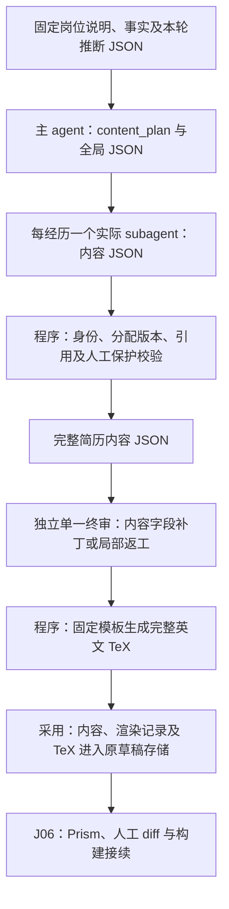
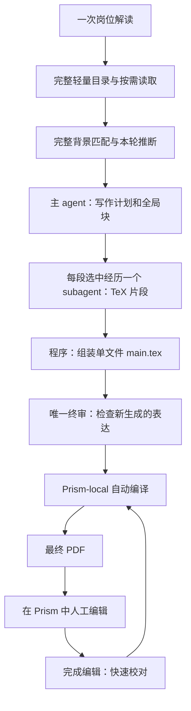

# 分经历写作、单一终审与 Prism 编辑

J05 已将[JSON 内容与固定渲染](json-resume-design.md)接入现有分经历任务。
默认结构化事实交付使用 `content-writing/v1`；旧任务继续原契约。
源码、实际 subagents 合成运行和完整回归分别见
[J05 验证](../.scratch/json-resume-delivery-2026-10-24/j05-verification.md)。
本轮保留现有数据和人工修改，没有迁移私库或更新安装版。

程序从已交付事实、推断及显式绑定的固定 `.tex` 模板形成
`content_plan`（`resume-template-plan/v1`）；已有模板选择复用 `bind_latex_base`。
模板直接保存固定样式、姓名、LinkedIn、网站、邮箱和教育。当前内容
`resume-template-content/v1` 只保存可变摘要、技能、经历和申请/模板绑定，无
`profile`/`education`；不在每轮生成中从信息库注入固定资料。固定修改单独更新模板。
主 agent 选择并排序经历，设置写作要求，负责摘要和技能 JSON；每段
经历由不同的真实 subagent 创作。写作者只接收该经历的 `assignment`、允许引用、
分配版本、输出 schema 和局部反馈，返回 `experience-writing/v1`。模型不生成
排版命令，也不重新检索整库、解释 JD 或调整匹配分。

程序检验字段、经历与候选 ID、分配版本、逐条引用和人工保护，再组装内容。
模板中章节标题和槽位之外的原文精确保留。程序只对摘要、技能和经历槽位正文
转义与渲染，经历内部每段形成一个 subsection；所有简历为英语，使用 LaTeX 默认字体。
三个唯一标记为 `%% TOMORROWSTAR_SUMMARY %%`、`%% TOMORROWSTAR_SKILLS %%`、
`%% TOMORROWSTAR_EXPERIENCES %%`。缺少模板或标记不合法时停止。
缺资料使用 `needs_material` 定位问题；混合旧来源缺语义事实时停止并保留资料，
不能静默丢掉未完成经历。失败与局部返工保留其他成功作者。

一个独立终审只检查 AI 新表达的范围、重点、重复、矛盾和清楚程度。小修返回
`resume-content-patch/v1`，程序核验基线、旧值和权限后应用；通过结论绑定补丁后
内容版本及渲染结果。实质返工只退回指定经历，由同一终审角色接续，不再建立
逐片段语义批准或编译后的第二次语义终审。

采用复用现有草稿版本存储，保存 `content.json`、`render-manifest.json` 和 TeX，
保持旧版本可读。已映射人工条目的措辞、位置、经历顺序及记录省略受保护。
显式人工 TeX 保留稿没有 JSON 映射时，停止内容覆盖并保留原稿；J05 不做逆解析。
J06 已接回能唯一定位的人工文字、链接、删项和顺序，人工列表结构传入后续作者与
终审。固定模板、宏或身份歧义保留为未归并稿，不能按旧 JSON 自动覆盖。finishing
恢复核验已有校对响应和条件保存，不重复未知调用；已有 PDF 绑定实际人工源与
原生构建回执。范围见[J06 验证](../.scratch/json-resume-delivery-2026-10-24/j06-verification.md)。

CLI、字段与恢复行为见[操作说明](resume-agent-operations.md)。
固定上游、局部恢复、人工返回只快速校对及最终 Submit 手动仍适用。

旧 TeX 契约的历史设计及已有接受范围

以下记录供旧任务和历史验收解释使用，不能作为新内容作者契约。

状态：P01–P06 源码已交付，见[P05 记录](../.scratch/resume-agent-delivery-2026-10-22/p05-source-verification.md)。P06 人工快速校对、Prism 只读结果与局部版本已完成源码、回归与审查，见[P06 记录](../.scratch/resume-agent-delivery-2026-10-22/p06-source-verification.md)；真实服务、私人材料及安装版分别接受。唯一实施顺序与状态见[开发计划](development-plan.md)和[实施地图](../.scratch/resume-agent-delivery-2026-10-22/map.md)。既有源码、[工件入口](resume-agent-operations.md)及[历史交付记录](../.scratch/resume-agent-delivery-2026-10-22/evidence/README.md)只证明各自范围，不覆盖完整新流程。

TomorrowStar 为 Codex 提供资料、工具、材料和持久进度。Codex 编排真实 subagents；不增加另一套 App 内 agent 平台。单岗内部可以并行，岗位之间顺序执行。

## 单向交付与职责

应用流程信任基础信息库、职业经历库和上游交付结果。用户自述直接作为事实；无考试不降低已记录语言等级。大型项目未完成的研究审核或能力评分暂不参与应用流程，不补造审核结果。保留实际角色、团队分工、时间、状态及答案适用范围。

岗位业务目标、要求、权重和匹配推断只在上游相应步骤形成。写作、组装、终审不重新解读 JD，不重算匹配，不审核经历可信度。上游推断可以作为写作依据，不自动写回永久信息库。背景匹配度衡量完整背景；简历覆盖情况单独展示，选材不反向改变匹配分。

## 生成输入与写作计划

生成任务保存固定上游输入，以及主 agent 在本轮形成、交付写作者的写作计划：

| 输入 | 内容与约束 |
|---|---|
| `job_brief` | 一次岗位解读的业务目标、工作产出与完整要求，只读 |
| `match_result` | 完整背景的要求对应、判断和匹配结果，只读 |
| `inference_results` | 本轮直接记录、确定性推导和语义推断结论、事实引用及表达范围，只读 |
| `material_packet` | 检索已交付的经历正文、必要细节和适用个人事实 |
| `retained_resume` | 当前 TeX、固定内容、人工修改及省略记录 |
| `writing_plan` | 主 agent 形成的本次选材、排序、篇幅、各块重点和归属；交付后固定 |

写作计划按业务贡献与信息价值选材。直接业务经历和可迁移方法分别说明用途，不按 quantitative、数学、AI 或工具词频排序。方法经历不能因资料数量多而挤掉更相关的业务经历；岗位未提出的条件不能自行成为门槛。具体篇幅不在此冻结新页数规则。

主 agent 负责摘要、技能等全局块。默认每段选中经历分配一个真实 subagent，不给同一经历默认安排多个写作者。各块有唯一归属，避免主 agent 与经历写作者重复输出。固定身份、学历及受保护人工块由程序保留，不交给经历写作者自由改写。

生成任务使用上游已经交付的固定版本。提示词、JD、库、模型、登录凭据或 App 配置后来改变，不自动使旧稿及旧 PDF 失效。显式采用新输入重做相应步骤时，才创建新交付版本。

## 分经历写作接口

概念接口为 `write_experience(writer_input) -> FragmentResult`，具体字段名称在实施时复用已有契约，不为文档另建运行平台。

写作者只收到当前经历资料、相关匹配与推断、写作重点和篇幅、允许引用集合、人工修改保护及输出块 ID。默认不再读取整个库。需要未交付细节时提出明确的补充读取需求，由检索步骤读取，不重跑匹配。

输出包含 `block_id`、对应任务版本、`status`、`latex_fragment` 和 `used_refs`。`used_refs` 可指原始事实或已接受的本轮推断，只作关联记录，不要求可信度报告、独立推理复核或另一套内容批准。

写作者只写分配的 TeX 候选片段，不写完整文档前导、不修改其他经历、不改两库或主文件。保持数字、角色和状态，不补造事实。确实缺少完成指定表达所需的细节时报告缺项，不把经历降为“未审核”。

程序检查块归属、任务版本、引用 ID 是否属于输入、允许的片段结构及人工保护；不判断经历可信度、语义推断或岗位分数。不能以机械数字/关键词核验再建立一层内容审核。

## 程序组装

概念接口为 `assemble(writing_plan, fragments, retained_resume) -> Candidate`。

程序是自动生成阶段 `main.tex` 的唯一写入者，按计划收齐片段、排序、放回固定和人工保护内容，生成单文件候选，并保留正文块到片段版本的映射。沿用现有模板和恢复记录，不增加重复状态库。人工编辑模式下由用户通过 Prism 修改；系统暂停写该 TeX。

组装只检查缺失、重复、归属冲突、任务版本和结构完整性。不得静默省略失败片段，不调用模型自动补造。一个写作者失败，保留其他已完成片段和旧终稿，只恢复失败或确实受影响的部分。

用户当前 TeX 是后续修改底稿。保留人工措辞、增补、排序、省略和模板，不因 JD 或库更新静默重建全篇。既有任务与材料不强制迁移到新模板，不通过隐藏排版变换覆盖人工修改。TeX 是否实际编译成功由 Prism-local 负责。

## 单一 AI 终审

概念接口为 `review_candidate(review_input) -> ReviewResult`。

唯一终审 agent 接收完整候选、写作计划、本次已交付事实与推断、人工保护记录。它信任这些输入，只检查 AI 新生成表达是否越界、遗漏计划重点、重复、矛盾或不清楚。例：“参与”被写成“领导”、没有输入的数字成果、推断支持英语交流却新增考试成绩。

终审不重新检索整个库，不核验自述可信度，不重做推断、业务定位或匹配判断，不要求完成研究能力评分。语义检查集中在此，不在片段提交、程序组装、PDF 导出中重复执行。

终审可输出定位明确的局部补丁，由程序应用；补丁限于本轮允许修改的块，程序核对目标版本及人工保护。该终审的结论绑定应用补丁后的候选。实质重写或缺少资料才退回对应写作者，其他片段保留，再由同一终审角色接续，不增加第二审核 agent。终审是内部自动步骤，不增加用户批准。

## Prism-local、最终 PDF 与人工编辑

Prism-local 负责编辑与预览。最终 PDF 由 App 在临时副本中用 tectonic（与 Prism 同一引擎）编译当前 TeX（2026-10-31 决定），自动流程不依赖 Prism 运行；不增加自动保存编译开关或重复 PDF 内容/排版审核。

最终 PDF 区并列提供“打开最终 PDF”和“在 Prism 中编辑”。进入编辑打开同一岗位当前 TeX，暂停系统修改；关闭窗口不被猜测为编辑完成。用户明确点击“完成编辑”后接续：

- AI 生成稿：单一内容终审 → App tectonic 编译 → 最终 PDF。
- 人工完成稿：快速校对 → App tectonic 编译 → 最终 PDF；不回到 AI 内容终审。

人工后校对只允许明确的拼写、语法、大小写、标点和重复词修正。接口仅返回局部文字补丁，不能返回整篇重写；程序禁止改 TeX 命令及排版参数。不得质疑内容、润色、增删观点、调整排序、字体、间距或篇幅。歧义或专有名词保留原文并提示。明确小错误可自动修正，保留修改记录；人工意图优先，不因库无对应记录否定人工新增内容，也不自动把它写回经历事实。

App 记录成功 PDF 对应的 TeX 及实际编译依赖版本。仅比较这些输入，不把库、JD、提示词、认证、模型或 App 配置纳入旧稿失效判定。当前 TeX 有修改时显示“有未导出的修改”，旧成功 PDF 仍可查看；编译失败保留旧 PDF 和用户 TeX，不自动修稿。晚到的旧编译结果不得覆盖更新稿。

预览/下载读取已有 PDF，不触发重新编译或内容审核。上传状态独立记录实际 PDF 版本；新 PDF 产生不等于网站附件已替换。未知编译/导出结果先核对既有记录及 Prism 状态，不盲目重放。最终 Submit 手动。

## 验收边界

各项按[开发计划](development-plan.md)分层举证；P05 源码与实际 subagent 合成验证见交付记录，P06 源码与合成验证见[P06 记录](../.scratch/resume-agent-delivery-2026-10-22/p06-source-verification.md)，真实接受另记：

1. 同一岗位说明和匹配/推断结果贯穿写作，不发生重新评分、重解 JD 或自述降级；简历选材不改变背景匹配分。
2. 多经历由真实 subagents 分工，各读本段交付资料；程序正确组装，局部失败只恢复对应片段。
3. 写作、组装和终审没有重复语义批准；唯一终审能定位新生成的越界表达并局部修订。
4. 人工修改及旧材料完整保留；人工后只快速校对，测试证明内容和 TeX 排版未被改写。
5. Prism-local 实际自动编译和 PDF 接回可用；库/认证/配置变化不会让旧稿/PDF 被误标失效。
6. 对应版本、晚到结果、失败恢复和 PDF 附件版本独立；主 App 安装只在明确后续实施票完成验收后执行。

历史 HTML 简历记录仅保留，不重新进入内容事实或生成回退。既有紧凑教育模板、来源凭据或版本规则属于历史实现；凡与本文保护人工稿、固定交付及单一终审冲突的部分须在实施票中收窄，不能作为继续叠加审核的依据。

