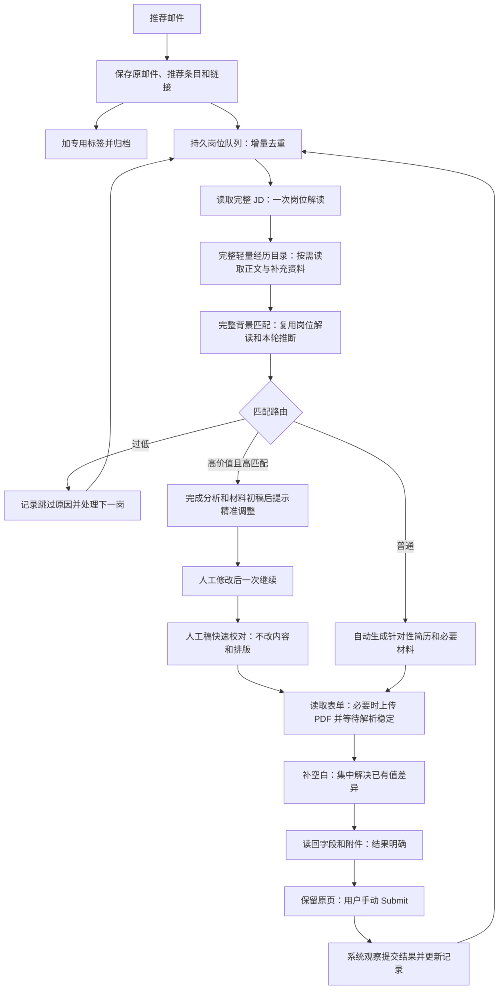

# 自动投递：当前产品规范

2026-10-25 Cover Letter 补充：[已确认产品约定](../.scratch/cover-letter-integration-2026-10-25/PRD.md)
规定同岗简历与整封求职信并发写作、独立检查及恢复。正文统一派生文本与按需
LaTeX PDF，有文本入口优先文本，可选入口默认交付；只有必需材料缺失阻止就绪，
未知结果和重要事实冲突仍停止。源码与合成验证范围见
[实施记录](../.scratch/cover-letter-integration-2026-10-25/implementation.md)。

**设计基线：2026-10-23，来自本轮逐项对齐。** 本文规定目标行为；它不表示这些行为已全部实现，也不启动真实申请。实现差距见[系统审计](system-audit-2026-10-20.md)，执行顺序见[开发计划](development-plan.md)及[实施地图](../.scratch/resume-agent-delivery-2026-10-22/map.md)。2026-10-23 的对齐仅修改目标设计；后续源码交付按下方补充和各包验证记录区分，旧工程报告仍描述当时实现。

2026-10-24 内容格式补充：[JSON 设计](json-resume-design.md)及[J01–J08 计划](../.scratch/json-resume-delivery-2026-10-24/map.md)
规定结构化事实、分经历内容输出、字段补丁和固定渲染。APP-07 的片段改为内容 JSON，
程序生成 TeX，PDF 是编译产物；其余单岗、保留人工稿、无重复批准和人工 Submit 规则不变。
J01/J02 已有英文合成切片，使用 LaTeX 默认字体；J03 已修改现有经历存储、同步
和默认事实读取。J04 已重构现有默认读取/匹配：按 ID 交付事实，无未读候选时
停止补查，P04 失败重试保留已完成 JD 和读取。已完成分析核验语义输入后可跨无关
资料或诊断元数据变化复用；原尝试、失败和人工材料保留。
源码与合成范围见[J04 验证](../.scratch/json-resume-delivery-2026-10-24/j04-verification.md)。
J05 接入正式写作与终审；版本接入与私人数据迁移仍待后续工作包。
所有简历为英语，原始职业资料语言不限；旧任务与所有材料历史保留。

本工具供用户在本机使用。开启后，系统收录邮件中工作平台推荐的岗位，逐个完成分析、材料、填写和上传，停在最终 Submit 前。最终 Submit 始终由用户操作。系统不主动搜寻新岗位。

本文替代旧试验中有关固定批量、整轮时限、逐份材料审批、重复接管确认、逐请求授权和重开一律暂停的日常流程规定。旧票、试验报告和研究验收保留其历史含义。职业能力研究中的评审不成为投递的通用前置条件。

## 完整流程

缺少必要事实、重要冲突、登录验证、操作超时或持续无进展、操作结果不明时，保留当前岗位并提示用户。岗位执行在此等待；新邮件仍可收录。用户答复或修正后继续当前岗位；用户选择“跳过”才处理下一个。没有收集一批问题后继续其他岗位的机制。

## 可验证要求

| 编号 | 要求与验收要点 |
| --- | --- |
| APP-01 | **推荐邮件收录。** 保存原邮件内容、平台推荐条目和链接后，才加专用标签并归档。完整 JD 后续逐岗获取。保存失败不归档；标签或归档失败只补做该步骤，不重复岗位工作。标签名称可沿用已有配置。 |
| APP-02 | **增量和去重。** 用系统处理记录和岗位身份判断已处理、重复和待办。已读邮件仍可未处理；未读邮件也可能已收录。重开、重复扫描和重复推荐均不增加重复任务。不限制总邮件数或岗位数；API 分页只控制单次读取量，自动续页。领英岗位用用户经“登录领英”保存的登录读取一次：站外申请改用公司官网申请页（领英链接另存，用于去重）；已停止招聘的标为“岗位已关闭”，只能 Easy Apply 的保留领英链接，二者都在匹配前带原因跳过；读不到时按原链接继续。 |
| APP-03 | **持续、线性执行。** 开启后持续收录并按持久顺序一次处理一个岗位。正常无需逐批启动。主动暂停或等待用户时停止岗位自动操作，保持原页和进度，仅继续新推荐收录。先跑通线性闭环，再研究岗位并发。 |
| APP-04 | **两库分工。** 基础信息库保存个人事实、带作用域的申请答案与偏好，并提供统一经历目录入口；职业经历库维护经历正文、分节和关联资料，自动生成与同步目录，不重复维护。经历而非单个文件是默认检索单位。明确自述和更正直接保存并保留历史，不因无证书或未完成研究审核降级；生成简历及本轮推断不自动写成永久职业事实。两库的修订和补充不使已有分析、匹配、材料或发送授权失效，也不自动触发重新匹配或重新生成；填写总是读取当前资料。大范围修订后由用户（或经 Claude/Codex）明确发起重新匹配或重新生成材料。 |
| APP-05 | **自主复用和判断。** 岗位解读只做一次，后续复用其目标、要求与权重。检索遍历完整轻量目录并按需读取；匹配接受两库事实，允许受策略约束的语义推断，不重复审核经历可信度。直接记录、确定性推导和语义推断分开记录，推断仅用于本轮匹配和写作。重复问题不再询问；只问实际重要冲突或确实缺少的信息。引用错误、漏读、截断和读取失败属于执行问题，不能冒充能力不足。 |
| APP-06 | **匹配与路由。** 匹配评价完整背景，不受简历篇幅或最终选材影响；简历覆盖单列。权重在岗位解读时围绕业务目标固定，几项都需满足的条件拆分判断、汇总展示且总权重不增加；同一条件的多种满足方式（如硕士或博士）作为一个条件判断，不拆分（2026-11-04 决定）；明确资格门槛单列，不被其他优势抵消；语言等级要求不是资格门槛，每种语言单独计分，未达到只降低匹配分，不暂停、不跳过（2026-11-08 决定）。申请需要登录或注册的岗位离开自动路径：匹配进行的同时，后台无界面浏览器只打开岗位页并点一次申请（不填写、不提交），已知招聘系统按网址判断，其余按页面判断，判断不了才截图交模型；需要账号且匹配分低于 55 的岗位（目标公司除外）直接跳过；填写时遇到登录或注册则搁置该岗位、保留页面、记住该网站并继续下一个岗位（2026-11-09 决定）。模型按固定规则在判档范围内给每项打满足度，程序锁住档位边界后加权得出单分（2026-10-31 决定）；主模型 gpt-6.1-sol 打分，配置 Claude 登录时 Opus 5.5 同时并发打分，相差 10 分以内按 sol 0.45、Opus 0.55 加权平均（2026-11-04 决定），超过则标记待用户审核并列出判断不一致的要求，Opus 未完成时只用 sol 并注明；全库读完仍无记录的项按低档计分，引用失败或资料未读完等执行问题不按缺失计分，保留可能范围。分析后按分数分四档（2026-10-31 决定）：低于 20 自动跳过并保留可返回；20–60 自主推进；60–80 分析后、生成材料前暂停，一次 Continue 即批准；80 以上或目标公司、超高薪资走精准调整。距分档线 5 分以内按更需用户介入的一档，按区间上限判断；两模型分差超过 10 至少进入审批档。审批档不再按分数触发：75 以下、跳过线以上的岗位都自主推进，只有缺少匹配分或两模型分差过大时才暂停询问（2026-11-11 决定）。 |
| APP-07 | **材料生成。** 复用本轮岗位解读、匹配、推断和资料 JSON，先定选材、顺序与篇幅，一经历一 subagent 输出纯内容 JSON；程序校验字段、经历 ID、引用、结构及人工保护，组装完整内容。单一终审只检查新生成表达，输出字段补丁，不重新审事实或匹配。固定模板每经历生成一个 subsection，组装 TeX，复用 Prism-local 自动编译与预览；PDF 是构建产物，无独立业务接受或复用判断，不增加重复编译、PDF 审核或人工确认。已有终稿可直接使用；明确新生成才采用上游新资料。学历和人工修改保留。缺少未知资格信息不阻止仍可继续的准备工作。 |
| APP-08 | **浏览器填写与上传。** 先读取当前表单，保存非空字段和附件基线；必要时上传最终 PDF，再等待明确解析结束信号及字段稳定。无结束信号时采用稳定窗口并持续监测；稳定不等于保证网站不再改写。只补空白、修正能确定的新解析错误；已有人工填写或来源不明的非空值均保护，与最新资料的实质差异集中由用户选择，不自动覆盖或写回两库。迟到自动填充暂停系统写入并重新合并；保存网站改写前后值，不默默恢复可能过期的基线。平台无预设适配器本身不是停止理由。 |
| APP-09 | **登录。** 复用已有登录状态。需要用户登录、二次验证或处理验证码时，在原流程暂停并提示。完成后一次继续；不要求重复登录或预先重置权限。 |
| APP-10 | **人工交接。** 手动操作期间暂停相应自动操作并保留进度。最终 PDF 旁提供“在 Prism 中编辑”；编辑期间系统不写 TeX，用户明确点击“完成编辑”后仅快速校对拼写、语法、大小写、标点和重复词，不质疑事实、不润色或改变内容、顺序及排版。明确局部错误可自动修正并留记录，有歧义保留原文并提示；不得重进 AI 内容终审。表单人工操作后读取现场接续，差异一次汇总，选择只作用于当前申请，除非用户明确更正信息库。 |
| APP-11 | **最终 Submit 手动。** 自动执行者不点击最终提交，不以 Enter、脚本、表单调用或网络请求代替最终提交。多步表单的普通 Next/Continue、草稿保存和文件上传可自动执行；若某操作实际完成最终申请，必须交由用户。此限制独立于平台适配和网络白名单。 |
| APP-12 | **提交结果和下一岗。** 用户手动 Submit 后，系统读取明确的成功页面、确认邮件或其他可归属当前岗位的结果，更新记录并自动处理下一岗。填写完成、上传成功或仅进入草稿不算提交。无需再点击“我已提交”或填写回执。无法判断结果时停当前岗询问，避免重复提交；收到确认不表示录用。 |
| APP-13 | **重开与资料复用。** 原页仍在时读取现场后继续；原页关闭时，不以恢复浏览器会话为前提；已填内容和附件随页面消失，材料变更无需核对旧页，新页面直接使用当前材料。按岗位身份定位原记录，复用已保存 JD、分析、终稿和有来源的填写值，为新页面建立新的执行尝试与基线。旧页面身份、旧动作和上传回执保留为历史，不充当新页成功证明。主动暂停、实质差异、登录或未知提交结果仍等待处理；不盲目重投。每次新动作仍先记 intent、执行后读回；同名附件不能证明同版 PDF。 |
| APP-14 | **跳过并保留。** 用户可随时跳过当前岗位。保存材料、进度和停止原因后处理下一个，不要求先解决当前问题。以后可返回该岗位，从实际剩余步骤继续；跳过不记为已提交。 |
| APP-15 | **固定交付与局部版本。** 每步信任上一步交付的固定结果，只负责自己的输入齐全与输出成功。JD、两库、模型、提示词、账户刷新、App 或配置变化均不自动废弃已有分析、终审、内容 JSON、TeX 或 PDF；明确采用新输入重做对应步骤才产生新内容修订。内容 JSON 为业务主记录，TeX/PDF 归在其构建记录下，保留模板与实际编译依赖对应；未导出修改与旧 PDF 失效分开，编译失败保留上一版成功 PDF，不让旧任务覆盖新编辑。新 PDF 不等于已替换网站附件。人工 TeX diff 接回 JSON 前保护原稿，不能静默重新渲染覆盖。保留所有历史，不用全局指纹触发连锁失效。 |
| APP-16 | **运行异常。** 无整轮 20 分钟或固定总量限制；正常有进展就继续。对具体操作使用合理超时，持续无进展或确实失败则保存原因和断点并提示。不能通过重启一轮掩盖未知结果，也不能因为历史诊断窗口到期暂停健康流程。 |
| APP-17 | **本地工具所需检查。** 保留真实 OS 能力检查、单执行者互斥、原子保存、断点和防重复操作。身份、签名、版本、权限诊断用于维护；成功检查不得让健康会话失效。逐步完整包证明、每次写入审批、固定几秒租约、Touch ID/隐私审批不是日常业务步骤。已有资料按本次产品授权复用、填写和上传，不再逐份批准。 |
| APP-18 | **事实和步骤边界。** 不编造事实、学历、成果或责任，不把计划写成完成；接受自述，缺少考试不降低已保存语言等级，仅明确证书要求单独判断。未完成项目审核或 Skill 评分暂不用于应用流程。保留真实角色和状态；检索不评分、匹配不重复审核、生成不改匹配、组装不审内容、编译不审事实、填表不重新判断能力。引用或读取错误标记本次执行问题，不使全库或已有终稿失效。研究、测试、安装和真实申请结果含义分开。 |

### 单一职责与材料版本

本节及 APP-04–08、10、13、15、18 替代旧设计中重复审核、目录按文件堆砌、旧匹配分语义和全局失效判断。其余 APP 要求仍有效；历史工程票、接受记录和报告不改写为新方案已实现。

职业经历正文保留身份、时间和状态、背景目标、实际工作、方法技术、合作交流、结果产物及关联资料；大经历内部按子项目分节。目录摘要与检索词分别从完整内容生成，关联仓库和论文可检索但不强制变成独立经历。TeX 与对应 PDF 等同内容只索引一次；导出、旧版本和日志不进入日常全文检索。目录整理失败不得隐藏已保存经历；首次完整建目录，随后按变更增量同步。

检索交付事实 JSON；匹配交付要求对应、判断和本轮推断 JSON；写作计划只定选材与表达。写作者只提交指定经历的内容 JSON，程序检查归属、齐全、引用、结构和锁定内容后组装。终审可提出局部字段补丁由程序应用，再由固定模板生成每经历一个 subsection 和完整 TeX；实质重写或缺资料才退回对应写作者，其他已完成片段保留。上下游通过本轮交付版本关联，不通过实时全库或账户状态相互否定。旧资料的 Markdown/HTML/TeX 留在显式导入 Adapter，不成为新的内部内容格式。

Prism-local 编辑入口与最终 PDF 并列。人工完成编辑后进入受限快速校对；允许的局部文字补丁不能修改 TeX 命令或排版参数。Prism-local 负责编辑与预览；最终 PDF 由 App 在临时副本中用同一 tectonic 引擎编译当前 TeX（2026-10-31 决定），不依赖 Prism 运行，求职信 PDF 同样如此，失败时已有 PDF 保留；App 记录源与 PDF 对应关系并采用最新成功结果。明确新增事实或全局更正按 APP-04 入库，普通材料修订不自动变成库事实。

### 表单解析、差异和未知结果

适配器或通用浏览器返回当前步骤、字段值及必填状态、附件、解析状态、校验错误与导航语义。上传完成不代表解析结束；字段稳定不代表未来绝不改写。系统写入前再读字段、写入后读回，若原空白已被网站填入则重新合并。用户手动操作或网站迟到填充时暂停系统写入。

差异按实际含义比较，忽略等价格式。集中显示当前值、适用资料值及来源（未知则不猜），由用户选择使用新值、保留当前值或手动修改。重要差异未解决不能标为准备提交，但可继续无冲突字段。来源不明或既有非空值不作为“解析错误”自动改掉。

历史填写值只作同岗位的复用候选，不写成全局已确认事实。空值、脱敏占位值、歧义字段和不符合当前选项的值不直接填写。当前信息库仍是确认事实来源；与旧填写记录有实质冲突时停在当前岗位处理。新页面已有非空值和人工修改继续受保护。

执行结果记录完成、明确失败或未知；超时不是失败证明。原页仍在时观察同一页面与动作记录。原页已关闭时可以另开同岗位新页面、复用资料重新填写；这不宣告旧未知动作已解决，也不创建新的岗位记录。若是否已经最终提交仍未知，先核对接收结果，不能自动重投。最终准备状态要求必填完成、网站错误解决、差异已选、附件版本可确认、没有未知操作且解析当前稳定。只自动执行确定是中间步骤的 Next/Continue；语义不明的按钮交用户，最终 Submit、等价 Enter、脚本和网络提交保持禁止。

旧链接的“限时执行”规定已由 APP-16 替代：具体操作可超时，健康流程没有整轮时限。

## 状态与恢复的最小责任

产品只需表达当前岗位、已完成步骤、运行或等待原因、用户修改和已观察结果。上表是行为要求，不要求引入一组新的状态枚举、审批对象或通用工作流框架。优先扩展既有持久记录与控制器。

| 当前情况 | 下一步 |
| --- | --- |
| 已开启且有可做的剩余步骤 | 自动执行当前岗位；没有岗位时等待新推荐。 |
| 等待必要事实、精准调整、登录或人工介入 | 停止岗位自动操作，保存上下文；用户处理后一次继续。 |
| 到最终提交页面 | 保留网页，提示手动 Submit，并观察后续结果。 |
| 正常运行被中断 | 读取断点与当前结果，自动继续可确定的剩余步骤。 |
| 已明确主动暂停 | 保持暂停，直至用户继续。 |
| 外部操作结果不明 | 保留原动作和页面，询问或核对结果；不盲目重放。 |
| 用户跳过 | 保留当前记录，处理下一岗；允许以后返回。 |

人工修改、真实提交和邮件归档都需要从实际页面或持久记录核对结果。检查应与所做操作有关，不重新验证无关的全库、模型或安装历史。重复来源不得重复提问；本次回答保存后立即用于当前剩余步骤和后续适用岗位。

## 实现与验收

[架构说明](../ARCHITECTURE.md)记录现有模块，不把本规范当作已实现声明。[开发计划](development-plan.md)把 APP-01–18 对应到现有票与必要新票；[审计报告](system-audit-2026-10-20.md)保留本次证据和差距。

最终验收走一条真实的线性闭环：推荐收录与归档 → 普通岗自动准备填写上传 → 用户手动 Submit → 自动识别结果并处理下一岗；并验证高价值精准调整、低分跳过、必要事实等待及入库、人工编辑一次继续、断点恢复和可恢复跳过。提交由用户实际操作；模拟成功页面只证明测试中的观察逻辑。文档完成不表示运行功能或真实闭环验收完成。
