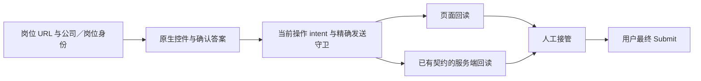

# 通用申请 worker：原生控件与草稿传输契约

核验日期：2026-10-11，Europe/Zurich。
研究票：[核验通用控件与草稿传输契约的复用边界](../.scratch/application-worker-next-stage/issues/03-generic-contract-research.md)。

**复用单位应是已经核验的表单能力与发送契约。平台名称不能代替这两项。**
原生控件操作可以复用现有实现。岗位身份、答案含义、条件字段、服务端值、自动保存和附件目的地仍需逐表单核验。
这是研究结论与候选建议，不是新支持范围的用户决定。

本轮只读当前源码、既有文档和官方规范。没有寻找或访问新的真实岗位，没有读取个人记录、运行 worker、上传文件、调用模型或执行最终提交。
没有新增依赖，没有复制上游实现。公开文档链接于本日读取；后续文档或站点变化不由本报告覆盖。

## 源码与研究版本

| 项目 | 固定上下文 |
| --- | --- |
| 研究分支 | `D_m/research/application-worker-form-contracts-20261011` |
| 分支起点 revision | `e4a26d0c24311d014d478f7f92e58a88e6709b4b` |
| 实际实现来源 | 主 checkout 的当前未提交源码；不是上述 Git revision 的文件内容 |
| 实现清单 | [source-hashes.json](../validation/application-automation/2026-10-11/workflow-consolidation/source-hashes.json) |
| 清单 SHA256 | `3093bec7ec614af6685cfe551a16af3bd441c4752d677f08ef2394c241595e88` |
| 本轮核验 | 清单中全部 17 个源码／测试文件的 SHA256 与主 checkout 相符 |
| 研究 commit | 本文件的首次提交；准确 commit 写入研究票的 Resolution，避免自引用 commit 值 |

关键文件的实际 SHA256：

| 主 checkout 文件 | SHA256 |
| --- | --- |
| `src/career_evidence_graph/hosted_ats.py` | `eef46d2c1f06ab09b3f679cd9d1b5f29558a1bb8e4ae3fffebfb4021f454a4c8` |
| `src/career_evidence_graph/ashby_drafts.py` | `9c9e55b2b81cf892465c802e21911447fa0dbcd77377517d95ced65510549829` |
| `src/career_evidence_graph/application_worker_browser.py` | `166f3d9daeb3cc5c4625f026c420d9440c2160f81ce8f60fa3cc94523ff4c587` |
| `src/career_evidence_graph/application_worker.py` | `18674c22d0e2da7b0019587fdabaea4fe73b1810d79c8ef7c5674afe353c22dc` |
| `tests/test_generic_worker.py` | `39e8190c9393bd8f764f17e5d3c170bce375a6a881f27302c6997faaad27995d` |
| `tests/test_ashby_drafts.py` | `a790cc8de784db879f3bf60b123d33ab619da1f97a614a298368a551356a1776` |

相对源码链接指向主 checkout 中的文件。这些文件可能不在研究分支起点内；应结合清单核验，不能用研究分支的 Git HEAD 代替实现快照。
既有[回归记录](../validation/application-automation/2026-10-11/workflow-consolidation/README.md)是历史验证证据。本轮没有重跑行为测试，也没有增加真实运行验收证据。

## 官方事实：三种接口必须分开

| 平台 | 公开岗位读取 | 雇主申请写入 API | 候选人原生浏览器流程 |
| --- | --- | --- | --- |
| Lever | Postings API 返回岗位 ID、描述、`hostedUrl`、`applyUrl`；不公开岗位自定义问题 | 申请 POST 需要账户 Super Admin 生成的 API key；必填字段可按账户配置 | 官方建议使用托管申请页。岗位列表可嵌入 iframe；岗位详情和申请表不提供同样的 iframe 视图。[Lever 官方文档](https://github.com/lever/postings-api) |
| Greenhouse | Job Board API 的 GET 无需认证；岗位查询 `questions=true` 可返回问题及字段 | 申请 POST 需要 Job Board API key 的 Basic Auth | 嵌入招聘页使用 iframe；企业配置控制其中的问题和字段。[Job Board API](https://docs.greenhouse.io/job-board.html#authentication)、[官方嵌入说明](https://support.greenhouse.io/hc/en-us/articles/46365908766875-Embed-a-Greenhouse-job-board-on-your-career-site) |
| Ashby | 公开 Job Postings API 返回描述、地点、`jobUrl` 与 `applyUrl` | 正式 API 使用 API key 的 Basic Auth；`applicationForm.submit` 要求 `candidatesWrite` | 公开岗位文档没有承诺托管页的 DOM 或内部草稿 GraphQL 契约。[公开岗位 API](https://developers.ashbyhq.com/docs/public-job-posting-api)、[认证](https://developers.ashbyhq.com/reference/authentication)、[提交端点](https://developers.ashbyhq.com/reference/applicationformsubmit) |

公开岗位数据可以帮助核验身份和申请入口。它不授予申请写入权限，也不能确认候选人的答案。
雇主集成 API 与候选人在原生页面中的操作是不同路径。本 worker 不应索取或借用雇主凭据，不应改为调用最终投递 API。
这些是根据上表接口边界得出的工程判断，不是厂商对本 worker 的认证。

Greenhouse 的同一个问题可以包含多个字段，例如 Resume 接受文件或文本；其问题级必填条件要求至少一个字段有效。
其字段类型也包含隐藏字段和多选；选择某些人口统计选项后可要求自由文本。因此“一个标签对应一个控件”和“所有 checkbox 组只有一个答案”都不能成为跨企业假设。[Greenhouse 问题契约](https://docs.greenhouse.io/job-board.html#questions-location-questions-compliance)

Ashby 的正式自建招聘页流程定义字段 `path`、类型和必填条件。附件可先取得签名 handle，再向返回目的地上传，最后用 handle 提交表单。
这证明正式集成可以在最终提交前发送附件。它不证明托管页使用同一 endpoint、上下文或保存语义；本地 `NonUserFormEngine` 草稿契约需独立证据。[Ashby 自建招聘页](https://developers.ashbyhq.com/docs/creating-a-custom-careers-page)

## 可直接复用／最小契约／人工处理矩阵

“直接复用”指复用控件操作，不免除岗位预检、确认答案范围、发送守卫和操作后回读。
“最小契约”指实际样本出现阻塞后才补齐的局部核验。它不是本轮已实现功能。

| 能力 | 直接复用现有部分 | 仍需核验的最小契约 | 当前人工处理边界 |
| --- | --- | --- | --- |
| 文本、email、tel、url、number、date、textarea | 原生 `fill`，当前值和有效性回读 | 唯一字段／标签、格式与长度、只读状态、答案适用范围、事件触发的发送 | 无标签、富文本、自定义日期、未知含义或特殊键盘协议。[Playwright 输入](https://playwright.dev/python/docs/input#text-input)、[本地 fill](../src/career_evidence_graph/hosted_ats.py) |
| 原生单选 select、radio；明确的单个 checkbox 事实 | `select_option`、`check`／`uncheck` | 标签到实际 value 的唯一映射；radio 分组；checkbox 独立必填语义 | 多选、重复选项标签、自由文本分支、不能用单个已确认值表达的 checkbox 组。[HTML input](https://html.spec.whatwg.org/multipage/input.html)、[Playwright select_option](https://playwright.dev/python/docs/api/class-locator#locator-select-option) |
| 自定义组合框 | 当前 editable input 型 combobox 的唯一明确 `option` 选择和显示值回读 | editable／select-only 类型、`aria-controls` 所属 popup、选项身份、最终已接受 value、远程查询与保存 | select-only、grid／dialog popup、多选、远程不确定结果或歧义选项。[W3C combobox 模式](https://www.w3.org/WAI/ARIA/apg/patterns/combobox/)、[本地 fill](../src/career_evidence_graph/hosted_ats.py) |
| 动态必填与条件字段 | 每次操作前后重新观察；字段形状变化暂停 | 条件出现／消失、问题级替代字段、隐藏提交值、完整必填覆盖、服务端错误 | 未识别必填控件、动态条件不能完整回读、多个申请区域。[本地 process](../src/career_evidence_graph/application_worker_browser.py)、[Greenhouse 问题契约](https://docs.greenhouse.io/job-board.html#questions-location-questions-compliance) |
| 附件 | 已确认的逐岗位 PDF 内容绑定、明确 resume 控件、`set_input_files` | 文件字节／MIME／长度／版本；选择、解析、预上传、挂接的不同结果；确切目的地与响应 | 额外必填附件、多文件、未知上传、未知保存结果；匿名可选文件框按现有规则跳过。[Playwright 文件选择](https://playwright.dev/python/docs/input#upload-files)、[本地 DraftSession](../src/career_evidence_graph/ashby_drafts.py) |
| 多步表单 | 队列、答案库、暂停与交接可以复用 | 每一步的岗位身份、字段变化、Next 的发送语义、恢复点和最后一步边界 | 当前自动层没有 Next／Continue 执行契约；人工接管。[当前流程](../docs/generic-application-worker.md) |
| iframe | Playwright 已有 `frame_locator` 原生能力；无需新增浏览器依赖 | 唯一 frame、完整 URL／岗位身份、导航／detach 变化、frame 内字段及发送归属 | 当前扫描只读主文档，未实现通用 frame 遍历；不能由顶层完成推出 frame 内完成。[Playwright frames](https://playwright.dev/python/docs/frames)、[当前扫描](../src/career_evidence_graph/hosted_ats.py) |

## HTML、ARIA 与事件的复用边界

HTML 原生 label、fieldset／legend、表单所有者和控件属性提供可复用语义。`form` 属性允许控件关联到非祖先 form；只扫描 form 子树不是全部合法 HTML 控件的枚举。
当前 `INSPECT_HOSTED` 使用子树查询；这是已确认的实现边界。若实际样本需要外置关联控件，优先用原生 `form.elements`／`control.form` 核验归属，避免新建表单框架。[HTML 表单关联](https://html.spec.whatwg.org/multipage/form-control-infrastructure.html#association-of-controls-and-forms)、[当前扫描](../src/career_evidence_graph/hosted_ats.py)

`aria-label`、`aria-labelledby` 和 `aria-required` 描述可访问名称与状态。ARIA role 不会自动赋予交互行为。
当前标签 helper 是受限 DOM 读取，不是完整 accessible-name 算法。遇到复杂名称时，应优先核验现有 Playwright label／role locator，而非补写通用名称计算器。[WAI-ARIA 名称与状态](https://www.w3.org/TR/wai-aria-1.2/)、[W3C ARIA 行为说明](https://www.w3.org/WAI/ARIA/apg/practices/read-me-first/)、[Playwright locators](https://playwright.dev/python/docs/locators)

`fill()` 会聚焦控件并触发 `input`。原生 `select_option()` 触发 `input` 和 `change`；普通脚本修改 value 不自动触发这些用户事件。
现有 Ashby 文本流程另有 focus／blur，等待已核验的保存响应。它不应变成所有表单一律追加 blur 或键盘序列的规则。[Playwright 输入](https://playwright.dev/python/docs/input#text-input)、[select_option](https://playwright.dev/python/docs/api/class-locator#locator-select-option)、[HTML 事件](https://html.spec.whatwg.org/multipage/input.html#common-event-behaviors)、[当前 process](../src/career_evidence_graph/application_worker_browser.py)

HTML 允许隐式提交，包括某些情况下的 Enter；GET 表单也可将输入编码进 URL。
因此隐藏 Submit、避免点击 Submit 或仅阻止 POST，都不能证明资料没有发送。控件操作和资料发送必须分别留证。[HTML 提交](https://html.spec.whatwg.org/multipage/form-control-infrastructure.html#implicit-submission)

Playwright 自动等待核验动作的可执行条件，不确认答案含义或服务端保存结果。框架能力仍需站点契约和回读。[Playwright 自动等待](https://playwright.dev/python/docs/actionability)

## 当前实现已具备的分层

- [hosted_ats.py](../src/career_evidence_graph/hosted_ats.py)：标准控件、受限标签、岗位身份及 PDF 回读。通用模式选唯一明确区域；无 form 时只在单一 email 入口条件下使用 body。它仍要求一个明确 resume 附件入口。
- [application_worker_browser.py](../src/career_evidence_graph/application_worker_browser.py)：复用队列、答案 revision、操作 intent、暂停和交接。通用 GET 读取集合在输入前固定；公开 JSON POST 绑定岗位 URL、请求 URL 和完整原始 body SHA256。未知发送暂停受影响岗位。
- [ashby_drafts.py](../src/career_evidence_graph/ashby_drafts.py)：请求核验除 operation 名外，还包含完整 query SHA256、精确请求 URL、变量、表单身份、字段 path 与当前已确认值。选项映射要求唯一服务端选项。国家选择还绑定返回的 provider location ID。
- 同一 `DraftSession` 的附件核验绑定目的地、handle 返回字段、文件名、PDF MIME、字节 SHA256及当前 upload intent；等待上传状态与服务端文件挂接。`verify()` 核验已见服务端可见必填项覆盖及保存值。

以上为本轮直接读取当前源码的事实。`OPERATIONS` 集合本身不是发送许可。完整 query 或变量变化仍需重新核验；不推荐 operationName 级或域名级 mutation 许可。
此 Ashby 契约来自现有局部实现，不能视为官方稳定 API，也不能扩展为跨组织保证。

当前启动设置 `service_workers="block"`，与 Playwright 官方关于路由可观察性的说明一致。HTTP／WebSocket 守卫属于本 worker 浏览器上下文；它不是操作系统级网络沙箱。人工接管之后，用户原生操作具有自己的发送结果。[当前启动与守卫](../src/career_evidence_graph/application_worker_browser.py)、[Playwright 网络路由](https://playwright.dev/python/docs/network#missing-network-events-and-service-workers)

## 候选扩展与验收证据

以下建议只有具体样本阻塞才进入开发。当前通用范围应由独立 HITL 票决定。

| 触发需求 | 最小候选扩展 | 所需合成证据 |
| --- | --- | --- |
| 原生单选有相同显示标签 | 核验唯一 label→value；优先复用现有 Ashby 唯一映射模式 | 重复标签不猜第一个；选中 value 和显示值均回读 |
| 外置 form 控件 | 复用 HTML 原生表单所有者枚举，保留范围限制 | 正确归属；别的 form 不被填写；字段新增／移除暂停 |
| 新 combobox 变体 | 仅为该变体添加操作与回读；绑定所属 popup | editable／select-only 分开；重复／过期选项暂停；远程保存单独核验 |
| 条件必填或问题级替代字段 | 复用逐动作观察；补齐该条件的字段／服务器覆盖 | 分支新增、消失、隐藏值与自由文本均有用例；未覆盖不报完成 |
| 高价值岗位必须跨步／iframe | 优先核验同岗位可用托管入口；否则只实现该具体步骤／frame 契约 | URL／身份漂移、frame 替换、Next 写入、未知结果、人工接管与恢复 |
| 新草稿或附件发送变体 | 复用现有 intent 与 guard；核验该完整协议 | 方法／URL／文档／变量／答案／字节任何变化均阻止；错误与未知响应不重复发送 |

这些切片使用现有 Playwright、标准库和仓库代码即可研究和验证。只有新的具体需求证明已有能力不足时，才考虑新增依赖。
本轮未证明需要任何新依赖。[仓库实现顺序](../AGENTS.md)、[现有 worker](../src/career_evidence_graph/application_worker_browser.py)

验收应按同一“身份＋控件变体＋发送契约”记录证据，不按平台名称合并：

| 证据 | 可声明 | 不可推导 |
| --- | --- | --- |
| 官方规范／API 文档 | 对应标准或正式 API 的事实 | 任意企业托管页面与本 worker 兼容 |
| 当前源码与合成回归 | 已实现边界、受测行为 | 当前真实页面仍打开、跨公司成功率 |
| 经授权的指定真实草稿回读 | 该岗位该版本的保存／附件结果 | 最终提交或招聘方接收 |
| 人工最终提交与接收回执 | 各自操作／接收证据 | 其他岗位或版本的成功 |

本轮只增加第一类研究和当前源码核验。没有新增真实草稿、人工提交或接收证据。
现有扫描也不是“页面所有未知控件、iframe、隐藏状态均已排除”的证明。后续样本必须单独核验这些缺口，不能把已观察控件全部完成解释为所有申请要求完成。

## 交付核验

完成项：官方主源核验；当前源码清单逐文件 SHA256 比较；本文件本地链接／空白检查；单报告提交。
保留项：未决 HITL 支持范围；未做的新控件实现；新真实岗位验收；生产／运行时行为测试。
研究文件在主 checkout 保留同字节副本，研究票保存准确 branch／commit 与 Resolution。研究分支只提交本报告。
