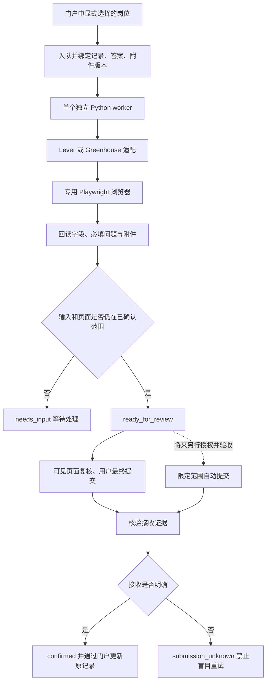

# 独立后台投递程序：资料与可行性评估

评估日期：2026-10-09。范围：脱离 Codex 对话和内置浏览器，使用独立本地进程处理已选定岗位。
这是研究结果和拟定试点，不是已实现功能，也不是当前真实提交授权。
现有人工最终提交约定保持有效。本次未安装执行框架，未使用个人申请资料，未投递。

## 结论

**独立运行和后台批量处理有技术可行性。推荐 Python + Playwright Chromium + 单个顺序 worker，先覆盖 Lever 与 Greenhouse。**
Playwright 官方提供普通 Python 脚本启动浏览器的示例，默认 headless，可改为可见浏览器。
固定字段映射无需 Codex 或 LLM。[官方 Library 文档](https://playwright.dev/python/docs/library)

限定已确认事实、答案、岗位和附件的自动提交，在浏览器操作层面可实现。
可靠运行还需要执行前核对、动作限制、去重、持久化状态和接收确认。
跨平台长期无人值守的可靠性没有足够实测证据。以下评级都是工程判断，不是成功率。

| 目标 | 判断 | 主要条件 |
| --- | --- | --- |
| 关闭 Codex 后继续运行独立 worker | 高可行 | 独立进程、运行时及浏览器；不用 Codex 工具完成任务 |
| 后台读取队列、检查岗位、准备固定字段 | 高可行 | 仅使用显式选择的岗位和已确认输入；一个 worker 顺序执行 |
| 后台填写后交给用户检查 | 条件可行 | 明确保留或重建页面；浏览器状态文件不等于已保存表单草稿 |
| 指定平台与范围内自动提交 | 条件可行，尚未验收 | 所有答案可核验、运行时动作限制、发送范围明确、接收可核验 |
| 同时覆盖陌生平台和陌生问题 | 暂不作为试点目标 | 每个新增平台都需要适配与验收；未知答案必须暂停 |
| 全天候无人值守 | 本地笔记本不保证 | 登录失效、CAPTCHA/MFA、休眠、断网和页面变更都会中断 |

## 现有证据与缺口

[当前接入](../docs/application-automation.md)仅生成一个 Codex Job Apply 任务。
`prepare_application_task()` 本身不执行浏览器，也不创建申请状态。
[源码](../src/career_evidence_graph/application_automation.py)

[三轮合成测试](../validation/application-automation/2026-10-09/three-rounds-01/README.md)中，
Lever 和 Greenhouse 完整填写各通过 9 项检查；缺失答案场景按预期阻止复核。
这些操作使用 Codex 内置浏览器，不能当作独立 Playwright worker 验收。
其中一次附件相关组合调用耗时 545.88 秒；独立程序的耗时需要重新测量。

| 已有 | 尚缺 |
| --- | --- |
| 岗位链接规范化、重复记录检查、drafting 状态与 revision 检查 | 批次入队、持久化领取状态、进程崩溃恢复 |
| 原记录更新与原字节备份 | 独立 worker 与门户的统一写回路径 |
| Job Apply 确认答案与范围存储协议 | 独立浏览器中的字段适配、停止条件、交接机制 |
| 本地夹具、字段和附件复核、未触发最终动作的记录 | 独立进程测试、真实 ATS 填写验收、实际接收确认 |

## 浏览器基础能力

| 能力 | 官方证据 | 对本方案的用途 |
| --- | --- | --- |
| 独立运行、headless/headed | [Library](https://playwright.dev/python/docs/library) | 后台运行；人工步骤使用新启动的可见实例并重新核验任务 |
| 标签与角色定位、自动等待 | [Locators](https://playwright.dev/python/docs/locators)、[Auto-waiting](https://playwright.dev/python/docs/actionability) | 按语义定位控件；操作后仍需检查实际值，不能把可点击当成填对 |
| 文件选择与直接设置 file input | [Actions / Upload files](https://playwright.dev/python/docs/input#upload-files) | 使用指定附件；回读文件名，按平台确认上传已完成 |
| 专用持久化 browser context | [BrowserType](https://playwright.dev/python/docs/api/class-browsertype#browser-type-launch-persistent-context) | 使用 worker 自己的浏览器资料目录；同一目录不并发启动 |
| 登录状态复用 | [Authentication](https://playwright.dev/python/docs/auth) | 保存必要 cookies/storage；过期后暂停；不能保证所有认证模型恢复 |
| Trace 与截图 | [Tracing](https://playwright.dev/python/docs/api/class-tracing) | 复现错误；含页面及网络信息的原始 trace 留在私人运行目录 |

独立 worker 使用专用浏览器资料目录，由用户在该浏览器中完成需要的登录。
不要复制 Codex 或日常 Chrome 的 cookies、凭据或完整资料目录。
Playwright 官方说明浏览器不能同时使用相同 user-data directory，
并警告不要自动化 Chrome 的默认用户资料目录。
[BrowserType](https://playwright.dev/python/docs/api/class-browsertype#browser-type-launch-persistent-context)

`storage_state` 不是任意会话的完整备份。官方文档说明它不提供 sessionStorage 的持久化 API。
认证状态文件还可能含可用于冒用会话的 cookies 和 headers，应保存在私人目录。
[Authentication](https://playwright.dev/python/docs/auth)

## 官方 API 能替代浏览器吗

| ATS | 可公开读取 | 官方提交接口 | 对个人批量投递的判断 |
| --- | --- | --- | --- |
| Lever | 岗位 JSON、hostedUrl、applyUrl | POST 需要招聘方账户 Super Admin 生成的 API key | 可用 GET 辅助核验岗位；不能凭公开岗位 URL 获得通用提交权限 |
| Greenhouse | Job Board GET 无需认证；`questions=true` 可返回字段与问题 | POST 需要 Job Board API key 的 Basic Auth | GET 可辅助检查问题；实际申请继续走受支持的浏览器表单 |

Lever 的密钥、附件 multipart 和限流规则见
[官方 Postings API](https://github.com/lever/postings-api#apply-to-a-job-posting)。
Greenhouse 的 GET/POST 权限和问题字段见
[官方 Job Board API](https://docs.greenhouse.io/job-board.html#authentication)。
不存在由这两份文档支持的“求职者只凭链接即可提交所有公司”的官方公共 API 路线。
这里不把网页内部接口当作获得招聘方 API 授权的替代方案。

Greenhouse 特别说明，Job Board API 提交端点不验证必填字段完整性。
即使将来获得合法 API 接入，HTTP 成功也不能代替业务完整性检查。
[Submit an application](https://docs.greenhouse.io/job-board.html#submit-an-application)

## 框架选择

详细版本、许可证、固定 revision、默认数据路径和源码链接见
[框架资料笔记](application-automation-framework-sources-2026-10-09.md)。

| 方案 | 独立于 Codex | 本次采用判断 |
| --- | --- | --- |
| Playwright Python | 可以；普通 Python 脚本直接启动浏览器 | 首选浏览器基础库；补最小 ATS 适配和任务状态 |
| browser-use | 可以；有本地浏览器和多模型接入 | 仅在固定映射维护困难时评估；模型、遥测、依赖版本需要单独配置 |
| Stagehand | 可以；有本地浏览器路径 | 变化较大的动作发现备选；当前 v4 API 需按新文档使用 |
| Skyvern | 可以自部署 | 有工作流能力，但服务、数据库、UI 和模型部署较重，暂不引入 |
| geckguy/AutoApply | 无需 Codex；依赖扩展与后端 | 可参考填表和按钮过滤；不是现成后台批量 worker |
| ApplyPilot / 简单多 ATS bot | 有独立脚本 | 不直接采用；许可证、prompt 式限制或缺少接收确认等问题未满足本试点 |
| 已装 Job Apply | 当前浏览器流程依赖宿主 | 复用答案存储协议和流程约束；它不是独立执行引擎 |

“本地浏览器”与“数据完全本地”是两个条件。AI 框架可能将问题、DOM、截图、
简历文本或任务记录发送给模型、云网关或遥测服务。
首版采用确定性字段映射，省去模型调用及其费用；页面和申请资料仍会发送给目标 ATS。
这是设计选择，不是已完成配置。若以后增加 LLM，仅允许它提出待审查映射或草稿，
不要让它决定未知个人答案或直接调用任意浏览器动作。

## 最小试点结构

以下为建议结构，不是已实施架构。

初版只需要：任务清单、一个 worker、两个 ATS 适配、一个私人运行目录。
复用 Python 标准库、现有 Pydantic 和记录访问代码。
本项目当前 `pyproject.toml` 未包含 Playwright；落地时新增一个锁定版本的
浏览器库和匹配的 Chromium 二进制即可开始验证，不在本次研究中安装。
[当前依赖](../pyproject.toml)

复用已有 JSON/JSONL 和原子文件写入模式，配合单 worker 互斥和领取记录。
先不加 Redis、Celery、微服务或新的 Web 框架。
仅当界面和 worker 确实要并发领取、停止或修改任务，且文件锁方案难以可靠维护时，
再用 Python `sqlite3` 的事务和唯一约束保存运行状态；申请笔记仍是原状态来源。
[sqlite3 官方文档](https://docs.python.org/3.13/library/sqlite3.html)

`ApplicationStore` 的 `RLock` 是进程内锁，不是多进程任务锁。
worker 不应创建第二套直接写笔记的逻辑；建议统一通过现有门户写回，
保留 revision 检查与备份。若门户未运行，先保留接收证据和待写回状态，稍后核对版本再更新。
[记录存储](../src/career_evidence_graph/career_portal_data.py)、
[现有门户接口](../src/career_evidence_graph/career_portal.py)

现有 Job Apply 的存储 helper 是可独立调用的 Python 工具。
可以通过显式私人 root 复用已确认答案及适用范围，避免复制两套答案存储。
其 auto-submit policy 目前仅允许隔离 QA adapter 消费 lease，不能拿 QA 许可当真实 ATS 的提交许可。
policy helper 本身不能控制浏览器；真实 ATS 的动作限制仍须由新执行器实现和验收。
[固定版本 Skill](https://github.com/neonwatty/job-apply-plugin/blob/370204c58b1137d08c5a7e7449538ae6447be0b9/skills/job-apply/SKILL.md)、
[存储 helper](https://github.com/neonwatty/job-apply-plugin/blob/370204c58b1137d08c5a7e7449538ae6447be0b9/scripts/job-apply-store.py)

## 后台填写与人工提交的交接问题

不能假定“headless 填完、退出进程、稍后打开 URL”会保留填写内容。
cookies/storage 恢复不等于当前页面 DOM、附件选择或招聘方草稿已保存。
这属于试点必须验证的应用行为。
Playwright 的 headless 选项在启动时确定；需要人工操作时，应启动可见实例并恢复任务，
不能承诺将正在运行的 headless 实例原地显示成浏览器窗口。
恢复时仍需验证认证、页面、字段和附件，不能仅凭保存过的任务数据宣称完成。

| 交接方式 | 适用条件 | 验收要求 |
| --- | --- | --- |
| 可见页面填完后保留该页 | 首次试点；每次只保留一个待提交页面 | 用户看见全部字段与附件；关闭页面不能被记录为已接收 |
| 后台准备任务，用户复核时在可见浏览器重新填写 | 表单没有可靠的持久草稿 | 重新读取记录、答案和文件版本；再次检查页面和全部字段 |
| 使用招聘方持久草稿 | 已真实确认网站可保存、恢复字段与附件 | 浏览器和 worker 重启后草稿仍完整；不能只验证 cookies 存在 |

因此，首版的“后台批量”优先覆盖检查和资料准备；人工提交阶段逐个打开已核验任务。
要证明后台完成多份表单并可直接提交，还需验证该平台的草稿恢复或保留页面机制。
若将来限定范围自动提交，每个岗位可以顺序执行到接收确认后关闭浏览器上下文。

## 必需的运行状态和停止条件

后续决策（2026-10-10）：用户批准 Codex 等工具用于受限的问题等价判断。
本文无模型固定映射为先前研究基线；新执行边界以
[确定 ATS 适配、上传与人工提交的执行边界](../.scratch/independent-application-worker/issues/06-ats-execution-boundary.md)
为准。该决定没有运行模型或证明真实 ATS 行为。

状态建议：`queued → running → needs_input / ready_for_review`。
将来的提交阶段：`submitting → confirmed / rejected / submission_unknown`。
这些是 worker 运行状态，不修改 Skill 分数或职业图谱语义。

| 条件 | 处理 |
| --- | --- |
| 未知必填问题、事实冲突、范围不匹配 | 该岗位 needs_input；其他独立且明确的岗位可继续 |
| 工作授权、sponsorship、通知期、入职日期 | 独立答案；不互相推断，不默认 Yes/No/0 |
| 记录 revision、简历 hash、答案版本或题目集合变化 | 重新检查；原执行确认失效 |
| 登录过期、CAPTCHA、MFA | 暂停相关浏览器/平台，交给用户处理 |
| 意外跳转到其他岗位或不明 origin | 停止该任务，不继续发送资料 |
| 同一 ATS、招聘方、岗位 ID、申请者引用已领取或已处理 | 拒绝重复；去重键不依赖跟踪参数和 URL 表面形式 |
| 提交前崩溃 | 依据持久领取记录恢复；重新检查输入及页面 |
| 提交发出后超时、崩溃或没有确认页 | submission_unknown；保留证据，不自动再次提交 |
| 有与本岗位关联的确认页、回执 ID 或确认邮件 | 才记录 confirmed；按钮点击成功不是接收证明 |
| 附件上传或表单 autosave | 这是资料发送；必须在事先明确的资料和目标范围内 |

没有招聘方幂等接口或事务支持时，本地锁只能限制本程序的重复动作。
它不能保证网络超时后的“服务端恰好接收一次”。
恢复时要同时保存“提交结果”和“门户是否已写回”，避免写回失败触发再次投递。
这两个状态不得合并为一个 `applied` 布尔值。

最终动作必须由明确的平台适配分支执行，不能依赖一句 prompt 或按钮名称黑名单。
首版不给可选模型任意 click、Enter、脚本或 HTTP 提交工具。
按平台识别出的提交请求可以加网络限制，但不能简单封锁所有 POST：附件、autosave
和中间步骤也可能使用 POST。Playwright `route()` 对 Service Worker 有覆盖限制，
WebSocket 又有独立路由 API；网络限制需要逐个平台验证，不能宣称覆盖所有发送路径。
[BrowserContext routing](https://playwright.dev/python/docs/api/class-browsercontext#browser-context-route)

## 本地后台与持续在线

独立进程无需保持 Codex 对话运行。以后要定时启动，可使用 macOS 原生 `launchd`；
本次没有创建定时任务。Apple 的归档指南说明日历任务在睡眠后可延迟到唤醒执行，
关机期间不会执行。后台运行不等于机器睡眠或关机时仍能投递。
[Apple Scheduling Timed Jobs](https://developer.apple.com/library/archive/documentation/MacOSX/Conceptual/BPSystemStartup/Chapters/ScheduledJobs.html)

若确实需要持续在线，常开主机或服务器能处理电源限制，但会增加浏览器登录、
私人资料存放、人机交接和运行维护成本。首批试点先在本地运行，不引入云浏览器。
这属于部署方案判断，不是对云平台可靠性的实测结论。

LinkedIn 不作为第一批目标。它的官方帮助明确禁止第三方软件或扩展自动化站内活动，
并说明账号可能受限。采用直接 ATS 页面可避开这一特定站内工作流，
但仍需逐个核对目标网站的使用要求。
[LinkedIn 官方说明](https://www.linkedin.com/help/linkedin/answer/a1341387/prohibited-software-and-extensions)

## 拟定验证顺序

以下均未执行；需要未来实现和相应真实资料发送授权。

| 阶段 | 范围 | 通过条件 |
| --- | --- | --- |
| A：独立执行 | 本地合成 Lever/Greenhouse；从终端启动，关闭 Codex | 浏览器与队列继续工作；已确认字段正确；最终动作次数为 0 |
| B：恢复与负向测试 | 未知题、版本改变、重复任务、附件失败、登录中断、进程崩溃、提交结果不明 | 逐项按上表停止；无猜测答案、重复动作或伪造接收状态 |
| C：真实填写试点 | 两个平台各 3–5 个明确选择的岗位；顺序执行，人工最终提交 | 每字段和附件检查；统计完整填写、人工修改、未知问题、耗时及接收证据 |
| D：限定自动提交 | 仅在另行明确授权后，先单个指定岗位的 canary | 资料/答案版本与题目不变；确认接收；未知状态停止；通过后才扩批 |

统计应分平台和模式，明确每项分母：完整填写率、字段错误数、人工修改项、
未知问题数、接收确认率、重复动作数、每岗位耗时和外部模型调用数。
小样本成功不证明跨平台长期可靠性；README 的平台列表、stars 和演示不作成功率证据。

## 决策建议

推进一个独立、默认人工提交的 Playwright 试点具有合理性。
先复用记录和答案协议，证明独立运行、两个 ATS 的填写和中断恢复。
模型框架、云平台、多 worker 和自动最终提交都在具体需求和验收出现后再增加。
本研究不改变当前职业图谱里程碑；尚未实施独立 runner，也未证明真实投递成功率。
