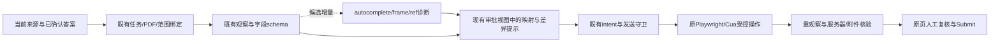

# TomorrowStar 开源代码复用与功能借鉴分析

核验日期：**2026-10-17，Europe/Zurich**。依据当前工作树、[43 项资源清单](open-source-job-application-browser-tools-2026-10-17.md)、固定上游源码与许可证。本文是研究结论和候选接入设计；没有把建议实现到产品，也没有安装候选运行时、启动模型/真实浏览器/ATS 或自动投递。

## 结论

**最值得做的是小片段改编与现有模块补强。** TomorrowStar 已有答案作用域、逐岗位材料绑定、原页面交接、发送守卫、未知结果停止和独立测量。多数完整投递器重复这些能力，同时带来更宽松的答案推断、自动提交、重复上传或成功判定。没有源码证据支持现在整体换用另一套投递系统。

**第一优先是简历改写的逐条事实差异检查。** jobpilot 的数字/技术词差异函数可用 Python 标准库改编，结合 Jobops 的 finding 结构，补在现有 `_validate_task_rewrites` 后。当前代码检查来源、责任字段、版本和禁止改写项的原文；对允许改写的个人来源，数字/技术词变化仍需额外提示。检查必须限于当前来源/Contribution，不能借整个 résumé 其他条目的技术词授权本条能力。规则通过也不等于语义忠实。[jobpilot facts](https://github.com/suxrobGM/jobpilot/blob/bdc8eb5c215bd0c7234b6ca411ec5ed1e8d6d895/apps/api/src/modules/resume/tailoring/facts.ts#L12)、[rewrite guard](https://github.com/suxrobGM/jobpilot/blob/bdc8eb5c215bd0c7234b6ca411ec5ed1e8d6d895/apps/api/src/modules/resume/tailoring/guards.ts#L150)、[application_resume.py:517](../src/career_evidence_graph/application_resume.py#L517)。

**填写侧的有效增量是更好的字段候选、映射预览与frame身份。** Porter 的 autocomplete 信号、AutoApply 的 landed-value 诊断、FoxiFill 的映射审阅、Nanobrowser/agent-browser 的document/frame/loader失效设计值得改编。同页通用控件和动态重扫已经具备；跨 iframe/open shadow 的受控发现与绑定则尚未形成当前执行契约。应使用现有 Playwright，而非另起浏览器运行时。

全量取舍：**reuse 3 项、adapt 10 项、inspired-by 22 项、reject 8 项**。这些是项目层的主取舍，不表示整仓库可以复制。reuse 中 Playwright 与 Job Apply store 已在使用；Trafilatura 是仅在非结构化 JD 失败样本证明需要后，才考虑的公开接口候选。[完整决策与证据快照](tomorrowstar-open-source-reuse-analysis-2026-10-17.json) 包含每项上游函数/行号、当前本地对应位置、许可证与限制。

## 一、当前 TomorrowStar 基线：哪些不要重复建设

| 能力 | 当前源码依据 | 本次判断 |
| --- | --- | --- |
| 答案库与确认范围 | [README.md:3](../src/career_evidence_graph/_vendor/README.md#L3)、[application_worker.py:467](../src/career_evidence_graph/application_worker.py#L467) | store 与同 SHA 上游同字节；已有 confirmed、国家/公司/岗位 scope、one-use、精确选项与答案版本。不再引入另一份profile/store。 |
| 逐岗位简历与发送确认 | [application_flow.py:390](../src/career_evidence_graph/application_flow.py#L390)、[application_single_binding.py:201](../src/career_evidence_graph/application_single_binding.py#L201) | 已绑定任务/analysis/source/config/PDF hash/发送范围；不得以score阈值或agent outcome替代批准。 |
| 贡献来源与责任分离 | [application_resume.py:31](../src/career_evidence_graph/application_resume.py#L31)、[application_resume.py:517](../src/career_evidence_graph/application_resume.py#L517) | 已分User/Team/他人/Codex/第三方；复用通用flat résumé corpus不得把团队技术转成个人能力。 |
| 同页表单观察与控件操作 | [hosted_ats.py:179](../src/career_evidence_graph/hosted_ats.py#L179)、[hosted_ats.py:216](../src/career_evidence_graph/hosted_ats.py#L216) | label/ARIA/fieldset、隐藏native代理、radio、select/combobox、可见性/歧义检查和重观察已有。不能把“原库能操作”当本地未实现。 |
| 跨frame/open shadow | [hosted_ats.py:182](../src/career_evidence_graph/hosted_ats.py#L182)、[hosted_ats.py:212](../src/career_evidence_graph/hosted_ats.py#L212) | 当前document/page级查询与控制缺独立frame_path；是可论证的缺口，尚未证明当前真实样本必须立即扩展。 |
| 附件与草稿回读 | [workable_uploads.py:1](../src/career_evidence_graph/workable_uploads.py#L1)、[ashby_drafts.py:1](../src/career_evidence_graph/ashby_drafts.py#L1) | 已有特定协议、批准PDF/digest和远端回读；通用File API、文件名或uploaded文案不是替代。 |
| 原页、会话归属和人工交接 | [cua_driver.py:982](../src/career_evidence_graph/cua_driver.py#L982)、[application_worker_browser.py:685](../src/career_evidence_graph/application_worker_browser.py#L685) | 已有exact owner/target、保留原Page与附件、人工接管；cookie/profile恢复不能取代原DOM。 |
| intent/未知结果与网络发送 | [application_worker_browser.py:431](../src/career_evidence_graph/application_worker_browser.py#L431)、[application_worker_browser.py:896](../src/career_evidence_graph/application_worker_browser.py#L896) | 已有HTTP/WebSocket守卫、intent绑定与延迟完成防误清。main-frame域名白名单不足以覆盖上传/fetch副作用。 |
| 来源获取与JD完整性 | [application_job_source.py:28](../src/career_evidence_graph/application_job_source.py#L28)、[application_job_source.py:552](../src/career_evidence_graph/application_job_source.py#L552) | 已有DNS/peer/TLS/redirect/字节/deadline约束、JSON-LD和封闭LinkedIn scope；流畅Markdown不代表完整JD。 |
| 生命周期与效率观测 | [worker_measurement.py:128](../src/career_evidence_graph/worker_measurement.py#L128)、[worker_measurement.py:330](../src/career_evidence_graph/worker_measurement.py#L330) | 已有互斥计时、模型/工具/unknown与损坏日志处理；不再为dashboard引入第二套任务库。 |

本次读取当前 `.venv`：Python **3.13.14**、Playwright **1.63.0**、Pydantic **2.13.4**，与当前锁定依赖相符。工作树包含未提交修改；Git HEAD `e4a26d0c24311d014d478f7f92e58a88e6709b4b` 不能独自代表受分析实现。机器快照记录 65 个相关本地文件哈希，其中最初捕获的 64 个在分析结束核对时没有变化。

## 二、建议优先级：具体可改编什么，放到哪里

以下均是候选方案，尚未实施。成本是按源码耦合判断的小/中/大级别，不是工期承诺。

| 顺序 | 可复用代码/可借鉴功能 | 本地接入位置与最小范围 | 必须保留的限制 | 成本 |
| --- | --- | --- | --- | --- |
| P0 | jobpilot `normalizeNumber/extractNumbers/techTokens/bulletProblem`，结合Jobops逐条finding | `application_resume._validate_task_rewrites` 之后做当前来源对当前改写的差异报告；在现有简历审阅显示 | 不使用全局技术词池，不将检测通过当事实证明，不自动改写/批准/写入Skill | 小到中；stdlib re/sets，无模型/新依赖 |
| P1 | Porter autocomplete + GodsScion whole-word/极性反例 | `hosted_ats.INSPECT_HOSTED` 记录原始autocomplete tokens与候选语义，仍由 `fact_for/resolve` 确认 | given/family/full name分开；`section-*`/shipping/billing不乱合并；未知资格不猜，选项精确绑定 | 小；抽取纯逻辑/独立合成语料 |
| P1 | AutoApply landed-value诊断 | 既有填写后re-observe路径输出exact/格式化/截断/拒绝等解释 | 不复用通用去标点等价、digits-only重写和模糊option；不因格式“相似”解除unknown | 小到中；读回诊断和按字段契约的校验 |
| P1 | FoxiFill字段映射预览 | 现有材料/发送审批或异常复核中展示“页面问题→已批准答案/来源/范围”，默认突出冲突和变更 | 已确认字段不新增逐项弹窗；不将undo描述为服务器保存/附件回滚 | 中；复用现有projection和UI，避免第二份canonical状态 |
| P1，出现frame阻塞样本时 | Playwright FrameLocator + Nanobrowser/agent-browser refs | 扩展现有observe/control的frame_path、parent/frame URL、posting/form/schema/loader绑定 | 同一owner/页面，导航/脱离即失效；发送守卫与frame相同scope；不遍历所有frame后盲填 | 中到大；能力契约和网络权限须同时扩展 |
| P1 | Job Apply QA fixtures/oracle + BrowserGym独立validator + Skyvern超时负例 | 将控件形态和断言翻译到现有synthetic server/pytest，重建纯合成值 | 不导入真实capture/答案；不引入自动提交、导航式validator或AGPL代码；0自动最终动作 | 小到中；无新测试运行时 |
| P2 | agent-browser/Nanobrowser document/session/loader感知refs，Chrome MCP私有诊断 | 先补结构化失败证据；确认反复同一阻塞或耗时瓶颈后再做有界locator/mapping缓存 | 缓存不绑定个人答案授权；旧页/schema/options/材料/answer revision变化即重新检查；不缓存“可提交”权限 | 中；先观测，后优化 |
| P2 | Jobops current/stale原因视图 | 在现有跨岗位列表显示JD/资料/模型/政策失效原因，复用单任务 `_fresh` 语义 | 是只读优先级视图，不新增批量执行或用匹配分自动批准；unknown资格仍unknown | 中；无SQLite/新队列 |
| 需要失败样本后 | Trafilatura公开extract或Crawl4AI schema诊断思路 | 只处理经当前安全获取器保留的HTML，辅助正文/缺失字段诊断 | 不替换DNS绑定fetch，不用正文长度/coverage赋full JD；保留资格尾部和原始来源 | 解析库/验证为中；当前不新增依赖 |

### 接入位置：保留现有执行主干



虚线节点是拟议增量；其余是既有职责。建议扩展现有接口和观察projection，不新建全局Field事实库、第二状态机或多agent执行平台。

### 不建议照搬的具体路径

- `skkhub/AI-form-filler-crx` 的 setInputFiles 用模拟文字生成File；Enter路径会 `requestSubmit()`。其定位诊断可参考，执行/上传路径拒绝。[固定源码](https://github.com/skkhub/AI-form-filler-crx/blob/7f3c873b08d2a30b3f4f5efa0bd0c181b03aa8be/src/content.ts#L1507)。
- Offlyn 有完整扩展源码，但所查message桥未核验origin/source，动作桥直接click；只借frame发现设计，不复制消息/动作执行器。[固定源码](https://github.com/offlyn-ai/offlyn-apply/blob/6179317448bcaf8c04dbdf50905771b98d7af93a/apps/extension-chrome/src/content.ts#L1412)。
- AutoApply / linkedin-ai / devdattatalele等存在“点击或无错误即applied/submitted”；Pickle-Pixel dry-run仍可沿 `RESULT:APPLIED` 路径落为applied。只借局部语义/负例，不接结果状态解析器。
- Abhishek AutoApply 会把生成简历再解析写入KB；这不能成为已核实Contribution/个人事实的来源。当前真实资料→草稿→人审的方向应保持。

## 三、依赖、许可与部署成本

| 候选 | 固定源码核验结果 | 采用判断 |
| --- | --- | --- |
| browser-use 0.13.13 | 硬钉pydantic==2.13.5，与当前2.13.4冲突；另有cdp-use/bubus/PostHog/BU SDK和BrowserSession | 不直接放进现有lock；若日后比较，隔离实验，不替换当前浏览器owner |
| Stagehand v4 | Python SDK范围可兼容Pydantic2.13.4，但执行在extension/understudy；Node运行要求另算；云cache发送原始AX/URL，key不含模型配置 | 当前只适配观察/定位边界；不能把云cache当本地安全缓存 |
| agent-browser 0.39.1 | npm要求Node>=24、封装Rust native daemon；snapshot自动只展开一层iframe | 借ref失效设计，暂不增加第二常驻进程/浏览器生命周期 |
| Playwright MCP 0.0.83 | 实际playwright-core=1.64.0-alpha-1790635538000；npm gitHead对应`e8149b8257d32dcf8f72573ecc43e72439da7080` | 与当前Python1.63.0不同；不复制内部AI snapshot接口或混用清单最新monorepo HEAD |
| Crawl4AI / Crawlee Python / Trafilatura | 核心直接依赖分别34/12/7；Crawlee的Stagehand extra约束<4，与清单v4不同 | 当前先保留标准库获取与已装Playwright；解析实验只接保留HTML |
| Skyvern/Automa/UI.Vision/Bitwarden | AGPL/GPL/商业分区或独立闭源模块各自适用；当前根项目未见统一LICENSE声明 | 本轮仅借鉴设计/独立构造负例；实际复制前另核对应文件许可、通知及发行兼容范围 |
| BrowserMCP / OmniParser | 前者公开构建缺内部包/extension；后者根LICENSE、README徽章与模型权重分许可 | 不作为可直接集成的完整开源依赖 |

上表是清单固定revision的实现/manifest事实，不是法律意见或实际安装兼容性测试。完整许可证链接在逐项矩阵与机器快照；本次没有改变锁文件和provenance registry，因为没有新增代码复用。

## 四、43 项逐项决策矩阵

分类：`reuse`=调用成熟公开接口/已有原样复用；`adapt`=局部规则、接口或测试语料改编；`inspired-by`=只借设计/反例，不复制执行器；`reject`=当前不引入。已有/部分/缺口表示对照当前源码的情况，不表示真实ATS已验收。项目主分类不覆盖其全部文件。

### 专用申请系统（12）

| 项目 / 许可 | 主取舍与当前状态 | 可以复用/借鉴的精确范围 | 取舍原因与源码入口 |
| --- | --- | --- | --- |
| [neonwatty/job-apply-plugin](https://github.com/neonwatty/job-apply-plugin)<br>[MIT](https://github.com/neonwatty/job-apply-plugin/blob/370204c58b1137d08c5a7e7449538ae6447be0b9/LICENSE) | `reuse`<br>已有 | Store 已原样 vendor，无需新增；可把多 ATS fixture/语义控件目录和 oracle 断言翻译进现有 synthetic server。<br>本地：[README.md:3](../src/career_evidence_graph/_vendor/README.md#L3)、[job_apply_store.py:83](../src/career_evidence_graph/_vendor/job_apply_store.py#L83) | MIT；真实表单未验证；final-action policy helper inert，当前人工 Submit 不需要自动提交 lease。<br>[源1](https://github.com/neonwatty/job-apply-plugin/blob/370204c58b1137d08c5a7e7449538ae6447be0b9/scripts/job-apply-store.py#L83-L113)、[源2](https://github.com/neonwatty/job-apply-plugin/blob/370204c58b1137d08c5a7e7449538ae6447be0b9/qa/contracts.py#L29-L95)、[源3](https://github.com/neonwatty/job-apply-plugin/blob/370204c58b1137d08c5a7e7449538ae6447be0b9/qa/oracle.py#L555-L565) |
| [geckguy/AutoApply](https://github.com/geckguy/AutoApply)<br>[MIT](https://github.com/geckguy/AutoApply/blob/6c5fbc42833278acaa45981e86b5d99ae97d77a0/LICENSE) | `adapt`<br>部分 | 借用网页保留值的精确/格式化/截断/拒绝诊断，限小纯逻辑与fixture<br>本地：[application_worker_browser.py:1357](../src/career_evidence_graph/application_worker_browser.py#L1357)、[hosted_ats.py:216](../src/career_evidence_graph/hosted_ats.py#L216) | 不得复用通用去标点相等、digits-only重写、模糊选项匹配及Next启发式作为发送硬门<br>[源1](https://github.com/geckguy/AutoApply/blob/6c5fbc42833278acaa45981e86b5d99ae97d77a0/extension-chrome/content/filler.js#L283)、[源2](https://github.com/geckguy/AutoApply/blob/6c5fbc42833278acaa45981e86b5d99ae97d77a0/extension-chrome/content/filler.js#L328)、[源3](https://github.com/geckguy/AutoApply/blob/6c5fbc42833278acaa45981e86b5d99ae97d77a0/extension-chrome/content/scraper.js#L186) |
| [AbhishekMandapmalvi/AutoApply](https://github.com/AbhishekMandapmalvi/AutoApply)<br>[MIT](https://github.com/AbhishekMandapmalvi/AutoApply/blob/053071ba1bba5733b522d78c3d645002d817e55a/LICENSE) | `inspired-by`<br>已有 | 借 résumé 版本来源/组装 entry IDs 展示；本地已有 selected/used/unselected source 与 artifact 版本，不导入 DB/engine。<br>本地：[application_flow.py:390](../src/career_evidence_graph/application_flow.py#L390)、[application_resume.py:667](../src/career_evidence_graph/application_resume.py#L667) | MIT；无可见 error 即 success/applied，生成简历反向写 KB，重新 goto/login retry/关闭页与本地契约冲突。<br>[源1](https://github.com/AbhishekMandapmalvi/AutoApply/blob/053071ba1bba5733b522d78c3d645002d817e55a/bot/bot.py#L139-L228)、[源2](https://github.com/AbhishekMandapmalvi/AutoApply/blob/053071ba1bba5733b522d78c3d645002d817e55a/bot/apply/greenhouse.py#L64-L94)、[源3](https://github.com/AbhishekMandapmalvi/AutoApply/blob/053071ba1bba5733b522d78c3d645002d817e55a/bot/bot.py#L640-L681) |
| [yuyao-wang/Jobops](https://github.com/yuyao-wang/Jobops)<br>[MIT](https://github.com/yuyao-wang/Jobops/blob/643f489936e07494941d58433da82826ed224ae8/LICENSE) | `adapt`<br>部分 | 可借跨岗位 current/stale 的明确原因、逐来源事实检查 finding；本地逐岗审批/unknown intent/原页交接已有。<br>本地：[application_flow.py:256](../src/career_evidence_graph/application_flow.py#L256)、[job_screening.py:188](../src/career_evidence_graph/job_screening.py#L188) | MIT；源码体量大、多个 domain ports；不导入完整 SQLite/gate/lease/自动提交；facts token 启发式不能证明语义忠实。<br>[源1](https://github.com/yuyao-wang/Jobops/blob/643f489936e07494941d58433da82826ed224ae8/core/current_priority_queue.py#L244-L295)、[源2](https://github.com/yuyao-wang/Jobops/blob/643f489936e07494941d58433da82826ed224ae8/core/resume_fact_qa.py#L1195-L1412)、[源3](https://github.com/yuyao-wang/Jobops/blob/643f489936e07494941d58433da82826ed224ae8/core/application_engine.py#L620-L674) |
| [GodsScion/Auto_job_applier_linkedIn](https://github.com/GodsScion/Auto_job_applier_linkedIn)<br>[MIT（当前；早期发布 AGPL-3.0）](https://github.com/GodsScion/Auto_job_applier_linkedIn/blob/e0b2401a7a7b333eab0b518e80be5285c3ee85c5/LICENSE) | `adapt`<br>部分 | 借 whole-word/极性安全的资格问题反例，扩充审阅过的 aliases/option mapping；纯函数可独立提取。<br>本地：[application_worker.py:125](../src/career_evidence_graph/application_worker.py#L125)、[application_worker.py:175](../src/career_evidence_graph/application_worker.py#L175) | 固定 SHA 为 MIT，历史 pre-relicense 为 AGPL；Selenium/PyAutoGUI/LangGraph 不导入；click 即 date_applied、dryrun discard 原页不可照搬。<br>[源1](https://github.com/GodsScion/Auto_job_applier_linkedIn/blob/e0b2401a7a7b333eab0b518e80be5285c3ee85c5/runAiBot.py#L403-L427)、[源2](https://github.com/GodsScion/Auto_job_applier_linkedIn/blob/e0b2401a7a7b333eab0b518e80be5285c3ee85c5/runAiBot.py#L472-L523)、[源3](https://github.com/GodsScion/Auto_job_applier_linkedIn/blob/e0b2401a7a7b333eab0b518e80be5285c3ee85c5/runAiBot.py#L1349-L1429) |
| [Pickle-Pixel/ApplyPilot](https://github.com/Pickle-Pixel/ApplyPilot)<br>[AGPL-3.0](https://github.com/Pickle-Pixel/ApplyPilot/blob/4a8d521f67f5139811c0a910ef37410f8e6d836a/LICENSE) | `reject`<br>已有 | 仅借按阶段显示进度/耗时/成本的产品思路；本地测量模块已有。<br>本地：[application_worker.py:1136](../src/career_evidence_graph/application_worker.py#L1136)、[application_worker.py:1193](../src/career_evidence_graph/application_worker.py#L1193) | AGPL-3.0-only；dry_run 也输出 RESULT:APPLIED，runner 直接记 applied；未知/超时当 failed 释放锁可重试；不复制执行/持久层。<br>[源1](https://github.com/Pickle-Pixel/ApplyPilot/blob/4a8d521f67f5139811c0a910ef37410f8e6d836a/src/applypilot/apply/prompt.py#L510-L514)、[源2](https://github.com/Pickle-Pixel/ApplyPilot/blob/4a8d521f67f5139811c0a910ef37410f8e6d836a/src/applypilot/apply/launcher.py#L468-L498)、[源3](https://github.com/Pickle-Pixel/ApplyPilot/blob/4a8d521f67f5139811c0a910ef37410f8e6d836a/src/applypilot/apply/launcher.py#L580-L623) |
| [suxrobGM/jobpilot](https://github.com/suxrobGM/jobpilot)<br>[MIT](https://github.com/suxrobGM/jobpilot/blob/bdc8eb5c215bd0c7234b6ca411ec5ed1e8d6d895/LICENSE) | `adapt`<br>缺口 | 最可取小函数：逐条改写新增/删除数字与技术词检查+audit finding，用 Python stdlib 移植；本地已有结构/归属验证。<br>本地：[application_resume.py:517](../src/career_evidence_graph/application_resume.py#L517)、[application_resume.py:285](../src/career_evidence_graph/application_resume.py#L285) | MIT；不能用整个 résumé corpus 给单条 Contribution 添个人技术能力；无 finding 不证明忠实；API 的 appliedAt+agent outcome 不是接收回执。<br>[源1](https://github.com/suxrobGM/jobpilot/blob/bdc8eb5c215bd0c7234b6ca411ec5ed1e8d6d895/apps/api/src/modules/resume/tailoring/facts.ts#L12-L29)、[源2](https://github.com/suxrobGM/jobpilot/blob/bdc8eb5c215bd0c7234b6ca411ec5ed1e8d6d895/apps/api/src/modules/resume/tailoring/guards.ts#L150-L176)、[源3](https://github.com/suxrobGM/jobpilot/blob/bdc8eb5c215bd0c7234b6ca411ec5ed1e8d6d895/apps/api/src/modules/campaign/jobs/job-result.ts#L45-L138) |
| [siddharthjain094/linkedin-ai-apply](https://github.com/siddharthjain094/linkedin-ai-apply)<br>[AGPL-3.0-or-later（README）](https://github.com/siddharthjain094/linkedin-ai-apply/blob/a9ffec23adcacff4b0d470ffac95e7017c345dec/LICENSE) | `inspired-by`<br>已有 | 结构化 needs_input + 未解决不自动再跑的 attention list，可借文案，本地 question/scope/one-use 已有。<br>本地：[application_worker.py:1603](../src/career_evidence_graph/application_worker.py#L1603)、[application_worker.py:467](../src/career_evidence_graph/application_worker.py#L467) | AGPL-3.0-or-later；substring/LLM 可直接成为答案，click 即 applied、dismiss 原页、非原子 PID 锁不能移入。<br>[源1](https://github.com/siddharthjain094/linkedin-ai-apply/blob/a9ffec23adcacff4b0d470ffac95e7017c345dec/agent/pipeline/apply.py#L198-L228)、[源2](https://github.com/siddharthjain094/linkedin-ai-apply/blob/a9ffec23adcacff4b0d470ffac95e7017c345dec/agent/browser/easy_apply.py#L114-L139)、[源3](https://github.com/siddharthjain094/linkedin-ai-apply/blob/a9ffec23adcacff4b0d470ffac95e7017c345dec/agent/browser/forms.py#L21-L97) |
| [madingess/EasyApplyBot](https://github.com/madingess/EasyApplyBot)<br>[GPL-3.0](https://github.com/madingess/EasyApplyBot/blob/b77bbb46e0f8a7a15ba3f099b309416d787f3f9d/LICENSE) | `reject`<br>已有 | 保留为合成负样本来源：总经验≠每项 Skill 经验、未知以前雇佣不可默认 No、dismiss 不代表接收。<br>本地：[application_worker.py:467](../src/career_evidence_graph/application_worker.py#L467)、[application_worker.py:1136](../src/career_evidence_graph/application_worker.py#L1136) | GPL-3.0；Selenium/PyAutoGUI/OpenAI 耦合；布尔默认、敏感选择、自动提交与当前边界相反，无引入必要。<br>[源1](https://github.com/madingess/EasyApplyBot/blob/b77bbb46e0f8a7a15ba3f099b309416d787f3f9d/linkedineasyapply.py#L519-L618)、[源2](https://github.com/madingess/EasyApplyBot/blob/b77bbb46e0f8a7a15ba3f099b309416d787f3f9d/linkedineasyapply.py#L644-L750) |
| [devdattatalele/auto-apply](https://github.com/devdattatalele/auto-apply)<br>[MIT](https://github.com/devdattatalele/auto-apply/blob/be05095da900ef531ac8f7f47005e06be922b774/LICENSE) | `inspired-by`<br>部分 | 借控件家族诊断和人工审阅映射建议库，不替换现有 scanner；确认重复阻塞后再做 form-fingerprint scoped mapping。<br>本地：[hosted_ats.py:24](../src/career_evidence_graph/hosted_ats.py#L24)、[hosted_ats.py:179](../src/career_evidence_graph/hosted_ats.py#L179) | MIT；Node+postinstall Chromium+imapflow 不导入；dropdown 非空不等于 expectedValue、提交最多3次/无error即submitted、15秒关页都拒绝。<br>[源1](https://github.com/devdattatalele/auto-apply/blob/be05095da900ef531ac8f7f47005e06be922b774/lib/scanner.mjs#L78-L107)、[源2](https://github.com/devdattatalele/auto-apply/blob/be05095da900ef531ac8f7f47005e06be922b774/lib/fields.mjs#L23-L72)、[源3](https://github.com/devdattatalele/auto-apply/blob/be05095da900ef531ac8f7f47005e06be922b774/lib/learner.mjs#L106-L155) |
| [muhammad-saadd/applyai](https://github.com/muhammad-saadd/applyai)<br>[MIT](https://github.com/muhammad-saadd/applyai/blob/d4a97b5643aa219592883a43b068fc18dff94678/LICENSE) | `inspired-by`<br>已有 | 现有材料/发送审批中的逐字段review/copy交互<br>本地：[worker.js:92](../src/career_evidence_graph/portal_static/worker.js#L92)、[application_worker_browser.py:1357](../src/career_evidence_graph/application_worker_browser.py#L1357) | 无select options、过滤radio/checkbox/file、fieldName碰撞、填写即true无回读；不迁入执行器<br>[源1](https://github.com/muhammad-saadd/applyai/blob/d4a97b5643aa219592883a43b068fc18dff94678/content_scripts/generic.js#L22)、[源2](https://github.com/muhammad-saadd/applyai/blob/d4a97b5643aa219592883a43b068fc18dff94678/content_scripts/detector.js#L112)、[源3](https://github.com/muhammad-saadd/applyai/blob/d4a97b5643aa219592883a43b068fc18dff94678/content_scripts/modal.js#L28) |
| [offlyn-ai/offlyn-apply](https://github.com/offlyn-ai/offlyn-apply)<br>[MIT](https://github.com/offlyn-ai/offlyn-apply/blob/6179317448bcaf8c04dbdf50905771b98d7af93a/LICENSE) | `inspired-by`<br>缺口 | iframe/open-shadow独立发现及容器排除设计；同页动态重扫本地已有<br>本地：[hosted_ats.py:19](../src/career_evidence_graph/hosted_ats.py#L19)、[hosted_ats.py:52](../src/career_evidence_graph/hosted_ats.py#L52) | 跨域message不核验origin/source、直接click、多次upload重试；只参考设计，需frame_path与guard同scope绑定<br>[源1](https://github.com/offlyn-ai/offlyn-apply/blob/6179317448bcaf8c04dbdf50905771b98d7af93a/apps/extension-chrome/src/shared/dom.ts#L804)、[源2](https://github.com/offlyn-ai/offlyn-apply/blob/6179317448bcaf8c04dbdf50905771b98d7af93a/apps/extension-chrome/src/shared/dom.ts#L19)、[源3](https://github.com/offlyn-ai/offlyn-apply/blob/6179317448bcaf8c04dbdf50905771b98d7af93a/apps/extension-chrome/src/content.ts#L1412) |

### 浏览器基础（3）

| 项目 / 许可 | 主取舍与当前状态 | 可以复用/借鉴的精确范围 | 取舍原因与源码入口 |
| --- | --- | --- | --- |
| [microsoft/playwright](https://github.com/microsoft/playwright)<br>[Apache-2.0](https://github.com/microsoft/playwright/blob/b335271cdc2b57cac2be8ad37c5dd283ac6b8938/LICENSE) | `reuse`<br>已有基础；frame/AX观测可补充 | 继续复用已装Playwright；frame_locator与aria_snapshot可支撑受控iframe发现和故障观测，不必新增浏览器框架。<br>本地：[hosted_ats.py:179](../src/career_evidence_graph/hosted_ats.py#L179)、[hosted_ats.py:212](../src/career_evidence_graph/hosted_ats.py#L212) | 必须保留同一BrowserContext/Page、scope与发送守卫；AX树不能成为岗位身份或答案事实。<br>[源1](https://github.com/microsoft/playwright-python/blob/3e7abc4edba4dee1e1553a02c437f5b45e22a8ed/playwright/_impl/_locator.py#L426)、[源2](https://github.com/microsoft/playwright-python/blob/3e7abc4edba4dee1e1553a02c437f5b45e22a8ed/playwright/_impl/_locator.py#L740)、[源3](https://github.com/microsoft/playwright-python/blob/3e7abc4edba4dee1e1553a02c437f5b45e22a8ed/playwright/_impl/_locator.py#L805) |
| [puppeteer/puppeteer](https://github.com/puppeteer/puppeteer)<br>[Apache-2.0](https://github.com/puppeteer/puppeteer/blob/ff3103c8e46f1b97e00a6a4a72f8e2509cbc796f/LICENSE) | `reject`<br>现有Playwright覆盖控制/上传 | 可读uploadFile的multiple约束和清空文件时事件行为作测试参考。<br>本地：[hosted_ats.py:216](../src/career_evidence_graph/hosted_ats.py#L216)、[application_worker_browser.py:1094](../src/career_evidence_graph/application_worker_browser.py#L1094) | 引入Node与另一控制栈会重复已有能力；CDP设定File不证明ATS收件。<br>[源1](https://github.com/puppeteer/puppeteer/blob/ff3103c8e46f1b97e00a6a4a72f8e2509cbc796f/packages/puppeteer-core/src/cdp/ElementHandle.ts#L106) |
| [SeleniumHQ/selenium](https://github.com/SeleniumHQ/selenium)<br>[Apache-2.0](https://github.com/SeleniumHQ/selenium/blob/b1d954354b37c3bca42989f4529b73528e1c15fa/LICENSE) | `reject`<br>已有浏览器等待与输入 | 可研究until等待谓词和本地/远程文件区分；不用移植webdriver。<br>本地：[application_worker_browser.py:45](../src/career_evidence_graph/application_worker_browser.py#L45)、[hosted_ats.py:216](../src/career_evidence_graph/hosted_ats.py#L216) | until反复调用谓词，不应包装一次性上传/保存；remote upload会产生另一条文件发送路径。<br>[源1](https://github.com/SeleniumHQ/selenium/blob/b1d954354b37c3bca42989f4529b73528e1c15fa/py/selenium/webdriver/support/wait.py#L78)、[源2](https://github.com/SeleniumHQ/selenium/blob/b1d954354b37c3bca42989f4529b73528e1c15fa/py/selenium/webdriver/remote/webelement.py#L235) |

### AI控制/工具接口/视觉与评估（12）

| 项目 / 许可 | 主取舍与当前状态 | 可以复用/借鉴的精确范围 | 取舍原因与源码入口 |
| --- | --- | --- | --- |
| [browser-use/browser-use](https://github.com/browser-use/browser-use)<br>[MIT](https://github.com/browser-use/browser-use/blob/ccd22fef47a1a36e0c4596fef5db73a5117b9d06/LICENSE) | `inspired-by`<br>部分 | 借鉴事件化诊断、上传路径穿越负例及控件实际值读回；现有上传字节与版本绑定更适合继续保留。<br>本地：[application_worker_browser.py:1424](../src/career_evidence_graph/application_worker_browser.py#L1424)、[cua_driver.py:111](../src/career_evidence_graph/cua_driver.py#L111) | pydantic==2.13.5与本地2.13.4冲突；新增cdp-use/bubus/PostHog/SDK及独立BrowserSession；上传成功回文不证明ATS接受。<br>[源1](https://github.com/browser-use/browser-use/blob/ccd22fef47a1a36e0c4596fef5db73a5117b9d06/browser_use/tools/service.py#L864)、[源2](https://github.com/browser-use/browser-use/blob/ccd22fef47a1a36e0c4596fef5db73a5117b9d06/browser_use/browser/watchdogs/default_action_watchdog.py#L2692)、[源3](https://github.com/browser-use/browser-use/blob/ccd22fef47a1a36e0c4596fef5db73a5117b9d06/browser_use/browser/watchdogs/crash_watchdog.py#L161) |
| [browserbase/stagehand](https://github.com/browserbase/stagehand)<br>[MIT](https://github.com/browserbase/stagehand/blob/10418f98831285b3cddca5328c8013a94f22672a/LICENSE) | `adapt`<br>部分 | 只移植观察候选→确定性唯一性检查→现有worker执行的边界；借鉴跨frame观察与共享deadline。<br>本地：[hosted_ats.py:179](../src/career_evidence_graph/hosted_ats.py#L179)、[cua_driver.py:1134](../src/career_evidence_graph/cua_driver.py#L1134) | v4已是extension/understudy；默认locator取首个匹配，云cache发送原始AX+URL且不含model配置；不能直接替换精确绑定/发送守卫。<br>[源1](https://github.com/browserbase/stagehand/blob/10418f98831285b3cddca5328c8013a94f22672a/packages/extension/services/observeService.ts#L85)、[源2](https://github.com/browserbase/stagehand/blob/10418f98831285b3cddca5328c8013a94f22672a/packages/extension/services/extractService.ts#L73)、[源3](https://github.com/browserbase/stagehand/blob/10418f98831285b3cddca5328c8013a94f22672a/packages/extension/services/cacheService.ts#L62) |
| [vercel-labs/agent-browser](https://github.com/vercel-labs/agent-browser)<br>[Apache-2.0](https://github.com/vercel-labs/agent-browser/blob/dac13bb87468fe9d74a040d862720f6cc17a9565/LICENSE) | `adapt`<br>部分 | 借鉴document/session/frame/loader绑定的ref失效与snapshot增量；不再为同名控件用全局序号。<br>本地：[cua_driver.py:1088](../src/career_evidence_graph/cua_driver.py#L1088)、[cua_driver.py:1151](../src/career_evidence_graph/cua_driver.py#L1151) | Rust原生daemon与Node>=24打包增加第二生命周期；自动snapshot只展开一层iframe并会忽略子树错误；命令级policy不能替代ATS请求契约。<br>[源1](https://github.com/vercel-labs/agent-browser/blob/dac13bb87468fe9d74a040d862720f6cc17a9565/cli/src/native/snapshot.rs#L321)、[源2](https://github.com/vercel-labs/agent-browser/blob/dac13bb87468fe9d74a040d862720f6cc17a9565/cli/src/native/element.rs#L151)、[源3](https://github.com/vercel-labs/agent-browser/blob/dac13bb87468fe9d74a040d862720f6cc17a9565/cli/src/native/element.rs#L671) |
| [microsoft/playwright-mcp](https://github.com/microsoft/playwright-mcp)<br>[Apache-2.0](https://github.com/microsoft/playwright-mcp/blob/b8b4183e099f136cbec0388a6088d4aa2f6b9685/LICENSE) | `inspired-by`<br>已有 | 复用已安装Playwright API；借鉴aria ref→locator、modal/file chooser和结果诊断，不新增MCP执行器。<br>本地：[application_worker_browser.py:1084](../src/career_evidence_graph/application_worker_browser.py#L1084)、[application_worker_browser.py:1435](../src/career_evidence_graph/application_worker_browser.py#L1435) | MCP 0.0.83实际依赖1.64.0-alpha-1790635538000，对应monorepo e8149b8257d32dcf8f72573ecc43e72439da7080；与本地1.63.0不同，内部AI snapshot API不可直接套用。<br>[源1](https://github.com/microsoft/playwright-mcp/blob/b8b4183e099f136cbec0388a6088d4aa2f6b9685/index.js#L19)、[源2](https://github.com/microsoft/playwright-mcp/blob/b8b4183e099f136cbec0388a6088d4aa2f6b9685/package.json#L39)、[源3](https://github.com/microsoft/playwright-mcp/blob/b8b4183e099f136cbec0388a6088d4aa2f6b9685/src/README.md#L1) |
| [BrowserMCP/mcp](https://github.com/BrowserMCP/mcp)<br>[Apache-2.0（仅此仓库）](https://github.com/BrowserMCP/mcp/blob/9db12f2b4f61294f0bc11708986abc47db539d6c/LICENSE) | `reject`<br>已有 | 仅有既有浏览器tab显式连接的交互参考；现有精确target/window绑定更完整。<br>本地：[cua_driver.py:142](../src/career_evidence_graph/cua_driver.py#L142)、[cua_driver.py:1088](../src/career_evidence_graph/cua_driver.py#L1088) | 公开仓库缺monorepo内部types/utils与extension；ws启动直接killProcessOnPort；无法独立构建或审计完整执行与权限链。<br>[源1](https://github.com/BrowserMCP/mcp/blob/9db12f2b4f61294f0bc11708986abc47db539d6c/src/context.ts#L28)、[源2](https://github.com/BrowserMCP/mcp/blob/9db12f2b4f61294f0bc11708986abc47db539d6c/src/tools/snapshot.ts#L28)、[源3](https://github.com/BrowserMCP/mcp/blob/9db12f2b4f61294f0bc11708986abc47db539d6c/src/ws.ts#L8) |
| [microsoft/OmniParser](https://github.com/microsoft/OmniParser)<br>[根 LICENSE=CC-BY-4.0；README MIT 徽章冲突；模型分许可](https://github.com/microsoft/OmniParser/blob/354021201345a96178360b28733573e27269f2de/LICENSE) | `inspired-by`<br>缺口 | 未来canvas或缺AX控件的只读视觉候选检测；当前原生DOM/AX路径无需增加视觉模型。<br>本地：[cua_driver.py:1134](../src/career_evidence_graph/cua_driver.py#L1134)、[hosted_ats.py:179](../src/career_evidence_graph/hosted_ats.py#L179) | root LICENSE=CC-BY-4.0而README徽章MIT；icon_detect_v3 MIT、旧Ultralytics detector AGPL、caption MIT分开；像素框没有DOM/frame身份和ATS接受判据。<br>[源1](https://github.com/microsoft/OmniParser/blob/354021201345a96178360b28733573e27269f2de/util/omniparser.py#L16)、[源2](https://github.com/microsoft/OmniParser/blob/354021201345a96178360b28733573e27269f2de/util/utils.py#L417)、[源3](https://github.com/microsoft/OmniParser/blob/354021201345a96178360b28733573e27269f2de/README.md#L70) |
| [ServiceNow/BrowserGym](https://github.com/ServiceNow/BrowserGym)<br>[Apache-2.0（根文件）；API 检测为 Other](https://github.com/ServiceNow/BrowserGym/blob/e71419aef5759a11cb7896a26c36e5f7e92d82b2/LICENSE) | `adapt`<br>部分 | 借鉴action/observation/independent validator拆分，补iframe、部分动作完成与显式终止负例；沿用本地synthetic fixture。<br>本地：[worker_measurement.py:213](../src/career_evidence_graph/worker_measurement.py#L213)、[test_worker_recovery_regressions.py:149](../tests/test_worker_recovery_regressions.py#L149) | 这是评测环境，默认非strict且允许multiaction；OpenEndedTask reward恒0并靠user exit终止，不能当成功判据；task validate可导航，不能用于保留原Page的现场恢复。<br>[源1](https://github.com/ServiceNow/BrowserGym/blob/e71419aef5759a11cb7896a26c36e5f7e92d82b2/browsergym/core/src/browsergym/core/env.py#L432)、[源2](https://github.com/ServiceNow/BrowserGym/blob/e71419aef5759a11cb7896a26c36e5f7e92d82b2/browsergym/core/src/browsergym/core/task.py#L44)、[源3](https://github.com/ServiceNow/BrowserGym/blob/e71419aef5759a11cb7896a26c36e5f7e92d82b2/browsergym/core/src/browsergym/core/action/highlevel.py#L517) |
| [Skyvern-AI/skyvern](https://github.com/Skyvern-AI/skyvern)<br>[AGPL-3.0](https://github.com/Skyvern-AI/skyvern/blob/2d274fcf0c1066314bb620e419ffb11f18477efb/LICENSE) | `inspired-by`<br>部分 | 借鉴已dispatch与等待导航超时的区分、禁止fallback二次点击的反例、上传pending与completed分开记录。<br>本地：[application_worker_browser.py:1084](../src/career_evidence_graph/application_worker_browser.py#L1084)、[cua_driver.py:111](../src/career_evidence_graph/cua_driver.py#L111) | AGPL-3.0代码不作为当前直接复制候选；CUA引擎和若干模型有enterprise gating；其他失败仍有coordinate/JS fallback，不能拿来覆盖未知结果暂停。<br>[源1](https://github.com/Skyvern-AI/skyvern/blob/2d274fcf0c1066314bb620e419ffb11f18477efb/skyvern/webeye/utils/dom.py#L96)、[源2](https://github.com/Skyvern-AI/skyvern/blob/2d274fcf0c1066314bb620e419ffb11f18477efb/skyvern/webeye/utils/dom.py#L1386)、[源3](https://github.com/Skyvern-AI/skyvern/blob/2d274fcf0c1066314bb620e419ffb11f18477efb/tests/unit/test_element_click_navigation_timeout_skips_fallback.py#L95) |
| [lavague-ai/LaVague](https://github.com/lavague-ai/LaVague)<br>[Apache-2.0](https://github.com/lavague-ai/LaVague/blob/9024bb832c40291cd012916757f27ef60469b22d/LICENSE) | `inspired-by`<br>部分 | 参考规划与动作分层、只让候选xpath来自已观察上下文；不引入LLM生成代码执行。<br>本地：[application_worker_browser.py:955](../src/career_evidence_graph/application_worker_browser.py#L955)、[application_worker_browser.py:1268](../src/career_evidence_graph/application_worker_browser.py#L1268) | 默认Context要求OpenAI context与LLM/MM/embedding；代码无异常被当success，未验证业务效果；整套driver/retriever重复现有执行器且增大出站/重试范围。<br>[源1](https://github.com/lavague-ai/LaVague/blob/9024bb832c40291cd012916757f27ef60469b22d/lavague-core/lavague/core/action_engine.py#L226)、[源2](https://github.com/lavague-ai/LaVague/blob/9024bb832c40291cd012916757f27ef60469b22d/lavague-core/lavague/core/navigation.py#L400)、[源3](https://github.com/lavague-ai/LaVague/blob/9024bb832c40291cd012916757f27ef60469b22d/lavague-core/lavague/core/navigation.py#L417) |
| [steel-dev/steel-browser](https://github.com/steel-dev/steel-browser)<br>[Apache-2.0](https://github.com/steel-dev/steel-browser/blob/d8a4a7e9fb1d49db833b41acf04e894b9ebb2b37/LICENSE) | `inspired-by`<br>已有 | 参考脱敏交互事件、目标生命周期诊断；不再引入浏览器session服务。<br>本地：[cua_driver.py:561](../src/career_evidence_graph/cua_driver.py#L561)、[cua_driver.py:1008](../src/career_evidence_graph/cua_driver.py#L1008) | endSession执行shutdown后relaunch idle browser，cookie/localStorage持久化不能恢复DOM File；可配置logSinkUrl及危险请求详情，必须额外审计隐私；Node API/存储/代理栈过重。<br>[源1](https://github.com/steel-dev/steel-browser/blob/d8a4a7e9fb1d49db833b41acf04e894b9ebb2b37/api/src/services/session.service.ts#L93)、[源2](https://github.com/steel-dev/steel-browser/blob/d8a4a7e9fb1d49db833b41acf04e894b9ebb2b37/api/src/services/cdp/cdp.service.ts#L1400)、[源3](https://github.com/steel-dev/steel-browser/blob/d8a4a7e9fb1d49db833b41acf04e894b9ebb2b37/api/src/services/cdp/instrumentation/browser-interaction-sanitize.ts#L92) |
| [nanobrowser/nanobrowser](https://github.com/nanobrowser/nanobrowser)<br>[Apache-2.0](https://github.com/nanobrowser/nanobrowser/blob/f1e912d7c9e859eec6638702be920c78a8eff0ea/LICENSE) | `adapt`<br>部分 | 优先借鉴frame+loader+session refs、动作delivered/effect/postcondition分离、fill_form部分回执与授权后重验目标。<br>本地：[cua_driver.py:1151](../src/career_evidence_graph/cua_driver.py#L1151)、[application_worker_browser.py:896](../src/career_evidence_graph/application_worker_browser.py#L896) | 扩展有debugger与all_urls；默认/记忆submit策略不符合manual final Submit；main-frame导航守卫不覆盖fetch/XHR/WebSocket；文件名大小读回不等于SHA或ATS接受，禁止引入其自动submit分支。<br>[源1](https://github.com/nanobrowser/nanobrowser/blob/f1e912d7c9e859eec6638702be920c78a8eff0ea/src/browser-control/core/refs.ts#L34)、[源2](https://github.com/nanobrowser/nanobrowser/blob/f1e912d7c9e859eec6638702be920c78a8eff0ea/src/browser-control/core/interaction/gate.ts#L163)、[源3](https://github.com/nanobrowser/nanobrowser/blob/f1e912d7c9e859eec6638702be920c78a8eff0ea/src/browser-control/core/tools/upload.ts#L64) |
| [ChromeDevTools/chrome-devtools-mcp](https://github.com/ChromeDevTools/chrome-devtools-mcp)<br>[Apache-2.0](https://github.com/ChromeDevTools/chrome-devtools-mcp/blob/2777fa05b296cdb51507e6fd33ae05c06fe0b9e7/LICENSE) | `adapt`<br>部分 | 只借鉴按页面绑定的网络/console诊断和loader感知AX身份；浏览器控制保持现有worker。<br>本地：[application_worker_browser.py:174](../src/career_evidence_graph/application_worker_browser.py#L174)、[worker_measurement.py:213](../src/career_evidence_graph/worker_measurement.py#L213) | usageStatistics和CrUX默认开启；upload异常后fallback点击可能二次动作，成功回文无SHA/ATS读回；关闭eval等选项也不是请求发送沙箱。<br>[源1](https://github.com/ChromeDevTools/chrome-devtools-mcp/blob/2777fa05b296cdb51507e6fd33ae05c06fe0b9e7/src/TextSnapshot.ts#L47)、[源2](https://github.com/ChromeDevTools/chrome-devtools-mcp/blob/2777fa05b296cdb51507e6fd33ae05c06fe0b9e7/src/McpPage.ts#L927)、[源3](https://github.com/ChromeDevTools/chrome-devtools-mcp/blob/2777fa05b296cdb51507e6fd33ae05c06fe0b9e7/src/McpContext.ts#L87) |

### 网页解析（6）

| 项目 / 许可 | 主取舍与当前状态 | 可以复用/借鉴的精确范围 | 取舍原因与源码入口 |
| --- | --- | --- | --- |
| [apify/crawlee](https://github.com/apify/crawlee)<br>[Apache-2.0](https://github.com/apify/crawlee/blob/02899241d570624a0ce0b77dbcb44b9d58a98ade/LICENSE.md) | `inspired-by`<br>已有串行推荐入口、去重和错误记录 | 只读职位发现若扩量，可借鉴RequestQueue、request状态和failed_request_handler的可观测分层。<br>本地：[application_intake.py:48](../src/career_evidence_graph/application_intake.py#L48)、[application_recommendations.py:406](../src/career_evidence_graph/application_recommendations.py#L406) | 其handler异常会重排整个request；不能直接用作申请/上传/保存队列。<br>[源1](https://github.com/apify/crawlee-python/blob/508f544f7f0260b4f26b806d50e84592538f8db6/src/crawlee/crawlers/_basic/_basic_crawler.py#L1016)、[源2](https://github.com/apify/crawlee-python/blob/508f544f7f0260b4f26b806d50e84592538f8db6/src/crawlee/crawlers/_basic/_basic_crawler.py#L1235)、[源3](https://github.com/apify/crawlee-python/blob/508f544f7f0260b4f26b806d50e84592538f8db6/src/crawlee/crawlers/_basic/_basic_crawler.py#L1527) |
| [unclecode/crawl4ai](https://github.com/unclecode/crawl4ai)<br>[Apache-2.0](https://github.com/unclecode/crawl4ai/blob/94b67888ca8b335ff2121423a50e06dd27661922/LICENSE) | `inspired-by`<br>已有JSON-LD/LinkedIn有界正文提取；通用CSS schema未实现 | 可借鉴schema extraction的必需字段覆盖诊断；字段coverage仅是提取状态，不是JD完整性。<br>本地：[application_job_source.py:552](../src/career_evidence_graph/application_job_source.py#L552)、[application_job_source.py:649](../src/career_evidence_graph/application_job_source.py#L649) | 整库引入34个直接核心依赖；新的fetch会绕过现有DNS绑定及传输约束。<br>[源1](https://github.com/unclecode/crawl4ai/blob/94b67888ca8b335ff2121423a50e06dd27661922/crawl4ai/extraction_strategy.py#L1088)、[源2](https://github.com/unclecode/crawl4ai/blob/94b67888ca8b335ff2121423a50e06dd27661922/crawl4ai/extraction_strategy.py#L1241)、[源3](https://github.com/unclecode/crawl4ai/blob/94b67888ca8b335ff2121423a50e06dd27661922/crawl4ai/extraction_strategy.py#L1989) |
| [firecrawl/firecrawl](https://github.com/firecrawl/firecrawl)<br>[AGPL-3.0](https://github.com/firecrawl/firecrawl/blob/acd9d4155c213e1239e3cc1d65aefd2286a55fda/LICENSE) | `reject`<br>已有受控JD获取；缺口不需要完整爬虫平台 | 可借鉴引擎能力表，把读取、截图、动作与外部服务能力分开声明。<br>本地：[application_job_source.py:661](../src/career_evidence_graph/application_job_source.py#L661)、[ats_forms.py:13](../src/career_evidence_graph/ats_forms.py#L13) | AGPL核心与多服务部署成本高；SDK的MIT不等于核心可按MIT抽取。<br>[源1](https://github.com/firecrawl/firecrawl/blob/acd9d4155c213e1239e3cc1d65aefd2286a55fda/apps/api/src/scraper/scrapeURL/engines/index.ts#L238)、[源2](https://github.com/firecrawl/firecrawl/blob/acd9d4155c213e1239e3cc1d65aefd2286a55fda/apps/api/src/scraper/scrapeURL/engines/playwright/index.ts#L8) |
| [scrapy/scrapy](https://github.com/scrapy/scrapy)<br>[BSD-3-Clause](https://github.com/scrapy/scrapy/blob/1b4b7946e36fd311458878893004ca18410eb848/LICENSE) | `inspired-by`<br>推荐按岗位身份去重已有 | 只读抓取可借鉴request fingerprint与重试原因统计。<br>本地：[application_recommendations.py:99](../src/career_evidence_graph/application_recommendations.py#L99)、[application_recommendations.py:410](../src/career_evidence_graph/application_recommendations.py#L410) | 请求去重不是逐岗材料版本绑定，skip_dupefilter_once重试也不是恰好一次发送。<br>[源1](https://github.com/scrapy/scrapy/blob/1b4b7946e36fd311458878893004ca18410eb848/scrapy/dupefilters.py#L140)、[源2](https://github.com/scrapy/scrapy/blob/1b4b7946e36fd311458878893004ca18410eb848/scrapy/downloadermiddlewares/retry.py#L95) |
| [D4Vinci/Scrapling](https://github.com/D4Vinci/Scrapling)<br>[BSD-3-Clause](https://github.com/D4Vinci/Scrapling/blob/7a684934907a8c7feaafe9ff1ccfd9d45cc26faf/LICENSE) | `inspired-by`<br>已有字段身份/schema检查；无相似候选排序 | 可借鉴候选元素特征与相似度排序，作为只读诊断/人工候选，不作为自动写授权。<br>本地：[hosted_ats.py:179](../src/career_evidence_graph/hosted_ats.py#L179)、[application_worker_browser.py:896](../src/career_evidence_graph/application_worker_browser.py#L896) | relocate默认40阈值且可能返回并列多个；持久缓存按注册域+identifier，不足以隔离ATS租户/岗位/frame。<br>[源1](https://github.com/D4Vinci/Scrapling/blob/7a684934907a8c7feaafe9ff1ccfd9d45cc26faf/scrapling/parser.py#L530)、[源2](https://github.com/D4Vinci/Scrapling/blob/7a684934907a8c7feaafe9ff1ccfd9d45cc26faf/scrapling/parser.py#L670)、[源3](https://github.com/D4Vinci/Scrapling/blob/7a684934907a8c7feaafe9ff1ccfd9d45cc26faf/scrapling/core/storage.py#L109) |
| [adbar/trafilatura](https://github.com/adbar/trafilatura)<br>[Apache-2.0](https://github.com/adbar/trafilatura/blob/e2f85c965662c7df26b73290ef175b2c2a5fdca6/LICENSE) | `reuse`<br>当前能读正文；非结构化页面清理可作候选 | 可通过公开extract/bare_extraction对已捕获HTML生成辅助正文，不复制算法。<br>本地：[application_job_source.py:552](../src/career_evidence_graph/application_job_source.py#L552)、[application_job_source.py:649](../src/career_evidence_graph/application_job_source.py#L649) | 文章正文启发式会裁掉JD资格尾部/侧栏/列表；结果不能自动获full标记。<br>[源1](https://github.com/adbar/trafilatura/blob/e2f85c965662c7df26b73290ef175b2c2a5fdca6/trafilatura/core.py#L169)、[源2](https://github.com/adbar/trafilatura/blob/e2f85c965662c7df26b73290ef175b2c2a5fdca6/trafilatura/core.py#L278)、[源3](https://github.com/adbar/trafilatura/blob/e2f85c965662c7df26b73290ef175b2c2a5fdca6/trafilatura/core.py#L482) |

### 填写辅助与RPA（10）

| 项目 / 许可 | 主取舍与当前状态 | 可以复用/借鉴的精确范围 | 取舍原因与源码入口 |
| --- | --- | --- | --- |
| [AutomaApp/automa](https://github.com/AutomaApp/automa)<br>[AGPL core; business directory commercial](https://github.com/AutomaApp/automa/blob/a4cbe34a60c92873c48c2470ca8ab1d96c22c7a0/LICENSE.txt) | `inspired-by`<br>已有固定流程与暂停复核；无通用可视化编排器 | 借鉴每步说明、目标高亮、断点和失败项展示，放进既有流程视图。<br>本地：[application_worker_browser.py:685](../src/career_evidence_graph/application_worker_browser.py#L685)、[application_flow.py:594](../src/career_evidence_graph/application_flow.py#L594) | AGPL核心/business商业分区；forms多元素路径allSettled后不检查失败，不能复制为成功判据。<br>[源1](https://github.com/AutomaApp/automa/blob/a4cbe34a60c92873c48c2470ca8ab1d96c22c7a0/src/content/blocksHandler/handlerForms.js#L7)、[源2](https://github.com/AutomaApp/automa/blob/a4cbe34a60c92873c48c2470ca8ab1d96c22c7a0/src/content/blocksHandler/handlerUploadFile.js#L4)、[源3](https://github.com/AutomaApp/automa/blob/a4cbe34a60c92873c48c2470ca8ab1d96c22c7a0/src/workflowEngine/WorkflowWorker.js#L15) |
| [A9T9/RPA](https://github.com/A9T9/RPA)<br>[AGPL-3.0 or commercial; XModules excluded](https://github.com/A9T9/RPA/blob/17b6302f1617b838efe2b26d3ef19c2face81350/LICENSE.txt) | `inspired-by`<br>已有同页native/custom控件及Cua | 可借鉴明确的selector候选来源、frame选择错误和人工诊断展示。<br>本地：[hosted_ats.py:212](../src/career_evidence_graph/hosted_ats.py#L212)、[hosted_ats.py:216](../src/career_evidence_graph/hosted_ats.py#L216) | fallback locator可能选到语义不同元素；AGPL核心外的XModules源码未公开。<br>[源1](https://github.com/A9T9/RPA/blob/17b6302f1617b838efe2b26d3ef19c2face81350/src/ext/content_script/command_runner.js#L52)、[源2](https://github.com/A9T9/RPA/blob/17b6302f1617b838efe2b26d3ef19c2face81350/src/ext/content_script/command_runner.js#L596)、[源3](https://github.com/A9T9/RPA/blob/17b6302f1617b838efe2b26d3ef19c2face81350/Not_included.txt#L1) |
| [open-rpa/openrpa](https://github.com/open-rpa/openrpa)<br>[MPL-2.0](https://github.com/open-rpa/openrpa/blob/b78115e45bcfdc1a22398662bac355fdd52fac87/LICENSE) | `reject`<br>已有macOS Cua/Playwright执行链 | 可读其tabid/frameId/element-id消息绑定作对照，但本地已有owner/target约束。<br>本地：[cua_driver.py:982](../src/career_evidence_graph/cua_driver.py#L982)、[hosted_ats.py:212](../src/career_evidence_graph/hosted_ats.py#L212) | Windows/.NET/工作流基础与当前macOS不匹配；消息返回不等于服务器字段正确。<br>[源1](https://github.com/open-rpa/openrpa/blob/b78115e45bcfdc1a22398662bac355fdd52fac87/OpenRPA.NM/NMElement.cs#L233)、[源2](https://github.com/open-rpa/openrpa/blob/b78115e45bcfdc1a22398662bac355fdd52fac87/OpenRPA.NM/Activities/GetElement.cs#L1) |
| [aisingapore/TagUI](https://github.com/aisingapore/TagUI)<br>[Apache-2.0](https://github.com/aisingapore/TagUI/blob/7508625e815913f691598295817b9953d101e319/LICENSE.md) | `reject`<br>已有问答、暂停/恢复和填写任务 | 自然语言步骤日志可读，但不需要新增DSL/parser。<br>本地：[application_worker_browser.py:651](../src/career_evidence_graph/application_worker_browser.py#L651)、[application_worker_browser.py:685](../src/career_evidence_graph/application_worker_browser.py#L685) | 旧CasperJS/Chrome/Sikuli路径与当前栈不同；live直接eval输入，不作为模型动作接口。<br>[源1](https://github.com/aisingapore/TagUI/blob/7508625e815913f691598295817b9953d101e319/src/tagui_parse.php#L800)、[源2](https://github.com/aisingapore/TagUI/blob/7508625e815913f691598295817b9953d101e319/src/tagui_parse.php#L859)、[源3](https://github.com/aisingapore/TagUI/blob/7508625e815913f691598295817b9953d101e319/src/tagui_parse.php#L986) |
| [MarketSquare/robotframework-browser](https://github.com/MarketSquare/robotframework-browser)<br>[Apache-2.0](https://github.com/MarketSquare/robotframework-browser/blob/b8aa7b64f5cf15630579ed83e8845f27c8410be9/LICENSE) | `inspired-by`<br>pytest/Playwright已有合成与故障回归 | 借鉴strict locator、动作/观察断言分离和日志脱敏；沿用现有pytest夹具。<br>本地：[hosted_ats.py:216](../src/career_evidence_graph/hosted_ats.py#L216)、[worker_measurement.py:128](../src/career_evidence_graph/worker_measurement.py#L128) | 它是Python→gRPC→Node→Playwright包装，不会新增ATS业务正确性；secret包装也不保护Playwright debug日志。<br>[源1](https://github.com/MarketSquare/robotframework-browser/blob/b8aa7b64f5cf15630579ed83e8845f27c8410be9/Browser/keywords/interaction.py#L94)、[源2](https://github.com/MarketSquare/robotframework-browser/blob/b8aa7b64f5cf15630579ed83e8845f27c8410be9/Browser/keywords/interaction.py#L224)、[源3](https://github.com/MarketSquare/robotframework-browser/blob/b8aa7b64f5cf15630579ed83e8845f27c8410be9/node/playwright-wrapper/interaction.ts#L66) |
| [kalinplus/auto-filler](https://github.com/kalinplus/auto-filler)<br>[Apache-2.0](https://github.com/kalinplus/auto-filler/blob/6a5443c57e840066761ef5c66f6273a30cc7e8c7/LICENSE) | `inspired-by`<br>部分 | 表格邻接label及局部context只读展示，实际需求存在时扩展<br>本地：[hosted_ats.py:26](../src/career_evidence_graph/hosted_ats.py#L26)、[workable_uploads.py:359](../src/career_evidence_graph/workable_uploads.py#L359) | 流式生成直接入表、radio/select虚报true、File赋值无远端回读；不接入matcher或上传执行器<br>[源1](https://github.com/kalinplus/auto-filler/blob/6a5443c57e840066761ef5c66f6273a30cc7e8c7/entrypoints/content.ts#L60)、[源2](https://github.com/kalinplus/auto-filler/blob/6a5443c57e840066761ef5c66f6273a30cc7e8c7/entrypoints/content.ts#L244)、[源3](https://github.com/kalinplus/auto-filler/blob/6a5443c57e840066761ef5c66f6273a30cc7e8c7/entrypoints/content.ts#L299) |
| [FoxiFill/foxifill-extension](https://github.com/FoxiFill/foxifill-extension)<br>[MIT](https://github.com/FoxiFill/foxifill-extension/blob/fa674ade9025017b3355eebab89fa3429e9e6cf2/LICENSE) | `inspired-by`<br>部分 | 现有审批/异常复核中展示字段到已批准事实/答案范围映射，默认突出冲突与变更<br>本地：[worker.js:122](../src/career_evidence_graph/portal_static/worker.js#L122)、[application_worker_browser.py:955](../src/career_evidence_graph/application_worker_browser.py#L955) | 自动undo无URL/当前值保护并触发input/change，不能回滚真实ATS保存或附件；不新增每字段重复确认<br>[源1](https://github.com/FoxiFill/foxifill-extension/blob/fa674ade9025017b3355eebab89fa3429e9e6cf2/src/libs/mapping.ts#L73)、[源2](https://github.com/FoxiFill/foxifill-extension/blob/fa674ade9025017b3355eebab89fa3429e9e6cf2/src/popup/Popup.tsx#L126)、[源3](https://github.com/FoxiFill/foxifill-extension/blob/fa674ade9025017b3355eebab89fa3429e9e6cf2/src/background/sw.ts#L556) |
| [bitwarden/clients](https://github.com/bitwarden/clients)<br>[GPL-3.0 default; bitwarden_license directory proprietary](https://github.com/bitwarden/clients/blob/abccf1e342dccba06a3cc635cd4c706defa64a32/LICENSE.txt) | `inspired-by`<br>部分 | 多信号字段身份、shadow/iframe分界和opacity/clip/detached-node设计及独立负例<br>本地：[hosted_ats.py:17](../src/career_evidence_graph/hosted_ats.py#L17)、[hosted_ats.py:53](../src/career_evidence_graph/hosted_ats.py#L53) | 所查路径默认GPLv3，仅设计参考/独立依赖待许可评估；不能过滤掉已验证隐藏native代理；不复制源码<br>[源1](https://github.com/bitwarden/clients/blob/abccf1e342dccba06a3cc635cd4c706defa64a32/LICENSE.txt#L1)、[源2](https://github.com/bitwarden/clients/blob/abccf1e342dccba06a3cc635cd4c706defa64a32/apps/browser/src/autofill/services/collect-autofill-content.service.ts#L850)、[源3](https://github.com/bitwarden/clients/blob/abccf1e342dccba06a3cc635cd4c706defa64a32/apps/browser/src/autofill/services/dom-element-visibility.service.ts#L36) |
| [M-SaaD-H/porter](https://github.com/M-SaaD-H/porter)<br>[MIT](https://github.com/M-SaaD-H/porter/blob/5d7222239edc48f68a514a23170f22dac307517b/LICENSE) | `adapt`<br>部分 | 把autocomplete原始tokens作为严格已审阅语义候选，无需模型<br>本地：[hosted_ats.py:16](../src/career_evidence_graph/hosted_ats.py#L16)、[application_worker.py:125](../src/career_evidence_graph/application_worker.py#L125) | 上游full/first/last合并name且双向includes过宽；不搬filler；本地姓名细分和scoped答案必须保留<br>[源1](https://github.com/M-SaaD-H/porter/blob/5d7222239edc48f68a514a23170f22dac307517b/src/scanner.ts#L67)、[源2](https://github.com/M-SaaD-H/porter/blob/5d7222239edc48f68a514a23170f22dac307517b/src/classifier.ts#L106)、[源3](https://github.com/M-SaaD-H/porter/blob/5d7222239edc48f68a514a23170f22dac307517b/src/filler.ts#L29) |
| [skkhub/AI-form-filler-crx](https://github.com/skkhub/AI-form-filler-crx)<br>[MIT own code; bundled Playwright Apache-2.0](https://github.com/skkhub/AI-form-filler-crx/blob/7f3c873b08d2a30b3f4f5efa0bd0c181b03aa8be/LICENSE) | `inspired-by`<br>已有 | 定位0/多命中/动态选项诊断展示可借鉴；本地Playwright已具备定位和状态底座<br>本地：[hosted_ats.py:225](../src/career_evidence_graph/hosted_ats.py#L225)、[application_worker_browser.py:1268](../src/career_evidence_graph/application_worker_browser.py#L1268) | Reject执行器/上传：setInputFiles造模拟文字File；Enter调用requestSubmit；scope可退全页，未知method默认click；MIT与bundled Apache分别审查<br>[源1](https://github.com/skkhub/AI-form-filler-crx/blob/7f3c873b08d2a30b3f4f5efa0bd0c181b03aa8be/src/background.ts#L598)、[源2](https://github.com/skkhub/AI-form-filler-crx/blob/7f3c873b08d2a30b3f4f5efa0bd0c181b03aa8be/src/background.ts#L311)、[源3](https://github.com/skkhub/AI-form-filler-crx/blob/7f3c873b08d2a30b3f4f5efa0bd0c181b03aa8be/src/content.ts#L1473) |

## 五、验证范围与未来验证用例

**本次已执行的当前基线检查**：

```sh
uv run --locked --offline --cache-dir /private/tmp/tomorrowstar-reuse-uv-cache python scripts/run_pytest.py -q tests/test_generic_worker.py tests/test_workable_uploads.py tests/test_worker_measurement.py tests/test_application_job_source.py tests/test_application_single_binding.py tests/test_worker_recovery_regressions.py
```

结果：**198 passed，46 deselected，2.43s**。默认marker排除live、live_model与worker_browser；这验证选中的当前离线契约，不是候选框架执行测试、完整离线套件、安装版验收或真实ATS成功率。源码分析、运行结果和未来接入验收各自独立。

**以下是候选方案实施时的验证设计，本次尚未执行，也未据此声称功能完成：**

| 候选改编 | 正/负例 | 通过条件 |
| --- | --- | --- |
| 改写事实差异 | 20→200、Python→CUDA、Team→I、design→implemented、跨Contribution借术语；合法同义/大小写/百分数表达 | 可解释finding绑定原条目；无finding不升级事实/Skill；材料仍人工批准 |
| autocomplete/选项规则 | given/family/full name、section前缀、United States/state、no/non-citizen、Java/JavaScript、hidden native proxy | 只作候选；精确scope和options满足前不写；冲突/未知保持问题 |
| 读回诊断 | 电话格式化、截断邮箱、受控输入拒绝、异步回退、等长但不同值、非法去标点 | 区分格式契约和实际错误；不自动二次改写，不把相似当确认 |
| 映射预览 | 答案/选项/页面schema在预览后变化，用户已手改，字段保存有网络副作用 | preview失效提示，现有审批仍生效；不盲undo、不重复弹确认、不自动重传 |
| frame/ref定位 | 两frame同名Email、cross-origin iframe、open shadow、detach、loader导航、跨岗位/公司同域 | posting/frame/schema/当前节点唯一且相符才执行；unknown与原Page/File保留 |
| 缓存/队列读模型 | JD/资料/模型/政策/答案/PDF变更，历史score与当前资格不同，损坏记录 | 明确stale reason；旧结果不授权新动作；不开启批量自动执行 |
| 回放/结果oracle | click后导航超时、半批动作完成、上传pending、附件字节不符、dry-run返回APPLIED | intent与dispatch/readback分离；不二次click/upload；0最终自动Submit；独立oracle判业务状态 |
| JD解析 | 资格尾部/薪资在列表外、related jobs污染、登录/验证码/过期、错误岗位JSON-LD | 辅助提取不擅自赋full；保留原body、URL、redirect/hash；失败可恢复 |

## 六、排除项与实施记录边界

原清单的5个无许可公开仓库（iknalos/ApplyPilot、adrianhajdin/job_pilot、tohodo/autofill、DragFill、needyamin auto-form-fill）、DrissionPage非商业限制、Axiom/Simplify/Careerflow商业产品，以及AIHawk改名，维持原清单取舍。没有因为本次深入分析而推定复制授权。主表43项已全部逐项覆盖；这些排除项不重复计数。[排除依据](open-source-job-application-browser-tools-2026-10-17.md#六排除许可不明与改名项目)。

这份报告没有新增实现ticket、改变milestone、升级依赖、替换安装App或修改个人资料。真正实施选中片段时，按[既有集成规则](../references/README.md#integration-rule)同时提交：上游repo/固定SHA/具体文件、许可证通知、局部分歧以及体现TomorrowStar不同语义的测试。已存在的Job Apply和Cua provenance保持原样。

## 附录：完整源码对照记录

下列记录保留具体调用链、局部函数、既有/缺口判断和最小验证设计。它们与上面的项目主分类一致；同项目可能同时有可改编小片段和必须拒绝的执行路径。

### 附录 A：9个专用系统：状态、答案与简历


日期：2026-10-17（Europe/Zurich）。责任范围：只研究、不实施。公开 GitHub metadata/tree/contents 经 `gh api` 读取；所有引用固定到初次调查 JSON 的 SHA，未以最新主分支替代。本次还用 web 打开了 9 个仓库的一手首页。没有安装候选、启动浏览器、调用真实模型、访问 ATS 或私人职业资料。

本地依据：当前工作目录源码；HEAD `e4a26d0c24311d014d478f7f92e58a88e6709b4b`，但大量业务文件为未提交/未跟踪文件，故不能用 HEAD 代替所读工作树。下文的本地行号指本次工作树。本报告没有改动仓库。结论是静态源码审计，不是候选真实成功率/维护质量的运行认证。

#### 先说明 TomorrowStar 已经有什么

- 当前授权的操作工作流与 v1.1 假设实验分开：`.planning/PROJECT.md:51-59`；人工最终 Submit、材料和发送范围确认属于操作工作流，不能借外部自动投递产品改变技能评估权威。
- `application_flow.py:390-405 confirm_materials` 绑定当前任务、resume ID、PDF SHA；`:471-519 prepare_worker` 另查国家和发送确认。`application_single_binding.py:201 check_single_binding` 是执行前绑定核验入口。相应测试：`test_application_flow.py:114`、`test_application_single_binding.py:506`、`:611`。这不是新建议。
- `_vendor/README.md:3-12` 声明 `neonwatty/job-apply-plugin@370204...` 的 `scripts/job-apply-store.py` 已原样引入，文件名仅为 import 改名。本次 `cmp` 对同 SHA 公共源码退出 0。`WorkerStore.resolve` 在 `application_worker.py:467-500` 只取 confirmed、scope 匹配、唯一无冲突值，选项必须精确属于表单选项；`:175-199` 对国家/岗位限定 scope。
- `application_worker_browser.py:955-1008 authorize` 持久化动作 intent，`:1091-1092` 对未决 intent 进入 `needs_recheck`；`application_worker.py:1193-1221` 拒绝在人工提交后重填，拒绝未经具体结论核验的旧 intent 和未经确认的交接接管。测试已有 `test_application_flow.py:699`、`test_application_worker.py:804`、`:846` 等。因此“加一个 unknown 状态/恢复按钮”也不是新建议。
- `application_worker.py:1136-1164` 区分 `user_confirmation` 的人工提交与 `user_verified_receipt` 接收回执；`test_application_worker.py:593` 覆盖两者不可混成一个来源。
- `application_execution.py:50-111` 已提供持久单执行者占用，宕机不自动过期，不应改成“PID 死了就清锁/超时就重试”。`application_automation.py:80-120` 已有精确 ATS 岗位 identity + 缺链接时公司/岗位名称复核。
- `application_resume.py:31-85` 区分 User、Team、Other person、Codex、Codex-assisted、Third party，设计责任与实施责任不混合；`:285-406` 生成器要求一条改写绑定一个来源；`:517-548` 检查来源、责任、绑定和禁止改写项的原文。不应引入通用 flat résumé 作为能力/事实权威。测试：`test_application_resume.py:373`、`:875`、`:1431`、`:1522`。
- `hosted_ats.py:24-128,179-244` 已有 labels/legend/ARIA、可见性、必填、select/radio/checkbox/combobox 的识别与填写。`application_worker_fixtures.py:17,110` 已有独立 loopback 表单。因此“通用字段 scanner”和“本地测试表单”只是部分扩充机会。

#### 1. neonwatty/job-apply-plugin — 已有代码复用；增量在回归语料

固定 SHA：`370204c58b1137d08c5a7e7449538ae6447be0b9`。MIT，见 [LICENSE](https://github.com/neonwatty/job-apply-plugin/blob/370204c58b1137d08c5a7e7449538ae6447be0b9/LICENSE)。依赖：store/QA 核心为 Python 标准库；实际可见操作依赖宿主 Browser/Claude 模型能力，不是独立无模型执行器。

**reuse（已经完成，无需新增）**：`scripts/job-apply-store.py:83-113 atomic_write_json`、`:134-149 normalize_question/answer_key`、`:452-549 find_answer/put_answer`、`:704-755 save_session` 与本地 vendor 同字节；本地另加明确 private root、串行锁、实际 scope 核验。固定源码：[store](https://github.com/neonwatty/job-apply-plugin/blob/370204c58b1137d08c5a7e7449538ae6447be0b9/scripts/job-apply-store.py#L83)。禁止再次提议整体接入插件以“获得答案记忆”。

**adapt（真实增量）**：[qa/contracts.py:29-95 CATALOG](https://github.com/neonwatty/job-apply-plugin/blob/370204c58b1137d08c5a7e7449538ae6447be0b9/qa/contracts.py#L29)、[qa/compiler.py:279 compile_capture](https://github.com/neonwatty/job-apply-plugin/blob/370204c58b1137d08c5a7e7449538ae6447be0b9/qa/compiler.py#L279)、[qa/oracle.py:555-565 checks](https://github.com/neonwatty/job-apply-plugin/blob/370204c58b1137d08c5a7e7449538ae6447be0b9/qa/oracle.py#L555)。其回放同时要求必填完成、附件名匹配、到达 Review、history 已开始/已审阅但未 completed、session 不包含值、最终控件零触发；这比“agent 没报错”更可测。已有 Ashby/LinkedIn 筛选/Greenhouse/Lever fixture 和 capture-month/compiler/provenance 元数据，如 [Ashby fixture](https://github.com/neonwatty/job-apply-plugin/blob/370204c58b1137d08c5a7e7449538ae6447be0b9/qa/fixtures/ashby-application-2026-08-v1/fixture.json#L1)。本地已有 fixture server，建议只翻译 controls/steps + oracle 断言，复用本地运行器；不要复制整套发布/promote 存储链。抽取成本：小到中（每 ATS 若干 fixture JSON + adapter）；不加依赖。

**reject 当前接入**：[scripts/job_apply_policy.py:383 PolicyStore](https://github.com/neonwatty/job-apply-plugin/blob/370204c58b1137d08c5a7e7449538ae6447be0b9/scripts/job_apply_policy.py#L383) 的 campaign/短租约/claim/final-action receipt。文件开头明确该 helper inert、无 browser integration；当前上游真实表单未验证，不能把 lease 文件当真实站点自动提交授权或接收证明。TomorrowStar 当前人工 Submit 无需此套 final-action authority。

最小验证：新增语料只用合成资料和 loopback；在本地既有 fixture 上跑缺字段、错附件、未到 Review、history 假 completed、final 控件触发五种故障，均须失败；与当前 unknown-upload 恢复断言兼容。不要把 fixture 历史 capture-month 当 2026-10 真实站点兼容证据。

#### 2. AbhishekMandapmalvi/AutoApply — 可借鉴展示，拒绝执行内核

固定 SHA：`053071ba1bba5733b522d78c3d645002d817e55a`。MIT [LICENSE](https://github.com/AbhishekMandapmalvi/AutoApply/blob/053071ba1bba5733b522d78c3d645002d817e55a/LICENSE)。Python>=3.11；项目依赖 Flask/Socket.IO/gevent/SQL DB/UI、Playwright1.58、ReportLab、keyring、APScheduler、pywebview 等。整体移植成本高，且 TomorrowStar 已有主壳与模型/材料流程。

深读链路：[bot/bot.py:139-228](https://github.com/AbhishekMandapmalvi/AutoApply/blob/053071ba1bba5733b522d78c3d645002d817e55a/bot/bot.py#L139) score/filter → `_generate_docs` → review/watch 的内存 `_wait_for_review` → `_apply_to_job`；`:512-574` 页面 goto+login handler → applier；[GreenhouseApplier._do_apply:24-94](https://github.com/AbhishekMandapmalvi/AutoApply/blob/053071ba1bba5733b522d78c3d645002d817e55a/bot/apply/greenhouse.py#L24) 填写/上传/点击 Submit → 查 error element → 没看到 visible error 就 `success=True`；[bot.py:640-681 _save_application](https://github.com/AbhishekMandapmalvi/AutoApply/blob/053071ba1bba5733b522d78c3d645002d817e55a/bot/bot.py#L640) success 直接存 applied、记录 resume version。login retry 会重新 `_apply_to_job` 导航；finally `browser.close`。这没有 TomorrowStar 的原页/未决动作核验保障。

**inspired-by**：`version_meta` 的 `reuse_source`、`source_entry_ids` 在应用详情展示“从哪些条目组装、哪次模型生成”很直观；本地 `ApplicationResumeStore._generate:667` 已保留 selected/used/unselected 源、input digest 和旧 artifact，故状态是**已有基础，展示部分可参考**，不需要其 DB 或 assembly engine。

**reject**：submit/无错误=success；[bot.py:487-507 `_ingest_llm_output`](https://github.com/AbhishekMandapmalvi/AutoApply/blob/053071ba1bba5733b522d78c3d645002d817e55a/bot/bot.py#L487) 和 [core/resume_assembler.py:440-475 `ingest_llm_resume`](https://github.com/AbhishekMandapmalvi/AutoApply/blob/053071ba1bba5733b522d78c3d645002d817e55a/core/resume_assembler.py#L440) 会把生成简历重新解析写入 KB。即便标注 LLM-generated，也不能把此 KB 增量变成已核实 Contribution/个人事实/Skill。不要移入“候选生成→事实库→下次生成”的闭环。

最小验证：若只借来源展示，用一份个人/团队/Codex 混合 fixture，逐条展示 selection 来源和 attribution；生成物永不能回写 `career_source_snapshot` 或评估图。没有必要导入实际 applier、调度和凭据栈。

#### 3. yuyao-wang/Jobops — 最丰富，但只能切小片适配

固定 SHA：`643f489936e07494941d58433da82826ed224ae8`。MIT [LICENSE](https://github.com/yuyao-wang/Jobops/blob/643f489936e07494941d58433da82826ed224ae8/LICENSE)。核心多为 dataclass/enum/hash/SQLite/Protocol，整项目还带 FastAPI/uvicorn/APScheduler/JobSpy/模型 CLI/Node Stagehand 等。`application_engine.py` 858 行、`plan_material_manifest.py` 1600+、`resume_fact_qa.py` 2100+；禁止将整包带入现有简单流程。

深读提交/恢复链：

1. [JobApplicationEngine.submission_preflight:146-194](https://github.com/yuyao-wang/Jobops/blob/643f489936e07494941d58433da82826ed224ae8/core/application_engine.py#L146) 在启动 browser 前按 canonical posting 查询 PENDING/SUBMITTING/UNKNOWN/VERIFIED；前三者阻断自动重试，需要人工 reconciliation，VERIFIED 为重复申请阻断。
2. [execute:502-536](https://github.com/yuyao-wang/Jobops/blob/643f489936e07494941d58433da82826ed224ae8/core/application_engine.py#L502) 首轮 adapter 明确 `request_submit=False`；若 adapter 自报 submitted 则降为 unknown；只到 Review 不能作为提交完成。
3. [:620-674 validate_and_reserve](https://github.com/yuyao-wang/Jobops/blob/643f489936e07494941d58433da82826ed224ae8/core/application_engine.py#L620) 在最终动作前核验 run/job/review hash、lease freshness、消费 gate-B token，再持久化 submission intent 和 started。[:705-833](https://github.com/yuyao-wang/Jobops/blob/643f489936e07494941d58433da82826ed224ae8/core/application_engine.py#L705) 区分 reservation 前失败可重试和之后任何未证实结果都 unknown；adapter success 必须有 trusted gate + intent + eligible evidence 才 verified。
4. [EventLedger.create_submission_intent:913-1012](https://github.com/yuyao-wang/Jobops/blob/643f489936e07494941d58433da82826ed224ae8/core/event_ledger.py#L913) canonical URL 是去重 identity，材料/答案/review/policy 哈希是 idempotency key；SQLite transaction + active statuses 查询/约束拒绝重复。与公司/title/随意 job ID 解耦。这是可借鉴的设计，不说明实站真的确认成功。

**已有，不新增**：TomorrowStar 已有 action intent、unknown stop、single owner、材料和来源哈希、人工 receipt；不要照抄 token/SQLite/两级 gates。更不能用有期限 lease 替换本地“宕机后占用保持直到核验”的明确策略。

**adapt：两块实质增量**：

- [current_priority_queue.py:244-295 `priority_binding_stale_reasons`](https://github.com/yuyao-wang/Jobops/blob/643f489936e07494941d58433da82826ed224ae8/core/current_priority_queue.py#L244)：把 JD revision/content、policy、candidate summary、prompt/model/gate 等变更原因逐项列为 CURRENT/STALE/MISSING/INCOMPLETE；`:343-378` 将资格和优先级排序分开。本地 `job_screening.py:188-285` 只给路线/重复/语言/资格 hints，`application_flow.py:256 _fresh`/`:346 update_inputs` 有任务失效，但缺一张跨岗位、可解释的“哪些匹配/优先级仍有效”的 read model。适合以后在既有列表加只读字段；无需开启批量执行。抽取成本中：移植比较语义而非上游几十种 records/repositories；无需新增依赖。最小验证：改 JD/资料/模型/政策分别出对应 stale reason，历史分不能隐式成为本次可执行资格，unknown 和手动交接岗位不进入 runnable 队列。
- [resume_fact_qa.py:1195-1412 `_deterministic_findings`](https://github.com/yuyao-wang/Jobops/blob/643f489936e07494941d58433da82826ed224ae8/core/resume_fact_qa.py#L1195)：独立于生成器检查 source block 绑定、重复来源、evidence 范围、未改写项原文、unsupported factual tokens，输出逐条 finding。相较本地 `_validate_task_rewrites:517-548` 的结构/责任/版本检查，**对允许改写的 User 来源进行数字/技术事实增添核验仍是缺口**。不直接复制整函数（依赖多个上游 domain types）；移植“小段数字/标识符变化探测 + finding 列表”，把本地单来源绑定当输入。其 factual token helper `:1180-1192` 可参考，但检测为启发式，不是语义真值。最小验证：20→200、Python→CUDA、designed→implemented、team→I 的负样本；合法同义改写、百分数表达变化不得被当成新能力；保留人工逐条审阅。

**可借鉴，暂不需接入**：[PlanMaterialEntry:206-271](https://github.com/yuyao-wang/Jobops/blob/643f489936e07494941d58433da82826ed224ae8/core/plan_material_manifest.py#L206) 为 resume/cover-letter 分别绑定 artifact SHA、media/page/byte size 和 source record；`:601-615` 明确 resume-ready 不能代表 complete material、也不是 Gate-A approval。本地只有已批准 résumé，未来新增 cover letter/成绩单等材料时再扩成角色化 manifest，不应现在增加抽象层。

边界：上游 `_scope_allows:1331-1339` 主要限 job ID，本地国家/公司/岗位 scope 更精细，不能倒退；上游 `_forbidden_by_plan:1342-1369` 用自然语言短语找 omit 规则，不能替代结构化授权。

#### 4. GodsScion/Auto_job_applier_linkedIn — 小语义规则和反例有价值，整机不适合

固定 SHA：`e0b2401a7a7b333eab0b518e80be5285c3ee85c5`。当前 MIT [LICENSE](https://github.com/GodsScion/Auto_job_applier_linkedIn/blob/e0b2401a7a7b333eab0b518e80be5285c3ee85c5/LICENSE)；[NOTICE](https://github.com/GodsScion/Auto_job_applier_linkedIn/blob/e0b2401a7a7b333eab0b518e80be5285c3ee85c5/NOTICE) 自述 August-2026 前历史仍 AGPL，不要误从旧版抽代码并按当前 MIT 处理。依赖 Selenium/undetected-chromedriver/PyAutoGUI/LangChain/LangGraph/Flask，不应导入这些栈。

**adapt 小函数/测试语料**：[runAiBot.py:403-427 `find_bad_word/label_has`](https://github.com/GodsScion/Auto_job_applier_linkedIn/blob/e0b2401a7a7b333eab0b518e80be5285c3ee85c5/runAiBot.py#L403)，`:472-486 work_authorization_answer`，`:489-523 match_answer_to_option`。清楚区分 sponsorship、currently legally authorized、citizenship；whole-word 与极性检查防止 `state` 命中 United States、`no` 命中 Non-citizen、Yes 命中 I do not wish、Java 命中 JavaScript。本地 `fact_for:125-172` 与 `resolve:467-500` 已安全地只接受已审阅 alias 和精确选项，故主要收益是扩充审阅过的 alias/选项映射反例，而非修复已证实本地错填。成本小：抽取无 Selenium 的纯规则或用现有 stdlib 重写更短；保持国家 scope 和 confirmed 来源。本地已有对总经验与具体 skill 经验不混淆的评估语义，不能使用 profile 总年限给每个 Skill 填值。

链路风险：[apply_to_jobs:1349-1429](https://github.com/GodsScion/Auto_job_applier_linkedIn/blob/e0b2401a7a7b333eab0b518e80be5285c3ee85c5/runAiBot.py#L1349) answer_questions → Next/Review → 可选 pause_before_submit → bot 点击 Submit，click 成功立刻给 date_applied；`stop_before_submit` 分支反而 discard draft。**reject** 其提交、discard、CSV 作为成功事实、陌生 UI 循环重试。TomorrowStar 要保留原页和附件供用户提交，不能把 dry run 设计移入。

最小验证：纯函数字段测试覆盖上述 4 种 substring 冲突、极性否定、多个候选、不同国家；不能确定映射就维持 needs_input，不要用“最接近”当 confirmed。

#### 5. Pickle-Pixel/ApplyPilot — 拒绝代码接入；仅借任务进度展示

固定 SHA：`4a8d521f67f5139811c0a910ef37410f8e6d836a`。AGPL-3.0-only（[pyproject](https://github.com/Pickle-Pixel/ApplyPilot/blob/4a8d521f67f5139811c0a910ef37410f8e6d836a/pyproject.toml#L1)；[LICENSE](https://github.com/Pickle-Pixel/ApplyPilot/blob/4a8d521f67f5139811c0a910ef37410f8e6d836a/LICENSE)）。依赖 Typer/Rich/pandas/BeautifulSoup/Playwright/Claude+MCP，完整产品导入成本高；直接复制需单独处理许可证兼容，当前收益不足。

深读链路：[launcher.py:80-172 acquire_job](https://github.com/Pickle-Pixel/ApplyPilot/blob/4a8d521f67f5139811c0a910ef37410f8e6d836a/src/applypilot/apply/launcher.py#L80) SQLite transaction 取最高 fit score、将 NULL/failed 变 in_progress；`:298-498 run_job` 启模型并解析整段文字 `RESULT:APPLIED`；`:580-623 worker_loop` 把它写为 applied，失败下次可重试；`:199-205 release_lock` 在异常/中断可把 in_progress 清回 NULL。

关键证据：[prompt.py:510-514](https://github.com/Pickle-Pixel/ApplyPilot/blob/4a8d521f67f5139811c0a910ef37410f8e6d836a/src/applypilot/apply/prompt.py#L510) dry_run 仍要求模型输出 RESULT:APPLIED；launcher 没有按 dry_run 分离 applied 写入。由源码可得：遵从 dry_run 提示的模型输出会被 `mark_result(...,"applied")` 记成实际 applied。不是现场执行结论，但路径明确。unknown 后释放锁并自动再取也不能移入本地持久 intent 模型。

**reject** apply runner、状态解析器、自动 retry/clear lock、solver/OTP 自动处理、whole pipeline score。**inspired-by 可选**：Dashboard 展示 worker 当前 action/用时/模型 cost、按 stage 查看 discovery/enrichment/scoring/tailoring/apply。TomorrowStar 已有 `worker_measurement.py` 和原页审阅，先用本地数据，不复制 UI/DB。最小验证仅需本地合成 run 确认 displayed filled、user-submitted、receipt-verified 三种计数不同。

#### 6. suxrobGM/jobpilot — 最容易抽取的是改写事实守卫

固定 SHA：`bdc8eb5c215bd0c7234b6ca411ec5ed1e8d6d895`。MIT [LICENSE](https://github.com/suxrobGM/jobpilot/blob/bdc8eb5c215bd0c7234b6ca411ec5ed1e8d6d895/LICENSE)。全栈 Bun/TypeScript、Prisma、Web 前端、.NET terminal、Codex/Claude 插件；整体不移植。

**adapt（小而明确的缺口）**：[facts.ts:12-29 `normalizeNumber/extractNumbers`](https://github.com/suxrobGM/jobpilot/blob/bdc8eb5c215bd0c7234b6ca411ec5ed1e8d6d895/apps/api/src/modules/resume/tailoring/facts.ts#L12)，`:32-54 isTechLike/techTokens`、`:85-91 unverifiedTerms/droppedTerms`；[guards.ts:150-176 `bulletProblem`](https://github.com/suxrobGM/jobpilot/blob/bdc8eb5c215bd0c7234b6ca411ec5ed1e8d6d895/apps/api/src/modules/resume/tailoring/guards.ts#L150) 对单条原文/改写查新增/删除数字、技术词、膨胀，再由 `validateRewrites:183+` 检查真实 bullet 与重复改写，产 per-entry audit。本地 `_validate_task_rewrites:517-548` 适合在结构验证后加 finding；小函数可用 Python re/sets 翻译，保留 MIT attribution，无新增依赖。预计小到中，不需要 TypeScript runtime。

边界：`buildCorpus:56-81` 把全部 résumé 技术词混为一池，对 TomorrowStar 不够：另一条 Team/Codex/另一个 Contribution 出现 CUDA 不能授权本条个人改写添加 CUDA。应使用当前 source 对应的 User 允许范围；不要照搬全局 corpus。技术 token 也漏掉单首字母大写词，源码 `:84` 自认该限制，不能将无 finding 当语义已忠实。增长比例/stock-phrase 是风格选择，不宜作为真实性硬门槛。最小验证：数字新增/删除、跨 Contribution 偷借技术、个人/团队归属、自然语言数字/百分数同义、常见合法术语大小写；发现不确定内容交给现有审阅，不更新 mastery。

深读队列/结果链：[apply/SKILL.md:79-112](https://github.com/suxrobGM/jobpilot/blob/bdc8eb5c215bd0c7234b6ca411ec5ed1e8d6d895/plugin/skills/apply/SKILL.md#L79) yes/go → approved；[apply-guard.ts:132-155 startApplying](https://github.com/suxrobGM/jobpilot/blob/bdc8eb5c215bd0c7234b6ca411ec5ed1e8d6d895/apps/api/src/modules/campaign/jobs/apply-guard.ts#L132) 检查已投/在途并 CAS approved→applying；[job-applier.md:86-87,142-156](https://github.com/suxrobGM/jobpilot/blob/bdc8eb5c215bd0c7234b6ca411ec5ed1e8d6d895/plugin/agents/job-applier.md#L86) agent 自己 Submit+snapshot、返回 outcome；[writeJobResult:45-138](https://github.com/suxrobGM/jobpilot/blob/bdc8eb5c215bd0c7234b6ca411ec5ed1e8d6d895/apps/api/src/modules/campaign/jobs/job-result.ts#L45) 结果幂等、同 terminal outcome 不再重写，appliedAt/owned resume variant 与 Application 同事务连接。可以借鉴幂等结果记账思路，本地 sync 和 receipt 已更严格，暂无新增内核必要。

**reject** `[form-filling.md:26-36]` 默认两周入职、从最早工作算全部经验、空 EEO 自动不披露、best judgment custom answer、nearest salary bracket；score 达阈值直接 approved；job-applier 完成后关 tabs。API 在结果写入端只要求 agent outcome+appliedAt（并无 provider receipt schema），不代表接收证据。`assertNotDuplicateApply` 查询在途 sibling 的想法有价值，但仅静态代码不证明跨不同 job rows 并发串行，不能声称它比当前全局写锁更安全。

**inspired-by**：[question.service.ts:16-20,75-95](https://github.com/suxrobGM/jobpilot/blob/bdc8eb5c215bd0c7234b6ca411ec5ed1e8d6d895/apps/api/src/modules/pilot/question.service.ts#L16) 将 two_factor/approval 排除于可复用事实，手机可回答的 attention card 带 deepLink；本地 one-use/confirmed/scope 已有，未来只借清晰分类和导航，不复制其自动记忆普通 answerKey 的宽松策略，不需要推送服务。

#### 7. siddharthjain094/linkedin-ai-apply — 结构化未决问题可借，提交和映射不可复用

固定 SHA：`a9ffec23adcacff4b0d470ffac95e7017c345dec`。AGPL-3.0-or-later，见 [pyproject](https://github.com/siddharthjain094/linkedin-ai-apply/blob/a9ffec23adcacff4b0d470ffac95e7017c345dec/pyproject.toml#L1)、[LICENSE](https://github.com/siddharthjain094/linkedin-ai-apply/blob/a9ffec23adcacff4b0d470ffac95e7017c345dec/LICENSE)。Playwright+SQLAlchemy+LiteLLM+pandas/DOCX/PDF 等；当前无需复制或新增这些依赖。

深读链：[pipeline/apply.py:167-228](https://github.com/siddharthjain094/linkedin-ai-apply/blob/a9ffec23adcacff4b0d470ffac95e7017c345dec/agent/pipeline/apply.py#L167) 调 `easy_apply`，human_review 时 `_park_for_review` 保存 `needs_input` 并将 `review_resolved=False`，后续 skip 等用户；[easy_apply.py:62-69](https://github.com/siddharthjain094/linkedin-ai-apply/blob/a9ffec23adcacff4b0d470ffac95e7017c345dec/agent/browser/easy_apply.py#L62) 读 applied/closed 页面 guard；`:114-138` 未知必填停 review，但它 dismiss modal；dry_run 同样 dismiss；click Submit 成功就返回 applied，不等待接收证据；[forms.py:21-97](https://github.com/siddharthjain094/linkedin-ai-apply/blob/a9ffec23adcacff4b0d470ffac95e7017c345dec/agent/browser/forms.py#L21) substring 答案查找→LLM fallback→选项 substring coercion。

**inspired-by**：结构化 `needs_input[{question,options,type}]` + 显式 review_resolved 的待办列表。本地 `application_worker.py:1603-1671 _answer` 已有 question IDs/实际选项/one-use/scope，属于**已有**；可借呈现文案和未决原因，不必接代码。

**reject**：模型输出直接作为已确认答案；substring coercion 可混淆 no/non-citizen 等；dismiss 原页/附件；click→applied；[runlock.py:29-54](https://github.com/siddharthjain094/linkedin-ai-apply/blob/a9ffec23adcacff4b0d470ffac95e7017c345dec/agent/runlock.py#L29) 先查 PID 再 write 的锁并非原子跨进程 mutex，且死进程可清锁与 TomorrowStar recovery 策略冲突。最小验证如借待办 UI：同一个 question 改 options/revision 后旧回答必须失效、未知动作未核验不能由 `review_resolved=True` 直接复活执行。

#### 8. madingess/EasyApplyBot — 不复用；可作负样本

固定 SHA：`b77bbb46e0f8a7a15ba3f099b309416d787f3f9d`。GPL-3.0 [LICENSE](https://github.com/madingess/EasyApplyBot/blob/b77bbb46e0f8a7a15ba3f099b309416d787f3f9d/LICENSE)。Selenium/PyAutoGUI/OpenAI API/配置字典耦合大；无理由替换本地 Playwright/guard 栈。

[linkedineasyapply.py:519-618 apply_to_job](https://github.com/madingess/EasyApplyBot/blob/b77bbb46e0f8a7a15ba3f099b309416d787f3f9d/linkedineasyapply.py#L519) 循环拿 primary button→fill_up→click，看到 submit 文案后仍点击；随后把可 dismiss modal/toast/save_application 按钮当 confirmation 代理，return True。`:644-648 get_answer` 把配置 truthiness 压成 yes/no；`:650-750 additional_questions` 对“以前在本公司工作”默认 No、总经验>0 则特定 experience 问题 Yes、敏感问题靠 negative_keywords 首选；`AIHelper.generate_response:64-125` 直接输出 numeric/choice。

**reject 全体执行/答案代码**：本地 unknown/confirmed/scope/Contribution 精度都强于它，且复制许可证成本无收益。其常见失败类型（必填、file-required、数值格式、多语言）可作为独立设计的合成故障类目；不要原样把字符串错误目录当通用 verifier。最小验证无需新测试生产代码；如维护回归语料，仅加入“总经验不是每项 Skill 经验”“未提供既往雇佣不可默认 No”“点击 dismiss 不证明被接收”的 synthetic case。

#### 9. devdattatalele/auto-apply — scanner/learning 只做候选辅助

固定 SHA：`be05095da900ef531ac8f7f47005e06be922b774`。MIT [LICENSE](https://github.com/devdattatalele/auto-apply/blob/be05095da900ef531ac8f7f47005e06be922b774/LICENSE)。Node>=18；Playwright^1.58.1、js-yaml、imapflow，`postinstall` 自动安装 Chromium。不要整体 npm install；现有 Python Playwright 已足够。

**inspired-by/小片 adapt**：[scanner.mjs:78-107 getLabel/getRequired](https://github.com/devdattatalele/auto-apply/blob/be05095da900ef531ac8f7f47005e06be922b774/lib/scanner.mjs#L78) 有 label/parent/ARIA/placeholder/邻接 fallback；[fields.mjs:23-72 findField](https://github.com/devdattatalele/auto-apply/blob/be05095da900ef531ac8f7f47005e06be922b774/lib/fields.mjs#L23) 汇合 selector/id/name/getByLabel/邻接标签策略；`:75-87 OPTION_SELECTORS` 收集若干 dropdown 家族。本地 `hosted_ats.py:24-128` 已包含更谨慎的 label/visible/ambiguity 处理；适合把未支持的 widget class 做**候选探测/诊断语料**，不应该把 `getByLabel(exact:false).first()` 或“附近任意输入”变成自动填写执行 locator。状态：**已有 scanner，跨更多 widget 的兼容性未验证**，不是当前已证实缺失。

[learner.mjs:106-155 `recordOptionCorrection/applyLearnings`](https://github.com/devdattatalele/auto-apply/blob/be05095da900ef531ac8f7f47005e06be922b774/lib/learner.mjs#L106) 按 ats/label/plan_value 学会选项不同写法。这可借鉴为**审阅过的映射建议库**：存表单指纹/问题语义/选项集合/来源/审阅状态，不存默认事实、不跨国家自动提升确定性。本地 answer library 记的是事实+scope，尚不是 widget/文案映射库；仅在真实观察表明反复同类阻塞时值得做，成本中。直接 learner 未有足够 scope、版本绑定、原子写和人工确认，不复用其持久层（本地 helper 已有）。

深读执行链：[fillForm:176-211](https://github.com/devdattatalele/auto-apply/blob/be05095da900ef531ac8f7f47005e06be922b774/lib/engine.mjs#L176) 新 browser/page→fill plan→verification/retry→[submit retry:506-532](https://github.com/devdattatalele/auto-apply/blob/be05095da900ef531ac8f7f47005e06be922b774/lib/engine.mjs#L506) 最多三次提交、无 error node 且非 OTP 页面则 status submitted→[:587-609](https://github.com/devdattatalele/auto-apply/blob/be05095da900ef531ac8f7f47005e06be922b774/lib/engine.mjs#L587) CSV/learner，15秒关闭 browser；异常也关闭。**reject** 这段链路、自动 submit retry、OTP/邮箱凭据处理；[verifyDropdownFilled:223-255](https://github.com/devdattatalele/auto-apply/blob/be05095da900ef531ac8f7f47005e06be922b774/lib/fields.mjs#L223) 多数仅检查非空/无 placeholder，不证明等于 expectedValue，不能当回读成功。

最小验证：仅在 loopback 复现新 widget；两个同标签控件/隐藏控件/跨 frame/label 注入 CSS/动态改变 options 必须阻断或要求选择；实际选中值必须精确匹配 reviewed option；一次映射修订不能自动授权下一岗位答案。不要在陌生网站采样来“训练 learner”。

#### Top 3：可给 TomorrowStar 带来实质收益的最小片段

| 优先级 | 借哪部分 | 与当前实现的增量 | 最小接入形态 | 不应带入 |
|---|---|---|---|---|
| 1 | jobpilot `facts.ts:12-29` + `guards.ts:150-176`，结合 Jobops `resume_fact_qa.py:1195+` 的逐条 finding | 当前保证来源/归属/绑定，但对允许改写的用户来源，数字/技术词新增还主要靠 prompt + 人审 | Python stdlib 的每条来源差异检查，UI 显示 finding，仍人工确认 PDF | 全局 resume corpus 充当个人能力、规则通过即语义已验证、额外模型/完整 QA 框架 |
| 2 | Jobops `priority_binding_stale_reasons:244-295` | 已有单任务 stale，缺跨岗位“当前/过期/缺失”且有理由的优先级视图 | 只读列表字段+稳定排序；绑定 JD/资料/模型配置；资格/熟练度/匹配分独立 | 批量自动执行、模型 fit score 自动批准材料、完整 SQLite/lease/repository 栈 |
| 3 | job-apply-plugin `qa/contracts.py` 语义控件目录和 oracle 检查项 | 已有 loopback fixture server，可扩到不同 ATS 的多步/选项/附件反例 | 翻译 fixture JSON 到现有测试 server、复用现有 runner/intent assertions | 第二套 replay engine、自动 final-action authority、历史 fixture 冒充当前真实站点验收 |

建议顺序只是未来实现选择。本次不创建实现任务、不触发模型/真实 ATS。若要选第一个工程增量，数字/术语改写差异的纯函数+审阅呈现比替换申请系统更有可核验的价值；原页、发送授权和人工 Submit 维持现有契约。

#### 结论的可信边界

- **已建立**：9 项固定 SHA 与许可证文件已读取；至少 AutoApply、Jobops、ApplyPilot、jobpilot、linkedin-ai-apply、GodsScion、devdattatalele 的提交/结果/恢复链已追到具体写状态处；本地对应代码与测试内容已读；vendor 同字节已 cmp。
- **推断/设计建议**：抽取成本、价值排序、最小接入点是对当前结构的工程判断，没有实现或 benchmark。
- **未验证**：9 项运行可靠性、真实 ATS 成功率、全部依赖安全性、browser-host 接受、用户是否接受新的 UI/检查误报率。本次未运行项目套件，不用“测试已读”宣称测试已通过。

### 附录 B：8个专用/通用填写扩展


日期：2026-10-17，Europe/Zurich。范围：AutoApply、ApplyAI、Offlyn Apply、Porter、FoxiFill、auto-filler、Bitwarden clients、AI-form-filler-crx。只研究；未安装候选项目、未运行其测试、未操作真实 ATS、未调用模型、未改仓库实现。

结论：这 8 项没有一套完整执行器适合直接替换 TomorrowStar。最有价值的三项是 **FoxiFill 的逐字段映射审阅、AutoApply 的网页改写值诊断、Porter 的 autocomplete 语义候选**。前两项主要是适配设计或小型纯逻辑；第三项通常自行扩展现有 scanner 比搬入扩展更小。当前原生控件填写、动态逐动作重扫、作用域答案、Ashby 草稿回读、Workable 签名上传及未知结果保护已经存在，不能重报为新功能。

#### 证据与判断边界

- 上游以 `research/open-source-job-application-browser-tools-2026-10-17.json` 的固定 SHA 为基线。通过 `gh api repos/.../contents/...?ref=<SHA>` 下载所列文件，并用网页工具打开各仓库固定 SHA 的一手页面核对。源码缓存位于 `本次临时源码快照（未入库）`。不是执行成功证明。
- 本地以本次工作树文件为准，基底 HEAD 为 `e4a26d0c24311d014d478f7f92e58a88e6709b4b`。工作树存在大量已有改动与未跟踪文件；本文不把 HEAD 当作当前代码的完整快照。机器附件保存本地文件 SHA-256。
- “已有”指源码有实现并有相应合成测试；本文只读测试，不声称本轮跑过，更不等于 native/真实岗位验收。README、ATS 支持列表、模型 prompt 的“不提交”承诺均不当作运行硬门。
- 许可证仅记录固定源码中的声明与抽取影响，不作法律结论。MIT/Apache 小段仍需保留通知与来源；GPL 默认仅设计参考或独立依赖候选，未做许可评估前不复制。没有授权的第三方代码不复制。
- “缺口”分两类：确实未实现的能力，和当前有意拒绝的复杂表单。发现一个能力不代表当前 milestone 应立即实施；需实际目标表单/故障证据支撑。

#### 本地已具备什么

| 能力 | 当前源码与测试证据 | 本轮判断 |
|---|---|---|
| 明确 label、ARIA、fieldset/legend、必填星号及 CSS `::after` | `hosted_ats.py:16-156`，`tests/test_hosted_ats.py:750,790,855,900,960,1082` | 已有；多 ID `aria-labelledby` 在普通字段逐 ID 解引用，比 Porter/若干上游实现更完整 |
| 隐藏 native radio/checkbox 与 combobox proxy | `hosted_ats.py:53-122`，上述测试 | 已有受限支持；不能泛化为任意隐藏输入都可写 |
| 原生 text/select/radio/checkbox 与唯一 combobox option | `hosted_ats.fill:216`，`application_worker_browser.py:1246-1360`，`tests/test_generic_worker.py:458` | 已有；Playwright 是现有操作 seam，无需再引入一套 native setter 执行器 |
| 动态同页表单 | `ApplicationRunner._tick:783` / `process:1084`，每次成功 fill 后 `1392` 返回，下个 tick `1136` 重扫；副作用前 `1268-1272` 再查形状 | 已有逐动作重扫；缺的是特定目标表单稳定等待/更丰富字段身份验证，而非从零增加 MutationObserver |
| scoped answer、姓名细分、人工补答 | `application_worker.fact_for:125-172`；`portal_static/worker.js:92-118` | 已有。`first_name`、`last_name`、`name` 分开，不能换成 Porter 的一个 name category |
| 保存与附件核验 | `ashby_drafts.DraftSession.verify:363`；`workable_uploads.ResumeUpload.readback:359`；`application_worker_browser.py:1396-1527` | 已有；Ashby 服务端必填/隐藏状态、Workable 远端 PDF digest 不等于仅 DOM `.files` 非空 |
| 未知结果、原页保留、人工最终提交 | `application_worker_browser.py:1226-1244,1398-1408`；`worker.js:122-184`；`tests/test_generic_worker.py:332,374`；`tests/test_worker_recovery_regressions.py` | 已有，不用上游自动重传/重新填写替换 |
| iframe / shadow 表单扫描 | `hosted_ats.py:19,52,179,212` 只扫当前 document；worker 无 frame traversal；`cua_driver.py:1156` 指定 main | **真实实现缺口**。Playwright 库能操作 frame/shadow 不等于本 worker 已集成；当前只识别 challenge iframe |
| 逐字段执行前映射审阅、受控撤回 | `worker.js:92-118` 显示待补问题，`122-184` 显示任务与动作证据；没有完整 mapping preview/undo | preview 为可借鉴增量；undo 是新的站点写入，不能承诺回滚远端草稿或已上传附件 |

本地文件路径均在 `src/career_evidence_graph/` 下，除非明确写出 `tests/`。可直接定位：[hosted_ats.py](../src/career_evidence_graph/hosted_ats.py#L16)、[worker](../src/career_evidence_graph/application_worker_browser.py#L1084)、[worker UI](../src/career_evidence_graph/portal_static/worker.js#L122)。

#### 1. geckguy/AutoApply — adapt，局部收益，不能整包替换

固定 SHA：`6c5fbc42833278acaa45981e86b5d99ae97d77a0`。[MIT 原文](https://github.com/geckguy/AutoApply/blob/6c5fbc42833278acaa45981e86b5d99ae97d77a0/LICENSE)。

深读调用链：[`overlay.js fillCurrentInstructions:1991-2007`](https://github.com/geckguy/AutoApply/blob/6c5fbc42833278acaa45981e86b5d99ae97d77a0/extension-chrome/content/overlay.js#L1991-L2007) → [`filler.js fillAllFields:602`](https://github.com/geckguy/AutoApply/blob/6c5fbc42833278acaa45981e86b5d99ae97d77a0/extension-chrome/content/filler.js#L602) → `fillField:120` → `fillTextInput:328` → `writeInputValue:303` / `classifyFilledValue:283`。结果包含失败原因与网页保留值。另查 [`scraper.js extractRadioGroup:186 / radioGroupLabel:258`](https://github.com/geckguy/AutoApply/blob/6c5fbc42833278acaa45981e86b5d99ae97d77a0/extension-chrome/content/scraper.js#L186-L299)，radio 以组为题、选项分开；它按 document name 聚组，不能直接用于不同 form 重复 name。`backend/routers/autofill.py:79-170` 先 local mapper，剩余才交 AI，并返回 review_required；这不是我们的已批准事实/发送范围替代品。

**可抽取候选：** `classifyFilledValue` 的结果分类（精确、网页仅格式化、截断、拒绝、改写）与配套合成失败例。对照本地 `application_worker_browser.py:1357-1360`，现有严格字符串相等能拦住错误，但诊断单一，电话 mask 合法加分隔符也会失败。这是适配收益，不需要搬其 React setter；本地 `hosted_ats.fill:216` 已通过 Playwright 完成原生操作。

**必须修改：** 上游 `comparableCharacters:270` 删除所有非 ASCII 字母数字；不能用于邮箱、姓名、金额或文本。例如 `a+b@example.com` 与 `ab@example.com` 会被当成相同，非拉丁字符也会丢失。只有明确 `phone` 事实、国家代码一致且仅显示格式变化时才能讨论放宽；原值与 landed_value 都需保留。上游 `fillTextInput:360-365` 会再次写 digits-only；`fillSelect:392-397` 使用包含匹配，均不移植。未知草稿发送后的 retry 可能违反本地不重复发送契约。

[`clickNextButton:641-689`](https://github.com/geckguy/AutoApply/blob/6c5fbc42833278acaa45981e86b5d99ae97d77a0/extension-chrome/content/filler.js#L641-L689) 实际有 submit-like 按钮过滤及动作前复核，强于只有 README 承诺；仍只是 DOM 启发式，`type=button` 的 Next 仍可能发送数据，不是本地 network guard 的等价硬门。`detectPageChange:702` 仅字段数差至少 2 触发，遗漏等数替换/单新增，不能替换现有逐动作重扫。

许可证/成本：所选 JS 为 MIT，纯分类函数低成本；完整扩展 all_frames、UI、上传 callback 与 FastAPI/数据库/模型路由耦合，整包成本高。只抽函数和必要 fixture，无需新运行时依赖。

最小接入：在现有回读失败处增加只读诊断字段，不新增写入或自动 retry。若实际电话 mask 阻塞已有目标 ATS，再为 phone 增加显式、狭窄的格式等价规则。验证：电话加括号/空格可解释；号码末位截断必须失败；邮箱 `+`、金额符号、小数点、Unicode 姓名不能因去标点而通过；延迟 mask 改写需等待后只读回查，不能重新输入。

#### 2. muhammad-saadd/applyai — inspired-by；现有填写能力更强

SHA：`d4a97b5643aa219592883a43b068fc18dff94678`。[MIT](https://github.com/muhammad-saadd/applyai/blob/d4a97b5643aa219592883a43b068fc18dff94678/LICENSE)。

源码链：[`detector.js startFillFlow:112`](https://github.com/muhammad-saadd/applyai/blob/d4a97b5643aa219592883a43b068fc18dff94678/content_scripts/detector.js#L112) → adapter `extractFormFields` → background `generate_content` → 根据 autoFill 直接 `setFieldValue`，或展示 [`modal.js showModal:28 / setFieldValue:186-210`](https://github.com/muhammad-saadd/applyai/blob/d4a97b5643aa219592883a43b068fc18dff94678/content_scripts/modal.js#L186-L210)。[`generic.js:22-76`](https://github.com/muhammad-saadd/applyai/blob/d4a97b5643aa219592883a43b068fc18dff94678/content_scripts/generic.js#L22-L76) 提取 label/placeholder/name/aria-label、required，但过滤 radio/checkbox/file，未提供 select 的实际 options；多个 form 统一收集、无可见性边界。fieldName 把非英数字压成下划线，会碰撞，同标签多字段、中文标签尤其不能据此定位。

可借鉴“生成内容 → 按字段 review/edit/copy → 明确填入”的交互。TomorrowStar 已有准确 PDF review、补答与任务证据，缺的只是所有计划字段的横向预览；优先沿用本地 `worker.js:92-118,122-184`，不搬其 DOM modal。`setFieldValue` 仅事件派发即 true、无实际回读，不如本地 `1357-1360`；其 URL MutationObserver 只在 URL 改变时重新 init（`detector.js:211-221`），不构成条件表单覆盖。manifest 没有 all_frames，不能证明 iframe 支持。

成本/风险：小 JS 无独立框架，但整个工作流直接依赖 OpenAI API、profile/resume storage；[`utils/ai.js`](https://github.com/muhammad-saadd/applyai/blob/d4a97b5643aa219592883a43b068fc18dff94678/utils/ai.js) 不是模型本地。MIT 可研究抽取；实际复用收益低，带入自动生成事实、字段名碰撞与无回读反而降低可靠性。

最小接入/验证：无需新增填写代码，只借鉴字段审阅 UI。测试同题不同上下文必须显示两行，未批准长答案只能作为草稿，模型未知值不得进入执行计划；autoFill 设置不得绕过人确认与发送范围。上游执行器分类 reject，产品交互 inspired-by。

#### 3. offlyn-ai/offlyn-apply — inspired-by；frame/shadow 是真实增量，但实现不可照搬

SHA：`6179317448bcaf8c04dbdf50905771b98d7af93a`。[MIT](https://github.com/offlyn-ai/offlyn-apply/blob/6179317448bcaf8c04dbdf50905771b98d7af93a/LICENSE)。

深读链：[`content.ts tryAutoFill:544-635`](https://github.com/offlyn-ai/offlyn-apply/blob/6179317448bcaf8c04dbdf50905771b98d7af93a/apps/extension-chrome/src/content.ts#L544-L635) → `generateFillMappings` → `executeFillPlan:2476` → `smartFillField` → [`react-input.ts setReactInputValueWithRetry:148-185`](https://github.com/offlyn-ai/offlyn-apply/blob/6179317448bcaf8c04dbdf50905771b98d7af93a/apps/extension-chrome/src/shared/react-input.ts#L148-L185)；随后 `postFillRescan:2297-2352` 和多次 `fillResumeFileInputs`。重试会按 selector 重新查询；重扫只在总数增大时处理新增 selector，因此不是任意动态表单保证。**本地已经每 fill 一次即返回、下 tick 全部重扫；不能再把“有 rescan”当新增能力。**

可借鉴：[`dom.ts extractFormSchema:650` / `traverseShadowDOM:804-874`](https://github.com/offlyn-ai/offlyn-apply/blob/6179317448bcaf8c04dbdf50905771b98d7af93a/apps/extension-chrome/src/shared/dom.ts#L804-L874) 展示 open ShadowRoot 单独扫描；[`isTrustedATSIframe:19-27`](https://github.com/offlyn-ai/offlyn-apply/blob/6179317448bcaf8c04dbdf50905771b98d7af93a/apps/extension-chrome/src/shared/dom.ts#L19-L27) 区分 ATS 子域与任意 iframe；排除聊天/付款容器是候选发现信号。这些是本地 current-document scanner 确实欠缺的边界。`generateShadowSelector:1019-1042` 仅一层 `host::shadow::field`，不能据此宣称任意嵌套 ShadowRoot 已可靠定位。

必须排除：[`content.ts:1412-1442`](https://github.com/offlyn-ai/offlyn-apply/blob/6179317448bcaf8c04dbdf50905771b98d7af93a/apps/extension-chrome/src/content.ts#L1412-L1442) 的 window message listener 按 type 触发 `tryAutoFill`，未核验 `event.source/event.origin`；父页发送使用 `'*'`（1367）。这能从源码确认缺少该校验，但本轮未运行利用验证。另 [`executeBrowserUseActions:3685-3688`](https://github.com/offlyn-ai/offlyn-apply/blob/6179317448bcaf8c04dbdf50905771b98d7af93a/apps/extension-chrome/src/content.ts#L3685-L3688) 直接执行 click；动作 prompt 示例含 #submit（`browser-use-actions.ts:80`）。不能称“人最终提交”硬门。广泛重传简历、phone hidden proxy 猜测、模型/embedding 推断选项、graph memory 自动学习均不接入。

成本：整个扩展含 React、Zod、AI/Ollama、graph/layout、文件解析与 webextension API；选取 DOM 遍历设计不需要带入这些依赖。MIT 的所选文件可单独评估；源码注释另提到外部项目 inspired-by，若直接复制复杂适配器需继续追溯该片段来源，不能仅凭仓库 LICENSE 结束 provenance 审查。

最小接入：先只读发现 frame/open shadow，报告 unsupported 所在路径。真正填写需把 `frame_path`、parent URL、frame URL、job/posting、表单 schema 与批准答案绑定，操作前后重新验证 frame 身份；guard、request intent 和 DOM 回读必须同 scope。当前 Workable 明确限制 main_frame（`application_worker_browser.py:560`），不能靠遍历所有 frames 绕开。仅当真实目标表单有需求时实施。

验证：同域 iframe、跨域 ATS iframe、导航换 frame、嵌套 open shadow、closed shadow、同名 host、兄弟 frame 同名字段；付款/登录 iframe 必须不填；伪造 window message 不得触发填写；conditional 显示一项/字段等数替换必须识别，上传超时不得触发第二次发送。

#### 4. M-SaaD-H/porter — adapt 少量语义信号；不用移植填写器

SHA：`5d7222239edc48f68a514a23170f22dac307517b`。[MIT](https://github.com/M-SaaD-H/porter/blob/5d7222239edc48f68a514a23170f22dac307517b/LICENSE)。

链：[`content.ts handleFillAll:17-35`](https://github.com/M-SaaD-H/porter/blob/5d7222239edc48f68a514a23170f22dac307517b/src/content.ts#L17-L35) → [`scanner.ts scanInputs:67`](https://github.com/M-SaaD-H/porter/blob/5d7222239edc48f68a514a23170f22dac307517b/src/scanner.ts#L67) → [`classifier.ts classifyFields:106-147`](https://github.com/M-SaaD-H/porter/blob/5d7222239edc48f68a514a23170f22dac307517b/src/classifier.ts#L106-L147) → [`filler.ts fillFields:29`](https://github.com/M-SaaD-H/porter/blob/5d7222239edc48f68a514a23170f22dac307517b/src/filler.ts#L29)。候选是 `autocomplete` 优先于文本 label，原生 setter + input/change/blur 无新价值；它不做实际 landed value 验证。

本地 `hosted_ats.py` 尚未输出 autocomplete；`application_worker.fact_for:125` 已有严格已审阅 aliases，以及独立 first/last/full name。Porter 的 KEYWORD_MAP 把三者同归 name，`includes` 双向匹配会过宽（含 name 的公司名/用户名等），不能搬。`aria-labelledby` 把整个 IDREF 串当一个 ID，也弱于本地普通字段逐 ID 处理。scanner 只看 input/textarea，排除 file、select、checkbox、radio、readonly；不是覆盖扩展。

许可证/成本：MIT，生产 dependencies 为空，TypeScript/Vite 为开发依赖。信号抽取低成本，整体替换净收益为负。最小接入是在已有 observation 增加 autocomplete 原始 tokens，仅作为候选；为 `given-name/family-name/name/email/tel` 建立精确允许映射，跳过 section-/shipping 等前缀，不把信用卡/one-time-code/密码 token 映射到求职事实。若 label 与 token 冲突，停在 review，不能自动用 profile。

验证：`given-name` 和 `family-name` 分别填已确认值；`company name` 不填人名；`autocomplete=off`/未知 token 不推断；`section-job shipping email` 可提候选但岗位 email 后继确认仍有效；ARIA 多 ID 不降级。已有可读 label 的表单无需新增任何代码。

#### 5. FoxiFill/foxifill-extension — inspired-by 预览；undo 仅能受控重设计

SHA：`fa674ade9025017b3355eebab89fa3429e9e6cf2`。[MIT](https://github.com/FoxiFill/foxifill-extension/blob/fa674ade9025017b3355eebab89fa3429e9e6cf2/LICENSE)。

深读链：[`mapping.ts buildFieldMappings:73-115`](https://github.com/FoxiFill/foxifill-extension/blob/fa674ade9025017b3355eebab89fa3429e9e6cf2/src/libs/mapping.ts#L73-L115) → [`Popup.tsx:126-195`](https://github.com/FoxiFill/foxifill-extension/blob/fa674ade9025017b3355eebab89fa3429e9e6cf2/src/popup/Popup.tsx#L126-L195)（matched/conflict/unmatched、逐项 enabled）→ `popup/store.ts applyMappings:196` → [`background/sw.ts handleApplyFieldMappings:556-609`](https://github.com/FoxiFill/foxifill-extension/blob/fa674ade9025017b3355eebab89fa3429e9e6cf2/src/background/sw.ts#L556-L609) → `content.ts:491` → [`form-fill.ts applyFieldMappings:254-299`](https://github.com/FoxiFill/foxifill-extension/blob/fa674ade9025017b3355eebab89fa3429e9e6cf2/src/content/form-fill.ts#L254-L299)。保存旧值 snapshot；undo 经 `background/sw.ts:611-652` 转发至 `form-fill.ts:313-352`。

最大收益是在已有材料/发送审批或异常复核视图中，默认突出冲突、变更和待核验候选，并可展开全部映射；不增加每字段弹窗或重复确认。显示“页面问题 → 要填写的已批准事实 → 答案版本/范围 → 匹配依据/冲突 → 用户允许本次填写”。本地 UI 目前以缺失问题与任务/传输证据为主；可在 `worker.js renderJobs:122` 增加只读映射 review，不需要 React/Zustand 新框架。不要把它的 0.95/0.72 固定启发式值标成真实概率或证据置信度。

上游 matcher 每个响应 key 独立取最高分；同一目标字段可被两个 key 命中，tie 在高分时不一定是 conflict（`mapping.ts:97` 条件 best.score<0.9）。filler 按 id、selector、name、aria、placeholder、label 找第一个（`form-fill.ts:97-142`），没有唯一性+表单身份保证；select 还会 substring 匹配（214-220）。因此只借鉴 UI，不接入它的自动匹配/执行。

undo 不是安全通用回滚：snapshot 虽记录 URL（256），`undoFillSnapshot:313` 不查 URL/当前页面身份、不比较当前值是否仍是本工具写入、不保护后来的人工编辑；它派发 input/change，可再次触发远端保存；radio 只保存单个映射目标，不完整保存整组旧状态；不撤销已上传文件/远端处理。它也没有本地 intent/no-duplicate 恢复契约。当前本地保留原页和已有 File 比提供泛化“一键撤销”更可靠。

成本：`form-fill.ts` 主要是原生 DOM+types，若抽函数无需 React；完整扩展另有 selector-generator、DOMPurify、React、Zod、Zustand、相似度依赖。MIT 小段可评估，整体引入成本高。

最小接入：先把只读 preview 与单项排除接入现有审批/异常复核视图，已确认且未变化字段无需重复确认；由本地 scope/answer ref 授权执行。若确需撤回，必须是明确用户动作，并限定同一 page_id/schema、字段当前值仍等于本次工具落值、未发生未知保存/上传、未人工接管；每次恢复也是新 intent，不能描述为撤销服务端。验证：重复标签两项冲突、两 key 指向同一 field、人工改后不得覆盖、导航后不得恢复、remote autosave 下必须确认写入、部分失败时准确显示，不能把 snapshot 存在当整批成功。

#### 6. kalinplus/auto-filler — inspired-by 局部上下文；reject 流式直接填入

SHA：`6a5443c57e840066761ef5c66f6273a30cc7e8c7`。[Apache-2.0](https://github.com/kalinplus/auto-filler/blob/6a5443c57e840066761ef5c66f6273a30cc7e8c7/LICENSE)。

[`entrypoints/content.ts findLabel:60`](https://github.com/kalinplus/auto-filler/blob/6a5443c57e840066761ef5c66f6273a30cc7e8c7/entrypoints/content.ts#L60-L94) 包含表格左侧 cell；`getSemanticContainer:244`、`sanitizeHtml:256`、`extractField:299` 同时保留 hint/context/去危险元素的局部 HTML，适合帮助用户理解旧式招聘/学术表格。`scanFields:328` 用 index→HTMLElement map；`fillOneField:372`、`fillFields:429` 执行并回报计数，无落值/服务端回读。`fillStreamInit:552-575` 清空长文本，随后逐块生成直接入表；这不适合 TomorrowStar 先批准内容再发送。

本地 scanner 的 label 主要 label/ARIA/fieldset；表格邻接上下文是可能增量，但用户必须看到匹配依据。不要让邻居问题跨 cell/重复行误绑事实。`matcher.ts buildPrompt:47-105` 将个人全部可用信息用于长文本生成，并鼓励“最接近”选项，模型声明不是禁止虚构/发送的硬门；不接入其 matcher。其 `fillField:578-580` 忽略 `fillOneField` 返回仍 `ok:true`，`radio:382-388` 不匹配仍 true，select 无匹配也 true，不能当完成证据。

上传 `fillFields:439-444` 用真实 base64 文件构造 File，与 skkhub 的 mock 不同；仍只证明 DOM File 赋值，不证明批准 PDF/站点签名上传/远端 attachment 绑定。现有 `workable_uploads.py:359` 与 Ashby transport 更完整，无需替换。

成本：Apache 通知/修改说明需随抽取保留；content 辅助函数可独立做低成本参考。完整包有 WXT、pdf-lib、pinyin-pro，流式 JSON/parser 与模型 provider 是多余依赖。最小接入先把局部 table label/context 作为只读展示字段，不改变自动事实解析。验证多行“开始日期/结束日期”、三列表格、合并 cell、隐藏行、同名控件；必须保留 required/option/scope 检查，不因 context 模型判断绕过。没有实际旧式表格需求则无需新增代码。

#### 7. bitwarden/clients — inspired-by，GPL 设计参考，不复制

SHA：`abccf1e342dccba06a3cc635cd4c706defa64a32`。[LICENSE.txt](https://github.com/bitwarden/clients/blob/abccf1e342dccba06a3cc635cd4c706defa64a32/LICENSE.txt) 声明默认 GPLv3，`/bitwarden_license` 为另一 Bitwarden License；本文查看的 `apps/browser/src/autofill/services/` 未见改用宽松许可的头声明。不是整个仓库单一 MIT/Apache。

设计证据：[`collect-autofill-content.service.ts getPageDetails:268 / buildAutofillFieldItem:850`](https://github.com/bitwarden/clients/blob/abccf1e342dccba06a3cc635cd4c706defa64a32/apps/browser/src/autofill/services/collect-autofill-content.service.ts#L850-L975) 分别保留多种 label、autocomplete、form/opid、可见性、readonly、options；`handleMutationObserverMutation:1512` 分批处理 attribute/child changes 与新 shadow root，清理 detached nodes。字段身份与 DOM 观察独立于具体答案的设计值得借鉴。当前 TomorrowStar 的 `hosted-N` 是重扫次序 id，动作前有 shape check，但更丰富表单/frame身份仍是未来 seam。

[`dom-element-visibility.service.ts:36-124`](https://github.com/bitwarden/clients/blob/abccf1e342dccba06a3cc635cd4c706defa64a32/apps/browser/src/autofill/services/dom-element-visibility.service.ts#L36-L124) 检查 opacity、父层 opacity、display、visibility/collapse、clip-path；本地 `hosted_ats.py:17-18` 仅 rect+visibility hidden。可以据此设计独立 synthetic 负例，先证明本地会错误纳入，不能直接套可见性过滤所有 hidden native proxies（当前已验证 radio/combobox 依赖受控隐藏节点）。

[`insert-autofill-content.service.ts fillForm:45-59`](https://github.com/bitwarden/clients/blob/abccf1e342dccba06a3cc635cd4c706defa64a32/apps/browser/src/autofill/services/insert-autofill-content.service.ts#L45-L59) 实际拒绝 sandbox iframe，并对 insecure/untrusted iframe 走确认；`DomQueryService` 对 iframe 和 shadow boundary 分开处理。密码管理器的登录/付款/自动提交语义不适配求职执行器，不搬相关脚本动作。

成本：默认 GPL 片段在合并、分发等情形的许可范围需专门评估；本报告不提出复制。整套服务依赖扩展内 utilities/types/observers、页面生命周期和后台 orchestrator，抽取成本高。最小方案仅借设计，复用现有 Playwright/stdlib，并保持原生代理的例外与严格 scope。验证 opacity0/clipped/covered 伪字段不得被填；合法 hidden proxy仍由可见唯一语义控件绑定；frame 导航后旧 opid/引用不得重用；closed shadow 以 unsupported 结束。

#### 8. skkhub/AI-form-filler-crx — inspired-by 定位诊断；reject 动作执行/上传

SHA：`7f3c873b08d2a30b3f4f5efa0bd0c181b03aa8be`。[自有代码 MIT 与 bundled Playwright 通知](https://github.com/skkhub/AI-form-filler-crx/blob/7f3c873b08d2a30b3f4f5efa0bd0c181b03aa8be/LICENSE#L23-L27)。仓库写有 LICENSE-APACHE.txt；LICENSE 还引用 THIRD_PARTY_NOTICES.md，本固定 tree 未找到该文件，不能视为整套第三方通知已经完整。

深读链：[`utils/pwcode.ts actionsToCode:205`](https://github.com/skkhub/AI-form-filler-crx/blob/7f3c873b08d2a30b3f4f5efa0bd0c181b03aa8be/src/utils/pwcode.ts#L179-L206) ↔ codeToActions:281 → [`background.ts handleExecuteFill:311 / runCode:329 / execStatementRemote:340 / execStep:370`](https://github.com/skkhub/AI-form-filler-crx/blob/7f3c873b08d2a30b3f4f5efa0bd0c181b03aa8be/src/background.ts#L311-L399) → [`content.ts pwExecStep:1633 / performAction:1553`](https://github.com/skkhub/AI-form-filler-crx/blob/7f3c873b08d2a30b3f4f5efa0bd0c181b03aa8be/src/content.ts#L1553-L1745)。它解析受限 Playwright 式语句，经 bundled injected helper 做定位/状态检查，不是一般 eval 任意 JS；但允许的动作本身仍过宽。

**必须突出的两个源码事实：**

1. [`content.ts doSetInputFiles:1507-1516`](https://github.com/skkhub/AI-form-filler-crx/blob/7f3c873b08d2a30b3f4f5efa0bd0c181b03aa8be/src/content.ts#L1507-L1516) 从参数取 basename，用固定模拟文字构造同名 `File`。它不读取真实 PDF。不能称为简历上传能力，更不能迁入生产。
2. [`content.ts doPress:1473-1483`](https://github.com/skkhub/AI-form-filler-crx/blob/7f3c873b08d2a30b3f4f5efa0bd0c181b03aa8be/src/content.ts#L1473-L1483) 在 Enter 未 prevented 时直接 `form.requestSubmit()`。即使没有 click Submit，也可能提交。`pwcode.methodCode:179-198` 的默认动作还回落为 click。这不符合本地人工最终 Submit 契约。

可借鉴的是 [`background.validateActionList:598-646`](https://github.com/skkhub/AI-form-filler-crx/blob/7f3c873b08d2a30b3f4f5efa0bd0c181b03aa8be/src/background.ts#L598-L646) 把 0 命中、多命中、动态选项分开展示；`validateAndFix:668` 再固化 aria ref。不能把它当硬门：通信失败 count<0 被略过；option 验证跳过；部分 scope0→页面级1可通过。`pwExecStep:1689-1693` 任何范围内无目标都可退到页面级，不仅下拉，可能越出用户选定容器。不能迁入本地 exact question/form guard。

本地对应是 `hosted_ats.fill:225-229` 唯一 option、`ApplicationRunner:1268-1272` 形状复核与 `authorize:955`、`workable_uploads.ResumeUpload:85`；底层 Playwright 已有 strict locator/state 等能力。无需再 bundle 一份 injected script 或实现 Playwright 文本解析器。

成本：独立 `pwcode.ts` 多为纯字符串逻辑但当前产品无需可编辑 Playwright 代码，收益不足。自有 MIT 与第三方 Apache 应分别保留来源/通知；如评估 bundled helper 需固定实际 playwright-core 版本、生成步骤、完整通知和本地 divergence，现阶段不引入。最小增量只是本地预览展示“未定位/歧义/尚未展开”，继续用现有 typed intent。验证 Enter、type缺失/未知action、selector多命中、scope外同名控件全部禁止；PDF 必须检查真实字节/hash，mock 文件在 fixture中应被拒绝；通信失败不得变成通过。

#### 优先三项与最小落地次序

| 优先 | 内容 | 来源 / 分类 | 为什么有净增益 | 完成证据要求 |
|---|---|---|---|---|
| 1 | 现有审批中的映射预览，默认突出冲突/变更 | FoxiFill，inspired-by | 用户当前主要看到缺失问题、任务状态和原页；preview 能提前看见事实/作用域是否绑错，保持一次现有审批 | 同题多字段、冲突、未批准值、版本更改等 synthetic UI/contract case；不新增自动决策 |
| 2 | 网页保留值诊断 | AutoApply，adapt 小函数/fixture | 对电话 mask、maxlength、格式改写给具体原因，保留严格失败边界 | 非 phone 不放宽；截断/改写不得完成；延迟只读回查不重复写入 |
| 3 | autocomplete 作为候选语义 | Porter，adapt 设计/小映射 | 补充标签弱但原生 token明确的表单，成本小，无模型或扩展运行时 | first/last/full区分；label冲突停住；岗位邮箱后继批准与scope仍绑定 |

Frame/open shadow 列为后续真实缺口候选，优先级受真实表单需求证据与既有稳定性/native验收控制。它不是在第18 generic控件、第20 Workable上传、第21原页恢复、第22初始化恢复、第23岗位邮箱更正后继之上的“重新实现”；这些已有能力先保持其原有验收范围。

**本轮完成的是固定源码对照与接入决策，不是实现或运行验收。** 未见收益的现有 text/select/radio/checkbox、native setter、附件 DOM赋值、通用 model matcher，明确建议不新增代码。

#### Memory 使用记录

轻量检索 `MEMORY.md:4683-4716` 仅定位既往 manual-submit、私有数据和稳定性顺序；本报告实现判断全部重新检查工作树与固定源码。对应历史 rollout id：`01a11fdf-1150-78b3-b495-eeabd346cf0b`。

#### 本次本地源码指纹

| 文件 | SHA-256 |
|---|---|
| `src/career_evidence_graph/ats_forms.py` | `25b5f990e1f511425c45d0b2c124c5d7bd4bafb78099100dd21faf726c365723` |
| `src/career_evidence_graph/hosted_ats.py` | `81d022481121a1a78b926f925d74a9fdbe0a3a4e8b9e05d3fdea1fc9960e1bf8` |
| `src/career_evidence_graph/application_worker_browser.py` | `4ad6a13a84f12be42a1a0a02ca7c6afaf34726c14304a103f1537929ed330c81` |
| `src/career_evidence_graph/ashby_drafts.py` | `1e526f7e4e38adc69752fd92c1734b081cdc5e2838a824166daeeb9c25421777` |
| `src/career_evidence_graph/workable_uploads.py` | `e7a4e592d1e406c22a7893028331502324d7699eead0027a8c50a4be6c20776a` |
| `src/career_evidence_graph/portal_static/worker.js` | `5150e4199bbe9c16acac803d4135a135f8fba825c21276a9ae1e31c893ba4935` |
| `tests/test_hosted_ats.py` | `e0648dac4ba66a8c1d572ee0bd36bc7f718449e03280c25fd4a922df698f7ef3` |
| `tests/test_generic_worker.py` | `0ec2fb3ee9e9ed3090e780efb89c7c37c338fdea20e16a69483be4b757b61091` |
| `tests/test_ashby_drafts.py` | `0206ccd63dba0504785b8a18c7801b9d2b55aa2aed59f8efc9efeef9bd70cc6e` |
| `tests/test_workable_uploads.py` | `03e8c0671887aa00281e00db604b8d9822123eaeaddcf1bd73fa2cd45e553197` |

### 附录 C：12个AI浏览器与工具接口


日期：2026-10-17（Europe/Zurich）。范围：公开源码、固定版本依赖与当前工作树对照。没有安装依赖，没有启动 App、浏览器、模型、ATS，也没有修改仓库文件。测试名称表示读过相应断言，不表示本次运行通过。

结论：当前不宜替换 TomorrowStar 的执行器。最有价值的增量是 **Nanobrowser 的元素身份和部分动作回执、Stagehand 的只读观察候选、BrowserGym 的独立任务判据**。现有 Playwright 填写、受控上传、动作持久化、精确页面归属和未知结果暂停应继续复用。下述 adapt 主要指小范围移植算法、数据契约或测试设计，不表示引入整个 SDK。

#### 1. 当前本地证据与不可被新框架削弱的边界

基线 HEAD：`e4a26d0c24311d014d478f7f92e58a88e6709b4b`，工作树有既有修改；本审计使用当前文件，不能把 HEAD 当作未提交代码的完整版本。依赖为 `playwright==1.63.0`、`pydantic==2.13.4`（`pyproject.toml:12-13`）。本地核心证据：

| 能力 | 当前源码证据 | 评价 |
|---|---|---|
| 浏览器与页面归属 | `cua_driver.py:561 managed_owned_cua_browser`、`:1023 new_page`、`:1088 _bind` | 已有 isolated owner、窗口/PID/target/tab 精确绑定和后台建页；同 URL 多 tab 拒绝不唯一归属。无需新 daemon 取代。 |
| 动作前许可 | `application_worker_browser.py:955 authorize` | 现有 running/control/batch、heartbeat lease、execution owner、输入 revision/PDF SHA 复核，写入 attempt_id/run_id/page_id 后才执行。 |
| 取消、迟到结果 | `application_worker_browser.py:896 update` | 已取消的 job 可记录在途结果，但不能恢复运行；完成结果只结算原 intent，不能清掉新 attempt。 |
| 未知结果 | `application_worker_browser.py:1084 process`、`cua_driver.py:111 _rpc` | 未结算 intent 进入 needs_recheck；MCP 超时/断连后 client 标记 failed，后续不能再次派发。 |
| 上传与读回 | `application_worker_browser.py:1424-1486`、`:1490-1526` | 上传当前审批 PDF 的内存 bytes；派发前复核 SHA，随后检查页面附件；Workable/Ashby 有各自远端契约。通用站点没有一概宣称远端字节验证。 |
| 网络发送边界 | `application_worker_browser.py:431 _live_guard_request`、`:499-582`、`:627 _websocket_guard` | 有请求级读/解析上传/草稿保存边界；handed-off page 才交回用户发送。单纯 URL 过滤或按钮分类不等价。 |
| 原 Page/File 保持 | `cua_driver.py:1008 review`、`:1023 new_page`、`application_worker.py:1070` | 恢复与人工查看围绕原对象；仍占用的页面不能在结算时偷偷重建。cookie/localStorage 导入不能恢复原 DOM File。 |
| 测量 | `worker_measurement.py:141 event`、`:213 stage`、`:268 track` | 已区分 unknown、outage、pause、user_wait、terminal，采用单调时钟/episode/span/attempt；无需引入另一事件数据库。 |
| 泛化定位的缺口 | `hosted_ats.py:179 observe`、`:212 control`；`cua_driver.py:1151-1160` | 当前表单扫描是 main-document evaluate，control 是 page.locator 的 data-ts 标记；Cua 只接受 `frame == main`。不能据此说支持嵌套或跨源 iframe。 |

已有相关回归断言：`tests/test_cua_worker.py:643` 每次原生动作取新 ref 且各自检查许可；`:717` 拒绝模糊绑定；`:751` 未知 MCP 结果不重派发；`tests/test_worker_recovery_regressions.py:149` 完成动作重启不重放、`:238` 新页面不重传已完成附件；`tests/test_worker_attempt_completion.py:116` 延迟上传不因重启重放；`tests/test_worker_measurement.py:432` 区分 unknown RPC 与随后未派发调用。`ARCHITECTURE.md` 明确源码与 synthetic 验证不等于原生/真实岗位验收。

#### 2. 全覆盖取舍

| 候选 | 决定 | 本地覆盖 | 真正增量 | 整体接入成本 |
|---|---|---|---|---|
| browser-use | inspired-by | 部分 | 上传 containment 负例、事件诊断 | 高；Pydantic 硬冲突与第二 BrowserSession/CDP 栈 |
| Stagehand | adapt | 部分 | AX+DOM 观察候选、frame 映射、共享 deadline | 中高；v4 extension/SDK 协议与云出站 |
| agent-browser | adapt | 部分 | document/session/loader ref 身份、snapshot delta | 中高；Rust daemon 与 Node 打包 |
| Playwright MCP | inspired-by | 已有 | 内部 aria ref/modal 诊断模式 | 高；与当前 Playwright 版本不同且重复执行器 |
| BrowserMCP/mcp | reject | 已有 | 仅保留显式连接 tab 的 UX 参考 | 高且不完整，当前仓库不能独立构建 |
| OmniParser | inspired-by | 缺口（低优先） | 非 DOM 视觉候选 | 高；Torch/OCR/模型权重与许可分区 |
| BrowserGym | adapt | 部分 | 独立 validator、嵌套 frame fixture | 小（只借设计）；整个 gym 很重 |
| Skyvern | inspired-by | 部分 | 派发后等待超时禁止二次点击负例 | 高；AGPL、服务栈与企业能力门 |
| LaVague | inspired-by | 部分 | 候选来自已见上下文的限制 | 高；LLM/MM/embedding 与生成代码执行 |
| Steel | inspired-by | 已有 | 交互事件与目标生命周期诊断 | 高；Node session 服务、重启语义 |
| Nanobrowser | adapt | 部分 | ref 失效、部分回执、授权后目标复核 | 中（模式）；整扩展引入成本高 |
| Chrome DevTools MCP | adapt | 部分 | 页面绑定的 console/network、AX 身份诊断 | 中；Node/Puppeteer、默认出站、上传 fallback |

#### 3. 深读：Stagehand

固定 `10418f98831285b3cddca5328c8013a94f22672a`，MIT。**适配观察层；不复制执行与云缓存策略。**

调用链为 `observe()` → `runObservation()` → `page.captureSnapshot()` → `inference.observe()` → 模型 elementId 对照 combinedXpathMap → 返回 Action `{selector, description, method, arguments}`。观察不会在这个函数里点击。提取则用 JSON schema 变换后执行 inference，URL 类字段先用 DOM ID 再映回真实链接。值得借的是“模型只输出可观察候选，动作另行执行”的边界。[observeService.ts:85](https://github.com/browserbase/stagehand/blob/10418f98831285b3cddca5328c8013a94f22672a/packages/extension/services/observeService.ts#L85)、[extractService.ts:123](https://github.com/browserbase/stagehand/blob/10418f98831285b3cddca5328c8013a94f22672a/packages/extension/services/extractService.ts#L123)

`captureHybridSnapshot` 按有效 CDP session 取 DOM 索引，为 frame 生成 ordinal-backendNodeId，再用 iframe host XPath 拼全局映射。`FrameLocator.resolveFrame` 对照 `DOM.getFrameOwner` 的 backendNodeId，惰性取得实际 child Frame。对 TomorrowStar 的 iframe 缺口有参考价值。不过这里的“语义定位”是 AX 推理映成 XPath，不能泛化成精确、唯一、安全定位保证。`Locator.resolveNode` 默认 index=0，并不要求只有一个匹配；现有本地 Cua 的 len(refs)==1 比它严格。[capture.ts:60](https://github.com/browserbase/stagehand/blob/10418f98831285b3cddca5328c8013a94f22672a/packages/extension/understudy/a11y/snapshot/capture.ts#L60)、[frameLocator.ts:40](https://github.com/browserbase/stagehand/blob/10418f98831285b3cddca5328c8013a94f22672a/packages/extension/understudy/frameLocator.ts#L40)、[locator.ts:924](https://github.com/browserbase/stagehand/blob/10418f98831285b3cddca5328c8013a94f22672a/packages/extension/understudy/locator.ts#L924)

缓存已不是常见旧版示例中的本地 action cache。当前 `buildCacheContext` 要 Browserbase API key+sessionId；`withCache` 发 URL、各 frame 原始 AX tree 和请求参数给 `/cache/get`，server 拥有 shaping/hash/Redis；模型配置刻意不入 key。locator/ignoreLocators scope 会绕过缓存；带 screenshot 的 extract 绕过，因为 key 不含像素。读取/回放失败自动回退正常执行。对 ATS 有副作用的 act，此“失败后重执行”不能取代本地未知结果结算。也不能声称已经审计了 cache server 的失效算法：这里仅审计 client 和 service 边界。[cacheService.ts:62](https://github.com/browserbase/stagehand/blob/10418f98831285b3cddca5328c8013a94f22672a/packages/extension/services/cacheService.ts#L62)、[cacheService.ts:121](https://github.com/browserbase/stagehand/blob/10418f98831285b3cddca5328c8013a94f22672a/packages/extension/services/cacheService.ts#L121)、[cacheService.ts:230](https://github.com/browserbase/stagehand/blob/10418f98831285b3cddca5328c8013a94f22672a/packages/extension/services/cacheService.ts#L230)、[cacheClient.ts:126](https://github.com/browserbase/stagehand/blob/10418f98831285b3cddca5328c8013a94f22672a/packages/extension/clients/cacheClient.ts#L126)、[extractService.ts:73](https://github.com/browserbase/stagehand/blob/10418f98831285b3cddca5328c8013a94f22672a/packages/extension/services/extractService.ts#L73)

`Progress.run` 让各步共用整个操作的 deadline，拒绝超时后继续新步骤，late resource 走有界 cleanup。但它停止等待不证明已发 CDP 命令没有生效。本地应继续保留 `cua_driver._rpc` unknown→failed 及 action intent。SDK Python 4.2.1 的 Pydantic 范围 `>=2.12,<3` 可容纳当前2.13.4；它是 httpx/websockets/browserbase 客户端，并不是现有 Python Playwright 的简单 extension。[progress.ts:49](https://github.com/browserbase/stagehand/blob/10418f98831285b3cddca5328c8013a94f22672a/packages/extension/understudy/progress.ts#L49)、[SDK pyproject:7](https://github.com/browserbase/stagehand/blob/10418f98831285b3cddca5328c8013a94f22672a/packages/sdk-python/pyproject.toml#L7)

最小验证：固定 synthetic 表单，两个同名 textbox 分别处在不同 iframe，模型 stub 只给 elementId；观察产生带 frame/document 身份的候选，确定性检查拒绝不唯一匹配。观察后替换 iframe document、改 options/label、把 target 变成 submit，执行前全部失效；不增加 model/云调用或执行路径。对 cache 的验证必须覆盖 schema、模型/策略版本、frame/DOM、screenshot、批准资料版本变化。实际实现优先用已安装 Playwright frame_locator，不必移植整个 CDP resolver。

#### 4. 深读：agent-browser

固定 `dac13bb87468fe9d74a040d862720f6cc17a9565`，Apache-2.0。**适配元素身份和观察差量；不新增生产 daemon。** 当前版本源码主实现是 Rust native，不能按旧 Node/Playwright 版本评价。

链路：daemon command → `handle_snapshot` → `RefMap.begin_snapshot` → `take_snapshot` → `Page.getFrameTree` loaderId+effective session → `observe_document` → AX nodes → durable ref。动作通过 `resolve_element_object_id` 从 ref 取得 backendNodeId，并在正确 frame session `DOM.resolveNode`。同一 document 的 ref 可复用，iframe document/session 替换后不能沿用相同 backend ID。开头有 document identity regression，专门覆盖 backend ID 42 在换 document 后不能复用同 ref。[actions.rs:5768](https://github.com/vercel-labs/agent-browser/blob/dac13bb87468fe9d74a040d862720f6cc17a9565/cli/src/native/actions.rs#L5768)、[snapshot.rs:408](https://github.com/vercel-labs/agent-browser/blob/dac13bb87468fe9d74a040d862720f6cc17a9565/cli/src/native/snapshot.rs#L408)、[element.rs:151](https://github.com/vercel-labs/agent-browser/blob/dac13bb87468fe9d74a040d862720f6cc17a9565/cli/src/native/element.rs#L151)、[element.rs:671](https://github.com/vercel-labs/agent-browser/blob/dac13bb87468fe9d74a040d862720f6cc17a9565/cli/src/native/element.rs#L671)

`tab_binding.rs` 持久化 targetId，pin-tab 是 sticky，不能因为旧 target 不见而悄悄切到另一 tab。这个设计可强化跨会话观察的定位记录，但 TomorrowStar 已有 execution owner、page_id、Cua target/tab/window 精确绑定，不能另造一份 owner 事实来源。另需注意 `take_snapshot` 只在主 frame 自动递归一次，nested iframe 不自动展开，子 frame 错误会被忽略；“有 iframe 支持”不等于观察完整。[tab_binding.rs:24](https://github.com/vercel-labs/agent-browser/blob/dac13bb87468fe9d74a040d862720f6cc17a9565/cli/src/native/tab_binding.rs#L24)、[snapshot.rs:642](https://github.com/vercel-labs/agent-browser/blob/dac13bb87468fe9d74a040d862720f6cc17a9565/cli/src/native/snapshot.rs#L642)

命令级 ActionPolicy 支持 allow/deny/confirm，空 allow 默认可放行；它约束命令类别，不能证明页面 JS 不会把普通 click/fill 转成最终请求。Rust 二进制、session socket/pid/target 文件、idle shutdown 与 CLI Node>=24 打包构成第二生命周期；本地已有 Cua/worker lease 与主线程 pump，直接加入会扩大恢复和页面保管矩阵。[policy.rs:84](https://github.com/vercel-labs/agent-browser/blob/dac13bb87468fe9d74a040d862720f6cc17a9565/cli/src/native/policy.rs#L84)、[daemon.rs:23](https://github.com/vercel-labs/agent-browser/blob/dac13bb87468fe9d74a040d862720f6cc17a9565/cli/src/native/daemon.rs#L23)、[package.json:7](https://github.com/vercel-labs/agent-browser/blob/dac13bb87468fe9d74a040d862720f6cc17a9565/package.json#L7)

最小验证：只提取 ref key 规则，验证同 document 可稳定、同 ID 换 loader/session 必失效；两层跨源 iframe 必须报告 incomplete 而非隐藏缺失；pin tab 消失拒绝重新绑定。生产比较点为 `cua_driver.py:1088/1151` 和 `application_worker_browser.py:990`，保留现有 lease/intent/网络守卫。

#### 5. 深读：Nanobrowser

固定 `f1e912d7c9e859eec6638702be920c78a8eff0ea`，Apache-2.0。**最值得适配的数据契约；不引入整个扩展或其 submit 分支。**

链路为 host 选择会话政策与共享 tab → controller attach → 观察建立 RefRegistry/KnownSet → resolveTarget+actionability → `confirmGate` → prompt 后重取目标/重查批准依据 → withEvidence baseline → dispatch → settle/readback → ActionReceipt。RefRecord 明确含 tabId/sessionId/frameId/loaderId/backendNodeId；reconcile 对换 document/解绑 frame/debugger 标 stale；lookupRef 同时检查 ref 的 tab、stale 和是否已在此会话观察中展示。这个边界正好补本地未来 frame-aware 的候选记录。[refs.ts:34](https://github.com/nanobrowser/nanobrowser/blob/f1e912d7c9e859eec6638702be920c78a8eff0ea/src/browser-control/core/refs.ts#L34)、[refs.ts:187](https://github.com/nanobrowser/nanobrowser/blob/f1e912d7c9e859eec6638702be920c78a8eff0ea/src/browser-control/core/refs.ts#L187)、[refs.ts:286](https://github.com/nanobrowser/nanobrowser/blob/f1e912d7c9e859eec6638702be920c78a8eff0ea/src/browser-control/core/refs.ts#L286)、[gate.ts:119](https://github.com/nanobrowser/nanobrowser/blob/f1e912d7c9e859eec6638702be920c78a8eff0ea/src/browser-control/core/interaction/gate.ts#L119)

Gate 的批准 basis 包含表单 method/action，而不只敏感类别；若页面在 pointer/按键过程中改变用途，assertJudged 拒绝继续。host-only handover 禁止密码/验证码、pay/grant、eval/devtools；uploadSources 可设 bytes-only，避免模型指定用户磁盘任意路径。控制器明确 cancellation 在步骤之间检查，不能在 dispatch 后声称“无动作”。这些是可适配的小契约，但本地 `authorize` 与 `check_cua` 已有真实 owner/输入/原节点复核，不能重复建 store。[gate.ts:108](https://github.com/nanobrowser/nanobrowser/blob/f1e912d7c9e859eec6638702be920c78a8eff0ea/src/browser-control/core/interaction/gate.ts#L108)、[gate.ts:163](https://github.com/nanobrowser/nanobrowser/blob/f1e912d7c9e859eec6638702be920c78a8eff0ea/src/browser-control/core/interaction/gate.ts#L163)、[controller.ts:43](https://github.com/nanobrowser/nanobrowser/blob/f1e912d7c9e859eec6638702be920c78a8eff0ea/src/browser-control/core/controller.ts#L43)、[controller.ts:162](https://github.com/nanobrowser/nanobrowser/blob/f1e912d7c9e859eec6638702be920c78a8eff0ea/src/browser-control/core/controller.ts#L162)

`upload` 对 paths/attachments 能力检查后，用 DOM.setFileInputFiles 或分块 base64→File/DataTransfer，settle 后读 fileList，回执分 dispatched、effect、postcondition；注释明确“input持有文件”不证明站点已接受。`fillForm` 每字段一个回执，中间失败保留 receipts/failedAt，并提示不能重跑整个表单。相比本地持久化 attempt，这是更适合用户阅读的诊断增量，尤其多字段局部完成。[upload.ts:64](https://github.com/nanobrowser/nanobrowser/blob/f1e912d7c9e859eec6638702be920c78a8eff0ea/src/browser-control/core/tools/upload.ts#L64)、[upload.ts:172](https://github.com/nanobrowser/nanobrowser/blob/f1e912d7c9e859eec6638702be920c78a8eff0ea/src/browser-control/core/tools/upload.ts#L172)、[fill.ts:21](https://github.com/nanobrowser/nanobrowser/blob/f1e912d7c9e859eec6638702be920c78a8eff0ea/src/browser-control/core/tools/fill.ts#L21)、[evidence.ts:1](https://github.com/nanobrowser/nanobrowser/blob/f1e912d7c9e859eec6638702be920c78a8eff0ea/src/browser-control/core/interaction/evidence.ts#L1)

不能复制的部分：扩展需要 debugger/tabs/scripting 等，host_permissions `<all_urls>`；confirmation 可被 host 切到 never 或按站点记忆 submit；fillForm 本身有自动 submit 参数。NavigationGuard 只拦主 frame Document，请求后发现越界还会替换 about:blank；这既不能拦 ATS fetch/XHR/WebSocket 写入，也可能损失原 Page/File。因而策略“问一下再点”不能当硬发送门。[manifest-permissions.ts:19](https://github.com/nanobrowser/nanobrowser/blob/f1e912d7c9e859eec6638702be920c78a8eff0ea/src/ui/manifest-permissions.ts#L19)、[wxt.config.ts:22](https://github.com/nanobrowser/nanobrowser/blob/f1e912d7c9e859eec6638702be920c78a8eff0ea/wxt.config.ts#L22)、[gate.ts:200](https://github.com/nanobrowser/nanobrowser/blob/f1e912d7c9e859eec6638702be920c78a8eff0ea/src/browser-control/core/interaction/gate.ts#L200)、[navigation-guard.ts:1](https://github.com/nanobrowser/nanobrowser/blob/f1e912d7c9e859eec6638702be920c78a8eff0ea/src/browser-control/core/navigation-guard.ts#L1)

最小验证：字段1已完成、字段2派发后结果未知、字段3未执行，界面必须准确展示三态，重启/Stop不得重放1或2。prompt等待时换节点/iframe/表单action，批准必须失效。附件名称大小相同而bytes不同必须被本地SHA拒绝。XHR自动提交、WebSocket发送仍由现有请求守卫阻断；最终Submit动作/最终请求放行数必须为0。

#### 6. 深读：Playwright MCP

固定 MCP 仓库 `b8b4183e099f136cbec0388a6088d4aa2f6b9685`，Apache-2.0。**已有底层能力，借鉴工具边界，不再接一个生产MCP。**

必须区分三个版本：清单当前 Playwright SHA `b335271...`；当前本地 Python Playwright 1.63.0；MCP 0.0.83 的依赖 `playwright`/`playwright-core` 都是 `1.64.0-alpha-1790635538000`。MCP index.js 仅导出 playwright-core coreBundle，src/README把源码指到monorepo。npm该固定版本元数据的 gitHead=`e8149b8257d32dcf8f72573ecc43e72439da7080`，本节调用链使用这个依赖SHA。[MCP index.js:19](https://github.com/microsoft/playwright-mcp/blob/b8b4183e099f136cbec0388a6088d4aa2f6b9685/index.js#L19)、[MCP package.json:39](https://github.com/microsoft/playwright-mcp/blob/b8b4183e099f136cbec0388a6088d4aa2f6b9685/package.json#L39)、[npm固定元数据](https://registry.npmjs.org/playwright-core/1.64.0-alpha-1790635538000)

执行链：snapshot工具 → `Tab.captureSnapshot` 调 page.ariaSnapshot(mode=ai) → 返回 fNeM/ eN ref；click/fill → `targetLocator` 验ref或selector → `aria-ref` normalize → locator操作；file chooser → `setFiles` → waitForCompletion/modal。工具会记录操作代码与快照，但没有本地WorkerStore的已批准PDF、答案revision、唯一execution owner与持久化attempt准入。[snapshot.ts:35](https://github.com/microsoft/playwright/blob/e8149b8257d32dcf8f72573ecc43e72439da7080/packages/playwright-core/src/tools/backend/snapshot.ts#L35)、[tab.ts:434](https://github.com/microsoft/playwright/blob/e8149b8257d32dcf8f72573ecc43e72439da7080/packages/playwright-core/src/tools/backend/tab.ts#L434)、[tab.ts:531](https://github.com/microsoft/playwright/blob/e8149b8257d32dcf8f72573ecc43e72439da7080/packages/playwright-core/src/tools/backend/tab.ts#L531)、[form.ts:39](https://github.com/microsoft/playwright/blob/e8149b8257d32dcf8f72573ecc43e72439da7080/packages/playwright-core/src/tools/backend/form.ts#L39)、[files.ts:35](https://github.com/microsoft/playwright/blob/e8149b8257d32dcf8f72573ecc43e72439da7080/packages/playwright-core/src/tools/backend/files.ts#L35)

browserFactory区分attached/own，提供CDP、isolated、extension、persistent；默认own/headless可有idle close，且调用者显式配置idle timeout也可影响attached。这些生命周期规则需要额外验证，不可假定MCP断连等于保留原页面。内部 `ariaSnapshotJSON`/`aria-ref` normalize 等不应视为当前 Python 1.63 的公开可移植API。[browserFactory.ts:53](https://github.com/microsoft/playwright/blob/e8149b8257d32dcf8f72573ecc43e72439da7080/packages/playwright-core/src/tools/mcp/browserFactory.ts#L53)

最小验证：若只借鉴，直接用当前公开locator/frame_locator API做fixture；若未来考虑工具运输层，必须证明CDP attach同一 target、停止MCP不关闭原页、file chooser cancel不重传、超时不重执行、内部ref更新不命中另一frame。现阶段没有必要为这些重复能力升级Playwright。

#### 7. 深读：Chrome DevTools MCP

固定 `2777fa05b296cdb51507e6fd33ae05c06fe0b9e7`，Apache-2.0。**适配诊断思路；不把上传和控制接管交给它。**

链路：Context管理page ID → TextSnapshot.create(includeIframes) → loaderId/backendNodeId映射成uid → getElementByUid从当前snapshot解实际handle → input工具交给Puppeteer locator + waitForEventsAfterAction → 结果附带等待事件/可选snapshot。Context的page ID全进程单调，reconnect不复用旧page号，防止旧命令命中不同页。这是与agent-browser/Nanobrowser相同的document身份经验。[McpContext.ts:87](https://github.com/ChromeDevTools/chrome-devtools-mcp/blob/2777fa05b296cdb51507e6fd33ae05c06fe0b9e7/src/McpContext.ts#L87)、[TextSnapshot.ts:47](https://github.com/ChromeDevTools/chrome-devtools-mcp/blob/2777fa05b296cdb51507e6fd33ae05c06fe0b9e7/src/TextSnapshot.ts#L47)、[McpPage.ts:927](https://github.com/ChromeDevTools/chrome-devtools-mcp/blob/2777fa05b296cdb51507e6fd33ae05c06fe0b9e7/src/McpPage.ts#L927)、[input.ts:129](https://github.com/ChromeDevTools/chrome-devtools-mcp/blob/2777fa05b296cdb51507e6fd33ae05c06fe0b9e7/src/tools/input.ts#L129)

network/console列表与详情、按page绑定的请求ID、有界事件等待能帮助说明“字段动作后哪些请求失败/JS错误/加载未完”。适配到本地已有 `transport` 和 MeasurementLog 的 reason/attempt关联即可；没有需求证据要求全量trace或新的日志库。[network.ts:35](https://github.com/ChromeDevTools/chrome-devtools-mcp/blob/2777fa05b296cdb51507e6fd33ae05c06fe0b9e7/src/tools/network.ts#L35)、[console.ts:43](https://github.com/ChromeDevTools/chrome-devtools-mcp/blob/2777fa05b296cdb51507e6fd33ae05c06fe0b9e7/src/tools/console.ts#L43)、[McpPage.ts:646](https://github.com/ChromeDevTools/chrome-devtools-mcp/blob/2777fa05b296cdb51507e6fd33ae05c06fe0b9e7/src/McpPage.ts#L646)

风险是具体实现：uploadFile异常后，工具会点击同一handle等待file chooser，再accept；“File uploaded”是在调用返回后写出的回文，没有PDF SHA或ATS接受验证。未知副作用后fallback再次click，不应导入本地生产上传路径。usageStatistics与performanceCrux都默认true，前者发指标，后者可把trace URL发Google CrUX；禁用JS求值/file navigation也明确不是完整sandbox。接入诊断工具也要限制工具集、停用出站并防正文/headers泄漏。[input.ts:582](https://github.com/ChromeDevTools/chrome-devtools-mcp/blob/2777fa05b296cdb51507e6fd33ae05c06fe0b9e7/src/tools/input.ts#L582)、[mcp-options.ts:139](https://github.com/ChromeDevTools/chrome-devtools-mcp/blob/2777fa05b296cdb51507e6fd33ae05c06fe0b9e7/src/config/mcp-options.ts#L139)

最小验证：synthetic表单在fill后发失败xhr并抛console error，报告必须绑定原page_id/attempt并脱敏；reconnect后旧uid/page号不能操作新页；上传已dispatch后延迟/错误，只记unknown，不走proxy点击fallback。真实浏览器现场仍不接新client。

#### 8. 深读：BrowserGym

固定 `e71419aef5759a11cb7896a26c36e5f7e92d82b2`。根文件为Apache-2.0，不能因API检测NOASSERTION就当无许可；各外部benchmark/站点资产仍需单独追来源。**适配fixture与validator设计，不引入Gym运行时。**

链路：`BrowserEnv.step(action)` → `action_mapping` → `HighLevelActionSet.to_python_code` → execute_python_code → 捕获last_action_error/执行时间 → post_step → task.validate(page,chat) → 独立reward/done → 新observation。任务成功判据没有被“动作未报错”替代。`get_elem_by_bid` 将bid的frame前缀逐层解析成frame_locator，再定位目标；测试有fill_through_iframe/iframe_bid，适合作为本地嵌套frame fixture的灵感。[env.py:432](https://github.com/ServiceNow/BrowserGym/blob/e71419aef5759a11cb7896a26c36e5f7e92d82b2/browsergym/core/src/browsergym/core/env.py#L432)、[env.py:499](https://github.com/ServiceNow/BrowserGym/blob/e71419aef5759a11cb7896a26c36e5f7e92d82b2/browsergym/core/src/browsergym/core/env.py#L499)、[utils.py:6](https://github.com/ServiceNow/BrowserGym/blob/e71419aef5759a11cb7896a26c36e5f7e92d82b2/browsergym/core/src/browsergym/core/action/utils.py#L6)、[test_actions_highlevel.py:520](https://github.com/ServiceNow/BrowserGym/blob/e71419aef5759a11cb7896a26c36e5f7e92d82b2/tests/core/test_actions_highlevel.py#L520)

三个细节限制其复用：默认strict=False、multiaction=True；parser允许在噪声文本间搜索多动作，只有配置strict并禁multiaction才是单动作语法。OpenEndedTask validator恒reward=0，收到用户exit即可done，所以done不是success。task.validate允许导航影响页面，env仅修复active page引用/history，不能恢复被导航销毁的附件。生产unknown-result观察不能用这种可能变更页面的validator。[highlevel.py:327](https://github.com/ServiceNow/BrowserGym/blob/e71419aef5759a11cb7896a26c36e5f7e92d82b2/browsergym/core/src/browsergym/core/action/highlevel.py#L327)、[highlevel.py:517](https://github.com/ServiceNow/BrowserGym/blob/e71419aef5759a11cb7896a26c36e5f7e92d82b2/browsergym/core/src/browsergym/core/action/highlevel.py#L517)、[task.py:101](https://github.com/ServiceNow/BrowserGym/blob/e71419aef5759a11cb7896a26c36e5f7e92d82b2/browsergym/core/src/browsergym/core/task.py#L101)、[env.py:540](https://github.com/ServiceNow/BrowserGym/blob/e71419aef5759a11cb7896a26c36e5f7e92d82b2/browsergym/core/src/browsergym/core/env.py#L540)

最小验证：本地synthetic服务提供独立只读validator，读取字段、真实File SHA、模拟草稿接受状态、最终请求计数和原Page身份。终止分别记ready_for_review、needs_input、needs_recheck、cancelled，不用单一reward/done。断言Stop/timeout/iframe换document和半完成动作均不触发重做；复用既有worker_preview_support与回归测试模块，不启动benchmark外部网站。

#### 9. 其余六项逐项源码结论

##### browser-use：事件诊断有价值，不能直接安装替代

MIT，固定 `ccd22fef47a1a36e0c4596fef5db73a5117b9d06`。`Tools.upload_file`检查available/downloaded/managed file路径，使用realpath containment防basename匹配引出的目录穿越；再dispatch UploadFileEvent→DefaultActionWatchdog→正确session的DOM.setFileInputFiles。它返回“上传成功”是在CDP命令完成后，并不检查ATS接受。输入实际值不一致被加在提示文本里，不是本地那样强制中止/复核。[tools/service.py:864](https://github.com/browser-use/browser-use/blob/ccd22fef47a1a36e0c4596fef5db73a5117b9d06/browser_use/tools/service.py#L864)、[watchdog:2692](https://github.com/browser-use/browser-use/blob/ccd22fef47a1a36e0c4596fef5db73a5117b9d06/browser_use/browser/watchdogs/default_action_watchdog.py#L2692)、[tools/service.py:829](https://github.com/browser-use/browser-use/blob/ccd22fef47a1a36e0c4596fef5db73a5117b9d06/browser_use/tools/service.py#L829)

0.13.13硬钉Pydantic==2.13.5，与本地2.13.4冲突；还带cdp-use、bubus、browser-use-sdk、PostHog等，新增独立BrowserSession/event_bus/SessionManager。Agent不传llm时默认ChatBrowserUse；telemetry service有PostHog出口，需明确关闭配置，不能按“本地浏览器=无云”判断。仅借鉴containment负例、CDP crash事件与状态分类；本地已用审批PDF内存bytes，无需为上传再建文件系统。[pyproject.toml:13](https://github.com/browser-use/browser-use/blob/ccd22fef47a1a36e0c4596fef5db73a5117b9d06/pyproject.toml#L13)、[agent/service.py:226](https://github.com/browser-use/browser-use/blob/ccd22fef47a1a36e0c4596fef5db73a5117b9d06/browser_use/agent/service.py#L226)、[telemetry/service.py:70](https://github.com/browser-use/browser-use/blob/ccd22fef47a1a36e0c4596fef5db73a5117b9d06/browser_use/telemetry/service.py#L70)

最小验证：managed basename含`../`、symlink越界、remote/local同名冲突的负例；CDP已ack但ATS迟迟未接受只能unknown。接入成本高；不因其自动恢复功能去重载已有附件页面。

##### BrowserMCP/mcp：公开部分不足以做可复现复用

Apache-2.0仅覆盖公开仓库，固定 `9db12f2b4f61294f0bc11708986abc47db539d6c`。Context单WebSocket→socket消息browser_click/type→captureAriaSnapshot，公开handle不含本地这类attempt/PDF/lease校验。依赖`@repo/config/messaging/types`等未包含；README明确不能独立构建。尤其createWebSocketServer上来killProcessOnPort，再等待端口释放，不能拿到有其他工作会话的桌面直接运行。[context.ts:28](https://github.com/BrowserMCP/mcp/blob/9db12f2b4f61294f0bc11708986abc47db539d6c/src/context.ts#L28)、[snapshot.ts:28](https://github.com/BrowserMCP/mcp/blob/9db12f2b4f61294f0bc11708986abc47db539d6c/src/tools/snapshot.ts#L28)、[ws.ts:8](https://github.com/BrowserMCP/mcp/blob/9db12f2b4f61294f0bc11708986abc47db539d6c/src/ws.ts#L8)、[README:26](https://github.com/BrowserMCP/mcp/blob/9db12f2b4f61294f0bc11708986abc47db539d6c/README.md#L26)

决定reject当前接入；保留显式用户连接既有tab的UX参考。本地Cua已做更强精确归属。最小再评估门：拿到可独立构建的完整extension+协议+权限源码，stub占用端口时不得杀现有进程；不满足无需试跑。

##### OmniParser：未来非DOM候选观察，不是填表执行器

固定 `354021201345a96178360b28733573e27269f2de`。Omniparser.parse(base64 screenshot)→OCR→YOLO icon detection→去重boxes→caption→带标号图与parsed content；没有DOM/frame/loader身份，没有原PageFile保管、动作许可或提交阻断。可用于未来canvas/无AX控件的只读候选列表，不能直接拿像素框去点未知控件。[omniparser.py:16](https://github.com/microsoft/OmniParser/blob/354021201345a96178360b28733573e27269f2de/util/omniparser.py#L16)、[utils.py:417](https://github.com/microsoft/OmniParser/blob/354021201345a96178360b28733573e27269f2de/util/utils.py#L417)

根LICENSE=CC-BY-4.0，与README MIT徽章冲突。模型还分区：新icon_detect_v3基于MIT YOLOv9，较早Ultralytics detector保留AGPL，caption模型MIT；不能说全项目/所有weights MIT，也不应笼统说全部detector AGPL。实际采用需固定每个权重修订和许可，不能只钉git SHA。[LICENSE:1](https://github.com/microsoft/OmniParser/blob/354021201345a96178360b28733573e27269f2de/LICENSE#L1)、[README:70](https://github.com/microsoft/OmniParser/blob/354021201345a96178360b28733573e27269f2de/README.md#L70)

决定inspired-by，成本高（Torch/OCR/检测/描述权重与CPU/GPU）。最小验证为离线合成图片上的候选框召回和重叠误匹配，所有视觉候选不自动执行；当前DOM/AX表单无需引入这套模型。

##### Skyvern：借鉴防重复动作测试，避开直接复制服务栈

AGPL-3.0，固定 `2d274fcf0c1066314bb620e419ffb11f18477efb`。`SkyvernElement.click`先EventStrategyFactory/locator.click，捕获“scheduled navigation”超时时判断动作已发，跳过coordinate/JS fallback；其余失败仍可能点阻挡元素、坐标或JS。细分post-dispatch timeout是有价值的负例，但字符串分类只覆盖某类错误，不能把没匹配的异常都当安全重试。本地任何unknown已有更保守的needs_recheck。[dom.py:96](https://github.com/Skyvern-AI/skyvern/blob/2d274fcf0c1066314bb620e419ffb11f18477efb/skyvern/webeye/utils/dom.py#L96)、[dom.py:1386](https://github.com/Skyvern-AI/skyvern/blob/2d274fcf0c1066314bb620e419ffb11f18477efb/skyvern/webeye/utils/dom.py#L1386)、[测试:95](https://github.com/Skyvern-AI/skyvern/blob/2d274fcf0c1066314bb620e419ffb11f18477efb/tests/unit/test_element_click_navigation_timeout_skips_fallback.py#L95)

另有ActionSuccess同时upload_file_triggered=False/needs_followup的测试，说明success不足以表明上传完毕。产品能力也分区，enterprise_features列出OpenAI CUA、Anthropic CUA与部分模型门；不能拿公开AGPL源码推断全部托管能力可无条件自建。决定inspired-by，不把AGPL函数直接复制进当前代码；复用只取问题定义与本地重新编写的fixture，不搬整套架构。[上传history测试:13](https://github.com/Skyvern-AI/skyvern/blob/2d274fcf0c1066314bb620e419ffb11f18477efb/tests/unit/test_upload_pending_action_history.py#L13)、[enterprise_features.py:5](https://github.com/Skyvern-AI/skyvern/blob/2d274fcf0c1066314bb620e419ffb11f18477efb/skyvern/forge/sdk/enterprise_features.py#L5)

最小验证：click计数已经+1但导航wait超时，local runner必须保留原intent且不触发第二次native/coordinate/JS click；上传followup不计ready_for_review。成本若只借鉴测试低，整栈与许可/分发成本高。

##### LaVague：规划与执行分层可参考，生成代码路径不适合当前准入

Apache-2.0，固定 `9024bb832c40291cd012916757f27ef60469b22d`。ActionEngine.dispatch_instruction选择navigation/python/control；NavigationEngine检索候选上下文→LLM→extract代码→_verify_llm_reponse检查xpath是否在authorized_xpaths→driver.exec_code→未异常则success。这个限制减少凭空xpath，但不证明用途、发送路径或副作用经过许可；无异常不等于表单已按批准事实填完。[action_engine.py:226](https://github.com/lavague-ai/LaVague/blob/9024bb832c40291cd012916757f27ef60469b22d/lavague-core/lavague/core/action_engine.py#L226)、[navigation.py:400](https://github.com/lavague-ai/LaVague/blob/9024bb832c40291cd012916757f27ef60469b22d/lavague-core/lavague/core/navigation.py#L400)、[navigation.py:417](https://github.com/lavague-ai/LaVague/blob/9024bb832c40291cd012916757f27ef60469b22d/lavague-core/lavague/core/navigation.py#L417)

Context要求LLM、MM LLM、embedding，默认加载OpenaiContext，增加模型/embedding出站与retriever/driver生命周期。决定inspired-by，只保留“候选必须来自已观察上下文”的想法；本地`application_worker_browser.py:1268`已重读question形状，Cua还检查原节点，所以不是当前急缺功能。[context.py:1](https://github.com/lavague-ai/LaVague/blob/9024bb832c40291cd012916757f27ef60469b22d/lavague-core/lavague/core/context.py#L1)

最小验证：模型给未见xpath、同xpath换成提交按钮、执行无异常但value被网站改写，必须分别拒绝/失效/判读回未满足，而非success。整套接入成本高，无必要增加任意生成代码执行面。

##### Steel：已有浏览器所有权，无需远程session服务替换

Apache-2.0，固定 `d8a4a7e9fb1d49db833b41acf04e894b9ebb2b37`。SessionService.startSession带cookie/localStorage/context、proxy、userDataDir、persist和可选logSinkUrl；endSession调用cdp endSession，后者shutdown后relaunch idle browser。会话持久化并不等于原tab上的File对象保持。它适合管理自有无状态/可重建浏览器，但不适合直接代管正在等待用户的申请页。[session.service.ts:93](https://github.com/steel-dev/steel-browser/blob/d8a4a7e9fb1d49db833b41acf04e894b9ebb2b37/api/src/services/session.service.ts#L93)、[session.service.ts:278](https://github.com/steel-dev/steel-browser/blob/d8a4a7e9fb1d49db833b41acf04e894b9ebb2b37/api/src/services/session.service.ts#L278)、[cdp.service.ts:1400](https://github.com/steel-dev/steel-browser/blob/d8a4a7e9fb1d49db833b41acf04e894b9ebb2b37/api/src/services/cdp/cdp.service.ts#L1400)

sanitizeInteractionPayload对白名单action、文本长度与字段进行整形，适合诊断schema参考；但保留text/page.url且接受redacted布尔值，不能把它的sanitize名字当隐私证明。DangerouslyLogRequestDetails/captureWorkerNetwork/logSink都扩大需要审查的日志面。决定inspired-by，复用本地MeasurementLog与Cua ownership，不引入Node API/代理/持久化服务。[browser-interaction-sanitize.ts:92](https://github.com/steel-dev/steel-browser/blob/d8a4a7e9fb1d49db833b41acf04e894b9ebb2b37/api/src/services/cdp/instrumentation/browser-interaction-sanitize.ts#L92)

最小验证：UI事件报告只保留字段类型/长度/动作结果，无答案正文、token、query；任何Stop/session刷新都不重启浏览器，不替换page/File。整服务成本高，诊断思想成本低。

#### 10. 优先级与最小可审阅改进包（建议，未实施）

1. **Nanobrowser→本地动作回执。** 在现有intent/action_result/measurements上补可展示的派发态、观察效果、业务后条件、failedAt/已完成字段；不创建新状态库。所有已完成/未知/未触及动作分开，供用户在needs_recheck时查看。保留单attempt结算、原Page/File与manual Submit。
2. **Stagehand/agent-browser→frame-aware观察候选。** 先用现有Playwright扫描frame并建立frame/document身份和完整性标记；对照标签/角色/选项返回候选，不自动选择first或模型猜测。只有现有确定性检查与发送契约满足后才能执行；更广ATS adapter本身仍需验证。
3. **BrowserGym→独立synthetic判据。** 用现有fixture服务构造iframe切换、同名字段、异步autosave、上传迟到和半完成动作；judge只读DOM/服务端接受状态、SHA、dispatch/最终请求计数。报告区分功能覆盖、模拟判据通过和真实ATS/原生验收。

Chrome DevTools式console/network诊断可作为第1项的小增量。没有足够收益支持引入完整browser-use/Stagehand agent/新MCP/Steel服务；也没有证据要求增加embedding或视觉模型。以上判断是源码适配推论，不是这些项目在真实ATS上的成功率测量。

#### 11. 许可与复用记录要求

本次读取12项目固定LICENSE，结论来自文件而非stars或README宣传。MIT：browser-use、Stagehand。Apache-2.0：agent-browser、Playwright MCP、BrowserMCP公开部分、BrowserGym、LaVague、Steel、Nanobrowser、Chrome DevTools MCP。Skyvern：AGPL-3.0。OmniParser：根CC-BY-4.0与README徽章冲突，权重单列。任何实际复制/改写都要按本仓库约定记录仓库、SHA、许可证、原路径与local divergence；商业托管后端、浏览器扩展未公开部分、独立模型权重不由开源代码许可自动涵盖。

机器可读12项矩阵见同名前缀 `.json`，其中Playwright MCP另保留npm→gitHead链。所有上游证据采用固定SHA链接。当前只完成研究与适配建议，没有宣称接入、性能、真实站点或模型验收。

### 附录 D：14个浏览器基础、解析与RPA


只读固定上游源码与当前checkout；未安装候选依赖或运行真实ATS。

#### microsoft/playwright — reuse

**当前：** 已有基础；frame/AX观测可补充。**收益：** 继续复用已装Playwright；frame_locator与aria_snapshot可支撑受控iframe发现和故障观测，不必新增浏览器框架。

原生locator.fill/select_option/set_input_files已经被本地hosted_ats和runner使用；无需复制第三方内部实现。真正的增量是当前document级观察与控制缺少frame身份，借原生FrameLocator补充frame_path、父页面/子frame URL、字段唯一性和失效检查。aria_snapshot可用于失败时的私有结构化观测；不能把所有快照全量发云。当前运行环境实读Python3.13.14/Playwright1.63.0/Pydantic2.13.4；上游Python源码SHA是清单默认分支快照，不是声称已安装该HEAD。

**限制：** 必须保留同一BrowserContext/Page、scope与发送守卫；AX树不能成为岗位身份或答案事实。 **接入成本：** 无需新增依赖；扩展既有观察/控制接口，难点在frame对应的网络授权与schema绑定。

**验证：** 同名字段分处主文档/iframe、iframe导航到别岗位、父页面换岗、frame detach、空/错误PDF、填写后server未保存；最终动作0次。

上游：[playwright/_impl/_locator.py:426](https://github.com/microsoft/playwright-python/blob/3e7abc4edba4dee1e1553a02c437f5b45e22a8ed/playwright/_impl/_locator.py#L426)；[playwright/_impl/_locator.py:740](https://github.com/microsoft/playwright-python/blob/3e7abc4edba4dee1e1553a02c437f5b45e22a8ed/playwright/_impl/_locator.py#L740)；[playwright/_impl/_locator.py:805](https://github.com/microsoft/playwright-python/blob/3e7abc4edba4dee1e1553a02c437f5b45e22a8ed/playwright/_impl/_locator.py#L805)。

本地：`src/career_evidence_graph/hosted_ats.py:179`；`src/career_evidence_graph/hosted_ats.py:212`；`src/career_evidence_graph/application_worker_browser.py:1094`。许可：[原文](https://github.com/microsoft/playwright/blob/b335271cdc2b57cac2be8ad37c5dd283ac6b8938/LICENSE)。

#### puppeteer/puppeteer — reject

**当前：** 现有Playwright覆盖控制/上传。**收益：** 可读uploadFile的multiple约束和清空文件时事件行为作测试参考。

uploadFile先检查multiple，解析绝对路径，通过DOM.setFileInputFiles设置；零文件专门用DataTransfer触发input/change。当地Playwright已经有文件接口，不能为这几行细节再带入Puppeteer或另起Chrome。可借鉴空文件、multiple、不存在路径的负例，业务批准PDF和远端digest仍由本地既有逻辑负责。

**限制：** 引入Node与另一控制栈会重复已有能力；CDP设定File不证明ATS收件。 **接入成本：** 新增Node/包/浏览器连接与生命周期；当前收益不足。

**验证：** 多文件误传、清空原附件、路径不可读，均不能记ready_for_review。

上游：[packages/puppeteer-core/src/cdp/ElementHandle.ts:106](https://github.com/puppeteer/puppeteer/blob/ff3103c8e46f1b97e00a6a4a72f8e2509cbc796f/packages/puppeteer-core/src/cdp/ElementHandle.ts#L106)。

本地：`src/career_evidence_graph/hosted_ats.py:216`；`src/career_evidence_graph/application_worker_browser.py:1094`。许可：[原文](https://github.com/puppeteer/puppeteer/blob/ff3103c8e46f1b97e00a6a4a72f8e2509cbc796f/LICENSE)。

#### SeleniumHQ/selenium — reject

**当前：** 已有浏览器等待与输入。**收益：** 可研究until等待谓词和本地/远程文件区分；不用移植webdriver。

send_keys会在远程driver下使用file_detector并_upload压缩文件，和当前受控本地PDF路径不同；WebDriverWait只是一种轮询，并不负责动作结果幂等。本地已有browser_deadline、显式等待与持久intent。因此旧LinkedIn bots的selector可作资料，运行时不替换。

**限制：** until反复调用谓词，不应包装一次性上传/保存；remote upload会产生另一条文件发送路径。 **接入成本：** 第二浏览器driver与同步机制，且没有当前需求证明必要。

**验证：** 谓词超时不能触发重发；等待期间取消后不得写入；原附件和Page保留。

上游：[py/selenium/webdriver/support/wait.py:78](https://github.com/SeleniumHQ/selenium/blob/b1d954354b37c3bca42989f4529b73528e1c15fa/py/selenium/webdriver/support/wait.py#L78)；[py/selenium/webdriver/remote/webelement.py:235](https://github.com/SeleniumHQ/selenium/blob/b1d954354b37c3bca42989f4529b73528e1c15fa/py/selenium/webdriver/remote/webelement.py#L235)。

本地：`src/career_evidence_graph/application_worker_browser.py:45`；`src/career_evidence_graph/hosted_ats.py:216`。许可：[原文](https://github.com/SeleniumHQ/selenium/blob/b1d954354b37c3bca42989f4529b73528e1c15fa/LICENSE)。

#### apify/crawlee — inspired-by

**当前：** 已有串行推荐入口、去重和错误记录。**收益：** 只读职位发现若扩量，可借鉴RequestQueue、request状态和failed_request_handler的可观测分层。

_run_request_handler成功后commit/mark handled；_handle_request_retries默认可将异常request reclaim到队列。这个事务只涵盖crawler结果，不撤销handler已造成的外站副作用。当前Gmail推荐→只读fetch→选中建记录已串行且有身份去重，不需要为了申请引入crawler队列。若日后有大量职位索引，应单独限于只读获取，并继续使用本地URL/DNS/peer/redirect约束。

**限制：** 其handler异常会重排整个request；不能直接用作申请/上传/保存队列。 **接入成本：** Python核心12个直接依赖；playwright extra另加fingerprint包；其stagehand extra当前要求<4，不兼容本清单Stagehand v4。

**验证：** 抓取失败/超时可计失败；不能重复建application；cross-domain重定向与私网DNS仍拒绝；POST/上传不进入crawler retry。

上游：[src/crawlee/crawlers/_basic/_basic_crawler.py:1016](https://github.com/apify/crawlee-python/blob/508f544f7f0260b4f26b806d50e84592538f8db6/src/crawlee/crawlers/_basic/_basic_crawler.py#L1016)；[src/crawlee/crawlers/_basic/_basic_crawler.py:1235](https://github.com/apify/crawlee-python/blob/508f544f7f0260b4f26b806d50e84592538f8db6/src/crawlee/crawlers/_basic/_basic_crawler.py#L1235)；[src/crawlee/crawlers/_basic/_basic_crawler.py:1527](https://github.com/apify/crawlee-python/blob/508f544f7f0260b4f26b806d50e84592538f8db6/src/crawlee/crawlers/_basic/_basic_crawler.py#L1527)。

本地：`src/career_evidence_graph/application_intake.py:48`；`src/career_evidence_graph/application_recommendations.py:406`；`src/career_evidence_graph/application_job_source.py:661`。许可：[原文](https://github.com/apify/crawlee/blob/02899241d570624a0ce0b77dbcb44b9d58a98ade/LICENSE.md)。

#### unclecode/crawl4ai — inspired-by

**当前：** 已有JSON-LD/LinkedIn有界正文提取；通用CSS schema未实现。**收益：** 可借鉴schema extraction的必需字段覆盖诊断；字段coverage仅是提取状态，不是JD完整性。

JsonCssExtractionStrategy通过baseSelector/fields对保留HTML提取，核心实现仍依赖bs4/lxml及父类；不是几行无依赖函数。生成schema部分可能调用LLM，不能因CSS执行无模型就将整条生成路径称为无模型。最小可借鉴的是明确expected_fields、记录missing/empty以及保留原HTML/URL/hash；不直接把Markdown、字段非空或coverage高标作full JD。

**限制：** 整库引入34个直接核心依赖；新的fetch会绕过现有DNS绑定及传输约束。 **接入成本：** 核心34依赖含unclecode-litellm/patchright/Playwright等；当前不装，若需实验只对已保留HTML的解析。

**验证：** 职位列表混杂、资格条件在description之外、尾部丢失、登录页与同名岗位、多源冲突都保持unknown/拒绝full。

上游：[crawl4ai/extraction_strategy.py:1088](https://github.com/unclecode/crawl4ai/blob/94b67888ca8b335ff2121423a50e06dd27661922/crawl4ai/extraction_strategy.py#L1088)；[crawl4ai/extraction_strategy.py:1241](https://github.com/unclecode/crawl4ai/blob/94b67888ca8b335ff2121423a50e06dd27661922/crawl4ai/extraction_strategy.py#L1241)；[crawl4ai/extraction_strategy.py:1989](https://github.com/unclecode/crawl4ai/blob/94b67888ca8b335ff2121423a50e06dd27661922/crawl4ai/extraction_strategy.py#L1989)；[crawl4ai/async_webcrawler.py:729](https://github.com/unclecode/crawl4ai/blob/94b67888ca8b335ff2121423a50e06dd27661922/crawl4ai/async_webcrawler.py#L729)。

本地：`src/career_evidence_graph/application_job_source.py:552`；`src/career_evidence_graph/application_job_source.py:649`；`src/career_evidence_graph/application_recommendations.py:410`。许可：[原文](https://github.com/unclecode/crawl4ai/blob/94b67888ca8b335ff2121423a50e06dd27661922/LICENSE)。

#### firecrawl/firecrawl — reject

**当前：** 已有受控JD获取；缺口不需要完整爬虫平台。**收益：** 可借鉴引擎能力表，把读取、截图、动作与外部服务能力分开声明。

engines表对默认fetch/Playwright列出actions=false，与云Fire-engine能力不同。其“引擎支持能力/失败原因”的声明方式可加强候选方案说明，但不能把云Browser/interact当自托管现成填表能力。当前精确岗位capture可在标准库保持DNS/SSL/redirect/byte/deadline证据，移到Firecrawl需要重建这些约束且引入外站数据发送面。

**限制：** AGPL核心与多服务部署成本高；SDK的MIT不等于核心可按MIT抽取。 **接入成本：** Node服务栈与数据库/消息基础设施，或外部云服务；当前不采用。

**验证：** 引擎不支持动作时显式unsupported；抓取success不得等于正确JD/成功投递；模型抽取不得升级completeness。

上游：[apps/api/src/scraper/scrapeURL/engines/index.ts:238](https://github.com/firecrawl/firecrawl/blob/acd9d4155c213e1239e3cc1d65aefd2286a55fda/apps/api/src/scraper/scrapeURL/engines/index.ts#L238)；[apps/api/src/scraper/scrapeURL/engines/playwright/index.ts:8](https://github.com/firecrawl/firecrawl/blob/acd9d4155c213e1239e3cc1d65aefd2286a55fda/apps/api/src/scraper/scrapeURL/engines/playwright/index.ts#L8)。

本地：`src/career_evidence_graph/application_job_source.py:661`；`src/career_evidence_graph/ats_forms.py:13`。许可：[原文](https://github.com/firecrawl/firecrawl/blob/acd9d4155c213e1239e3cc1d65aefd2286a55fda/LICENSE)。

#### scrapy/scrapy — inspired-by

**当前：** 推荐按岗位身份去重已有。**收益：** 只读抓取可借鉴request fingerprint与重试原因统计。

RFPDupeFilter记录request指纹；get_retry_request复制原request并设置skip_dupefilter_once。适合无副作用HTTP采集，不替代application identity、批准PDF、答案revision与send scope。当前候选合并同时保留邮件provenance，不能用通用URL dedup覆盖掉这些上下文。

**限制：** 请求去重不是逐岗材料版本绑定，skip_dupefilter_once重试也不是恰好一次发送。 **接入成本：** 新爬虫运行时；只读规模未证明前保持标准库当前路径。

**验证：** 不同跟踪URL指向同一岗位应合并来源；同岗位新的已批准材料不能因旧request指纹被静默吞掉；未知写结果不可retry。

上游：[scrapy/dupefilters.py:140](https://github.com/scrapy/scrapy/blob/1b4b7946e36fd311458878893004ca18410eb848/scrapy/dupefilters.py#L140)；[scrapy/downloadermiddlewares/retry.py:95](https://github.com/scrapy/scrapy/blob/1b4b7946e36fd311458878893004ca18410eb848/scrapy/downloadermiddlewares/retry.py#L95)。

本地：`src/career_evidence_graph/application_recommendations.py:99`；`src/career_evidence_graph/application_recommendations.py:410`；`src/career_evidence_graph/application_intake.py:48`。许可：[原文](https://github.com/scrapy/scrapy/blob/1b4b7946e36fd311458878893004ca18410eb848/LICENSE)。

#### D4Vinci/Scrapling — inspired-by

**当前：** 已有字段身份/schema检查；无相似候选排序。**收益：** 可借鉴候选元素特征与相似度排序，作为只读诊断/人工候选，不作为自动写授权。

relocate遍历整棵树并按结构相似度返回最高分集合；xpath失败后可retrieve旧元素、relocate再auto_save第一项。StorageSystem将URL折成注册域，SQL主键为域+identifier，无法区分greenhouse同域的不同公司/岗位。未来只接受唯一且身份/label/options/required/visible相符的候选，缓存至少绑定posting、form、frame和schema revision。不能直接引入自动“自愈并填写”。

**限制：** relocate默认40阈值且可能返回并列多个；持久缓存按注册域+identifier，不足以隔离ATS租户/岗位/frame。 **接入成本：** 库加解析/浏览器依赖，SQLite缓存为第二状态源；只借鉴特征设计。

**验证：** 两个同名Email、hidden proxy、recruiter邮箱、同域不同公司、frame换岗、选项变化、并列最高分，一律拒绝自动改绑。

上游：[scrapling/parser.py:530](https://github.com/D4Vinci/Scrapling/blob/7a684934907a8c7feaafe9ff1ccfd9d45cc26faf/scrapling/parser.py#L530)；[scrapling/parser.py:670](https://github.com/D4Vinci/Scrapling/blob/7a684934907a8c7feaafe9ff1ccfd9d45cc26faf/scrapling/parser.py#L670)；[scrapling/core/storage.py:109](https://github.com/D4Vinci/Scrapling/blob/7a684934907a8c7feaafe9ff1ccfd9d45cc26faf/scrapling/core/storage.py#L109)。

本地：`src/career_evidence_graph/hosted_ats.py:179`；`src/career_evidence_graph/application_worker_browser.py:896`。许可：[原文](https://github.com/D4Vinci/Scrapling/blob/7a684934907a8c7feaafe9ff1ccfd9d45cc26faf/LICENSE)。

#### adbar/trafilatura — reuse

**当前：** 当前能读正文；非结构化页面清理可作候选。**收益：** 可通过公开extract/bare_extraction对已捕获HTML生成辅助正文，不复制算法。

extract提供no_fallback/favor_recall/tables等选项；内部有提取cascade与短文本recall escalation，是可成熟依赖复用的解析器而非小段可抽取代码。若真实非JSON-LD样本确有正文污染，可把retained HTML送本地extract作辅助候选，与原source保持映射和hash，仍由既有岗位身份/完整性规则或人工核验决定可用性。不能直接替换现有JSON-LD和LinkedIn封闭scope提取。

**限制：** 文章正文启发式会裁掉JD资格尾部/侧栏/列表；结果不能自动获full标记。 **接入成本：** Apache-2.0；Python>=3.10，核心7依赖含lxml/courlan/htmldate/justext；当前仅候选，不安装。

**验证：** 保留资格/薪资/地点/授权条件尾部；related jobs不混入；提取出流畅文本但缺硬条件仍unknown；原始capture hash保持。

上游：[trafilatura/core.py:169](https://github.com/adbar/trafilatura/blob/e2f85c965662c7df26b73290ef175b2c2a5fdca6/trafilatura/core.py#L169)；[trafilatura/core.py:278](https://github.com/adbar/trafilatura/blob/e2f85c965662c7df26b73290ef175b2c2a5fdca6/trafilatura/core.py#L278)；[trafilatura/core.py:482](https://github.com/adbar/trafilatura/blob/e2f85c965662c7df26b73290ef175b2c2a5fdca6/trafilatura/core.py#L482)。

本地：`src/career_evidence_graph/application_job_source.py:552`；`src/career_evidence_graph/application_job_source.py:649`。许可：[原文](https://github.com/adbar/trafilatura/blob/e2f85c965662c7df26b73290ef175b2c2a5fdca6/LICENSE)。

#### AutomaApp/automa — inspired-by

**当前：** 已有固定流程与暂停复核；无通用可视化编排器。**收益：** 借鉴每步说明、目标高亮、断点和失败项展示，放进既有流程视图。

forms通过selector→handleFormElement执行；multiple用Promise.allSettled并返回null，没有聚合逐元素失败。upload通过File/DataTransfer向input派change，既无批准PDF hash绑定也无服务端readback；WorkflowWorker timeout包装只reject promise，不等于取消实际动作。这些语义与当前未知动作保留不同。应借鉴交互展示，而非引入block编辑器或执行器；已确认字段不新增逐项弹窗。

**限制：** AGPL核心/business商业分区；forms多元素路径allSettled后不检查失败，不能复制为成功判据。 **接入成本：** 扩展运行时与可视化engine很重，许可分区需另评；当前不抽取代码。

**验证：** 步骤超时后晚到完成不能清除下一intent；部分元素失败不能显示全完成；上传事件不得证明服务端接受。

上游：[src/content/blocksHandler/handlerForms.js:7](https://github.com/AutomaApp/automa/blob/a4cbe34a60c92873c48c2470ca8ab1d96c22c7a0/src/content/blocksHandler/handlerForms.js#L7)；[src/content/blocksHandler/handlerUploadFile.js:4](https://github.com/AutomaApp/automa/blob/a4cbe34a60c92873c48c2470ca8ab1d96c22c7a0/src/content/blocksHandler/handlerUploadFile.js#L4)；[src/workflowEngine/WorkflowWorker.js:15](https://github.com/AutomaApp/automa/blob/a4cbe34a60c92873c48c2470ca8ab1d96c22c7a0/src/workflowEngine/WorkflowWorker.js#L15)。

本地：`src/career_evidence_graph/application_worker_browser.py:685`；`src/career_evidence_graph/application_flow.py:594`；`src/career_evidence_graph/worker_measurement.py:330`。许可：[原文](https://github.com/AutomaApp/automa/blob/a4cbe34a60c92873c48c2470ca8ab1d96c22c7a0/LICENSE.txt)。

#### A9T9/RPA — inspired-by

**当前：** 已有同页native/custom控件及Cua。**收益：** 可借鉴明确的selector候选来源、frame选择错误和人工诊断展示。

command_runner在最终定位重试用targetOptions备用定位，支持selectFrame/type/check；file由chrome.debugger路径处理，Firefox另有限制。fallback选择器只提供位置匹配，不证明仍是原问题；需要当前schema/答案/岗位重新绑定。XModules是独立native模块，不属于此开源核心。当前Cua已有native集成，因此不再引入另一RPA native messaging链。

**限制：** fallback locator可能选到语义不同元素；AGPL核心外的XModules源码未公开。 **接入成本：** AGPL/商业核心 + 独立XModules；只借鉴设计和负例。

**验证：** 备用selector落到相似问题必须阻止；frame不存在或身份变化时停；不能把XModules可做桌面上传当作可复制源码。

上游：[src/ext/content_script/command_runner.js:52](https://github.com/A9T9/RPA/blob/17b6302f1617b838efe2b26d3ef19c2face81350/src/ext/content_script/command_runner.js#L52)；[src/ext/content_script/command_runner.js:596](https://github.com/A9T9/RPA/blob/17b6302f1617b838efe2b26d3ef19c2face81350/src/ext/content_script/command_runner.js#L596)；[Not_included.txt:1](https://github.com/A9T9/RPA/blob/17b6302f1617b838efe2b26d3ef19c2face81350/Not_included.txt#L1)。

本地：`src/career_evidence_graph/hosted_ats.py:212`；`src/career_evidence_graph/hosted_ats.py:216`；`src/career_evidence_graph/cua_driver.py:982`。许可：[原文](https://github.com/A9T9/RPA/blob/17b6302f1617b838efe2b26d3ef19c2face81350/LICENSE.txt)。

#### open-rpa/openrpa — reject

**当前：** 已有macOS Cua/Playwright执行链。**收益：** 可读其tabid/frameId/element-id消息绑定作对照，但本地已有owner/target约束。

SendText setter将browser/tabid/frameId/zn_id和值编码进NativeMessagingMessage并等result；这说明frame身份应进入命令，而不是只保存selector。框架整体针对Windows/.NET流程，不宜迁进macOS包。未来frame-aware接口应使用现有Playwright frame对象和exact posting/schema绑定，避免复制C#桥和第二存储。

**限制：** Windows/.NET/工作流基础与当前macOS不匹配；消息返回不等于服务器字段正确。 **接入成本：** MPL-2.0，Windows/.NET/扩展桥；当前reject运行时。

**验证：** frame切换、tab重用、旧element id失效、未知message结果均不自动再发。

上游：[OpenRPA.NM/NMElement.cs:233](https://github.com/open-rpa/openrpa/blob/b78115e45bcfdc1a22398662bac355fdd52fac87/OpenRPA.NM/NMElement.cs#L233)；[OpenRPA.NM/Activities/GetElement.cs:1](https://github.com/open-rpa/openrpa/blob/b78115e45bcfdc1a22398662bac355fdd52fac87/OpenRPA.NM/Activities/GetElement.cs#L1)。

本地：`src/career_evidence_graph/cua_driver.py:982`；`src/career_evidence_graph/hosted_ats.py:212`。许可：[原文](https://github.com/open-rpa/openrpa/blob/b78115e45bcfdc1a22398662bac355fdd52fac87/LICENSE)。

#### aisingapore/TagUI — reject

**当前：** 已有问答、暂停/恢复和填写任务。**收益：** 自然语言步骤日志可读，但不需要新增DSL/parser。

type/select/upload编译为浏览器语句；ask以prompt/stdin收用户输入；live读到done前执行eval(tagui_parse(live_input))。这些是通用脚本能力，不包含确认答案作用域和当前版本绑定。已有App不要求终端与外部task复制，新增DSL会增加学习/解释/恢复语义。官方维护停止的事实已在清单记录，保留为历史设计对照。

**限制：** 旧CasperJS/Chrome/Sikuli路径与当前栈不同；live直接eval输入，不作为模型动作接口。 **接入成本：** Apache-2.0，但旧多语言运行时/维护成本与当前无增量。

**验证：** 未知资格问题仍停在既有needs_input；输入不是可执行代码；暂停后不隐式恢复。

上游：[src/tagui_parse.php:800](https://github.com/aisingapore/TagUI/blob/7508625e815913f691598295817b9953d101e319/src/tagui_parse.php#L800)；[src/tagui_parse.php:859](https://github.com/aisingapore/TagUI/blob/7508625e815913f691598295817b9953d101e319/src/tagui_parse.php#L859)；[src/tagui_parse.php:986](https://github.com/aisingapore/TagUI/blob/7508625e815913f691598295817b9953d101e319/src/tagui_parse.php#L986)。

本地：`src/career_evidence_graph/application_worker_browser.py:651`；`src/career_evidence_graph/application_worker_browser.py:685`。许可：[原文](https://github.com/aisingapore/TagUI/blob/7508625e815913f691598295817b9953d101e319/LICENSE.md)。

#### MarketSquare/robotframework-browser — inspired-by

**当前：** pytest/Playwright已有合成与故障回归。**收益：** 借鉴strict locator、动作/观察断言分离和日志脱敏；沿用现有pytest夹具。

Fill Text透过RPC把strict模式传给Node locator.fill；Fill Secret避免Robot输出并替换异常中的secret，文档同时明确Playwright debug仍会泄漏明文。可借鉴不记录个人值的测试/诊断规则，而非为了可读关键字加Robot/gRPC/Node三层。现有offline suite与synthetic worker-browser用例已可承载功能/生命周期回归。

**限制：** 它是Python→gRPC→Node→Playwright包装，不会新增ATS业务正确性；secret包装也不保护Playwright debug日志。 **接入成本：** Apache-2.0；新增Robot+Node/gRPC包装无当前必要。

**验证：** 重复selector拒绝；动作成功与readback分开；错误/trace不进入公开报告；mask不误掩盖字段不一致。

上游：[Browser/keywords/interaction.py:94](https://github.com/MarketSquare/robotframework-browser/blob/b8aa7b64f5cf15630579ed83e8845f27c8410be9/Browser/keywords/interaction.py#L94)；[Browser/keywords/interaction.py:224](https://github.com/MarketSquare/robotframework-browser/blob/b8aa7b64f5cf15630579ed83e8845f27c8410be9/Browser/keywords/interaction.py#L224)；[node/playwright-wrapper/interaction.ts:66](https://github.com/MarketSquare/robotframework-browser/blob/b8aa7b64f5cf15630579ed83e8845f27c8410be9/node/playwright-wrapper/interaction.ts#L66)。

本地：`src/career_evidence_graph/hosted_ats.py:216`；`src/career_evidence_graph/worker_measurement.py:128`；`tests/test_generic_worker.py:1`。许可：[原文](https://github.com/MarketSquare/robotframework-browser/blob/b8aa7b64f5cf15630579ed83e8845f27c8410be9/LICENSE)。
